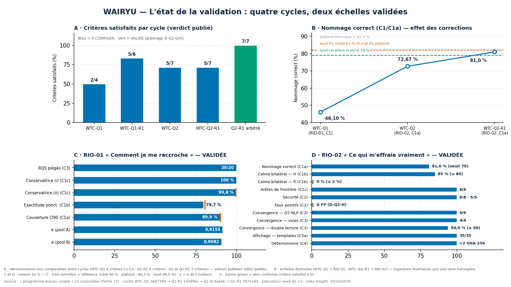

# Wairyu Thérapie Couple — Programme & Validation (hub de navigation)

> Point d'entrée de tout le programme WTC dans ce dépôt : document de référence officiel,
> arbre de navigation des packages de validation, statut des échelles RIO et règles
> permanentes issues des cycles. Mis à jour le **15/10/2026** (consolidation v2).

---

## 📌 Document de référence officiel — « programme wairyu couple » v2 consolidée

**➡️ [`programme wairyu couple.pdf`](programme%20wairyu%20couple.pdf)** — version 2.0 du 15/10/2026, 7 pages A4

C'est **le document canonique du projet** : il remplace la v1 comme contexte officiel de
Data Insight et comme archive de référence. Il contient :

- **Partie 13 — L'état de la validation** : le circuit à quatre acteurs (GLM → Data
  Insight → GLM superviseur → RIO), la chronologie des cycles WTC-Q1 → Q2-R1, le résultat
  final des deux échelles validées, les règles d'orchestrateur devenues permanentes
  (D-STD, D-Q2-1, D-Q2-2, D-Q2-H, D6/D7…) et les découvertes cliniques issues de la
  validation (suppression masquée, mains libres, plafond d'exactitude ~80,5 %) ;
- **Parties 1-12 (résumé d'archive)** : projet, 26 dimensions, 14 livrables, grammaire
  fédérée, standard des 110 quêtes, mécanismes de calcul, moteur Solène, doctrine RIO,
  garde-fous, fonctionnalités, test IA à l'aveugle, plan Data Insight ;
- **État actuel du projet** + note finale pour Data Insight (prochain package : WTC-Q3
  « Ce qui me porte », avec bornes de faisabilité D-STD intégrées dès la rédaction).

| Téléchargement direct | Fichier | Rôle |
|---|---|---|
| [programme wairyu couple.pdf](programme%20wairyu%20couple.pdf) | PDF v2 (7 p.) | **Document de référence officiel — remplace la v1** |
| [programme wairyu couple v2.txt](programme%20wairyu%20couple%20v2.txt) | source texte v2 | Texte intégral de la v2 consolidée |
| [programme wairyu couple.txt](programme%20wairyu%20couple.txt) | texte intégral v1 (27,8 Ko) | **Référence de contenu des parties 1-12** (désignée par la v2 elle-même) |
| [OUTILS DE TERAPIE DU COUPLE.txt](OUTILS%20DE%20TERAPIE%20DU%20COUPLE.txt) | recherche clinique (200,9 Ko) | Sources : efficacité, 67 instruments, parcours, marché |
| [rapports/programme wairyu couple.pdf](rapports/programme%20wairyu%20couple.pdf) | PDF v2 + couverture HTML | Copie d'archive dans `rapports/` (la v1 reste consultable dans l'historique git, commit 15ce3fa) |

---

## 🗺️ Arbre de navigation

```
Wairyu thérapie couple/
├── README.md                        ← ce fichier (hub)
├── programme wairyu couple.pdf      ← DOCUMENT DE RÉFÉRENCE v2 consolidée
├── programme wairyu couple v2.txt   ← source texte de la v2
├── programme wairyu couple.txt      ← texte intégral v1 (parties 1-12)
├── OUTILS DE TERAPIE DU COUPLE.txt  ← recherche clinique amont
├── rapports/                        ← PDF + couverture HTML (archive)
├── visualisations/                  ← 8 graphiques + index de lecture
├── scripts/                         ← scripts de génération (charts + PDF)
├── validation-q1/                   ← PACKAGE WTC-Q1   (verdict initial)
├── validation-q1-r1/                ← PACKAGE WTC-Q1-R1 (révision D1-D5)
├── validation-q2/                   ← PACKAGE WTC-Q2   (verdict initial)
└── validation-q2-r1/                ← PACKAGE WTC-Q2-R1 (révision D-Q2-A à F)
```

---

## 🧭 Les packages de validation — liens directs

| Package | Commit | Objet | Verdict publié | Dossier |
|---|---|---|---|---|
| **WTC-Q1** | `3eb7399` | Quête 1 « Comment je me raccroche » (RIO-01) — 500 honnêtes + 20 piégés, critères C1-C4 | À CORRIGER (C1 46,1 % · C2 0,1567) | [validation-q1/](validation-q1/) |
| **WTC-Q1-R1** | `1426f6e` | Révision D1-D5 (SEM structurel 0,195 · C1a/C1b/C1c · C2 [0,14;0,18]) | À CORRIGER (5/6 — C1c-(ii) 99,8 %) | [validation-q1-r1/](validation-q1-r1/) |
| **WTC-Q2** | `0c3aaab` | Quête 2 « Ce qui m'effraie vraiment » (RIO-02) — 431 sorties, 7 critères | À CORRIGER (5/7 — C1a 72,67 % · C5c) | [validation-q2/](validation-q2/) |
| **WTC-Q2-R1** | `78752d4` | Révision D-Q2-A à F (fqH/fqR branchés · 35 templates · 6 O7-NLP · 431 officiels) | À CORRIGER (5/7 — C1a 81,0 % · 1 FP) | [validation-q2-r1/](validation-q2-r1/) |
| **Arbitrages finaux** | — | Q1-R1 : D6/D7 · Q2-R1 : D-Q2-G (seuil 79 %) + D-Q2-H (définition FP) | **RIO-01 VALIDÉE 6/6 · RIO-02 VALIDÉE 7/7** | (décisions orchestrateur, cf. Partie 13 du PDF) |

Chaque dossier contient : `README.md` (verdict + visuels intégrés + liens de téléchargement
directs), `src/` (code exécuté), `results/` (CSV/JSON + `rapport.md` en 7 sections A-G),
`figures/` (PNG 1920×1080, 150 DPI).

---

## 🧪 État des échelles RIO

| Échelle | Instrument | Statut | Résultats clés (post-arbitrage) |
|---|---|---|---|
| **RIO-01 « Comment je me raccroche »** | 18 items (2 axes × 3 faces × 3), échelle 1-4, 2 inversés (5, 15), 1 vigilance — construct : attachement adulte (Bowlby ; Brennan, Clark & Shaver) | ✅ **VALIDÉE par simulation** (3 cycles) | α poolés 0,9155 / 0,9082 · SEM structurel 0,195 (3 métriques concordantes) · couverture CI90 89,9 % · exactitude 79,7 % (plafond ~80,5 % documenté) · RQS 20/20 · règle conservatrice 100 % / 99,8 % ≥ 99,5 % · SHA-256 ×2 · décisions D1-D5, D6, D7 |
| **RIO-02 « Ce qui m'effraie vraiment »** | 3 formats mixtes : 10 déclencheurs (6 distance + 4 proximité) + I_alarm 0-10 · 8 comportements (5 H + 3 R, H5 = sécurité) · origine 7 voies + NLP local (seuil 0,70) — constructs : Mikulincer & Shaver ; Bowlby | ✅ **VALIDÉE par simulation** (2 cycles) | Nommage 81,0 % (≥ 79 %, D-Q2-G sur plafond ≈ 82,4 %) · calme bilatéral 85 % / 0 % · arêtes 8/8 · sécurité 8/8 · 5/5 · 0 FP (D-Q2-H) · convergence 6/6 · 4/4 · 94,0 % · O7-NLP 6/6 · affichage 35/35 · SHA-256 ×2 |
| **RIO-03 « Ce qui me porte »** | (le positif prouvé) | 🔜 Package WTC-Q3 à rédiger | avec bornes de faisabilité D-STD + test anti-fabrication |

**Verdicts cumulés** : 3 cycles « À CORRIGER » → fautes de spécification attrapées par le
circuit et corrigées publiquement par l'orchestrateur → 2 échelles VALIDÉES · zéro
correction libre d'exécuteur · zéro masquage. **Le circuit a attrapé l'orchestrateur
trois fois sur trois.**

---

## 📏 Les règles permanentes (la leçon des cycles)

| Règle | Contenu | Origine |
|---|---|---|
| **D-STD (bornes de faisabilité)** | Tout nouveau package calcule, AVANT ses critères, le plafond atteignable par la géométrie de simulation — seuils posés à ≥ 3 points sous ce plafond | Q2-R1 (seuil posé à 0,4 pt du plafond) |
| **D-Q2-1** | L'arbre de nommage définit explicitement tous ses débouchés (fallthrough : ALARME SANS MAIN · SIGNAL LÉGER NON NOMMÉ) | Q2 |
| **D-Q2-2** | La convergence ne gate que les étiquettes d'OMBRE — jamais ZONE CALME, jamais le palier | Q2-R1 |
| **D-Q2-H** | FP = signal déclenché sans raison (sA < 3,21 ET i_alarm < 6 ET H5 < 2) — un déclenchement légitime de frontière n'est pas un FP | Q2-R1 |
| **D6 / D7** | Frontières multi-seuils : étiquette étendue du plus bas au plus haut touché · toute frontière porte le score ponctuel | Q1-R1 |
| **Exécuteur strict** | L'agent signale sans corriger — toute correction est de l'orchestrateur, documentée et chiffrée | Permanent depuis Q1 |
| **Réparation mécanique autorisée** | Une erreur bloquante exécutable peut être réparée au strict minimum, signalée en Section F | Q2 (S-Q2-8) |
| **Publication avec liens directs** | Tout livrable est poussé ET listé avec lien de téléchargement direct dans le README du dossier concerné | Permanente |

---

## 📊 Visualisation de synthèse



Index complet et lecture guidée : [`visualisations/README.md`](visualisations/README.md).

---

## ⚙️ Méthode commune à tous les packages

- Exécution **seed 42 ×2** avec vérification SHA-256 des livrables (déterminisme) ;
- Rapport en **7 sections A-G** (critères, matrices, stats, tracés, analyse, signalements,
  verdict + note sur barème déclaré) ;
- Les signalements (S-…) sont **documentés sans correction libre** ;
- La contresignature des fiches et les arbitrages appartiennent à l'orchestrateur (GLM
  superviseur) — cf. Partie 13.1 du PDF.
