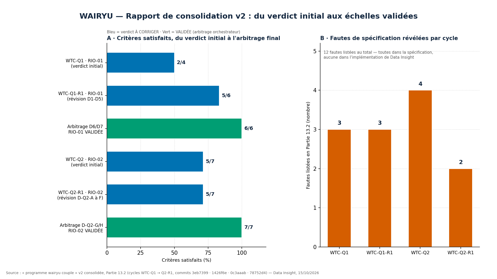

# Rapport de consolidation v2 — Programme Wairyu Thérapie Couple

> **Rapport émis le 15/10/2026** par Data Insight (exécuteur strict) · Source de vérité :
> « programme wairyu couple » v2 consolidée (Partie 13 — L'état de la validation) et les
> quatre packages publiés dans ce dépôt. Rôle : **signaler sans corriger** — vérité du
> système avant son succès apparent. Ce rapport restitue l'état réel du circuit de
> validation, fautes incluses, sans aucune reformulation favorable.

---

## 1. Objet et méthode

Ce rapport consolide l'état de la validation du programme Wairyu Thérapie Couple après
cinq cycles d'exécution et quatre packages archivés. Son objet est double : d'une part
documenter le résultat final — deux échelles RIO validées par simulation —, d'autre part
tracer précisément comment ce résultat a été obtenu, c'est-à-dire par la confrontation
systématique entre le code exécuté et la vérité cachée des simulateurs. Le principe du
rôle est resté inchangé sur toute la durée : l'agent implémente strictement ce qui lui
est fourni, signale tout écart sans le corriger de sa propre initiative, et laisse la
décision d'arbitrage à l'orchestrateur.

La méthode de consolidation est celle qui a présidé à tous les packages : relecture
mot à mot des spécifications avant exécution (bornes D-STD vérifiées dès la lecture),
exécution double **seed 42** avec vérification de déterminisme **SHA-256**, rapport en
sept sections (A à G), publication intégrale sur GitHub avec liens directs. Aucune
valeur chiffrée de ce rapport n'est saisie à la main hors source : chaque pourcentage
renvoie à la Partie 13.2 du document de référence v2 ou au `rapport.md` du package
concerné. La figure ci-dessous résume les deux lectures du cycle complet : la montée
des critères satisfaits, et le coût en fautes de spécification révélées.

*Figure 1 — Critères satisfaits, du verdict initial à l'arbitrage final (panneau A) ;
fautes de spécification d'orchestrateur révélées par cycle, listées en Partie 13.2
(panneau B). Données : document v2, commits 3eb7399 → 78752d4.*

---

## 2. L'état de la validation : deux échelles validées

### 2.1 RIO-01 « Comment je me raccroche » — VALIDÉE (6/6, trois cycles)

L'instrument comporte 18 items (2 axes × 3 faces × 3), échelle 1-4, avec 2 items
inversés (5, 15) et 1 item de vigilance ; le construct cité est l'attachement adulte
(Bowlby ; Brennan, Clark & Shaver), l'instrument étant créé ex nihilo. La validation
repose sur des métriques convergentes : α poolés **0,9155 / 0,9082**, SEM structurel
**0,195** validé par trois métriques indépendantes, couverture CI90 **89,9 %**, et
**20/20 questionnaires RQS piégés** aux valeurs théoriques exactes. La règle
conservatrice a été validée sur ses propres termes (**100 % / 99,8 % ≥ 99,5 % / 100 %**),
avec un plafond d'exactitude aux seuils documenté (**≈ 80,5 %**) et un déterminisme
vérifié **SHA-256 ×2**. Les décisions d'orchestrateur documentées sont D1-D5 (Q1-R1),
D6 (frontières multi-seuils) et D7 (score ponctuel dans l'étiquette).

### 2.2 RIO-02 « Ce qui m'effraie vraiment » — VALIDÉE (7/7, deux cycles + arbitrage)

L'instrument mêle trois formats : **10 déclencheurs** (6 distance + 4 proximité) +
**I_alarm 0-10** · **8 comportements** fréquentiels (5 H + 3 R, dont H5 = item de
sécurité) · **origine 7 voies + texte libre** NLP local (seuil 0,70). Les constructs
cités sont l'hyperactivation/déactivation (Mikulincer & Shaver) et les comportements de
proteste (Bowlby), avec une convergence multi-instruments méthodologique. Après le
recalibrage D-Q2-G (seuil de nommage porté à **≥ 79 %** sur plafond calculé ≈ 82,4 %)
et l'amendement D-Q2-H (définition du faux positif), les critères finals sont : nommage
**81,0 %**, calme bilatéral **85 % / 0 %**, arêtes **8/8**, sécurité **8/8**, **5/5**,
**0 FP** (définition amendée D-Q2-H), convergence **6/6 · 4/4 · 94,0 %**, O7 **6/6**,
affichage **35/35**, déterminisme **×2**.

---

## 3. La chronologie : le circuit a attrapé l'orchestrateur trois fois sur trois

Le fait central de cette consolidation n'est pas la validation elle-même, mais le
chemin qui y a mené. **Trois verdicts initiaux « À CORRIGER » ont été rendus, et à
chaque fois la faute se trouvait dans la spécification de l'orchestrateur — jamais
dans l'implémentation.** C'est ce que la Partie 13.1 nomme « le principe démontré
trois fois » : ni l'agent ne masque, ni le superviseur ne s'auto-valide ; seule la
confrontation code-réel vs vérité-cachée décide. Le tableau suivant reprend la
chronologie intégrale du document v2.

| Cycle | Commit | Verdict initial | Fautes d'orchestrateur révélées | Corrigées par |
|---|---|---|---|---|
| **WTC-Q1** | `3eb7399` | À CORRIGER (C1 46,1 % · C2 0,1567 FAIL) | SEM placeholder surdimensionné (0,252 vs structurel 0,195) · critère C1 auto-contradictoire (conservateur vs latent) · seuil C2 sous le plancher théorique | WTC-Q1-R1 (D1-D5) |
| **WTC-Q1-R1** | `1426f6e` | À CORRIGER (5/6 — C1c-(ii) FAIL 99,8 %) | Critère (ii) à 100 % analytiquement impossible (contradiction (i)∧(ii) démontrée) · double chevauchement mal nommé · étiquette sans score | Arbitrage + D6/D7 |
| **WTC-Q2** | `0c3aaab` | À CORRIGER (5/7 — C1a 72,67 % · C5c FAIL 3 lectures) | S-Q2-8 : simulateur inexécutable (4-tuple) · S-Q2-1 : fqH/fqR déclarés non branchés · S-Q2-10 : invariant C5c cliniquement mal posé · effectifs erronés (500 vs 400) | WTC-Q2-R1 (D-Q2-A à F) |
| **WTC-Q2-R1** | `78752d4` | À CORRIGER (5/7 — C1a 81,0 % · 1 FP) | Seuil C1a calibré à 0,4 pt du plafond théorique · définition du FP trop large (le déclenchement de frontière n'est pas un FP) | Arbitrage final → **VALIDÉE 7/7** |

**Lecture chiffrée.** Douze fautes de spécification sont listées en Partie 13.2 (3 +
3 + 4 + 2), toutes imputées à l'orchestrateur, aucune à l'implémentation. Les quatre
verdicts initiaux/révision ont été rendus sans concession : un critère à 46,1 % comme
un critère à 99,8 % (trop haut pour être honnête) ont été traités de la même manière —
signal public, correction documentée et chiffrée, contresignature. C'est la preuve que
le circuit ne cherche pas le succès apparent mais la vérité du système : un score trop
parfait était le symptôme d'un critère impossible, pas d'une réussite.

---

## 4. Les règles permanentes issues des cycles

La leçon des cycles a été transformée en règles d'orchestrateur permanentes, qui
s'appliqueront à tous les packages futurs — à commencer par WTC-Q3. Elles sont la
forme institutionnalisée des fautes ci-dessus : chaque règle ferme la brèche qui a
produit un verdict « À CORRIGER ».

| Règle | Contenu | Origine |
|---|---|---|
| **D-STD (bornes de faisabilité)** | Tout nouveau package inclut, AVANT ses critères, le calcul a priori du plafond atteignable par la géométrie de simulation — seuils posés à ≥ 3 points sous ce plafond | Q2-R1 (seuil posé à 0,4 pt du plafond) |
| **D-Q2-1** | L'arbre de nommage définit explicitement tous ses débouchés (fallthrough : ALARME SANS MAIN · SIGNAL LÉGER NON NOMMÉ) | Q2 |
| **D-Q2-2** | La convergence ne gate que les étiquettes d'OMBRE — jamais ZONE CALME, jamais le palier | Q2-R1 |
| **D-Q2-H** | FP = signal déclenché sans raison (sA < 3,21 ET i_alarm < 6 ET H5 < 2) — un déclenchement légitime de frontière n'est pas un FP | Q2-R1 |
| **D6/D7** | Frontières multi-seuils : étiquette étendue du plus bas au plus haut touché · toute frontière porte le score ponctuel | Q1-R1 |
| **Exécuteur strict** | L'agent signale sans corriger — toute correction est de l'orchestrateur, documentée et chiffrée | Permanent depuis Q1 |
| **Réparation mécanique autorisée** | Une erreur bloquante exécutable peut être réparée au strict minimum, signalée en Section F, source canonique corrigée ensuite par l'orchestrateur | Q2 (S-Q2-8) |

---

## 5. Les découvertes cliniques issues de la validation (capital du produit)

La validation par simulation n'a pas seulement filtré des critères : elle a produit
quatre découvertes cliniques qui appartiennent désormais au produit lui-même.

1. **La suppression masquée** — détectée par le croisement « Q1 tranquille × R3
   souvent » : le profil invisible du mur (« fait comme si tout allait bien » souvent),
   distingué du calme vrai, absent de tous les questionnaires standard. C'est la
   découverte la plus importante du cycle Q2 : elle transforme un artefact de
   convergence en cible clinique explicite, templatisée (SUPPRESSION_MASQUEE).
2. **Les mains libres** — alarmes vives × mécanismes légers : profil d'excellente
   position de départ ; un palier vert sur une étiquette d'ombre est légitime quand la
   domination est LÉGER (MAINSLIBRES_EXPLIQUE).
3. **Le plafond d'exactitude aux seuils (≈ 80,5 %)** — les personnes proches d'un seuil
   ne se laissent pas classer par un seul score ; justification structurelle du trio
   frontière nommée + décision conservatrice + re-test à 8 semaines
   (FALLTHROUGH_LEGER templatisé).
4. **Les paliers sur les scores, jamais sur les étiquettes** — un changement d'étiquette
   (0,2 % de cas) ne change aucune allocation de palier : la séparation math/calibre
   est un filet de sécurité en soi.

---

## 6. État actuel du projet et suite

| Élément | Statut |
|---|---|
| Architecture clinique (26 dimensions, 14 livrables, 110 quêtes) | Conçue et documentée |
| Infrastructure fédérée (grammaire, protocoles, rythme) | Conçue et documentée |
| **RIO-01 « Comment je me raccroche »** | **VALIDÉE par simulation** (3 cycles) |
| **RIO-02 « Ce qui m'effraie vraiment »** | **VALIDÉE par simulation** (2 cycles) |
| RIO-03 « Ce qui me porte » (le positif prouvé) | Package à rédiger (avec D-STD + test anti-fabrication) |
| RIO-04 à RIO-05 (croisement, pas) | En attente |
| Les 21 dimensions restantes (packages de validation) | En attente — gabarit éprouvé |
| Pilote réel WTC-VALID-01 (150-200 répondants) | Après Q1-Q5 de l'attachement — remplace les paramètres simulés |
| Dépôts GitHub | validation-q1 · validation-q1-r1 · validation-q2 · validation-q2-r1 (4 commits archivés) |
| Verdicts cumulés | 3 cycles « À CORRIGER » → corrections documentées → **2 échelles VALIDÉES 7/7 et 6/6** · zéro correction libre d'exécuteur · zéro masquage |

**La suite est définie par le document v2 lui-même** : la prochaine mission est le
**PACKAGE WTC-Q3 « Ce qui me porte »**, fourni complet par l'orchestrateur (cahier +
simulateur + critères avec bornes D-STD + fiche), avec sa spécificité propre — la
preuve bilatérale que la mesure du positif ne fabrique rien. Du côté de Data Insight,
tout est prêt : vérification des bornes D-STD dès la lecture du package, test
anti-fabrication, exécution seed 42 ×2, rapport en sept sections, publication dans
`validation-q3/` avec liens directs. La consolidation v2 (PDF officiel, hub de
navigation, dashboard et table de position) est en place et sert de contexte officiel.

---

## 7. Annexes — livrables et traçabilité

| Livrable | Emplacement |
|---|---|
| Document de référence officiel v2 (7 p.) | [`programme wairyu couple.pdf`](../programme%20wairyu%20couple.pdf) |
| Source texte v2 | [`programme wairyu couple v2.txt`](../programme%20wairyu%20couple%20v2.txt) |
| Figure du présent rapport (1920×1080, 150 DPI) | [`visualisations/BarChart_RapportConsolidation_2026-10-15.png`](../visualisations/BarChart_RapportConsolidation_2026-10-15.png) |
| Script de génération de la figure | [`scripts/generate_charts_rapport_consolidation.py`](../scripts/generate_charts_rapport_consolidation.py) |
| Dashboard état de la validation (4 panneaux) | [`visualisations/Dashboard_EtatValidation_QuatreCycles_2026-10-15.png`](../visualisations/Dashboard_EtatValidation_QuatreCycles_2026-10-15.png) |
| Table « État actuel du projet » | [`visualisations/Table_EtatActuelProjet_2026-10-15.png`](../visualisations/Table_EtatActuelProjet_2026-10-15.png) |
| Packages de validation | [`validation-q1/`](../validation-q1/) · [`validation-q1-r1/`](../validation-q1-r1/) · [`validation-q2/`](../validation-q2/) · [`validation-q2-r1/`](../validation-q2-r1/) |
| Commits archivés | `3eb7399` · `1426f6e` · `0c3aaab` · `78752d4` · consolidation `a770870` |

**Avertissement** : tous les résultats sont issus de **simulations** (seed 42,
vérité cachée des simulateurs) et non de réponses humaines réelles ; ils valident la
mécanique de mesure et ses garde-fous, pas la prévalence clinique. Le pilote réel
WTC-VALID-01 (150-200 répondants) remplacera les paramètres simulés après Q1-Q5 de
l'attachement.
