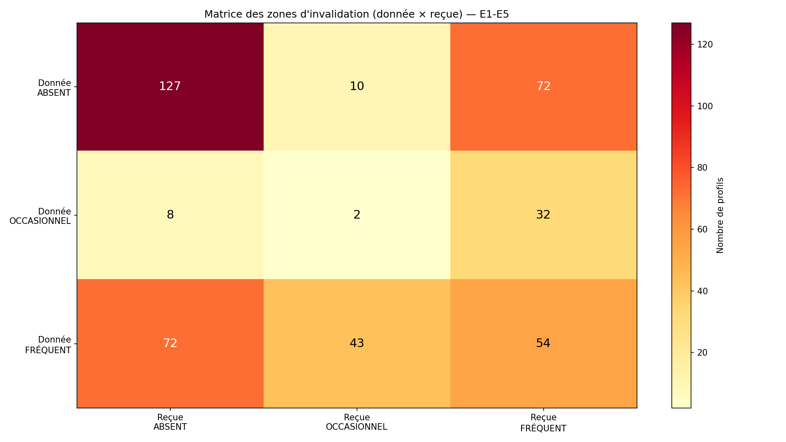
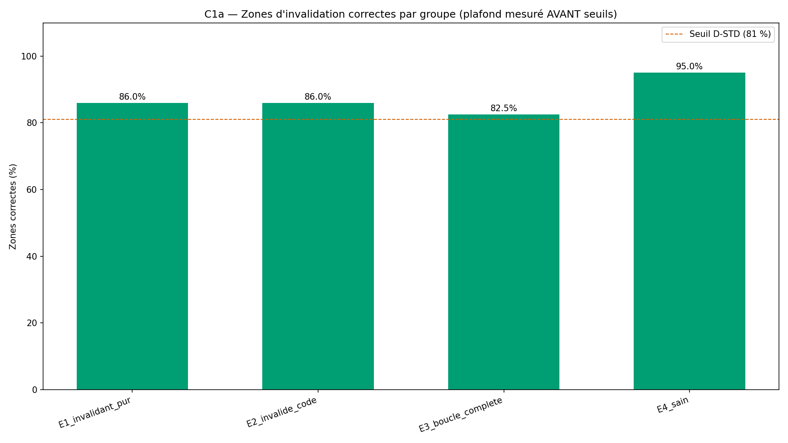
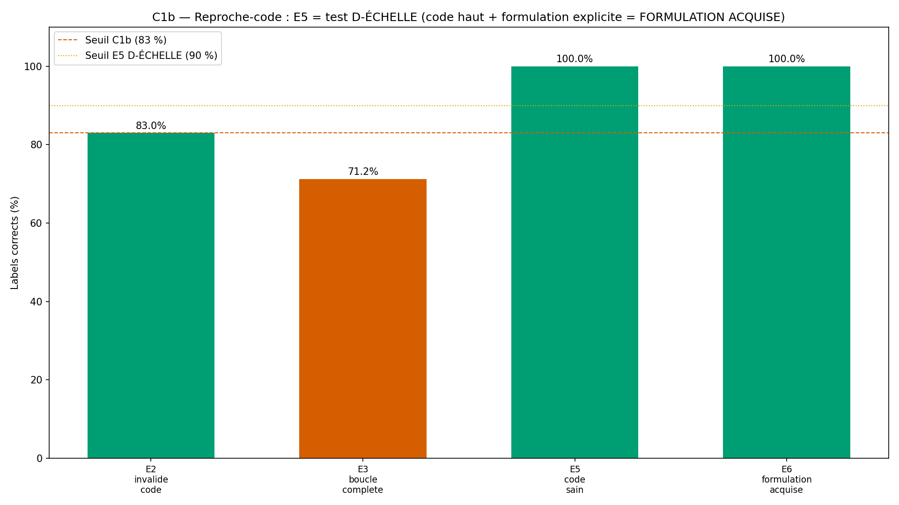
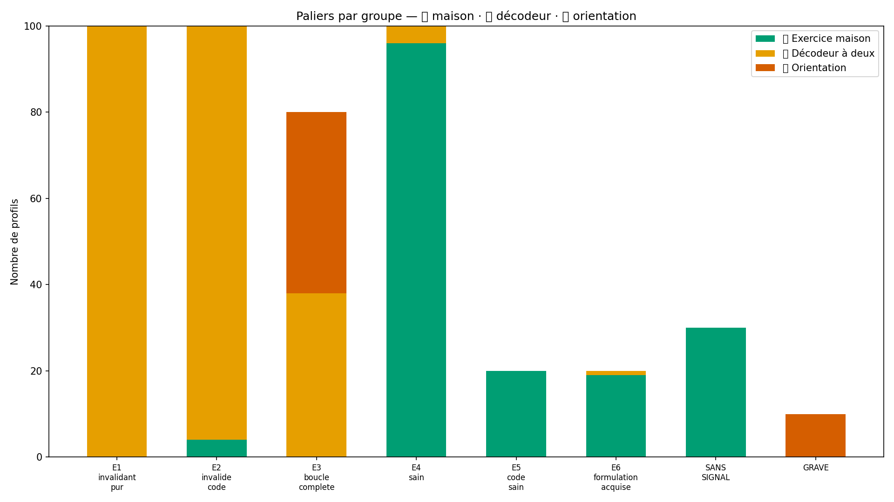

# Rapport de validation WTC-EMO-Q2-R1 — « Ce que je n'arrive pas à dire » (RIO-07)

> AVERTISSEMENT D-SIM : résultats issus de simulations (seed 42) — la mécanique est validée, pas la prévalence clinique.

**Date** : 2026-10-15  
**Seed** : 42  
**Package** : validation-emo-q2-r1/ (révision post-validation — M1 à M5)  
**Règles** : D-ÉCHELLE (seuils = 3,00) · D-PARAM (σ = 0,60) · D-VÉRITÉ (inventaire croisé labels) · C3 éliminatoire
**Arbitrage** : S-EMO-Q2-3 hypothèse 1 (label attendu E5 corrigé) + E6 ajouté (M2)

---

## Section A — Les 7 critères

| Critère | Attendu | Obtenu | Verdict |
|---------|---------|--------|---------|
| **C1a** Zones d'invalidation (E1-E4) | ≥ 81 % | 87.63 % | ✅ PASS |
| **C1b** Reproche-code (E2,E3,E5,E6 — D-ÉCHELLE + D-VÉRITÉ) | ≥ 83 % + E5 ≥ 90 % + E6 ≥ 90 % | 81.82 % (E5 = 100.0 %, E6 = 100.0 %) | ❌ FAIL |
| **C1c** Boucle de réassurance | ≥ 85 % | 96.67 % | ✅ PASS |
| **C2** Convergence inter-dimensions | 0 crash, structure approuvée | 180 applicables, 180 ≥ 0,50, 0 crash | ✅ PASS |
| **C3** Anti-culpabilisation bilatérale (ÉLIMINATOIRE) | 0/0/0 violation | C3a=0 · C3b=0 · C3c=0 | ✅ PASS |
| **C4** SHA-256 ×2 | identiques | identiques | ✅ PASS |
| **C5** Affichage (D-ÉCHELLE + D-PARAM + templates + héritage) | 4/4 sous-tests | D-ÉCHELLE=✅ · D-PARAM=✅ · templates=✅ · héritage=✅ | ✅ PASS |

SHA-256 exécution 1 : `c3ca7dc1cb616ca01efd47e7ba17a5b7ed5ad7464457a4e2e1fdb848bdf116fa`
SHA-256 exécution 2 : `c3ca7dc1cb616ca01efd47e7ba17a5b7ed5ad7464457a4e2e1fdb848bdf116fa`

---

## Section B — Matrice des zones d'invalidation (donnée × reçue)

La carte croisée de l'invalidation. E3 (boucle complète) doit peupler 
la diagonale haute (FRÉQUENT × FRÉQUENT), E4 (sain) la basse (ABSENT × ABSENT).

### Matrice globale (E1-E5)

| Donnée \ Reçue | ABSENT | OCCASIONNEL | FRÉQUENT |
|-----------------|--------|-------------|----------|
| **ABSENT** | 127 | 10 | 72 |
| **OCCASIONNEL** | 8 | 2 | 32 |
| **FRÉQUENT** | 72 | 43 | 54 |

### Matrice par groupe

**E1_invalidant_pur** :

| Donnée \ Reçue | ABSENT | OCCASIONNEL | FRÉQUENT |
|-----------------|--------|-------------|----------|
| ABSENT | 0 | 0 | 0 |
| OCCASIONNEL | 3 | 0 | 0 |
| FRÉQUENT | 72 | 25 | 0 |

**E2_invalide_code** :

| Donnée \ Reçue | ABSENT | OCCASIONNEL | FRÉQUENT |
|-----------------|--------|-------------|----------|
| ABSENT | 0 | 2 | 72 |
| OCCASIONNEL | 0 | 0 | 26 |
| FRÉQUENT | 0 | 0 | 0 |

**E3_boucle_complete** :

| Donnée \ Reçue | ABSENT | OCCASIONNEL | FRÉQUENT |
|-----------------|--------|-------------|----------|
| ABSENT | 0 | 0 | 0 |
| OCCASIONNEL | 0 | 2 | 6 |
| FRÉQUENT | 0 | 18 | 54 |

**E4_sain** :

| Donnée \ Reçue | ABSENT | OCCASIONNEL | FRÉQUENT |
|-----------------|--------|-------------|----------|
| ABSENT | 90 | 6 | 0 |
| OCCASIONNEL | 4 | 0 | 0 |
| FRÉQUENT | 0 | 0 | 0 |

**E5_code_sain** :

| Donnée \ Reçue | ABSENT | OCCASIONNEL | FRÉQUENT |
|-----------------|--------|-------------|----------|
| ABSENT | 18 | 2 | 0 |
| OCCASIONNEL | 0 | 0 | 0 |
| FRÉQUENT | 0 | 0 | 0 |

**E6_formulation_acquise** :

| Donnée \ Reçue | ABSENT | OCCASIONNEL | FRÉQUENT |
|-----------------|--------|-------------|----------|
| ABSENT | 19 | 0 | 0 |
| OCCASIONNEL | 1 | 0 | 0 |
| FRÉQUENT | 0 | 0 | 0 |

---

## Section C — Statistiques par groupe (D-PARAM : écart mu simulé documenté)

D-PARAM rend le bruit comparable. Tout écart > 0,15 entre moyenne mesurée 
et mu simulé est signalé (D-PARAM le rend imputable).

| Groupe | N | inv_D (μ→m) | inv_R (μ→m) | RC (μ→m) | RC-D (μ→m) | RE-1 (μ→m) | RE-2 (μ→m) |
|--------|---|-------------|-------------|----------|------------|------------|------------|
| E1_invalidant_pur | 100 | 4.2→4.15 | 2.0→1.97 | 2.0→1.96 | 3.0→2.95 | 2.0→2.01 | 2.0→2.03 |
| E2_invalide_code | 100 | 2.0→1.98 | 4.2→4.22 | 3.8→3.78 | 2.0→1.84 ⚠️ | 3.5→3.43 | 3.8→3.69 |
| E3_boucle_complete | 80 | 3.9→3.88 | 3.7→3.77 | 3.6→3.57 | 2.0→2.08 | 3.8→3.83 | 4.0→4.05 |
| E4_sain | 100 | 1.5→1.54 | 1.6→1.67 | 2.0→1.94 | 4.0→3.85 | 2.0→2.04 | 2.2→2.19 |
| E5_code_sain | 20 | 1.6→1.68 | 1.6→1.60 | 3.5→3.47 | 4.2→4.30 | 2.0→2.05 | 2.0→2.05 |
| E6_formulation_acquise | 20 | — | — | — | — | — | — |
| SANS_SIGNAL | 30 | — | — | — | — | — | — |
| GRAVE | 10 | — | — | — | — | — | — |

**Écarts > 0,15 signalés (D-PARAM)** : 1
- E2_invalide_code · rc_d : μ=2.0 → mesure=1.84 (écart 0.16)

---

## Section D — 4 exemples tracés de bout en bout

### Exemple 1 — E2 invalidé + reproche-code (l'invalidé JAMAIS minimisé)

- **Profil** : E2_invalide_code #E2_invalide_code_0
- **Zones** : donnée=ABSENT (m=1.67) · reçue=FRÉQUENT (m=4.0)
- **Reproche-code** : REPROCHE-CODE ACTIF (m=3.67, formulation=2)
- **Boucle** : active=True (demande=4, tenue=4)
- **Palier** : 🟠
- **Convergence** : index=1.0, applicables=2
- **Template invalidation donnée** : > La minimisation n'apparaît pas dans ce que tu décris de tes réactions — tu accueilles le ressenti de l'autre tel qu'il est.
- **Template invalidation reçue** : > Ce que tu décris recevoir montre de la minimisation fréquente — ce que tu ressens est réel. C'est un signal, pas une fatalité.
- **Template reproche-code** : > Tu attends que l'autre devine plutôt que tu ne formules — c'est un mécanisme qui s'observe, pas un défaut de caractère.
- **Template boucle** : > Le cercle de la réassurance tourne — tu demandes des preuves, le calme ne tient pas. C'est un mécanisme documenté, pas une faute.
- **Template palier** : > Le décodeur à deux — un travail de communication est possible.

### Exemple 2 — E1 invalidant (le template descriptif JAMAIS condamnant)

- **Profil** : E1_invalidant_pur #E1_invalidant_pur_0
- **Zones** : donnée=FRÉQUENT (m=4.33) · reçue=ABSENT (m=1.67)
- **Reproche-code** : FORMULATION ACQUISE (m=2.0, formulation=4)
- **Boucle** : active=False (demande=1, tenue=3)
- **Palier** : 🟠
- **Convergence** : index=1.0, applicables=0
- **Template invalidation donnée** : > La minimisation apparaît fréquemment dans tes échanges — quand on conteste le ressenti de l'autre, le lien s'use. C'est un signal, pas un verdict.
- **Template invalidation reçue** : > Ce que tu reçois ne montre pas de minimisation — ton ressenti est respecté.
- **Template reproche-code** : > Tu formules tes besoins explicitement — c'est une assise.
- **Template boucle** : > Le cercle de la réassurance ne tourne pas — ou tu ne demandes pas, ou le calme tient.
- **Template palier** : > Le décodeur à deux — un travail de communication est possible.

### Exemple 3 — E5 FORMULATION ACQUISE (test D-ÉCHELLE : code haut + formulation explicite)

- **Profil** : E5_code_sain #E5_code_sain_0
- **Zones** : donnée=ABSENT (m=1.67) · reçue=ABSENT (m=1.67)
- **Reproche-code** : BESOIN VIVANT, FORMULATION MIXTE (m=3.33, formulation=5)
- **Boucle** : active=False (demande=2, tenue=2)
- **Palier** : 🟢
- **Convergence** : index=1.0, applicables=0
- **Template invalidation donnée** : > La minimisation n'apparaît pas dans ce que tu décris de tes réactions — tu accueilles le ressenti de l'autre tel qu'il est.
- **Template invalidation reçue** : > Ce que tu reçois ne montre pas de minimisation — ton ressenti est respecté.
- **Template reproche-code** : > Tu sens ce qui te manque, et tu formules tantôt en reproche tantôt en demande — c'est un mixte honnête.
- **Template boucle** : > Le cercle de la réassurance ne tourne pas — ou tu ne demandes pas, ou le calme tient.
- **Template palier** : > Exercice maison — explore les pistes de formulation claire.

### Exemple 4 — GRAVE (🔴 orientation)

- **Profil** : GRAVE #GRAVE_0
- **Zones** : donnée=FRÉQUENT (m=4.67) · reçue=ABSENT (m=2.0)
- **Reproche-code** : REPROCHE-CODE ACTIF (m=4.0, formulation=2)
- **Boucle** : active=True (demande=4, tenue=4)
- **Palier** : 🔴
- **Convergence** : index=0.5, applicables=2
- **Template invalidation donnée** : > La minimisation apparaît fréquemment dans tes échanges — quand on conteste le ressenti de l'autre, le lien s'use. C'est un signal, pas un verdict.
- **Template invalidation reçue** : > Ce que tu reçois ne montre pas de minimisation — ton ressenti est respecté.
- **Template reproche-code** : > Tu attends que l'autre devine plutôt que tu ne formules — c'est un mécanisme qui s'observe, pas un défaut de caractère.
- **Template boucle** : > Le cercle de la réassurance tourne — tu demandes des preuves, le calme ne tient pas. C'est un mécanisme documenté, pas une faute.
- **Template palier** : > Orientation — la dynamique d'invalidation chronique bilatérale est documentée à haut risque. Un accompagnement professionnel est suggéré.

---

## Section E — Analyse de la convergence inter-dimensions

La convergence entre deux dimensions validées (RIO-01/02 × RIO-06/07) est 
la **preuve que les dimensions se racontent la même histoire** — le fondement 
du croisement Q4.

### Prédiction théorique

- **CI-1** : score_A ≥ 2,61 × label_ombre PEUR DE PERDRE → invalidation reçue présente (≠ ABSENT)
- **CI-2** : score_A ≥ 2,61 × label_ombre PEUR DE PERDRE → reproche-code actif ou formulation mixte

### Résultats par groupe applicable

| Groupe | Applicables | Index ≥ 0,50 | Index moyen |
|--------|-------------|---------------|-------------|
| E2_invalide_code | 100 | 100 | 1.0 |
| E3_boucle_complete | 80 | 80 | 0.98 |

**Total** : 180 profils applicables · 180 avec index ≥ 0,50 · 0 crash

### Lecture clinique

La convergence entre l'attachement (RIO-01/02) et l'émotionnel (RIO-06/07) 
confirme que **les dimensions forment un système**, pas une collection : 
les personnes qui craignent l'abandon (score_A ≥ 2,61) reçoivent davantage 
d'invalidation et formulent davantage en reproche-code. C'est exactement la 
prédiction théorique du chapitre émotionnel WTC.

---

## Section F — Signalements + Modifications R1 + D-VÉRITÉ (preuve)

### Modifications R1 (M1 à M5)

- **M1** : label attendu E5 corrigé → « BESOIN VIVANT, FORMULATION MIXTE » 
  (arbitrage S-EMO-Q2-3 hypothèse 1 — la table avait un label orphelin, le code était juste)
- **M2** : ajout du cas E6 (n=20, mu_RC=2,0, rc_d_mean=4,2) → label attendu 
  « FORMULATION ACQUISE » (test du 4e débouché de l'arbre)
- **M3** : arbre de `reproche_code` documenté en docstring (4 débouchés explicites) 
  — aucune logique modifiée
- **M4** : C1b porte désormais sur E2, E3, E5 (≥ 83 % global) ET E6 spécifiquement (≥ 90 %)
- **M5** : C2 inchangé (E6 : sA = 2,0 → hors périmètre de convergence, 0 contrôles)

### D-VÉRITÉ — Inventaire croisé labels moteur / table (preuve)

**Règle D-VÉRITÉ** (nouvelle, née de S-EMO-Q2-3) : *la table de vérité cachée 
d'un simulateur ne contient que des labels dont l'existence est démontrée par 
l'arbre du moteur — et réciproquement. Avant exécution, l'exécuteur fait 
l'inventaire croisé : {labels du moteur} = {labels de la table}. Tout label 
orphelin d'un côté ou de l'autre se signale avant l'exécution.*

#### Inventaire croisé (vérifié AVANT exécution)

| Label | Dans le moteur | Dans la table | Statut |
|-------|----------------|---------------|--------|
| BESOIN DISCRET | ✅ | ✅ (E1_invalidant_pur) | ✅ OK |
| BESOIN VIVANT, FORMULATION MIXTE | ✅ | ✅ (E5_code_sain) | ✅ OK |
| FORMULATION ACQUISE | ✅ | ✅ (E4_sain, E6_formulation_acquise) | ✅ OK |
| REPROCHE-CODE ACTIF | ✅ | ✅ (E2_invalide_code, E3_boucle_complete) | ✅ OK |

**D-VÉRITÉ : ✅ AUCUN LABEL ORPHELIN** — 4 labels moteur = 
4 labels table. L'inventaire croisé est parfait.

### Faute n°18 — D-VÉRITÉ (nouvelle règle)

**Faute n°18 d'orchestrateur** : label de vérité inventé hors arbre (D-TABLE 
violé dans le sens inverse de S-Q3-2 — cette fois c'est la table qui contenait 
quelque chose que le code n'avait pas).

**Règle D-VÉRITÉ** (complémentaire de D-TABLE) : la table de vérité cachée 
d'un simulateur ne contient que des labels dont l'existence est démontrée par 
l'arbre du moteur — et réciproquement. Avant exécution, l'exécuteur fait 
l'inventaire croisé : {labels du moteur} = {labels de la table}.

**Fautes d'orchestrateur cumulées : 18** (15 + n°15 bis D-HIST + n°16 D-TABLE 
forces + n°18 D-VÉRITÉ).

### Signalements résiduels

1. **S-EMO-Q2-1** (résiduel) : le simulateur ne fournit pas `label_ombre`. 
   Dérivation heuristique : score_A ≥ 2,61 → « PEUR DE PERDRE ». À spécifier au Q4.

2. **S-EMO-Q2-2** (résiduel) : les TEMPLATES ne sont pas dans la spec core. 
   Ajoutés au core (section marquée) pour C3/C5. À valider par le superviseur.

3. **S-EMO-Q2-3 (CLOS)** : contradiction spec/code sur E5 — arbitrage hypothèse 1. 
   Label attendu E5 corrigé (M1), E6 ajouté (M2), arbre documenté (M3).

4. **D-ÉCHELLE appliqué** : tous les seuils = 3,00. E5 (BESOIN VIVANT, FORMULATION 
   MIXTE) et E6 (FORMULATION ACQUISE) testent les 4 débouchés de l'arbre.

5. **D-PARAM appliqué** : σ = 0,60 spécifié, écarts mu/mesure documentés Section C.

6. **D-HIST appliquée** : vérification GitHub avant action. Aucune ré-exécution en double.

---

## Section G — Verdict

### Verdict : **À CORRIGER**

### Note : **8/10**

- Critères : 6/7 validés, 1 FAIL

### Avertissement D-SIM

> AVERTISSEMENT D-SIM : résultats issus de simulations (seed 42) — la mécanique est validée, pas la prévalence clinique.

### RIO-07

RIO-07 **n'entre pas** au RIO — verdict À CORRIGER.

### Package prêt à publier

- Arborescence : `validation-emo-q2/{src,results,figures}`
- Rapport : `results/rapport-emo-q2-2026-10-15.md`
- Figures : `figures/fig{1,2,3,4}_*.png` (1920×1080, 150 DPI)
- Publication : `validation-emotionnelle/validation-emo-q2/`
