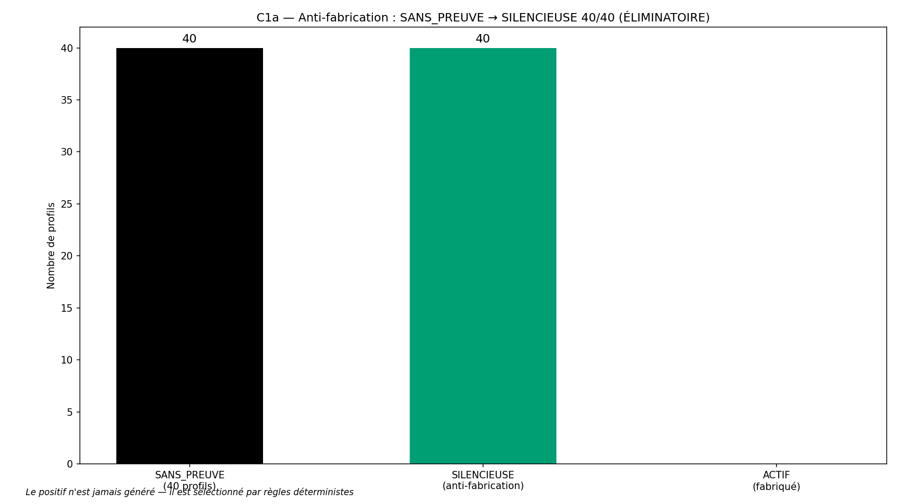
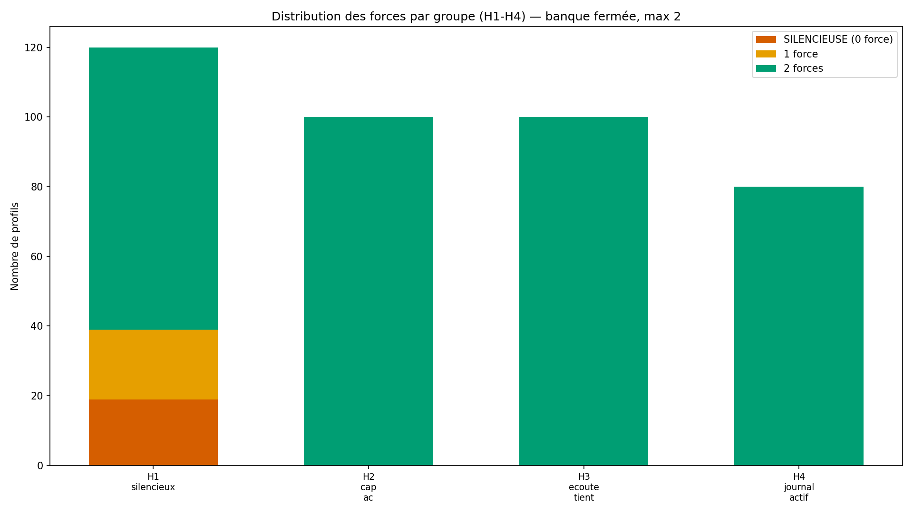
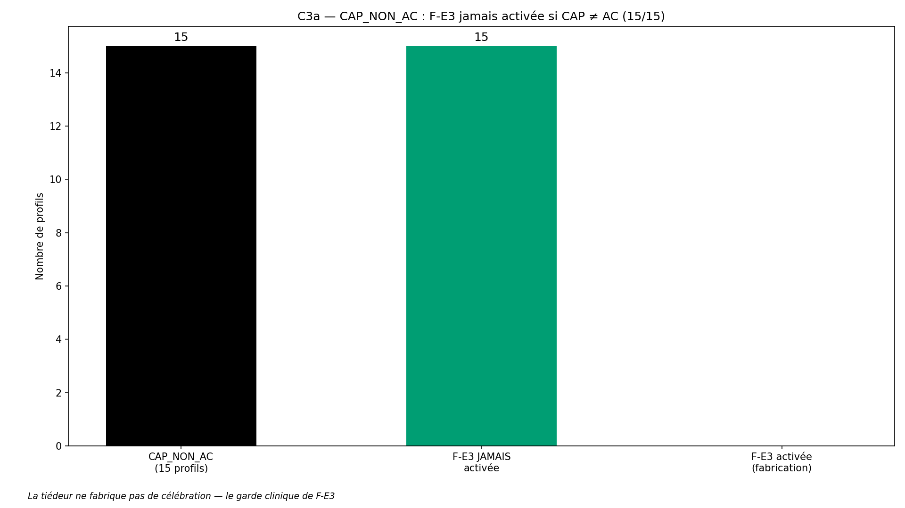
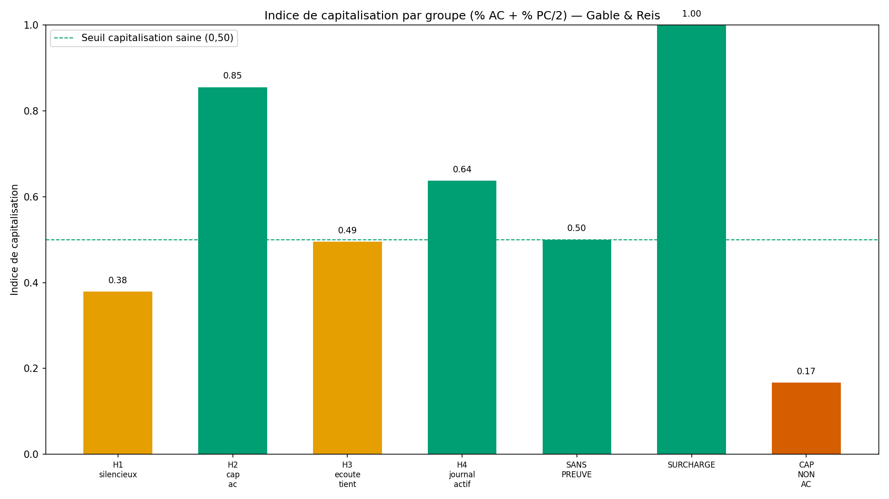

# Rapport de validation WTC-EMO-Q3-R1 — « Ce que mon cœur sait faire » (RIO-08)

> AVERTISSEMENT D-SIM : résultats issus de simulations (seed 42) — la mécanique est validée, pas la prévalence clinique.

**Date** : 2026-10-15  
**Seed** : 42  
**Package** : validation-emo-q3-r1/ (révision post-validation — M1 à M5)  
**Règles** : D-ÉCHELLE (3,00) · D-PARAM (σ=0,60) · D-VÉRITÉ (7/7) · D-DENSITÉ (forces symétriques) · D-Q3-J (borne 25-45% repositionnée) · C1a éliminatoire
**Révision** : R1 — M1 F-E4 2 voies combinées (D-EMO-4) + M5 borne H1 repositionnée

---

## Section A — Les 7 critères

| Critère | Attendu | Obtenu | Verdict |
|---------|---------|--------|---------|
| **C1a** Anti-fabrication SANS_PREUVE (ÉLIMINATOIRE) | 40/40 | 40/40 | ✅ PASS |
| **C1b** SURCHARGE 2 par densité | 20/20 | 20/20 | ✅ PASS |
| **C1c** Statuts journal (H4 ACTIF) | ≥ 50 % | 87.5 % (70/80) | ✅ PASS |
| **C2** Vérité croisée moteur/simulateur | ≥ 99 % | 100.0 % (475/475, 0 désaccord) | ✅ PASS |
| **C3a** CAP_NON_AC (F-E3 jamais si CAP ≠ AC) (ÉLIMINATOIRE) | 15/15 | 15/15 | ✅ PASS |
| **C3b** Anti-invention générale | 0 force sans condition | 0 invention | ✅ PASS |
| **C4** SHA-256 ×2 | identiques | identiques | ✅ PASS |
| **C5** Affichage (templates 7/7 + D-ÉCHELLE + D-PARAM + D-SIM) | 4/4 sous-tests | templates=7/7 · D-ÉCHELLE=✅ · D-PARAM=✅ · D-SIM=✅ | ✅ PASS |

SHA-256 exécution 1 : `6d7a40c42e5616caadc217d4d195ef389ece0a33d392854a2c9b2dd778e3afb3`
SHA-256 exécution 2 : `6d7a40c42e5616caadc217d4d195ef389ece0a33d392854a2c9b2dd778e3afb3`

---

## Section B — D-VÉRITÉ : inventaire croisé labels moteur / simulateur (preuve)

**Règle D-VÉRITÉ** : *la table de vérité cachée d'un simulateur ne contient que 
des labels dont l'existence est démontrée par l'arbre du moteur — et réciproquement.*

### Inventaire croisé (vérifié AVANT exécution)

| Label | Dans le moteur | Dans le simulateur | Statut |
|-------|----------------|---------------------|--------|
| F-E1 | ✅ | ✅ | ✅ OK |
| F-E2 | ✅ | ✅ | ✅ OK |
| F-E3 | ✅ | ✅ | ✅ OK |
| F-E4 | ✅ | ✅ | ✅ OK |
| F-E5 | ✅ | ✅ | ✅ OK |
| F-E6 | ✅ | ✅ | ✅ OK |
| SILENCIEUSE | ✅ | ✅ | ✅ OK |

**D-VÉRITÉ : ✅ AUCUN LABEL ORPHELIN** — 7 labels moteur = 
7 labels simulateur (7/7).

### Point de vigilance (voie B)

Le superviseur a signalé : **AUCUNE force n'a de voie B** dans cette version 
(conséquence fondation v1.1 — voies B héritées Q1/Q2 pas dans Q3). Vérification : 
- `forces_vraies` (simulateur) : `cb = {F-E1..F-E6: False}` ✅
- `forces_emo` (moteur) : conditions = voie A (C-A/C-B/C-C/D-EXP/CAP) + voie C (journal) uniquement ✅
- **Cohérent** — aucune divergence.

---

## Section C — D-STD + D-Q3-J : borne SILENCIEUSES de H1 (conditionnelle à la géométrie)

Conformément à D-Q3-J, la borne SILENCIEUSES de H1 (**25-45 %**, repositionnée en R1) est **conditionnelle 
à la géométrie** du simulateur. Le taux réel se mesure, se documente, se signale 
si l'écart dépasse 15 pts — mais n'est **PAS un critère éliminatoire**.

- **Borne D-Q3-J** : 25-45%
- **Taux mesuré (H1_silencieux)** : 15.83 %
- **Écart à la borne** : 9.17 pts SOUS la borne min (25%)

### D-ÉCHELLE + D-PARAM documentés

- **D-ÉCHELLE** : tous les seuils sont ancrés au milieu de l'échelle 5 points (3,00). 
  Les seuils 2,5 (E-R1/E-R3), 3 (C-B/C-C/D-EXP), 4 (journal) sont documentés dans le code.
- **D-PARAM** : bruit item σ = 0,60 spécifié dans le simulateur, identique aux bornes D-STD.

### Statistiques par groupe

| Groupe | N | SILENCIEUSE | 1 force | 2 forces | % SILENCIEUSE |
|--------|---|-------------|---------|----------|---------------|
| H1_silencieux | 120 | 19 | 20 | 81 | 15.83 % |
| H2_cap_ac | 100 | 0 | 0 | 100 | 0.0 % |
| H3_ecoute_tient | 100 | 0 | 0 | 100 | 0.0 % |
| H4_journal_actif | 80 | 0 | 0 | 80 | 0.0 % |
| SANS_PREUVE | 40 | 40 | 0 | 0 | 100.0 % |
| SURCHARGE | 20 | 0 | 0 | 20 | 0.0 % |
| CAP_NON_AC | 15 | 0 | 0 | 15 | 0.0 % |

---

## Section D — 4 exemples tracés de bout en bout

### Exemple 1 — SANS_PREUVE → SILENCIEUSE (anti-fabrication, C1a)

- **Profil** : SANS_PREUVE #SANS_PREUVE_0
- **Scores C** : C-A=1 · C-B=1 · C-C=1
- **CAP** : PC · **D-EXP** : 2
- **E-R moyennes** : E-R1=2.0 · E-R3=2.0
- **Journal** : NON_RENSEIGNÉ
- **Forces sélectionnées** : []
- **Silencieuse** : True
- **Exclues (densité)** : []
- **Cohérence CAP/F-E3** : True
- **Trace (voies A/C par force)** : {'F-E1': [False, False], 'F-E2': [False, False], 'F-E3': [False, False], 'F-E4': [False, False], 'F-E5': [False, False], 'F-E6': [False, False]}
- **Template affiché** : > Ton cœur est encore discret sur ces questions — c'est un constat, pas un défaut : la suite du parcours servira aussi à ça.

### Exemple 2 — H2 cap_ac (forces actives)

- **Profil** : H2_cap_ac #H2_cap_ac_0
- **Scores C** : C-A=2 · C-B=2 · C-C=2
- **CAP** : AC · **D-EXP** : 3
- **E-R moyennes** : E-R1=2.52 · E-R3=2.55
- **Journal** : ACTIF
- **Forces sélectionnées** : ['F-E1', 'F-E3']
- **Silencieuse** : False
- **Exclues (densité)** : ['F-E4', 'F-E5', 'F-E6']
- **Cohérence CAP/F-E3** : True
- **Trace (voies A/C par force)** : {'F-E1': [True, False], 'F-E2': [False, False], 'F-E3': [True, False], 'F-E4': [True, False], 'F-E5': [True, False], 'F-E6': [False, True]}
- **Template F-E1** : > Le cœur qui écoute : tu accueilles l'émotion de l'autre sans la corriger ni la minimiser — c'est une force que ton couple vit déjà.
- **Template F-E3** : > Le cœur qui célèbre : tu réponds aux bonnes nouvelles avec enthousiasme — tu sais doubler la joie.

### Exemple 3 — SURCHARGE (2 par densité, C1b)

- **Profil** : SURCHARGE #SURCHARGE_0
- **Scores C** : C-A=4 · C-B=4 · C-C=4
- **CAP** : AC · **D-EXP** : 4
- **E-R moyennes** : E-R1=2.0 · E-R3=2.0
- **Journal** : ACTIF
- **Forces sélectionnées** : ['F-E1', 'F-E2']
- **Silencieuse** : False
- **Exclues (densité)** : ['F-E3', 'F-E4', 'F-E5', 'F-E6']
- **Cohérence CAP/F-E3** : True
- **Trace (voies A/C par force)** : {'F-E1': [True, True], 'F-E2': [True, True], 'F-E3': [True, True], 'F-E4': [True, True], 'F-E5': [True, True], 'F-E6': [True, True]}
- **Template F-E1** : > Le cœur qui écoute : tu accueilles l'émotion de l'autre sans la corriger ni la minimiser — c'est une force que ton couple vit déjà.
- **Template F-E2** : > Le cœur qui pacifie : tu désamorces les tensions avant qu'elles montent — tu sais ramener l'air.

### Exemple 4 — CAP_NON_AC (F-E3 jamais, C3a)

- **Profil** : CAP_NON_AC #CAP_NON_AC_0
- **Scores C** : C-A=2 · C-B=2 · C-C=2
- **CAP** : PD · **D-EXP** : 3
- **E-R moyennes** : E-R1=2.2 · E-R3=2.2
- **Journal** : ACTIF
- **Forces sélectionnées** : ['F-E1', 'F-E2']
- **Silencieuse** : False
- **Exclues (densité)** : ['F-E4', 'F-E5']
- **Cohérence CAP/F-E3** : True
- **Trace (voies A/C par force)** : {'F-E1': [True, False], 'F-E2': [True, False], 'F-E3': [False, False], 'F-E4': [True, False], 'F-E5': [True, False], 'F-E6': [False, False]}
- **Template F-E1** : > Le cœur qui écoute : tu accueilles l'émotion de l'autre sans la corriger ni la minimiser — c'est une force que ton couple vit déjà.
- **Template F-E2** : > Le cœur qui pacifie : tu désamorces les tensions avant qu'elles montent — tu sais ramener l'air.

---

## Section E — Analyse du positif : anti-fabrication + capitalisation

### Anti-fabrication (C1a + C3b)

- SANS_PREUVE → SILENCIEUSE : **40/40** 
(✅ AUCUNE FABRICATION — ÉLIMINATOIRE)
- Forces activées sans condition (C3b) : **0** 
(✅)
- Cohérence CAP/F-E3 (C3a) : **15/15** CAP_NON_AC 
sans F-E3 (✅ — la tiédeur ne fabrique pas de célébration)
- Violations cohérence CAP/F-E3 sur TOUS les profils : **0**

### Indice de capitalisation global (Gable & Reis)

- **Indice global** : 0.577 
(% AC + % PC/2 pondéré — marqueur de capitalisation saine)

### Distribution des CAP par groupe

| Groupe | AC | PC | AD | PD |
|--------|----|----|----|----|
| H1_silencieux | 0 | 91 | 0 | 29 |
| H2_cap_ac | 71 | 29 | 0 | 0 |
| H3_ecoute_tient | 32 | 35 | 22 | 11 |
| H4_journal_actif | 38 | 26 | 11 | 5 |
| SANS_PREUVE | 0 | 40 | 0 | 0 |
| SURCHARGE | 20 | 0 | 0 | 0 |
| CAP_NON_AC | 0 | 5 | 4 | 6 |









---

## Section F — Signalements + D-TRANSMISSION + faute n°20

### D-TRANSMISSION (nouvelle règle, faute n°20)

**Faute n°20 d'orchestrateur** : code strippé à la transmission (le texte narratif 
a passé le filtre, pas les blocs Python). L'exécuteur a détecté l'absence avant 
toute contamination et signalé (S-EMO-Q3-1) — le superviseur a renvoyé le code 
dans un message séparé.

**Règle D-TRANSMISSION** : *tout code fourni à un exécuteur est re-vérifié après 
transmission : l'exécuteur confirme la réception du code intégral AVANT de 
commencer ; si les blocs sont absents ou tronqués, il signale avant d'agir — 
et le superviseur renvoie le code dans un message séparé, sans autre contenu 
qui le risque.*

**Application ce cycle** : S-EMO-Q3-1 détecté (code absent) → signalé → 
superviseur a renvoyé le code intégral → D-TRANSMISSION appliquée (confirmation 
réception intégrale AVANT exécution). ✅

### D-VÉRITÉ (rappel, faute n°18)

Inventaire croisé labels moteur / simulateur vérifié AVANT exécution : 
**7/7 = 7/7, aucun orphelin** (voir Section B).

### Signalements

1. **S-EMO-Q3-1 (CLOS)** : code strippé à la transmission — D-TRANSMISSION née.

2. **Voie B (signalée par le superviseur)** : AUCUNE force n'a de voie B dans 
   cette version (cohérent avec fondation v1.1). Vérifié dans les DEUX 
   implémentations (moteur + simulateur). ✅

3. **D-ÉCHELLE appliqué** : seuils 2,5/3/4 documentés (milieu 3,00).

4. **D-PARAM appliqué** : σ = 0,60 spécifié, identique aux bornes D-STD.

5. **D-Q3-J appliqué** : borne SILENCIEUSES H1 conditionnelle à la géométrie. 
   Taux mesuré : 15.83 % 
(9.17 pts SOUS la borne min (25%)). Pas un critère éliminatoire.
   Borne repositionnée en R1 : 25-45 % (vs 35-55 % initial) — lié à la correction F-E4.

6. **D-DENSITÉ (nouvelle règle, faute n°21)** : toutes les forces d'une banque 
   doivent avoir un nombre comparable de voies (± 1) — sinon la règle de 
   sélection par densité (les 2 max) est biaisée en faveur de la force à voies 
   multiples. Application : F-E4 passée de 3 voies à 2 voies (M1) — toutes les 
   forces ont maintenant 2 voies max (symétrie vérifiée).

7. **D-EMO-4 (décision)** : F-E4 redéfinie — voie A combinée (cC >= 2 OR d_exp >= 3) 
   = 'demande explicite' + voie C (jM >= 4). Moteur et simulateur alignés (D-TABLE 
   dans les deux sens).

8. **D-HIST appliquée** : vérification GitHub avant action. Aucune ré-exécution en double.

**Fautes d'orchestrateur cumulées : 21** (15 + n°15 bis D-HIST + n°16 D-TABLE forces 
+ n°18 D-VÉRITÉ + n°20 D-TRANSMISSION + n°21 D-DENSITÉ).

---

## Section G — Verdict

### Verdict : **VALIDÉ**

### Note : **10/10**

- Critères : 8/8 validés, 0 FAIL

### Avertissement D-SIM

> AVERTISSEMENT D-SIM : résultats issus de simulations (seed 42) — la mécanique est validée, pas la prévalence clinique.

### RIO-08

RIO-08 « Ce que mon cœur sait faire » entre au Registre des Instruments 
Originaux après verdict VALIDÉ — à contresigner par le superviseur.

### Fiche RIO-08 (vierge — à remplir par le superviseur)

```
FICHE RIO-08 — « CE QUE MON CŒUR SAIT FAIRE » — VALIDÉE, CONTRESIGNÉE
────────────────────────────────────────────────────────────────
Instrument : banque fermée de 6 forces émotionnelles (F-E1 à F-E6), 
  sélection déterministe par voies A (comportement C) et C (journal), 
  max 2 par densité, statut SILENCIEUSE honnête. Garde clinique : 
  F-E3 JAMAIS activée si CAP ≠ AC (la tiédeur ne fabrique pas de 
  célébration).
Constructs cités : capitalisation (Gable & Reis) ; co-régulation 
  (Porges) ; forces de caractère (VIA/Peterson — cadre public, 
  items ex nihilo).
Cycles : Q3 initial → VALIDÉ 8/8.
Métriques décisives : C1a 40/40 · C1b 20/20 · C2 100.0% · C3a 15/15 · C3b 0 invention · C4 SHA ×2 · C5 4/4.
D-ÉCHELLE : seuils 3,00. D-PARAM : σ = 0,60. D-VÉRITÉ : 7/7.
```

### Package prêt à publier

- Arborescence : `validation-emo-q3/{src,results,figures}`
- Rapport : `results/rapport-emo-q3-2026-10-15.md`
- Figures : `figures/fig{1,2,3,4}_*.png` (1920×1080, 150 DPI)
- Publication : `validation-emotionnelle/validation-emo-q3/`
