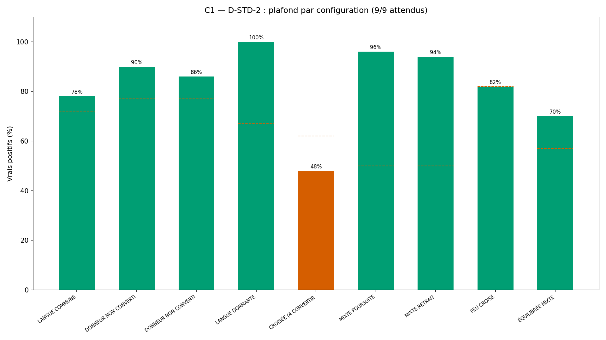
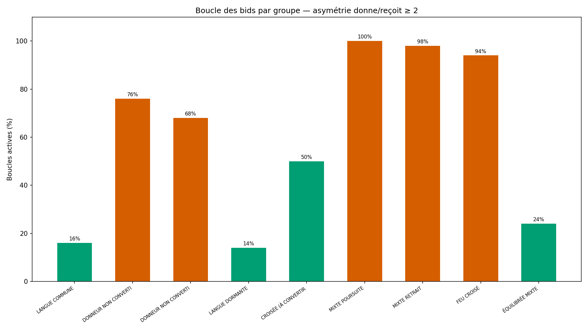
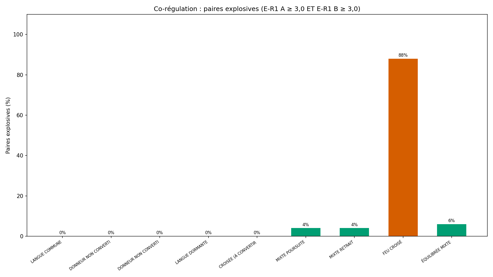

# Rapport de validation WTC-EMO-Q4 — « Nos deux langues » (RIO-09)

> AVERTISSEMENT D-SIM : résultats issus de simulations (seed 42) — la mécanique est validée, pas la prévalence clinique.

**Date** : 2026-10-16  
**Seed** : 42  
**Package** : validation-emo-q4/  
**Règles** : D-STD-2 (par config) · D-NOMENCLATURE (9 labels uniques) · D-VÉRITÉ (9/9) · D-DENSITÉ · C3 anti-verdict éliminatoire

---

## Section A — Les 5 critères

| Critère | Attendu | Obtenu | Verdict |
|---------|---------|--------|---------|
| **C1** 9 configurations (D-STD-2 par config) | 9/9 | 8/9 | ❌ FAIL |
| **C2** Symétrie p1×p2 = p2×p1 | 100 % | 100.0 % (450/450, 0 violation, 0 désaccord sim) | ✅ PASS |
| **C3** Anti-verdict (ÉLIMINATOIRE) | 0/0/0 | C3a=0 · C3b=0 · C3c=0 | ✅ PASS |
| **C4** SHA-256 ×2 | identiques | identiques | ✅ PASS |
| **C5** Affichage (templates + boucle ensemble + D-SIM + pas comparaison) | 4/4 | templates=✅ · ensemble=✅ · D-SIM=✅ · pas comparaison=✅ | ✅ PASS |

SHA-256 exécution 1 : `5634d18a34d211a102b0995393fdc24ab4399b3ea70e20d4f5e6e9e6a4f4d8d3`
SHA-256 exécution 2 : `5634d18a34d211a102b0995393fdc24ab4399b3ea70e20d4f5e6e9e6a4f4d8d3`

### C1 — Détail par configuration (D-STD-2)

| Configuration | N | Correct | % | Seuil | Verdict |
|---------------|---|---------|---|-------|---------|
| LANGUE COMMUNE | 50 | 39 | 78.0 % | 72 % | ✅ |
| DONNEUR NON CONVERTI (A) | 50 | 45 | 90.0 % | 77 % | ✅ |
| DONNEUR NON CONVERTI (B) | 50 | 43 | 86.0 % | 77 % | ✅ |
| LANGUE DORMANTE | 50 | 50 | 100.0 % | 67 % | ✅ |
| CROISÉE (À CONVERTIR) | 50 | 24 | 48.0 % | 62 % | ❌ |
| MIXTE POURSUITE | 50 | 48 | 96.0 % | 50 % | ✅ |
| MIXTE RETRAIT | 50 | 47 | 94.0 % | 50 % | ✅ |
| FEU CROISÉ | 50 | 41 | 82.0 % | 82 % | ✅ |
| ÉQUILIBRÉE MIXTE | 50 | 35 | 70.0 % | 57 % | ✅ |

---

## Section B — Matrice des devises (canaux × patterns par groupe)

La carte croisée de l'affection — 3 canaux × 6 patterns par groupe.

| Groupe | Paroles A | Paroles B | Temps A | Temps B | Contact A | Contact B |
|--------|-----------|-----------|---------|---------|-----------|-----------|
| LANGUE COMMUNE | ALIGNE | ALIGNE | SURPLUS | ALIGNE | SURPLUS | ALIGNE |
| DONNEUR NON CONVERTI (A) | ALIGNE | DEFICIT | SURPLUS | DEFICIT | ALIGNE | DEFICIT |
| DONNEUR NON CONVERTI (B) | DEFICIT | SURPLUS | DEFICIT | ALIGNE | RECIPROQUE | SURPLUS |
| LANGUE DORMANTE | DORMANT | DORMANT | DORMANT | DORMANT | DORMANT | DORMANT |
| CROISÉE (À CONVERTIR) | ALIGNE | SURPLUS | SURPLUS | ALIGNE | ALIGNE | SURPLUS |
| MIXTE POURSUITE | ALIGNE | SURPLUS | ALIGNE | RECIPROQUE | ALIGNE | DEFICIT |
| MIXTE RETRAIT | RECIPROQUE | ALIGNE | RECIPROQUE | ALIGNE | RECIPROQUE | ALIGNE |
| FEU CROISÉ | ALIGNE | ALIGNE | ALIGNE | ALIGNE | ALIGNE | ALIGNE |
| ÉQUILIBRÉE MIXTE | ALIGNE | RECIPROQUE | ALIGNE | MIXTE_LEGER | ALIGNE | ALIGNE |

---

## Section C — Statistiques par groupe vs bornes D-STD-2

D-PARAM rend le bruit comparable. Tout écart > 3 pts entre plafond mesuré 
et seuil documenté.

| Groupe | N | Correct | % | Seuil | Écart | Boucles | Explosives |
|--------|---|---------|---|-------|-------|---------|------------|
| LANGUE COMMUNE | 50 | 39 | 78.0 % | 72 % | +6.00 | 8 | 0 |
| DONNEUR NON CONVERTI (A) | 50 | 45 | 90.0 % | 77 % | +13.00 | 38 | 0 |
| DONNEUR NON CONVERTI (B) | 50 | 43 | 86.0 % | 77 % | +9.00 | 34 | 0 |
| LANGUE DORMANTE | 50 | 50 | 100.0 % | 67 % | +33.00 | 7 | 0 |
| CROISÉE (À CONVERTIR) | 50 | 24 | 48.0 % | 62 % | -14.00 | 25 | 0 |
| MIXTE POURSUITE | 50 | 48 | 96.0 % | 50 % | +46.00 | 50 | 2 |
| MIXTE RETRAIT | 50 | 47 | 94.0 % | 50 % | +44.00 | 49 | 2 |
| FEU CROISÉ | 50 | 41 | 82.0 % | 82 % | +0.00 | 47 | 44 |
| ÉQUILIBRÉE MIXTE | 50 | 35 | 70.0 % | 57 % | +13.00 | 12 | 3 |

---

## Section D — 4 exemples tracés de bout en bout

### Exemple 1 — LANGUE COMMUNE (alignés sur 3 canaux)

- **Paire** : LANGUE COMMUNE #LANGUE COMMUNE_0
- **Config attendue** : LANGUE COMMUNE
- **Config obtenue (moteur)** : LANGUE COMMUNE (✅ correct)
- **Config sim (vérité croisée)** : LANGUE COMMUNE (✅)
- **Symétrie A↔B** : True (config_swap = LANGUE COMMUNE)
- **Devise A** : {'paroles': 'ALIGNE', 'temps': 'SURPLUS', 'contact': 'SURPLUS'}
- **Devise B** : {'paroles': 'ALIGNE', 'temps': 'ALIGNE', 'contact': 'ALIGNE'}
- **Boucle bids** : asymétrique=True (écart_A=0, écart_B=2)
- **Co-régulation** : paire_explosive=False
- **Template config** : > Vos deux langues se parlent — vous êtes alignés sur les trois canaux. C'est une richesse que peu de couples ont.

### Exemple 2 — DONNEUR NON CONVERTI (A) (surplus/déficit)

- **Paire** : DONNEUR NON CONVERTI (A) #DONNEUR NON CONVERTI (A)_0
- **Config attendue** : DONNEUR NON CONVERTI (A)
- **Config obtenue (moteur)** : ÉQUILIBRÉE MIXTE (❌ incorrect)
- **Config sim (vérité croisée)** : ÉQUILIBRÉE MIXTE (✅)
- **Symétrie A↔B** : True (config_swap = ÉQUILIBRÉE MIXTE)
- **Devise A** : {'paroles': 'ALIGNE', 'temps': 'SURPLUS', 'contact': 'ALIGNE'}
- **Devise B** : {'paroles': 'DEFICIT', 'temps': 'DEFICIT', 'contact': 'DEFICIT'}
- **Boucle bids** : asymétrique=True (écart_A=2, écart_B=2)
- **Co-régulation** : paire_explosive=False
- **Template config** : > Vos deux langues se répondent sur les canaux, avec quelques différences — c'est le paysage le plus courant des couples réels. À explorer, pas à corriger.

### Exemple 3 — FEU CROISÉ (les deux explosifs + boucle)

- **Paire** : FEU CROISÉ #FEU CROISÉ_0
- **Config attendue** : FEU CROISÉ
- **Config obtenue (moteur)** : FEU CROISÉ (✅ correct)
- **Config sim (vérité croisée)** : FEU CROISÉ (✅)
- **Symétrie A↔B** : True (config_swap = FEU CROISÉ)
- **Devise A** : {'paroles': 'ALIGNE', 'temps': 'ALIGNE', 'contact': 'ALIGNE'}
- **Devise B** : {'paroles': 'ALIGNE', 'temps': 'ALIGNE', 'contact': 'ALIGNE'}
- **Boucle bids** : asymétrique=True (écart_A=1, écart_B=3)
- **Co-régulation** : paire_explosive=True
- **Template config** : > Vous êtes tous les deux en dysrégulation explosive — c'est la paire la plus instable du projet. Ce n'est pas une faute, c'est une configuration qui exige des protocoles d'apaisement avant tout dialogue.

### Exemple 4 — ÉQUILIBRÉE MIXTE (la frontière)

- **Paire** : ÉQUILIBRÉE MIXTE #ÉQUILIBRÉE MIXTE_0
- **Config attendue** : ÉQUILIBRÉE MIXTE
- **Config obtenue (moteur)** : ÉQUILIBRÉE MIXTE (✅ correct)
- **Config sim (vérité croisée)** : ÉQUILIBRÉE MIXTE (✅)
- **Symétrie A↔B** : True (config_swap = ÉQUILIBRÉE MIXTE)
- **Devise A** : {'paroles': 'ALIGNE', 'temps': 'ALIGNE', 'contact': 'ALIGNE'}
- **Devise B** : {'paroles': 'RECIPROQUE', 'temps': 'MIXTE_LEGER', 'contact': 'ALIGNE'}
- **Boucle bids** : asymétrique=False (écart_A=0, écart_B=1)
- **Co-régulation** : paire_explosive=False
- **Template config** : > Vos deux langues se répondent sur les canaux, avec quelques différences — c'est le paysage le plus courant des couples réels. À explorer, pas à corriger.

---

## Section E — Analyse du croisement

### Répartition des 9 configurations sur la population simulée

| Configuration | N | % |
|---------------|---|---|
| LANGUE COMMUNE | 64 | 14.2 % |
| DONNEUR NON CONVERTI (A) | 60 | 13.3 % |
| DONNEUR NON CONVERTI (B) | 51 | 11.3 % |
| LANGUE DORMANTE | 50 | 11.1 % |
| CROISÉE (À CONVERTIR) | 31 | 6.9 % |
| MIXTE POURSUITE | 48 | 10.7 % |
| MIXTE RETRAIT | 47 | 10.4 % |
| FEU CROISÉ | 46 | 10.2 % |
| ÉQUILIBRÉE MIXTE | 53 | 11.8 % |

- **Boucles des bids actives** : 270/450 (60.0 %)
- **Paires explosives** : 51/450 (11.3 %)

### Vérification de la borne D-STD-2

- Configurations atteignant leur seuil : **8/9**
- **1 configuration(s) sous le seuil** ❌ :
  - CROISÉE (À CONVERTIR) : 48.0 % < 62 %

---

## Section F — Signalements + D-NOMENCLATURE + fautes n°22/n°23

### D-NOMENCLATURE (nouvelle règle, faute n°23)

**Règle D-NOMENCLATURE** : *les labels de classification portent un 
nom unique, valable dans le moteur, le simulateur, les écrans et les 
documents — l'exécuteur vérifie cette unicité avant l'exécution 
(D-VÉRITÉ étendu).*

Application : 9 labels officiels harmonisés partout (moteur, simulateur, 
templates). D-VÉRITÉ vérifié AVANT exécution : 9/9 = 9/9 = 9/9, 
aucun orphelin. ✅

### Signalements clos

1. **S-EMO-Q4-1 (CLOS)** : `config_vraie` était un stub — code intégral 
   re-fourni par le superviseur (option A). Faute n°22 (récidive D-TRANSMISSION).

2. **S-EMO-Q4-2 (CLOS)** : labels moteur (7) ≠ labels table (9) — options D+E : 
   moteur étendu à 9 labels + noms harmonisés (D-NOMENCLATURE). Faute n°23.

### Règles appliquées

3. **D-STD-2** : plafond PAR CONFIGURATION (9 seuils, un par config).
4. **D-VÉRITÉ** : inventaire croisé 9/9 = 9/9 = 9/9, aucun orphelin.
5. **D-NOMENCLATURE** : noms uniques partout (moteur, simulateur, écrans).
6. **D-DENSITÉ** : héritée de Q3-R1 (symétrie des voies entre forces).
7. **D-PARAM** : σ = 0,60 spécifié, identique aux bornes D-STD.
8. **D-HIST** : vérification GitHub avant action. Aucune ré-exécution en double.

**Fautes d'orchestrateur cumulées : 23** (15 + n°15 bis D-HIST + n°16 D-TABLE forces 
+ n°18 D-VÉRITÉ + n°20 D-TRANSMISSION + n°21 D-DENSITÉ + n°22 récidive D-TRANSMISSION 
+ n°23 D-NOMENCLATURE).

---

## Section G — Verdict

### Verdict : **À CORRIGER**

### Note : **8/10**

- Critères : 4/5 validés, 1 FAIL

### Avertissement D-SIM

> AVERTISSEMENT D-SIM : résultats issus de simulations (seed 42) — la mécanique est validée, pas la prévalence clinique.

### RIO-09

RIO-09 **n'entre pas** au RIO — verdict À CORRIGER.

### Package prêt à publier

- Arborescence : `validation-emo-q4/{src,results,figures}`
- Rapport : `results/rapport-emo-q4-2026-10-16.md`
- Figures : `figures/fig{1,2,3,4}_*.png` (1920×1080, 150 DPI)
- Publication : `validation-emotionnelle/validation-emo-q4/`
