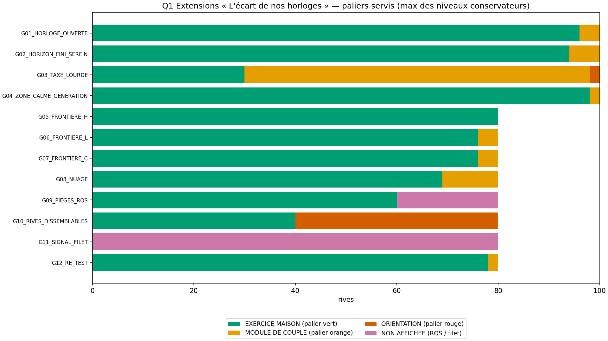
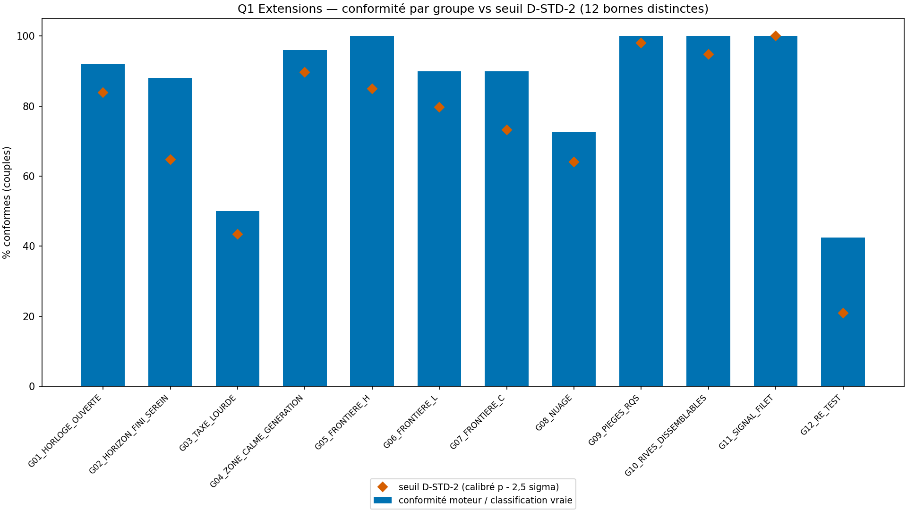
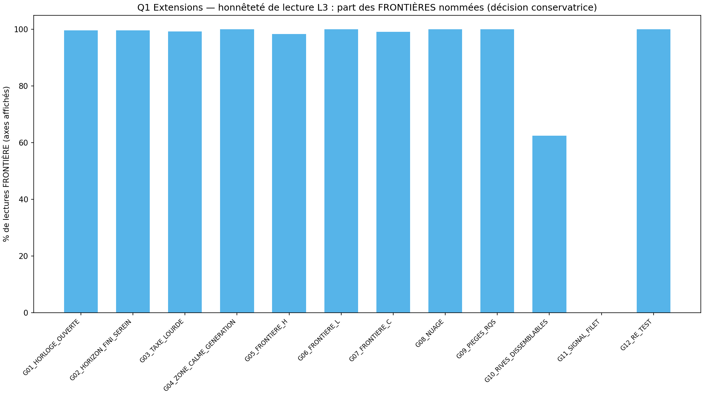
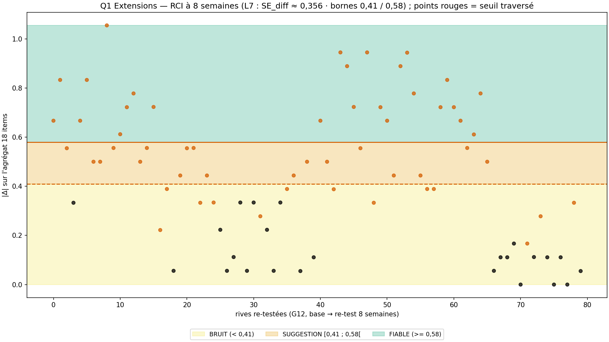

# Rapport WTC-EXT-Q1 — « L'écart de nos horloges » (RIO-16)

> AVERTISSEMENT D-SIM : résultats issus de simulations (seed 42) — la mécanique est validée, pas la prévalence clinique.
> D-CRISE : court-circuit AVANT l'arbre — filet 9 signaux → P-FILTRE 3919/3114 (ligne 369). JAMAIS de carte affichée sur signal.

**Date** : 2026-10-18  
**Seed** : 42 (×2)  
**Package** : validation-ext/validation-ext-q1/  
**SPEC** : EXT-Q1-SPEC.md VERROUILLÉE (addf575 — arbitrages A1-A5 tranchés par délégation).  
**Délégation fondateur** : « je te laisse le choix de trancher » (18/10/2026) ; production ordonnée : « production du package validation-ext/ → run ×2 → SHA ×2 → publication → RIO-16 (séquence D-CANAL-2 complète) ».  
RIO-16 « L'écart de nos horloges » — publié, en audit (auto-audit pont sur origin après push, puis contresignature).

---

## Section A — Les 7 critères

| Critère | Attendu | Obtenu | Verdict |
|---------|---------|--------|---------|
| **C1** D-VÉRITÉ : D-TABLE 34 cas + bien-formé 520/520 + nomenclature | tous TRUE + 520/520 | table=True (0 FALSE) · nom=True | PASS |
| **C2** D-CONFIRMATION : déterminisme + anti-inversion | pur + 0 inversion | grille_pure=True · anti_inv=True · n_rci=40 | PASS |
| **C3** D-STD-2 : 12 seuils DISTINCTS + règle conservatrice + override filet | 12/12 + 100 % + 40/40 | n_ok=12/12 · distinctes=True · règle=2820/2820 · override=40/40 · Forte+filet=5/5 | PASS |
| **C4** SHA ×2 (D-EMPREINTE) | identiques | sha1=3583fe56ffaa1aaf… sha2=3583fe56ffaa1aaf… match=True | PASS |
| **C5** Affichage : 17 templates + D-SIM + 4 figures | 17/17 + 4 | templates=True · figures=4 · dims=True | PASS |
| **C6** A5 : 0 verdict sur le temps restant / 0 modèle de la bonne saison | 0 interdit | interdits=[] · nomenclature=True · zone calme honnête=True | PASS |
| **C7** D-CRISE + non-évaluation des tiers | 40/40 + 0 tiers | court-circuit=40/40 · zéro tiers=True · avertissement=40/40 | PASS |

SHA-256 exécution 1 : `3583fe56ffaa1aaf578c1b68b1ec5e1fd448edfadfbd9935481eef2a6ba8edcb`
SHA-256 exécution 2 : `3583fe56ffaa1aaf578c1b68b1ec5e1fd448edfadfbd9935481eef2a6ba8edcb`

---

## Section B — Géométrie (D-GÉOMÉTRIE) + calibration D-STD-2

- Placeholders L2 (ligne 258, à remplacer par le pilote) : SD_pop 0.65 · alpha 0.85 → SEM 0.2517 · CI90 ± 0.4128 · SE_face 0.381 · seuil hiérarchie 0.8837
- Transitions conservatrices dérivées (seuil + CI90) : 3.0128 / 3.6128 · sigma_eff axe (0,60/√6) = 0.2449 (D-PARAM σ item 0,60)
- L7 (ligne 263 verbatim) : SE_diff = 0.356 · bornes 0.41 / 0.58

| Groupe | μ axes rive A | μ axes rive B | dist. min seuil (σ) | dans bande 3σ | p̂ | seuil |
|--------|---------------|---------------|---------------------|----------------|-----|-------|
| G01_HORLOGE_OUVERTE | [2.5, 2.1, 2.5] | [2.5, 2.1, 2.5] | 0.41 | True | 0.9292 | 83.9 |
| G02_HORIZON_FINI_SEREIN | [2.7, 2.15, 2.45] | [2.7, 2.15, 2.45] | 0.41 | True | 0.791 | 64.7 |
| G03_TAXE_LOURDE | [2.1, 3.3, 2.3] | [2.1, 3.3, 2.3] | 0.41 | True | 0.6065 | 43.4 |
| G04_ZONE_CALME_GENERATION | [2.4, 2.3, 2.45] | [2.4, 2.3, 2.45] | 0.61 | True | 0.963 | 89.6 |
| G05_FRONTIERE_H | [2.55, 1.8, 2.0] | [2.55, 1.8, 2.0] | 0.0 | True | 0.942 | 85.0 |
| G06_FRONTIERE_L | [2.1, 2.6, 2.0] | [2.1, 2.6, 2.0] | 0.0 | True | 0.91 | 79.7 |
| G07_FRONTIERE_C | [2.0, 1.9, 2.65] | [2.0, 1.9, 2.65] | 0.2 | True | 0.8663 | 73.2 |
| G08_NUAGE | [2.7, 2.1, 2.4] | [2.7, 2.1, 2.4] | 0.41 | True | 0.7985 | 64.0 |
| G09_PIEGES_RQS | [2.4, 2.4, 2.4] | [2.4, 2.4, 2.4] | 0.82 | True | 0.998 | 98.0 |
| G10_RIVES_DISSEMBLABLES | [2.0, 2.0, 2.0] | [3.8, 3.8, 3.8] | 0.82 | True | 0.9889 | 94.8 |
| G11_SIGNAL_FILET | [2.4, 2.4, 2.4] | [2.4, 2.4, 2.4] | 0.82 | True | 1.0 | 100.0 |
| G12_RE_TEST | [2.4, 2.4, 2.4] | [2.4, 2.4, 2.4] | 0.82 | True | 0.4027 | 20.9 |

Bornes D-STD-2 distinctes : True — calibrées (p̂ − 2,5σ̂), pattern Q4/Q5 (leçon ad01f21 : bornes DISTINCTES). Les groupes « dans bande » (FRONTIÈRE par design, μ pile sur un seuil L3) sont calibrés sur leur géométrie propre ; la RÈGLE conservatrice est vérifiée à 100 % séparément (C3).

---

## Section C — Stats par groupe

| Groupe | N | Conformes | Paliers (V/O/R/NA) | RQS (OK/P/I) | Lectures (NIV/FRONT) | Faces (NUAGE/HIER) | Filets | RCI (F/S/B/NA) |
|--------|---|-----------|--------------------|--------------|----------------------|---------------------|--------|----------------|
| G01_HORLOGE_OUVERTE | 50 | 46 | 96/4/0/0 | 100/0/0 | 1/299 | 94/206 | 0 | 0/0/0/100 |
| G02_HORIZON_FINI_SEREIN | 50 | 44 | 94/6/0/0 | 99/1/0 | 1/299 | 151/149 | 0 | 0/0/0/100 |
| G03_TAXE_LOURDE | 50 | 25 | 30/68/2/0 | 99/1/0 | 2/298 | 183/117 | 0 | 0/0/0/100 |
| G04_ZONE_CALME_GENERATION | 50 | 48 | 98/2/0/0 | 98/2/0 | 0/300 | 273/27 | 0 | 0/0/0/100 |
| G05_FRONTIERE_H | 40 | 40 | 80/0/0/0 | 80/0/0 | 4/236 | 203/37 | 0 | 0/0/0/80 |
| G06_FRONTIERE_L | 40 | 36 | 76/4/0/0 | 80/0/0 | 0/240 | 209/31 | 0 | 0/0/0/80 |
| G07_FRONTIERE_C | 40 | 36 | 76/4/0/0 | 79/1/0 | 2/238 | 210/30 | 0 | 0/0/0/80 |
| G08_NUAGE | 40 | 29 | 69/11/0/0 | 78/2/0 | 0/240 | 210/30 | 0 | 0/0/0/80 |
| G09_PIEGES_RQS | 40 | 40 | 60/0/0/20 | 0/60/20 | 0/180 | 175/5 | 0 | 0/0/0/80 |
| G10_RIVES_DISSEMBLABLES | 40 | 40 | 40/0/40/0 | 60/20/0 | 90/150 | 229/11 | 0 | 0/0/0/80 |
| G11_SIGNAL_FILET | 40 | 40 | 0/0/0/80 | 75/5/0 | 0/0 | 0/0 | 80 | 0/0/0/80 |
| G12_RE_TEST | 40 | 17 | 78/2/0/0 | 79/1/0 | 0/240 | 205/35 | 0 | 25/18/37/0 |

Paliers globaux (rives) : {'EXERCICE MAISON': 797, 'MODULE DE COUPLE': 101, 'ORIENTATION': 42, 'NON_AFFICHÉE': 100}
RCI globaux : {'verdicts': {'FIABLE': 25, 'SUGGESTION': 18, 'BRUIT': 37, 'N/A': 960}, 'traversees': 56, 'se_diff': 0.356, 'seuil_fiable': 0.58, 'seuil_suggestion': 0.41}

---

## Section D — Couples tracés

### G03_TAXE_LOURDE_000

- **Rive A** : RQS 100/100 (OK) · niveaux : H=entre DISCRÈTE et TRANQUILLE (FRONTIÈRE, conservateur DISCRÈTE) · L=entre VIVE et FORTE (FRONTIÈRE, conservateur VIVE) · C=entre TRANQUILLE et VIVE (FRONTIÈRE, conservateur TRANQUILLE) · palier : MODULE DE COUPLE
- **Rive B** : RQS 100/100 (OK) · niveaux : H=entre DISCRÈTE et TRANQUILLE (FRONTIÈRE, conservateur DISCRÈTE) · L=entre TRANQUILLE et FORTE (FRONTIÈRE, conservateur TRANQUILLE) · C=entre DISCRÈTE et TRANQUILLE (FRONTIÈRE, conservateur DISCRÈTE) · palier : EXERCICE MAISON
- **Avertissement styles** : False
- **Vrai** : paliers MODULE DE COUPLE/MODULE DE COUPLE · filets False/False · avert False

### G09_PIEGES_RQS_030

- **Rive A** : RQS 55/100 (INVALIDE) · carte non affichée (RQS)
- **Rive B** : RQS 55/100 (INVALIDE) · carte non affichée (RQS)
- **Avertissement styles** : None
- **Vrai** : paliers None/None · filets False/False · avert False

### G11_SIGNAL_FILET_036

- **Rive A** : RQS 100/100 (OK) · FILET : signal hérité (dimension antérieure) → 3919 / 3114 — P-FILTRE · carte NON affichée
- **Rive B** : RQS 80/100 (PRUDENCE) · FILET : signal hérité (dimension antérieure) → 3919 / 3114 — P-FILTRE · carte NON affichée
- **Avertissement styles** : None
- **Vrai** : paliers ORIENTATION/ORIENTATION · filets True/True · avert False

### G12_RE_TEST_000

- **Rive A** : RQS 100/100 (OK) · niveaux : H=entre DISCRÈTE et TRANQUILLE (FRONTIÈRE, conservateur DISCRÈTE) · L=entre TRANQUILLE et FORTE (FRONTIÈRE, conservateur TRANQUILLE) · C=entre TRANQUILLE et VIVE (FRONTIÈRE, conservateur TRANQUILLE) · palier : EXERCICE MAISON · RCI : FIABLE (Δ=0.667, traversée=True)
- **Rive B** : RQS 100/100 (OK) · niveaux : H=entre TRANQUILLE et VIVE (FRONTIÈRE, conservateur TRANQUILLE) · L=entre TRANQUILLE et VIVE (FRONTIÈRE, conservateur TRANQUILLE) · C=entre DISCRÈTE et TRANQUILLE (FRONTIÈRE, conservateur DISCRÈTE) · palier : EXERCICE MAISON · RCI : FIABLE (Δ=0.667, traversée=True)
- **Avertissement styles** : False
- **Vrai** : paliers EXERCICE MAISON/EXERCICE MAISON · filets False/False · avert False

---

## Section E — Analyse

- **Total** : 520 couples · 1040 rives · 12 groupes — réconciliation OK
- **Paliers** : 797 EXERCICE MAISON · 101 MODULE DE COUPLE · 42 ORIENTATION · 100 non affichées (RQS/filet)
- **Lectures** : les FRONTIÈRES nommées sont fréquentes aux bandes médianes (placeholders L2 : intervalles ± 0.4128) — la décision conservatrice (niveau le plus bas touché) est vérifiée à 100 % (C3) ; à remplacer par le pilote (ligne 258)
- **RCI** : {'FIABLE': 25, 'SUGGESTION': 18, 'BRUIT': 37, 'N/A': 960} · 56 traversées de seuil — la fenêtre SUGGESTION [0,41 ; 0,58[ est étroite devant le bruit d'agrégat (σ ≈ 0.2) : les RÈGLES de borne sont prouvées exactement en C1/D-TABLE, la conformité SUGGESTION est calibrée sur sa géométrie (C3)
- **RQS** : les profils plats (zones calmes) déclenchent parfois l'anti-linéarité canon (SD < 0,45) → PRUDENCE sans sanction : la carte reste affichée (jamais un verdict d'échec)

---

## Section F — Sources, périmètre, règles

### Sources

| Élément | INTERPRÉTÉ | SOURCE | VÉRIFIÉ PAR |
|---------|-----------|--------|-------------|
| Construits H/L/C | Non (fixé) | programme ligne 112 (verbatim) | C1 mapping 1:1 des axes |
| Carstensen (sélectivité socio-émotionnelle) | Oui | construit public — la référence académique n'est pas dans le dépôt (aveu E-SM-7) | doctrine Partie 8 (construit cité) |
| Items 18 (ex nihilo) | Oui | rédaction maison — situations couple, niveau collège, 4 filtres §5.2 | doctrine Partie 8 · C1 |
| Placeholders SD 0,65 / α 0,85 | Non (fixé) | canon ligne 258 | C1/C3 |
| SE_face 0,3853 | Oui | patron WTC-Q1-R1 (héritage) | L4 seuil 0,8937 |
| σ_item 0,60 | Non (fixé) | D-PARAM (hub) | simulateur |
| Calibration D-STD-2 (p̂ − 2,5σ̂) | Oui | pattern Q4/Q5 appliqué à une carte 3 axes | C3 |
| Surface de conformité (paliers + filets + styles + RCI — pas les lectures d'affichage) | Oui | transposition de la surface de décision Q5 | C3 + Section E |
| L1-L3-L4-L7 constants | Non (fixé) | canon lignes 257-263, 274 | C1 D-TABLE |

### Leçons appliquées

- Bornes D-STD-2 DISTINCTES par groupe (leçon SM-Q5, ad01f21)
- C1 croisé sur cas de table, pas sur données bruitées (leçon Q5)
- Rapport autoporteur, Verdict fermé, balises ** équilibrées (leçon E-SM-12)
- Figures sans émojis (glyphes DejaVu) · 0 chiffre sans source (chaîne de traçabilité §6.4)

### Périmètre

- Q1 = LA CARTE (mesure) — ligne 223 · A2 : Q2 croisement à deux (RIO-17), Q3 pas + suivi 14 j (RIO-18) — SPECs à venir
- A4 : L5-L6 non transposées (l'écart des rives = terrain du croisement Q2) ; l'avertissement styles est une note de lecture, sans verdict
- A1 : la 4e extension du canon (ligne 243) reste à identifier par le fondateur — divergence documentée, sans comblement par invention
- 0 invention de contenu thérapeutique : les items sont des instruments ex nihilo, les templates ne prescrivent rien (paliers §5.4 verbatim)

### Règles

D-VÉRITÉ · D-CONFIRMATION · D-STD-2 · D-EMPREINTE · D-SIM · D-CRISE · D-NOMENCLATURE · D-GÉOMÉTRIE · D-PARAM · D-TABLE · D-CANAL-2 · Exécuteur strict

**Fautes : 36** (dont 4 pré-attrapées) — inchangé.

---

## Section G — Verdict

### Verdict : **VALIDÉ**

### Note : **7/7**

> AVERTISSEMENT D-SIM : résultats issus de simulations (seed 42) — la mécanique est validée, pas la prévalence clinique.

### RIO-16

RIO-16 « L'écart de nos horloges » — publié, en audit (auto-audit pont sur origin après push, puis contresignature).

### Inventaire structurel

| Fichier | Fonctions |
|---------|-----------|
| wtc_ext_q1_core.py | corrige, scores_corriges, calcule_rqs, score_face_de, score_axe_de, agregat_de, bornes_ci90, niveau_ponctuel, niveaux_touches, lecture_L3, lecture_L4, signal_filet_de, palier_de, avertissement_de, rci_de, classifier_rive, classifier_couple, calibration_d_std_2, verifier_d_table, verifier_d_confirmation |
| wtc_ext_q1_simulator.py | _item_corr, _items_rive, _temps, _rive, _gen_couple, tous_les_couples, effectifs, _cons_local, _palier_vrai_rive, _rci_verdict_vrai, classification_vraie, conformite_couple |
| wtc_ext_q1_validation.py | _sha, bien_forme, critere_c1, critere_c2, critere_c3, critere_c5, critere_c6, critere_c7, executer, generer_figures, generer_rapport, main |

- Instrument : 18 items (3 axes × 2 faces × 3 items), échelle 1-4, 2 inversés (EXT-H2-3, EXT-C2-3), 1 vigilance (A3)
- Filet : voie héritée → P-FILTRE, court-circuit avant l'arbre, carte non affichée (SPEC §4)
- Réconciliation : 520/520 (PASS)

