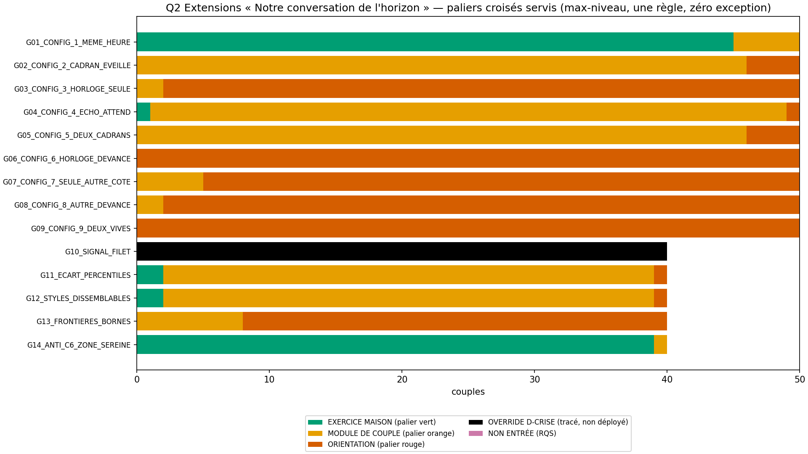
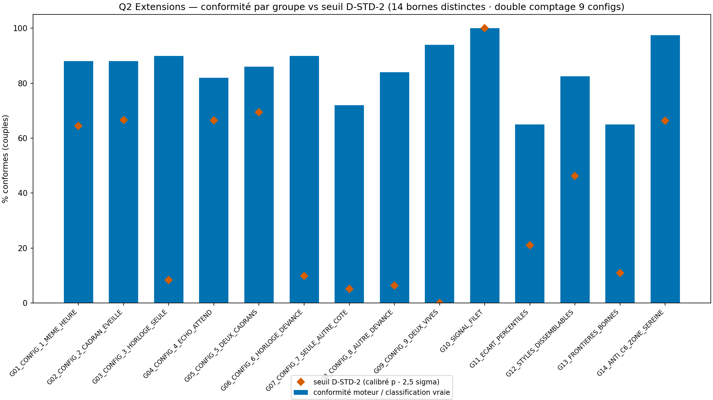
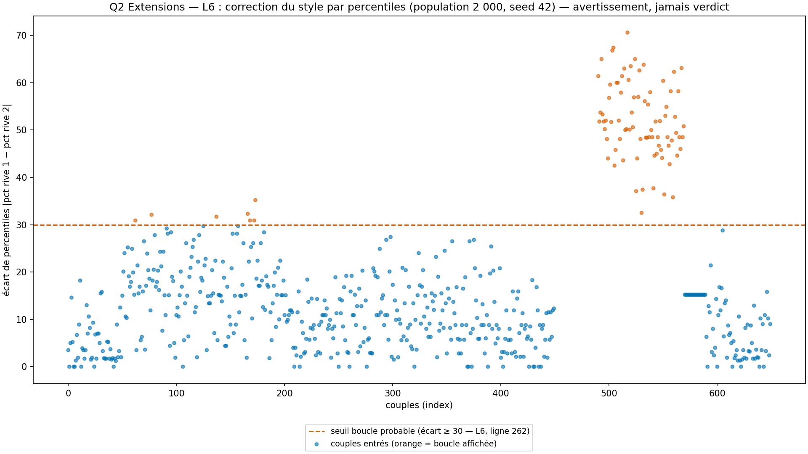
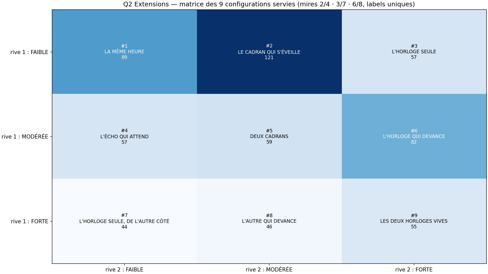

# Rapport WTC-EXT-Q2 — « Notre conversation de l'horizon » (RIO-17)

> AVERTISSEMENT D-SIM : résultats issus de simulations (seed 42) — la mécanique est validée, pas la prévalence clinique.
> D-CRISE : court-circuit AVANT le verdict de couple — filet 9 signaux → P-FILTRE 3919/3114 (ligne 369). JAMAIS de croisement de couple en crise.

**Date** : 2026-10-18  
**Seed** : 42 (×2)  
**Package** : validation-ext/validation-ext-q2/  
**SPEC** : EXT-Q2-SPEC.md VERROUILLÉE (5bc9600 — arbitrages A1-A6 tranchés par délégation).  
**Ordre fondateur** : « trancher A1-A6. ordonner l'exécution de P1-P6. Ensuite : verrouillage Q2 → production → RIO-17 » (18/10/2026) ; P1-P6 exécutées au commit fe13ffd.  
Entrées = sorties RIO-16 contresignées des deux rives (A2-a : zéro item nouveau ; empreinte 3583fe56… inchangée).

---

## Section A — Les 7 critères

| Critère | Attendu | Obtenu | Verdict |
|---------|---------|--------|---------|
| **C1** D-VÉRITÉ : D-TABLE 43 cas + bien-formé 650/650 + 9/9 configs + nomenclature | tous TRUE + 9/9 | table=True (0 FALSE) · configs=9/9 · nom=True · anti-collision SM-Q4=True | PASS |
| **C2** D-CONFIRMATION : config = f(H1, H2) pure + 0 inversion des rives | pur + 0 inversion | grille_pure=True · anti_inv=610/610 | PASS |
| **C3** D-STD-2 : 14 seuils DISTINCTES (9 configs + 14 groupes) + override filet + entrée RQS | 14/14 + 40/40 | n_ok=14/14 · distinctes=True (9 configs=True) · override=40/40 · Forte+filet=5/5 · entrée RQS=True | PASS |
| **C4** SHA ×2 (D-EMPREINTE) | identiques | sha1=2aea8d99b91ad664… sha2=2aea8d99b91ad664… match=True | PASS |
| **C5** Affichage : templates ×9 + boucle + styles + asymétries + D-SIM + littéraux | 6/6 | templates=True · boucle=True · styles=True · asym=True · figures=4 dims=True | PASS |
| **C6** A5-Q1 à deux : 0 verdict temps restant / 0 bonne saison / zone calme honnête / 0 verdict croisé sur C | 0 interdit | interdits=[] · zone calme=True · anti-C6=39/40 · 0 verdict C=True | PASS |
| **C7** D-CRISE + non-reproche + non-tiers | 40/40 + 0 | court-circuit=40/40 · zéro reproche=True · zéro tiers=True · boucle sans verdict=True | PASS |

SHA-256 exécution 1 : `2aea8d99b91ad664f896f1d974d775c134b5d16d0594c6756169421272f38ab5`
SHA-256 exécution 2 : `2aea8d99b91ad664f896f1d974d775c134b5d16d0594c6756169421272f38ab5`

---

## Section B — Géométrie (D-GÉOMÉTRIE) + calibration D-STD-2

- Bornes de croisement (A3-a) : FAIBLE < 2.5 ≤ MODÉRÉE < 3.5 ≤ FORTE — tranchage inclusif vérifié en D-TABLE (2,49/2,50/3,49/3,50)
- σ normal de référence du score d'axe (0,60/√6) = 0.2449 — la CALIBRATION des seuils est EMPIRIQUE : p̂ estimé par Monte-Carlo déterministe (10000 couples/groupe, seed 42, items entiers clippés + arrondis + inversés corrigés — même processus générateur que le simulateur ; D-GÉOMÉTRIE : σ_eff = propagation structurale, jamais modification)
- L6 (ligne 262 verbatim) : percentiles — population 2000 profils seed 42 N(3.0 ; 0.8) (placeholder L2, à remplacer par le pilote) · boucle probable si écart ≥ 30.0 · avertissement styles si écart moyen ≥ 1.0
- L5 (ligne 261) : 3 inférences Générationnelles VERROUILLÉES (A4) — déclencheurs mécaniques (taxe L1 ≥ 2.6 chez une rive · niveaux H différents · C2 > C1 des deux côtés)

| Groupe | μ H rive 1 | μ H rive 2 | μ agg 1 | μ agg 2 | écart pct vrai | p̂ | seuil |
|--------|-----------|-----------|---------|---------|----------------|-----|-------|
| G01_CONFIG_1_MEME_HEURE | 1.9 | 1.9 | 2.2 | 2.2 | 0.0 | 0.7896 | 64.5 |
| G02_CONFIG_2_CADRAN_EVEILLE | 1.85 | 3.0 | 2.217 | 2.667 | 15.5 | 0.8059 | 66.6 |
| G03_CONFIG_3_HORLOGE_SEULE | 1.85 | 3.9 | 2.217 | 2.633 | 14.3 | 0.2336 | 8.4 |
| G04_CONFIG_4_ECHO_ATTEND | 2.95 | 1.8 | 2.65 | 2.2 | 15.6 | 0.8051 | 66.5 |
| G05_CONFIG_5_DEUX_CADRANS | 3.0 | 3.05 | 2.667 | 2.717 | 2.9 | 0.8283 | 69.5 |
| G06_CONFIG_6_HORLOGE_DEVANCE | 3.0 | 3.9 | 2.667 | 2.933 | 14.1 | 0.2531 | 9.9 |
| G07_CONFIG_7_SEULE_AUTRE_COTE | 3.85 | 1.8 | 2.617 | 2.2 | 14.4 | 0.19 | 5.1 |
| G08_CONFIG_8_AUTRE_DEVANCE | 3.85 | 3.05 | 2.95 | 2.683 | 13.6 | 0.2066 | 6.3 |
| G09_CONFIG_9_DEUX_VIVES | 3.9 | 3.95 | 2.767 | 2.783 | 0.7 | 0.098 | 0.0 |
| G10_SIGNAL_FILET | 2.4 | 2.4 | 2.4 | 2.4 | 0.0 | 1.0 | 100.0 |
| G11_ECART_PERCENTILES | 2.0 | 3.0 | 2.2 | 3.667 | 63.8 | 0.405 | 21.1 |
| G12_STYLES_DISSEMBLABLES | 1.8 | 3.0 | 1.867 | 3.533 | 68.3 | 0.6501 | 46.2 |
| G13_FRONTIERES_BORNES | 2.5 | 3.5 | 2.5 | 2.833 | 15.2 | 0.2879 | 10.9 |
| G14_ANTI_C6_ZONE_SEREINE | 1.85 | 1.85 | 2.183 | 2.183 | 0.0 | 0.8167 | 66.4 |

Bornes D-STD-2 distinctes : True (14) · 9 configurations : True — calibrées (p̂_MC − 2,5σ̂, σ̂ binomial sur l'effectif réel du groupe), leçon ad01f21 (bornes DISTINCTES entre configurations ET entre groupes — double comptage). G13 mélange 20 couples EXACTS (items constants pile sur 2,50/3,50 — tranchage déterministe prouvé en D-TABLE) et 20 couples adjacents (μ dans la bande, calibrés sur leur géométrie propre, robustesse Section E).

---

## Section C — Stats par groupe

| Groupe | N | Conformes | Entrées | Paliers (V/O/R/ov/NE) | Boucle | Styles | Asym L/C marquées | Inférences (taxe/sujet/silence) |
|--------|---|-----------|---------|----------------------|--------|--------|--------------------|--------------------------------|
| G01_CONFIG_1_MEME_HEURE | 50 | 44 | 50 | 45/5/0/0/0 | 0 | 0 | 1/1 | 38/5/4 |
| G02_CONFIG_2_CADRAN_EVEILLE | 50 | 44 | 50 | 0/46/4/0/0 | 2 | 0 | 0/1 | 30/50/7 |
| G03_CONFIG_3_HORLOGE_SEULE | 50 | 45 | 50 | 0/2/48/0/0 | 1 | 0 | 1/1 | 17/50/10 |
| G04_CONFIG_4_ECHO_ATTEND | 50 | 41 | 50 | 1/48/1/0/0 | 4 | 0 | 2/1 | 40/48/7 |
| G05_CONFIG_5_DEUX_CADRANS | 50 | 43 | 50 | 0/46/4/0/0 | 0 | 0 | 0/1 | 40/6/10 |
| G06_CONFIG_6_HORLOGE_DEVANCE | 50 | 45 | 50 | 0/0/50/0/0 | 0 | 0 | 1/1 | 36/47/7 |
| G07_CONFIG_7_SEULE_AUTRE_COTE | 50 | 36 | 50 | 0/5/45/0/0 | 0 | 0 | 7/4 | 22/50/8 |
| G08_CONFIG_8_AUTRE_DEVANCE | 50 | 42 | 50 | 0/2/48/0/0 | 0 | 0 | 0/0 | 38/43/7 |
| G09_CONFIG_9_DEUX_VIVES | 50 | 47 | 50 | 0/0/50/0/0 | 0 | 0 | 0/0 | 22/3/8 |
| G10_SIGNAL_FILET | 40 | 40 | 0 | 0/0/0/40/0 | 0 | 0 | 0/0 | 0/0/0 |
| G11_ECART_PERCENTILES | 40 | 26 | 40 | 2/37/1/0/0 | 40 | 37 | 35/38 | 40/34/3 |
| G12_STYLES_DISSEMBLABLES | 40 | 33 | 40 | 2/37/1/0/0 | 40 | 38 | 38/38 | 40/37/4 |
| G13_FRONTIERES_BORNES | 40 | 26 | 40 | 0/8/32/0/0 | 0 | 0 | 0/0 | 15/34/22 |
| G14_ANTI_C6_ZONE_SEREINE | 40 | 39 | 40 | 39/1/0/0/0 | 0 | 0 | 0/0 | 25/0/5 |

Globaux : {'paliers': {'EXERCICE MAISON': 89, 'MODULE DE COUPLE': 237, 'ORIENTATION': 284, 'OVERRIDE': 40, 'NON ENTRÉE': 0}, 'entrees': 610, 'boucles': 87, 'styles': 75, 'inferences_L5': {'la taxe se paie à deux': 403, 'deux horloges, un seul sujet': 407, 'le silence partagé est aussi une réponse': 102}}

---

## Section D — Couples tracés

### G10_SIGNAL_FILET_036

- **Rive A** : RQS 100/100 (OK) · score H 3.3333 · L 3.8333 · C 3.8333 · filet=True
- **Rive B** : RQS 100/100 (OK) · score H 2.6667 · L 2.3333 · C 2.6667 · filet=False
- **Niveaux croisés** : MODÉRÉE / MODÉRÉE (scores H 3.3333 / 2.6667)
- **Configuration** : #5 DEUX CADRANS — les deux horloges tournent — le terrain naturel de la conversation de l'horizon
- **Display** : OVERRIDE D-CRISE · palier : ORIENTATION · verdict : None
- **Bandeau** : D-CRISE : court-circuit AVANT le verdict de couple — P-FILTRE, croisement jamais déployé sur une crise active (configuration calculée et tracée).
- **Vrai** : {'override': True}

### G11_ECART_PERCENTILES_000

- **Rive A** : RQS 100/100 (OK) · score H 2.1667 · L 2.1667 · C 2.1667 · filet=False
- **Rive B** : RQS 100/100 (OK) · score H 2.8333 · L 3.8333 · C 4.0 · filet=False
- **Niveaux croisés** : FAIBLE / MODÉRÉE (scores H 2.1667 / 2.8333)
- **Configuration** : #2 LE CADRAN QUI S'ÉVEILLE — une rive entend son horloge, l'autre pas encore
- **Display** : LE CADRAN QUI S'ÉVEILLE · palier : MODULE DE COUPLE · verdict : {'config': "LE CADRAN QUI S'ÉVEILLE", 'palier': 'MODULE DE COUPLE', 'zone_calme': False}
- **Percentiles** : {'rive1': 16.8, 'rive2': 78.2} · écart 61.4 · boucle probable=True
- **Styles** : écart 1.39 · dissemblables=True
- **Asymétries** : L {'ecart': 1.67, 'lecture': 'ASYMÉTRIE MARQUÉE'} · C {'ecart': 1.83, 'lecture': 'ASYMÉTRIE MARQUÉE'}
- **Empreinte L5** : {'la taxe se paie à deux': True, 'deux horloges, un seul sujet': True, 'le silence partagé est aussi une réponse': False} · force : force silencieuse : la permission à deux est vive chez une rive
- **Vrai** : {'override': False, 'config_num': 2, 'boucle': True, 'styles': True, 'asym_L': True, 'asym_C': True}

### G12_STYLES_DISSEMBLABLES_000

- **Rive A** : RQS 100/100 (OK) · score H 1.6667 · L 1.6667 · C 2.0 · filet=False
- **Rive B** : RQS 80/100 (PRUDENCE) · score H 2.6667 · L 3.0 · C 2.6667 · filet=False
- **Niveaux croisés** : FAIBLE / MODÉRÉE (scores H 1.6667 / 2.6667)
- **Configuration** : #2 LE CADRAN QUI S'ÉVEILLE — une rive entend son horloge, l'autre pas encore
- **Display** : LE CADRAN QUI S'ÉVEILLE · palier : MODULE DE COUPLE · verdict : {'config': "LE CADRAN QUI S'ÉVEILLE", 'palier': 'MODULE DE COUPLE', 'zone_calme': False}
- **Percentiles** : {'rive1': 7.5, 'rive2': 40.0} · écart 32.5 · boucle probable=True
- **Styles** : écart 1.0 · dissemblables=True
- **Asymétries** : L {'ecart': 1.33, 'lecture': 'ASYMÉTRIE MARQUÉE'} · C {'ecart': 0.67, 'lecture': 'asymétrie légère'}
- **Empreinte L5** : {'la taxe se paie à deux': True, 'deux horloges, un seul sujet': True, 'le silence partagé est aussi une réponse': False} · force : force silencieuse : la permission à deux est vive chez une rive
- **Vrai** : {'override': False, 'config_num': 2, 'boucle': True, 'styles': True, 'asym_L': True, 'asym_C': True}

### G13_FRONTIERES_BORNES_000

- **Rive A** : RQS 100/100 (OK) · score H 2.5 · L 2.5 · C 2.5 · filet=False
- **Rive B** : RQS 100/100 (OK) · score H 3.5 · L 2.5 · C 2.5 · filet=False
- **Niveaux croisés** : MODÉRÉE / FORTE (scores H 2.5 / 3.5)
- **Configuration** : #6 L'HORLOGE QUI DEVANCE — une rive vive, l'autre en éveil — un écart déclaré, descriptif causal
- **Display** : L'HORLOGE QUI DEVANCE · palier : ORIENTATION · verdict : {'config': "L'HORLOGE QUI DEVANCE", 'palier': 'ORIENTATION', 'zone_calme': False}
- **Percentiles** : {'rive1': 27.7, 'rive2': 42.9} · écart 15.2 · boucle probable=False
- **Styles** : écart 0.33 · dissemblables=False
- **Asymétries** : L {'ecart': 0.0, 'lecture': 'asymétrie légère'} · C {'ecart': 0.0, 'lecture': 'asymétrie légère'}
- **Empreinte L5** : {'la taxe se paie à deux': False, 'deux horloges, un seul sujet': True, 'le silence partagé est aussi une réponse': True} · force : les deux permissions à deux sont là (tirées des vraies réponses)
- **Vrai** : {'override': False, 'config_num': 6, 'boucle': False, 'styles': False, 'asym_L': False, 'asym_C': False}

### G14_ANTI_C6_ZONE_SEREINE_000

- **Rive A** : RQS 100/100 (OK) · score H 2.3333 · L 2.3333 · C 2.5 · filet=False
- **Rive B** : RQS 100/100 (OK) · score H 2.0 · L 2.1667 · C 2.1667 · filet=False
- **Niveaux croisés** : FAIBLE / FAIBLE (scores H 2.3333 / 2.0)
- **Configuration** : #1 LA MÊME HEURE — les deux horloges tournent discrètes — zone calme dite comme telle (§5.5), rien à fabriquer
- **Display** : LA MÊME HEURE · palier : EXERCICE MAISON · verdict : {'config': 'LA MÊME HEURE', 'palier': 'EXERCICE MAISON', 'zone_calme': True}
- **Percentiles** : {'rive1': 23.8, 'rive2': 15.1} · écart 8.7 · boucle probable=False
- **Styles** : écart 0.28 · dissemblables=False
- **Asymétries** : L {'ecart': 0.17, 'lecture': 'asymétrie légère'} · C {'ecart': 0.33, 'lecture': 'asymétrie légère'}
- **Empreinte L5** : {'la taxe se paie à deux': False, 'deux horloges, un seul sujet': False, 'le silence partagé est aussi une réponse': False} · force : None
- **Vrai** : {'override': False, 'config_num': 1, 'boucle': False, 'styles': False, 'asym_L': False, 'asym_C': False}

### G03_CONFIG_3_HORLOGE_SEULE_000

- **Rive A** : RQS 100/100 (OK) · score H 1.8333 · L 2.3333 · C 2.3333 · filet=False
- **Rive B** : RQS 100/100 (OK) · score H 3.8333 · L 2.0 · C 1.6667 · filet=False
- **Niveaux croisés** : FAIBLE / FORTE (scores H 1.8333 / 3.8333)
- **Configuration** : #3 L'HORLOGE SEULE — tout le vécu générationnel porté par une rive — asymétrie affichée en avertissement, jamais portée comme reproche (C7)
- **Display** : L'HORLOGE SEULE · palier : ORIENTATION · verdict : {'config': "L'HORLOGE SEULE", 'palier': 'ORIENTATION', 'zone_calme': False}
- **Percentiles** : {'rive1': 16.8, 'rive2': 27.7} · écart 10.9 · boucle probable=False
- **Styles** : écart 0.33 · dissemblables=False
- **Asymétries** : L {'ecart': 0.33, 'lecture': 'asymétrie légère'} · C {'ecart': 0.67, 'lecture': 'asymétrie légère'}
- **Empreinte L5** : {'la taxe se paie à deux': True, 'deux horloges, un seul sujet': True, 'le silence partagé est aussi une réponse': True} · force : None
- **Vrai** : {'override': False, 'config_num': 3, 'boucle': False, 'styles': False, 'asym_L': False, 'asym_C': False}

---

## Section E — Analyse

- **Total** : 650 couples · 14 groupes — réconciliation OK · 610 croisements servis
- **Paliers croisés** : 89 EXERCICE MAISON · 237 MODULE DE COUPLE · 284 ORIENTATION · 40 OVERRIDE D-CRISE (configuration calculée et tracée, jamais déployée) · 0 non entrés (RQS)
- **L6** : 87 boucles probables affichées (écart ≥ 30 — avertissement sans verdict) · 75 avertissements styles dissemblables — le fil rouge RIVES_DISSEMBLABLES de Q1 reçoit ici sa lecture corrigée (G12)
- **L5** : empreinte servie — {'la taxe se paie à deux': 403, 'deux horloges, un seul sujet': 407, 'le silence partagé est aussi une réponse': 102}
- **Override D-CRISE** : 40/40 — la crise héritée d'UNE seule rive suffit ; idx 35-39 (items Forte des deux rives) : override quand même, AVANT le verdict (court-circuit, jamais de croisement de couple en crise)
- **Robustesse (bandes 3σ)** : les μ adjacents aux bornes (G13 bruité à 2,56/3,44 ; G09 au plafond 3,9/3,95) sont calibrés sur leur géométrie propre — la RÈGLE de tranchage inclusif est prouvée exactement en C1/D-TABLE (2,49/2,50/3,49/3,50)
- **Re-tests non consommés** : les deltas L7 à 8 semaines ne sont PAS lus en Q2 (une mesure un rôle — SPEC §7) : la couche longitudinale reste celle du suivi (Q3)

---

## Section F — Sources, périmètre, règles

### Sources

| Élément | INTERPRÉTÉ | SOURCE | VÉRIFIÉ PAR |
|---------|-----------|--------|-------------|
| Zéro item nouveau (A2-a) | Non (verrouillé) | L5 ligne 261 « Empreinte situationnelle (croisement Q1×Q2) » · A2-Q1/SM-Q4-A2 | C1 (entrées = sorties RIO-16 re-implémentées) |
| 9 configurations, percentiles | Non (fixé) | canon lignes 297-298 verbatim | C1 (D-TABLE 9/9) · C5 |
| Noms des 9 configurations | Non (verrouillé A5) | table §2 de la SPEC mot pour mot | C1 noms uniques + anti-collision SM-Q4 |
| Bornes 2,50/3,50 | Non (verrouillé A3) | A3-a (bornes propres, une mesure un rôle) | D-TABLE bornes exactes |
| L6 percentiles/boucle/styles | Non (fixé) | canon ligne 262 verbatim · A4 | D-TABLE + C5 |
| 3 inférences L5 | Non (verrouillé A4) | libellés SPEC §2 (A4) | C5 littéraux |
| Sorties RIO-16 re-implémentées | Oui | mécanique verrouillée addf575 (L1-L3) | ré-implémentation indépendante — croisé D-VÉRITÉ |
| Population percentiles N(3,0 ; 0,8) | Oui | placeholder L2 (ligne 258) — à remplacer par le pilote | Section B |
| Override D-CRISE | Non (fixé) | pattern SM-Q4-A4 · hub D-CRISE · ligne 369 | C3/C7 40/40 |

### Leçons appliquées

- Bornes D-STD-2 DISTINCTES par configuration ET par groupe (leçon SM-Q5, ad01f21 — double comptage vérifié)
- C1 croisé sur cas de table, pas sur données bruitées (leçon Q5)
- Rapport autoporteur, Verdict fermé, balises de gras équilibrées (leçon E-SM-12)
- Figures sans émojis (glyphes DejaVu) · 0 chiffre sans source (chaîne de traçabilité §6.4)

### Périmètre

- Q2 = LE CROISEMENT à deux (lignes 223-224, position transposée par A2-Q1) — RIO-17 · Q3 = le pas + suivi 14 j (RIO-18, SPEC à venir)
- A6 : 0 verdict croisé sur l'axe C — la conversation de l'horizon reste l'objet du module (ligne 112)
- A1-Q1 : la 4e extension du canon (ligne 243) reste à identifier par le fondateur — divergence documentée, sans comblement par invention (D-CANAL-2)
- Protocole lexical (R2 · P5) : RIO-17 = zéro item nouveau — rien à auditer ; couverture héritée des sorties RIO-16 (legal/D-audit-pi.md §10)
- 0 invention de contenu thérapeutique : les templates ne prescrivent rien (paliers §5.4 verbatim) et ne lisent jamais le temps qui reste (C6)

### Règles

D-VÉRITÉ · D-CONFIRMATION · D-STD-2 · D-EMPREINTE · D-SIM · D-CRISE · D-NOMENCLATURE · D-GÉOMÉTRIE · D-PARAM · D-TABLE · D-CANAL-2 · Exécuteur strict

**Fautes : 36** (dont 4 pré-attrapées) — inchangé.

---

## Section G — Verdict

### Verdict : **VALIDÉ**

### Note : **7/7**

> AVERTISSEMENT D-SIM : résultats issus de simulations (seed 42) — la mécanique est validée, pas la prévalence clinique.

### RIO-17

RIO-17 « Notre conversation de l'horizon » — publié, en attente de contresignature du fondateur (16/16 RIO contresignés à date ; le registre passera à 17/17 sur « je valide »).

### Inventaire structurel

| Fichier | Fonctions |
|---------|-----------|
| wtc_ext_q2_core.py | niveau_croisement, config_de, palier_croise, percentile_de, boucle_probable, styles_dissemblables, lecture_asymetrie, inferences_L5, classifier_croisement, verifier_d_table, verifier_d_confirmation, calibration_d_std_2, p_conformite_groupe |
| wtc_ext_q2_simulator.py | corrige, calcule_rqs, sortie_rive, _rive, _gen_couple, tous_les_couples, effectifs, classification_vraie, conformite_couple |
| wtc_ext_q2_validation.py | _sha, bien_forme, critere_c1, critere_c2, critere_c3, critere_c5, critere_c6, critere_c7, executer, generer_figures, generer_rapport, main |

- Instrument : ZÉRO item nouveau (A2-a) — le croisement lit les sorties RIO-16 contresignées des deux rives
- Croisement : 9 configurations H×H (A5) · bornes propres 2,50/3,50 (A3-a) · L6 percentiles/boucle/styles (A4) · L5 empreinte 3 inférences verrouillées (A4) · 0 verdict croisé sur C (A6)
- Filet : override AVANT le verdict de couple — configuration calculée et tracée, jamais déployée sur une crise active
- Réconciliation : 650/650 (PASS)

