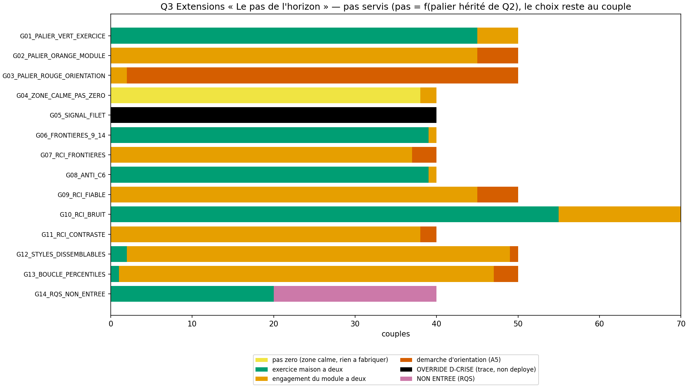
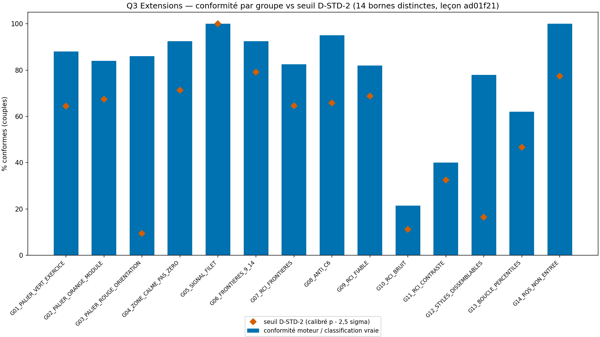
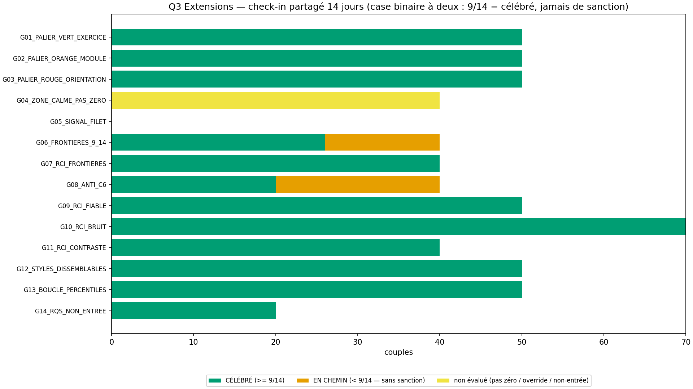
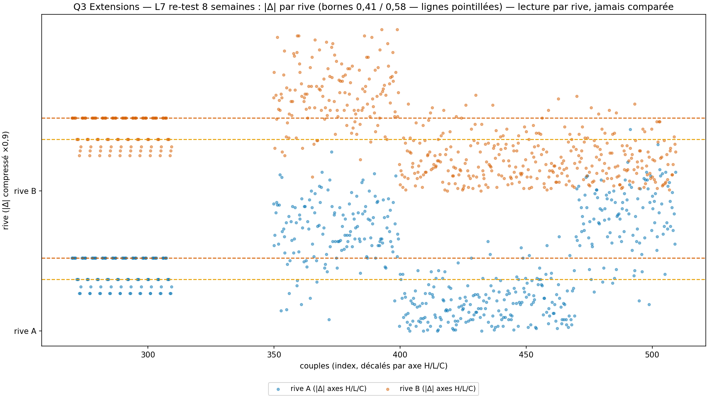

# Rapport WTC-EXT-Q3 — « Le pas de l'horizon » (RIO-18)

> AVERTISSEMENT D-SIM : résultats issus de simulations (seed 42) — la mécanique est validée, pas la prévalence clinique.
> D-CRISE : court-circuit AVANT le choix du pas — filet 9 signaux → P-FILTRE 3919/3114 (ligne 369). JAMAIS de pas de couple en crise (règle permanente du hub).

**Date** : 2026-10-18  
**Seed** : 42 (×2)  
**Package** : validation-ext/validation-ext-q3/  
**SPEC** : EXT-Q3-SPEC.md VERROUILLÉE (c68c78d — arbitrages A1-A6 tranchés par délégation fondateur, 18/10/2026).  
**Délégation fondateur** : « fais le toi meme » (18/10/2026) — tranchage ET cycle de production couverts (pattern Q2/Q5).  
Entrées = sorties RIO-17 contresignées (croisement, empreinte 2aea8d99… inchangée) + sorties RIO-16 contresignées des deux rives (empreinte 3583fe56… inchangée) — zéro item nouveau (A2-a).

---

## Section A — Les 7 critères

| Critère | Attendu | Obtenu | Verdict |
|---------|---------|--------|---------|
| **C1** D-VÉRITÉ : D-TABLE 28 cas + bien-formé 650/650 + 3 familles + pas zéro + nomenclature | tous TRUE + familles 3/3 | table=True (0 FALSE) · familles=3/3 · pas zéro=True · nom=True · anti-collision RIO-05/RIO-15/RIO-17=True | PASS |
| **C2** D-CONFIRMATION : pureté + 0 inversion temporelle + 0 inversion des rives | pur + 0 inversion | grille_pure=True · inv_temporelle=True · inv_rives=True · n_rci=200 | PASS |
| **C3** D-STD-2 : 14 seuils DISTINCTES + frontières 9/14 exactes + \|Δ\| pile 0,58/0,41 + BRUIT | 14/14 + 40/40 | n_ok=14/14 · distinctes=True · 9/14=40/40 · pile 0,58=120 · pile 0,41=60 · BRUIT=60 | PASS |
| **C4** SHA ×2 (D-EMPREINTE) | identiques | sha1=2e31e14d6e1d8815… sha2=2e31e14d6e1d8815… match=True | PASS |
| **C5** Affichage : templates + banque servie + D-SIM + récap A6 + littéraux | 6/6 | templates=True · banque=True (7 pas servis) · récap=True · figures=4 dims=True | PASS |
| **C6** Anti-fabrication à deux : 0 sanction / 0 verdict de réussite / pas zéro dit comme tel / 0 comparaison | 0 interdit | interdits=[] · zone calme=True · PERFECT=20/20 · ZERO=20/20 · 0 comparaison=True | PASS |
| **C7** D-CRISE + non-blâme + non-tiers + RQS | 40/40 + 0 | court-circuit=40/40 (Forte+filet=5/5) · zéro reproche=True · zéro tiers=True · non-entrée=20/20 · prudence entre=20/20 | PASS |

SHA-256 exécution 1 : `2e31e14d6e1d88159dab6feb2ac1ac6d5aeac7bd2e02dff902d5bfd1c6da6785`
SHA-256 exécution 2 : `2e31e14d6e1d88159dab6feb2ac1ac6d5aeac7bd2e02dff902d5bfd1c6da6785`

> Littéraux d'affichage cités (autoporteur contresignature) — pas zéro (§5.5) : « Pas zéro — zone calme : rien à fabriquer ici (§5.5). L'exercice maison reste disponible si vous le voulez. » · pile seuil (G06) : « 9 jours sur 14 — c'est célébré pile sur le seuil. Pas besoin de viser plus : le programme compte 9/14 comme un pas tenu. » · EN CHEMIN (jamais de sanction) : « 8 jours sur 14 — le pas est en chemin. Rien n'est perdu, rien n'est noté : le suivi continue, sans sanction. » · suivi partagé (A3) : « Case partagée : une coche par jour à deux — 9/14 = célébré, jamais de sanction (le bit commun n'expose jamais le contenu d'une rive, ligne 370). » · orientation (A5) : « Le pas est la démarche d'orientation : prendre le premier rendez-vous — le chemin le plus court, pas un échec. » · récapitulatif (A6) : « Récapitulatif descriptif de la dimension Générationnelle — carte (RIO-16) → croisement (RIO-17) → pas (RIO-18) : trois quêtes produites, lecture descriptive, 0 verdict de dimension. »

---

## Section B — Géométrie (D-GÉOMÉTRIE) + calibration D-STD-2

- σ_item = 0,60 (D-PARAM) · SEM L7 = √2⁻¹ × SE_diff = 0.2517 (constante L7, ligne 263) · σ_H de référence (0,60/√6) = 0.2449 — la CALIBRATION des seuils est EMPIRIQUE : p̂ estimé par Monte-Carlo déterministe (10000 couples/groupe, seed 42, items entiers clippés + arrondis + inversés corrigés — même processus générateur que le simulateur ; D-GÉOMÉTRIE : σ_eff = propagation structurale, jamais modification)
- Bornes de traversée — une mesure garde un seul rôle : axe H → bornes de croisement (2,50/3,50, héritées Q2) ; axes L/C → seuils L3 de la carte (1,80/2,60/3,20, verbatim RIO-16)
- Population percentiles HÉRITÉE de Q2 (2 000 profils, seed 42, N(3,0 ; 0,8) — génération déterministe identique, jamais recalculée — une mesure un rôle ; placeholder L2 à remplacer par le pilote)
- Interaction structurale (calibrée, pas corrigée) : l'inversion EXT-H2-3 au plafond (raw 4 → corrigé 1) tire l'axe H mesuré vers le bas pour les rives FORTE — les groupes concernés sont calibrés sur leur géométrie propre (patron Q2 publié : seuils 0,0 à 10,9 pour G03/G06-G09)

| Groupe | μ H rive A | μ H rive B | μ agg A | μ agg B | p̂ | seuil |
|--------|-----------|-----------|---------|---------|-----|-------|
| G01_PALIER_VERT_EXERCICE | 1.9 | 1.9 | 2.2 | 2.2 | 0.7896 | 64.5 |
| G02_PALIER_ORANGE_MODULE | 3.0 | 3.0 | 2.667 | 2.7 | 0.812 | 67.4 |
| G03_PALIER_ROUGE_ORIENTATION | 3.9 | 3.0 | 2.767 | 2.667 | 0.2459 | 9.4 |
| G04_ZONE_CALME_PAS_ZERO | 1.8 | 1.8 | 2.167 | 2.167 | 0.8531 | 71.3 |
| G05_SIGNAL_FILET | 2.4 | 2.4 | 2.4 | 2.4 | 1.0 | 100.0 |
| G06_FRONTIERES_9_14 | 1.7 | 1.7 | 2.1 | 2.1 | 0.9065 | 79.1 |
| G07_RCI_FRONTIERES | 2.95 | 2.95 | 2.883 | 2.883 | 0.8034 | 64.6 |
| G08_ANTI_C6 | 1.85 | 1.85 | 2.183 | 2.183 | 0.812 | 65.8 |
| G09_RCI_FIABLE | 3.0 | 3.1 | 2.667 | 2.733 | 0.8231 | 68.8 |
| G10_RCI_BRUIT | 2.0 | 2.1 | 2.2 | 2.267 | 0.2399 | 11.2 |
| G11_RCI_CONTRASTE | 3.0 | 3.1 | 2.667 | 2.733 | 0.5227 | 32.5 |
| G12_STYLES_DISSEMBLABLES | 1.8 | 3.0 | 1.867 | 3.2 | 0.3315 | 16.5 |
| G13_BOUCLE_PERCENTILES | 2.0 | 3.0 | 2.333 | 2.933 | 0.6372 | 46.7 |
| G14_RQS_NON_ENTREE | 1.9 | 1.9 | 2.2 | 2.2 | 0.8953 | 77.4 |

Bornes D-STD-2 distinctes : True (14) — calibrées (p̂_MC − 2,5σ̂, σ̂ binomial sur l'effectif réel du groupe), leçon ad01f21. G14 mélange 20 couples INVALIDE déterministes (RQS 35 fabriqué — non-entrée) et 20 couples PRUDENCE entrants (RQS 80 — la frontière RQS testée dans le groupe, ligne 257). G07 : Δ pile aux bornes (ε = 0, déterministe) ; G09-G11 : re-test = base + Δ + N(0, SEM L7).

---

## Section C — Stats par groupe

| Groupe | N | Conformes | Paliers (V/O/R/ov/NE) | CÉLÉBRÉ | EN CHEMIN | Non évalué | FIABLE | SUGGESTION | BRUIT | Traversées A+B | Boucle | Styles |
|--------|---|-----------|----------------------|---------|-----------|------------|--------|------------|-------|----------------|--------|--------|
| G01_PALIER_VERT_EXERCICE | 50 | 44 | 45/5/0/0/0 | 50 | 0 | 0 | 0 | 0 | 0 | 0+0 | 0 | 0 |
| G02_PALIER_ORANGE_MODULE | 50 | 42 | 0/45/5/0/0 | 50 | 0 | 0 | 0 | 0 | 0 | 0+0 | 0 | 0 |
| G03_PALIER_ROUGE_ORIENTATION | 50 | 43 | 0/2/48/0/0 | 50 | 0 | 0 | 0 | 0 | 0 | 0+0 | 0 | 0 |
| G04_ZONE_CALME_PAS_ZERO | 40 | 37 | 38/2/0/0/0 | 0 | 0 | 40 | 0 | 0 | 0 | 0+0 | 0 | 0 |
| G05_SIGNAL_FILET | 40 | 40 | 0/0/0/40/0 | 0 | 0 | 0 | 0 | 0 | 0 | 0+0 | 0 | 0 |
| G06_FRONTIERES_9_14 | 40 | 37 | 39/1/0/0/0 | 26 | 14 | 0 | 0 | 0 | 0 | 0+0 | 0 | 0 |
| G07_RCI_FRONTIERES | 40 | 33 | 0/37/3/0/0 | 40 | 0 | 0 | 40 | 20 | 20 | 74+66 | 0 | 0 |
| G08_ANTI_C6 | 40 | 38 | 39/1/0/0/0 | 20 | 20 | 0 | 0 | 0 | 0 | 0+0 | 0 | 0 |
| G09_RCI_FIABLE | 50 | 41 | 0/45/5/0/0 | 50 | 0 | 0 | 100 | 0 | 0 | 132+133 | 0 | 0 |
| G10_RCI_BRUIT | 70 | 15 | 55/15/0/0/0 | 70 | 0 | 0 | 18 | 43 | 79 | 41+59 | 0 | 0 |
| G11_RCI_CONTRASTE | 40 | 16 | 0/38/2/0/0 | 40 | 0 | 0 | 46 | 14 | 20 | 107+46 | 0 | 0 |
| G12_STYLES_DISSEMBLABLES | 50 | 39 | 2/47/1/0/0 | 50 | 0 | 0 | 0 | 0 | 0 | 0+0 | 50 | 47 |
| G13_BOUCLE_PERCENTILES | 50 | 31 | 1/46/3/0/0 | 50 | 0 | 0 | 0 | 0 | 0 | 0+0 | 15 | 0 |
| G14_RQS_NON_ENTREE | 40 | 40 | 20/0/0/0/20 | 20 | 0 | 0 | 0 | 0 | 0 | 0+0 | 0 | 0 |

Globaux : {'pas_servis': {"À deux : préparer la conversation de l'horizon — chacun relit sa propre carte (RIO-16) et choisit une chose à dire": 73, 'À deux : ouvrir le plan des jours durs (Les Deux Rives, ligne 133) à la lumière des horloges': 61, 'À deux : un tour des marées normatives (Les Marées de la durée, esquisse, ligne 111) — où en sommes-nous, chacun son tour': 67, "À deux : engager le module « L'Écart des horloges » (ligne 112) — première séance": 158, "À deux : reprendre la conversation de l'horizon appuyée sur la configuration tracée (RIO-17)": 126, "Le pas est la démarche d'orientation : prendre le premier rendez-vous — le chemin le plus court, pas un échec": 67, 'pas zéro — zone calme': 38}, 'statuts': {'CÉLÉBRÉ': 516, 'EN CHEMIN': 34, 'NON_ÉVALUÉ': 40}, 'paliers': {'EXERCICE MAISON': 239, 'MODULE DE COUPLE': 284, 'ORIENTATION': 67, 'OVERRIDE': 40, 'NON ENTRÉE': 20}, 'ensembles': {'UN CHANGEMENT FIABLE': 204, 'UNE PISTE À CONFIRMER': 77, 'DANS LE BRUIT DE LA MESURE': 119, 'N/A': 0}, 'traversees': 658, 'boucles': 65, 'styles': 47}

---

## Section D — Couples tracés

### G01_PALIER_VERT_EXERCICE_000

- **Rive A** : RQS 100/100 (OK) · score H 1.6667 · L 2.3333 · C 2.3333 · filet=False
- **Rive B** : RQS 100/100 (OK) · score H 1.8333 · L 2.8333 · C 2.0 · filet=False
- **Croisement hérité (Q2)** : config #1 LA MÊME HEURE · palier hérité : EXERCICE MAISON · zone calme : True
- **Display** : LA MÊME HEURE · pas : « À deux : préparer la conversation de l'horizon — chacun relit sa propre carte (RIO-16) et choisit une chose à dire » · statut : CÉLÉBRÉ
- **Suivi 14j (check-in partagé)** : 13/14
- **Vrai** : {'type': 'entree', 'config_num': 1, 'palier': 'EXERCICE MAISON', 'pas': "À deux : préparer la conversation de l'horizon — chacun relit sa propre carte (RIO-16) et choisit une chose à dire", 'statut': 'CÉLÉBRÉ', 'heritages': {'boucle': False, 'styles': False, 'asym_L': False, 'asym_C': False}, 'rci': None}

### G03_PALIER_ROUGE_ORIENTATION_000

- **Rive A** : RQS 100/100 (OK) · score H 3.8333 · L 2.1667 · C 2.3333 · filet=False
- **Rive B** : RQS 100/100 (OK) · score H 3.0 · L 2.1667 · C 2.0 · filet=False
- **Croisement hérité (Q2)** : config #8 L'AUTRE QUI DEVANCE · palier hérité : ORIENTATION · zone calme : False
- **Display** : L'AUTRE QUI DEVANCE · pas : « Le pas est la démarche d'orientation : prendre le premier rendez-vous — le chemin le plus court, pas un échec » · statut : CÉLÉBRÉ
- **Suivi 14j (check-in partagé)** : 11/14
- **Vrai** : {'type': 'entree', 'config_num': 8, 'palier': 'ORIENTATION', 'pas': "Le pas est la démarche d'orientation : prendre le premier rendez-vous — le chemin le plus court, pas un échec", 'statut': 'CÉLÉBRÉ', 'heritages': {'boucle': False, 'styles': False, 'asym_L': False, 'asym_C': False}, 'rci': None}

### G04_ZONE_CALME_PAS_ZERO_000

- **Rive A** : RQS 100/100 (OK) · score H 1.8333 · L 2.0 · C 2.0 · filet=False
- **Rive B** : RQS 100/100 (OK) · score H 1.8333 · L 2.1667 · C 2.5 · filet=False
- **Croisement hérité (Q2)** : config #1 LA MÊME HEURE · palier hérité : EXERCICE MAISON · zone calme : True
- **Display** : ZONE CALME · pas : « pas zéro — zone calme » · statut : non évalué
- **Suivi 14j (check-in partagé)** : aucun (pas zéro / override / non-entrée — rien à évaluer)
- **Vrai** : {'type': 'entree', 'config_num': 1, 'palier': 'EXERCICE MAISON', 'pas': 'pas zéro — zone calme', 'statut': None, 'heritages': {'boucle': False, 'styles': False, 'asym_L': False, 'asym_C': False}, 'rci': None}

### G05_SIGNAL_FILET_000

- **Rive A** : RQS 100/100 (OK) · score H 2.3333 · L 2.5 · C 2.1667 · filet=True
- **Rive B** : RQS 100/100 (OK) · score H 2.3333 · L 2.6667 · C 2.5 · filet=False
- **Croisement hérité (Q2)** : config #1 LA MÊME HEURE · palier hérité : EXERCICE MAISON · zone calme : True
- **Display** : OVERRIDE D-CRISE · pas : aucun (court-circuit / non-entrée) · statut : non évalué
- **Suivi 14j (check-in partagé)** : aucun (pas zéro / override / non-entrée — rien à évaluer)
- **Bandeau** : D-CRISE : court-circuit AVANT le choix du pas — P-FILTRE, jamais de pas de couple en crise (configuration calculée et tracée).
- **Vrai** : {'type': 'override'}

### G06_FRONTIERES_9_14_001

- **Rive A** : RQS 100/100 (OK) · score H 1.5 · L 2.1667 · C 2.3333 · filet=False
- **Rive B** : RQS 100/100 (OK) · score H 2.0 · L 2.3333 · C 2.5 · filet=False
- **Croisement hérité (Q2)** : config #1 LA MÊME HEURE · palier hérité : EXERCICE MAISON · zone calme : True
- **Display** : LA MÊME HEURE · pas : « À deux : ouvrir le plan des jours durs (Les Deux Rives, ligne 133) à la lumière des horloges » · statut : CÉLÉBRÉ
- **Suivi 14j (check-in partagé)** : 9/14
- **Vrai** : {'type': 'entree', 'config_num': 1, 'palier': 'EXERCICE MAISON', 'pas': 'À deux : ouvrir le plan des jours durs (Les Deux Rives, ligne 133) à la lumière des horloges', 'statut': 'CÉLÉBRÉ', 'heritages': {'boucle': False, 'styles': False, 'asym_L': False, 'asym_C': False}, 'rci': None}

### G07_RCI_FRONTIERES_000

- **Rive A** : RQS 100/100 (OK) · score H 3.0 · L 3.1667 · C 2.6667 · filet=False
- **Rive B** : RQS 100/100 (OK) · score H 3.0 · L 3.5 · C 2.6667 · filet=False
- **Croisement hérité (Q2)** : config #5 DEUX CADRANS · palier hérité : MODULE DE COUPLE · zone calme : False
- **Display** : DEUX CADRANS · pas : « À deux : engager le module « L'Écart des horloges » (ligne 112) — première séance » · statut : CÉLÉBRÉ
- **Suivi 14j (check-in partagé)** : 12/14
- **L7 rive_a** : Δ H -0.58 (FIABLE) · Δ L -0.58 (FIABLE) · Δ C -0.58 (FIABLE) → ensemble de rive : **UN CHANGEMENT FIABLE** · traversées : ['H', 'L', 'C']
- **L7 rive_b** : Δ H 0.58 (FIABLE) · Δ L 0.58 (FIABLE) · Δ C -0.58 (FIABLE) → ensemble de rive : **UN CHANGEMENT FIABLE** · traversées : ['H', 'C']
- **Vrai** : {'type': 'entree', 'config_num': 5, 'palier': 'MODULE DE COUPLE', 'pas': "À deux : engager le module « L'Écart des horloges » (ligne 112) — première séance", 'statut': 'CÉLÉBRÉ', 'heritages': {'boucle': False, 'styles': False, 'asym_L': False, 'asym_C': False}, 'rci': {'rive_a': 'UN CHANGEMENT FIABLE', 'rive_b': 'UN CHANGEMENT FIABLE'}}

### G08_ANTI_C6_000

- **Rive A** : RQS 100/100 (OK) · score H 2.1667 · L 2.8333 · C 2.5 · filet=False
- **Rive B** : RQS 100/100 (OK) · score H 2.0 · L 3.0 · C 2.0 · filet=False
- **Croisement hérité (Q2)** : config #1 LA MÊME HEURE · palier hérité : EXERCICE MAISON · zone calme : True
- **Display** : LA MÊME HEURE · pas : « À deux : préparer la conversation de l'horizon — chacun relit sa propre carte (RIO-16) et choisit une chose à dire » · statut : CÉLÉBRÉ
- **Suivi 14j (check-in partagé)** : 14/14
- **Vrai** : {'type': 'entree', 'config_num': 1, 'palier': 'EXERCICE MAISON', 'pas': "À deux : préparer la conversation de l'horizon — chacun relit sa propre carte (RIO-16) et choisit une chose à dire", 'statut': 'CÉLÉBRÉ', 'heritages': {'boucle': False, 'styles': False, 'asym_L': False, 'asym_C': False}, 'rci': None}

### G08_ANTI_C6_025

- **Rive A** : RQS 100/100 (OK) · score H 2.1667 · L 2.8333 · C 2.5 · filet=False
- **Rive B** : RQS 100/100 (OK) · score H 1.8333 · L 2.5 · C 2.0 · filet=False
- **Croisement hérité (Q2)** : config #1 LA MÊME HEURE · palier hérité : EXERCICE MAISON · zone calme : True
- **Display** : LA MÊME HEURE · pas : « À deux : ouvrir le plan des jours durs (Les Deux Rives, ligne 133) à la lumière des horloges » · statut : EN CHEMIN
- **Suivi 14j (check-in partagé)** : 0/14
- **Vrai** : {'type': 'entree', 'config_num': 1, 'palier': 'EXERCICE MAISON', 'pas': 'À deux : ouvrir le plan des jours durs (Les Deux Rives, ligne 133) à la lumière des horloges', 'statut': 'EN CHEMIN', 'heritages': {'boucle': False, 'styles': False, 'asym_L': False, 'asym_C': False}, 'rci': None}

### G10_RCI_BRUIT_000

- **Rive A** : RQS 100/100 (OK) · score H 2.3333 · L 2.1667 · C 1.8333 · filet=False
- **Rive B** : RQS 100/100 (OK) · score H 2.5 · L 2.3333 · C 2.0 · filet=False
- **Croisement hérité (Q2)** : config #2 LE CADRAN QUI S'ÉVEILLE · palier hérité : MODULE DE COUPLE · zone calme : False
- **Display** : LE CADRAN QUI S'ÉVEILLE · pas : « À deux : engager le module « L'Écart des horloges » (ligne 112) — première séance » · statut : CÉLÉBRÉ
- **Suivi 14j (check-in partagé)** : 11/14
- **L7 rive_a** : Δ H 0.04 (BRUIT) · Δ L -0.45 (SUGGESTION) · Δ C -0.41 (BRUIT) → ensemble de rive : **UNE PISTE À CONFIRMER** · traversées : ['L', 'C']
- **L7 rive_b** : Δ H 0.21 (BRUIT) · Δ L -0.05 (BRUIT) · Δ C -0.16 (BRUIT) → ensemble de rive : **DANS LE BRUIT DE LA MESURE** · traversées : —
- **Vrai** : {'type': 'entree', 'config_num': 1, 'palier': 'EXERCICE MAISON', 'pas': "À deux : préparer la conversation de l'horizon — chacun relit sa propre carte (RIO-16) et choisit une chose à dire", 'statut': 'CÉLÉBRÉ', 'heritages': {'boucle': False, 'styles': False, 'asym_L': False, 'asym_C': False}, 'rci': {'rive_a': 'DANS LE BRUIT DE LA MESURE', 'rive_b': 'DANS LE BRUIT DE LA MESURE'}}

### G11_RCI_CONTRASTE_000

- **Rive A** : RQS 100/100 (OK) · score H 3.3333 · L 2.6667 · C 2.8333 · filet=False
- **Rive B** : RQS 100/100 (OK) · score H 2.8333 · L 2.1667 · C 2.6667 · filet=False
- **Croisement hérité (Q2)** : config #5 DEUX CADRANS · palier hérité : MODULE DE COUPLE · zone calme : False
- **Display** : DEUX CADRANS · pas : « À deux : engager le module « L'Écart des horloges » (ligne 112) — première séance » · statut : CÉLÉBRÉ
- **Suivi 14j (check-in partagé)** : 13/14
- **L7 rive_a** : Δ H -0.75 (FIABLE) · Δ L -1.13 (FIABLE) · Δ C -0.72 (FIABLE) → ensemble de rive : **UN CHANGEMENT FIABLE** · traversées : ['L', 'C']
- **L7 rive_b** : Δ H -0.33 (BRUIT) · Δ L -0.75 (FIABLE) · Δ C 0.18 (BRUIT) → ensemble de rive : **UN CHANGEMENT FIABLE** · traversées : ['L']
- **Vrai** : {'type': 'entree', 'config_num': 5, 'palier': 'MODULE DE COUPLE', 'pas': "À deux : engager le module « L'Écart des horloges » (ligne 112) — première séance", 'statut': 'CÉLÉBRÉ', 'heritages': {'boucle': False, 'styles': False, 'asym_L': False, 'asym_C': False}, 'rci': {'rive_a': 'UN CHANGEMENT FIABLE', 'rive_b': 'DANS LE BRUIT DE LA MESURE'}}

### G14_RQS_NON_ENTREE_000

- **Rive A** : RQS 55/100 (INVALIDE) · score H 2.1667 · L 2.1667 · C 2.6667 · filet=False
- **Rive B** : RQS 100/100 (OK) · score H 3.3333 · L 2.6667 · C 2.6667 · filet=False
- **Croisement hérité (Q2)** : config #2 LE CADRAN QUI S'ÉVEILLE · palier hérité : MODULE DE COUPLE · zone calme : False
- **Display** : NON ENTRÉE (RQS) · pas : aucun (court-circuit / non-entrée) · statut : non évalué
- **Suivi 14j (check-in partagé)** : aucun (pas zéro / override / non-entrée — rien à évaluer)
- **Bandeau** : RQS < 70 chez une rive — le couple n'entre pas au pas (ligne 257) ; aucun résultat de couple.
- **Vrai** : {'type': 'non_entree'}

### G14_RQS_NON_ENTREE_025

- **Rive A** : RQS 80/100 (PRUDENCE) · score H 1.3333 · L 2.3333 · C 2.1667 · filet=False
- **Rive B** : RQS 100/100 (OK) · score H 2.0 · L 2.8333 · C 2.1667 · filet=False
- **Croisement hérité (Q2)** : config #1 LA MÊME HEURE · palier hérité : EXERCICE MAISON · zone calme : True
- **Display** : LA MÊME HEURE · pas : « À deux : ouvrir le plan des jours durs (Les Deux Rives, ligne 133) à la lumière des horloges » · statut : CÉLÉBRÉ
- **Suivi 14j (check-in partagé)** : 10/14
- **Vrai** : {'type': 'entree', 'config_num': 1, 'palier': 'EXERCICE MAISON', 'pas': 'À deux : ouvrir le plan des jours durs (Les Deux Rives, ligne 133) à la lumière des horloges', 'statut': 'CÉLÉBRÉ', 'heritages': {'boucle': False, 'styles': False, 'asym_L': False, 'asym_C': False}, 'rci': None}

---

## Section E — Analyse

- **Total** : 650 couples · 14 groupes — réconciliation OK · 40 overrides D-CRIse · 20 non entrés (RQS)
- **Le pas** : 7 libellés servis — pas zéro 38 (zone calme, affiché comme tel) · exercice maison à deux 201 · module à deux 284 · démarche d'orientation 67 (A5 : le pas EST la démarche)
- **Suivi 14 j** : 516 CÉLÉBRÉ · 34 EN CHEMIN (sans sanction) · 40 non évalués (pas zéro — rien à évaluer)
- **L7 (re-test 8 semaines)** : ensembles PAR RIVE — 204 UN CHANGEMENT FIABLE · 77 UNE PISTE À CONFIRMER · 119 DANS LE BRUIT DE LA MESURE · 658 traversées de seuil (signification clinique L7) — affichage descriptif par rive, jamais comparé (C7)
- **D-CONFIRMATION** : grille pure 650/650 · anti-inversion temporelle : Δ signé inversé exactement sur 200 couples re-testés (swap base/re-test) · anti-inversion des rives : labels L7 suivent leur rive échangée
- **D-STD-2** : 14/14 groupes à leur seuil (14 seuils distincts) · conformité < 100 % STRUCTURELLE sur les groupes à bruit (items + SEM L7 + héritages Q2), encadrée par les seuils calibrés · frontières 9/14 exactes 40/40 (totaux 8/9/10 pile) · |Δ| pile : 120 lectures à 0,58 · 60 à 0,41 · 60 < 0,41 (G07, ε = 0)
- **D-CRISE** : 40/40 court-circuités AVANT le choix du pas (y compris 5 couples items Forte — override quand même) · 0 pas déployé sur crise active
- **Robustesse (bandes 3σ)** : les μ adjacents aux bornes (G07/G09/G11 à 2,95-3,1 ; G02 à 2,9/3,1) sont calibrés sur leur géométrie propre — la RÈGLE de tranchage inclusif est prouvée exactement en C1/D-TABLE (2,49/2,50/3,49/3,50)
- **Récapitulatif A6** : la sortie inclut le récapitulatif descriptif de dimension (carte RIO-16 → croisement RIO-17 → pas RIO-18) — 0 verdict de « dimension réussie » ; après contresignature de RIO-18 : Générationnelle 3/3 ; la 4e extension reste ouverte au fondateur (A1-Q1, divergence ligne 243 — signalée sans comblement par invention)

---

## Section F — Sources, périmètre, règles

### Ancrages internes (mot pour mot)

| Ancrage | `programme wairyu couple.txt` | Statut |
|---------|-------------------------------|--------|
| Q5 = le pas (position 3e extension) | lignes 224-225 — « Q5 Le pas (1 changement + suivi 14 jours). Extensions : 3 quêtes » (position carte → croisement → pas, A2-Q1) | SOURCE INTERNE VÉRIFIÉE |
| Tracking 14 j, anti-perfectionnisme | lignes 297-298 — « Q5 (tracking 14 jours, seuils anti-perfectionnisme : 9/14 = célébré, jamais de sanction) » | SOURCE INTERNE VÉRIFIÉE |
| Tracking d'engagement | ligne 429 — « WTC-Q5 (tracking d'engagement) » | SOURCE INTERNE VÉRIFIÉE |
| RCI longitudinal | ligne 263 (L7) — « RCI longitudinal (Jacobson & Truax) : SE_diff = √2 × SEM ≈ 0,356 · \|Δ\| ≥ 0,58 = FIABLE · 0,41-0,58 = SUGGESTION · < 0,41 = BRUIT · + signification clinique si seuil traversé » | SOURCE INTERNE VÉRIFIÉE |
| Re-test 8 semaines | ligne 274 — « re-test programmé à 8 semaines » | SOURCE INTERNE VÉRIFIÉE |
| L8 assemblage | ligne 264 — « palier/pas » (7e bloc) : le pas est la lecture du palier, pas une décision nouvelle | SOURCE INTERNE VÉRIFIÉE |
| 3 paliers | §5.4 lignes 227-231 — « 🟢 Seul(e) (ombre légère → exercice maison) · 🟠 À deux (moyenne → module de couple) · 🔴 Professionnel (élevée/signal → orientation chaleureuse, « le chemin le plus court, pas un échec ») » | SOURCE INTERNE VÉRIFIÉE |
| Anti-fabrication | §5.5 lignes 233-237 — zone calme = résultat affiché comme tel ; ligne 366 — l'utilisateur valide/conteste chaque proposition | SOURCE INTERNE VÉRIFIÉE |
| D-CRISE | hub — « Court-circuit de crise AVANT l'arbre — filet 3919/3114. JAMAIS de pas de couple en crise. » | SOURCE INTERNE VÉRIFIÉE |
| Non-évaluation | ligne 363 — « Jamais le partenaire, jamais les tiers (rôles, pas de noms) » · ligne 370 — rive non synchronisée | SOURCE INTERNE VÉRIFIÉE |

### Périmètre verrouillé (D-CANAL)

| Portion | INTERPRÉTÉ | SOURCE | VÉRIFIÉ PAR |
|--------|-----------|--------|-------------|
| Titre « Le pas de l'horizon » | Non (verrouillé A1) | délégation 18/10 — déclinaison dimensionnelle (patron RIO-15) | C1 anti-collision registres |
| Pas = f(palier hérité) + pas zéro zone calme | Non (verrouillé A2) | L8 ligne 264 « palier/pas » + §5.5 | C1 famille de pas + D-TABLE palier_jamais_rescale |
| Banque 6 pas (modules existants lignes 111/112/133) + pas zéro | Non (fixé A2) | anti-fabrication §5.5 — zéro invention | C5 banque servie + C6 pas_authentiques |
| Check-in binaire PARTAGÉ, 9/14 verbatim | Non (verrouillé A3) | lignes 297-298 + Partie 4 (nous déclaré) | C1 grille 15 + C6/C7 |
| Pas zéro → statut non évalué (rien à fabriquer) | Oui | lecture anti-fabrication §5.5 (un pas zéro n'a rien à suivre) | D-TABLE pas_zero_rien_a_evaluer |
| RCI par rive, 3 axes, ensemble = max DE RIVE | Oui | A4 (verrouillé) + convention d'affichage anti-surinterprétation L4 — l'ensemble ne traverse jamais les rives (C7) | C2/C3 |
| Bornes de traversée H 2,50/3,50 · L/C 1,80/2,60/3,20 | Oui | une mesure un rôle — H hérite du croisement Q2, L/C de la carte L3 (RIO-16) | D-TABLE traversées |
| Héritages Q2 (boucle/styles/asymétries) dans la surface de conformité | Oui | croisé D-VÉRITÉ patron Q2 — la surface teste tout ce qui est servi | C3 calibrée |
| Population percentiles héritée de Q2 | Non (fixé §6) | « jamais recalculée — une mesure un rôle » | génération déterministe identique (default_rng(42)) |
| Override D-CRISE | Non (fixé) | règle permanente hub · ligne 369 | C3/C7 40/40 |
| Seuils D-STD-2 (14 valeurs distinctes) | Oui | calibrés p̂_MC − 2,5σ̂ (patron Q2) | C3 |

### Leçons appliquées

- Bornes D-STD-2 DISTINCTES par groupe (leçon SM-Q5/ad01f21 — double comptage vérifié)
- C1 croisé sur cas de table, pas sur données bruitées (leçon Q5)
- Rapport autoporteur, Verdict fermé, balises de gras équilibrées (leçon E-SM-12)
- Figures sans émojis (glyphes DejaVu) · 0 chiffre sans source (chaîne de traçabilité §6.4)
- Séquencement C5/SHA : figures générées AVANT l'évaluation de C5 (leçon Q4)

### Périmètre

- Q3 = LE PAS à deux (lignes 224-225, position 3 par A2-Q1) — RIO-18 · après contresignature : Générationnelle 3/3
- A6 : récapitulatif descriptif de dimension inclus — la 4e extension du canon (ligne 243) reste à identifier par le fondateur (A1-Q1, divergence documentée, sans comblement par invention, D-CANAL-2)
- Extensions suivantes (au fondateur) : Morale/éthique — « L'Épreuve » (ligne 114) · Politique/idéologique — « Les Deux Drapeaux » (ligne 115)
- Le pas nourrit le module « L'Écart des horloges » (ligne 112) et les supports Les Deux Rives (ligne 133) sans les remplacer ; la conversation de l'horizon (RIO-17) reste l'entrée narrative naturelle du choix du pas
- Protocole lexical (R2 · P5) : RIO-18 = zéro item nouveau — rien à auditer ; couverture héritée des sorties RIO-16 (legal/D-audit-pi.md §10)

### Règles

D-VÉRITÉ · D-CONFIRMATION · D-STD-2 · D-EMPREINTE · D-SIM · D-CRISE · D-NOMENCLATURE · D-GÉOMÉTRIE · D-PARAM · D-TABLE · D-CANAL-2 · Exécuteur strict

**Fautes : 36** (dont 4 pré-attrapées) — inchangé.

---

## Section G — Verdict

### Verdict : **VALIDÉ**

### Note : **7/7**

> AVERTISSEMENT D-SIM : résultats issus de simulations (seed 42) — la mécanique est validée, pas la prévalence clinique.

### RIO-18

RIO-18 « Le pas de l'horizon » — publié, en audit (contresignature à la validation fondateur).

### Inventaire structurel

| Fichier | Fonctions |
|---------|-----------|
| wtc_ext_q3_core.py | famille_de, pas_zero_legitime, pas_de, statut_engagement_de, delta_de, statut_rci_de, statut_ensemble_de, niveau_H_de, niveau_L3_de, traverse_de, signification_de, rci_de, classifier, verifier_d_table, verifier_d_confirmation, percentile_de, _p_regime_mc, p_conformite_groupe, calibration_d_std_2 |
| wtc_ext_q3_simulator.py | corrige, calcule_rqs, sortie_rive, _rive, niveau_croisement, croisement_q2, _serie_groupe, _choix_groupe, _gen_couple, tous_les_couples, effectifs, classification_vraie, _re_tests_de, construire, verdicts, conforme, resume_groupes |
| wtc_ext_q3_validation.py | _sha, bien_forme, critere_c1, critere_c2, critere_c3, critere_c5, critere_c6, critere_c7, executer, generer_figures, generer_rapport, main |

- Instrument : ZÉRO item nouveau (A2-a) — le pas lit les sorties RIO-17 + RIO-16 contresignées
- Le pas : f(palier croisé hérité, JAMAIS recalculé) · 3 familles §5.4 + pas zéro zone calme (A2) · check-in binaire partagé 9/14 verbatim, jamais de sanction (A3) · en 🔴 ORIENTATION le pas EST la démarche (A5)
- L7 : re-test RIO-16 à 8 semaines — Δ par rive sur H/L/C, SE_diff ≈ 0,356, bornes 0,58/0,41, signification clinique par échelle propre (A4)
- D-CRISE : court-circuit AVANT le choix du pas — JAMAIS de pas de couple en crise (configuration tracée)
- A6 : récapitulatif descriptif de dimension (3 quêtes) — Générationnelle 3/3 à la contresignature
- Réconciliation : 650/650 (PASS)

