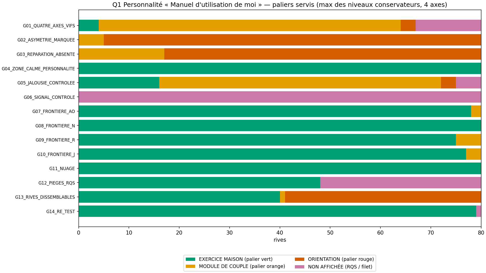
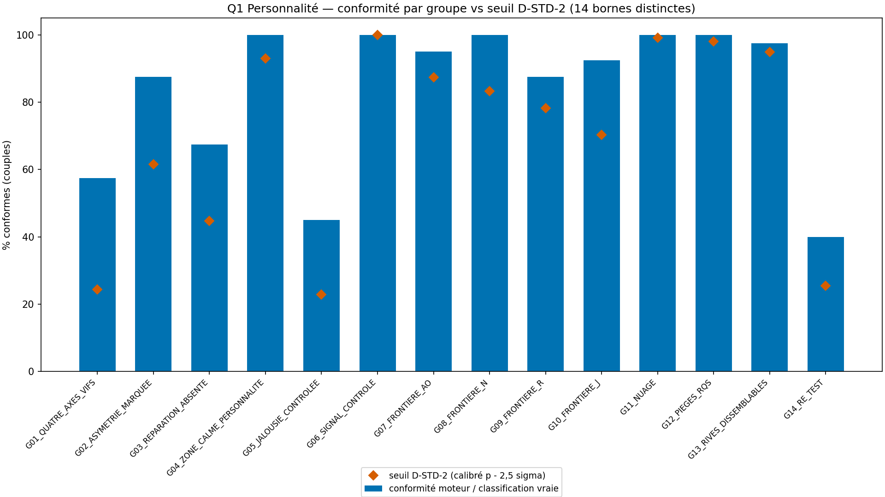
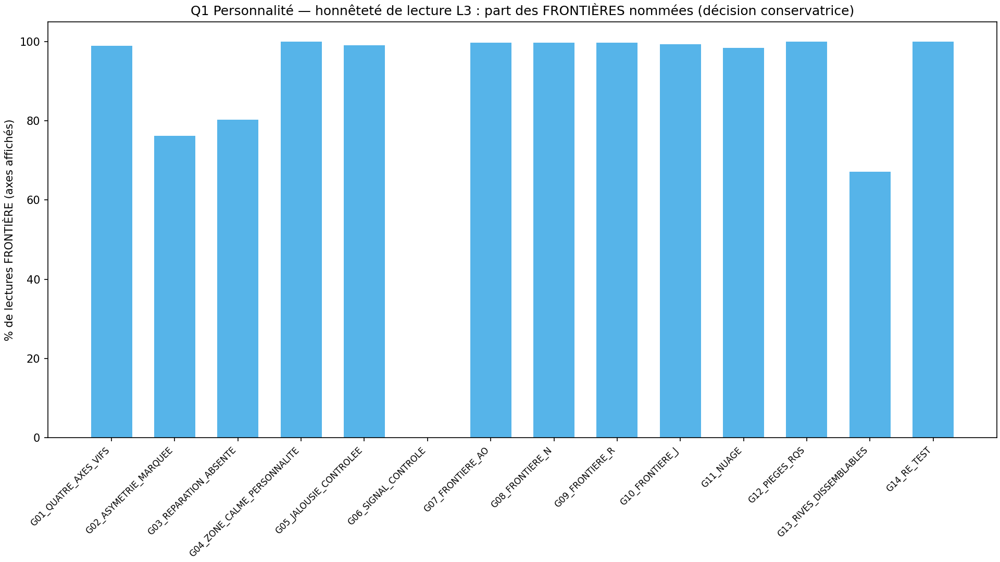
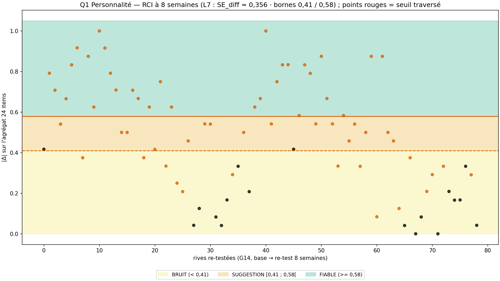

# Rapport WTC-PERS-Q1 — « Manuel d'utilisation de moi » (RIO-19)

> AVERTISSEMENT D-SIM : résultats issus de simulations (seed 42) — la mécanique est validée, pas la prévalence clinique.
> D-CRISE : court-circuit AVANT l'arbre — filet 9 signaux → P-FILTRE 3919/3114 (ligne 369) + voie détectée contrôle (SPEC §4). JAMAIS de carte affichée sur signal.

**Date** : 2026-10-19  
**Seed** : 42 (×2)  
**Package** : validation-pers/validation-pers-q1/  
**SPEC** : PERS-Q1-SPEC.md VERROUILLÉE (f4fa593 — arbitrages A1-A6 tranchés par délégation).  
**Délégation fondateur** : « je te laisse le choix de trancher » (20/10/2026) ; production couverte par l'accord préalable : « je verrouille, puis je lance la production validation-pers/ (séquence D-CANAL-2 complète → RIO-19) ».  
**Instrument** : 24 items (4 axes AO/N/R/J × 2 faces × 3 items), échelle 1-4, 2 inversés (PERS-N2-3, PERS-J2-3), 1 vigilance (PERS-VIG) — mapping 1:1 des 4 construits nommés ligne 98.

---

## Section A — Les 7 critères

| Critère | Attendu | Obtenu | Verdict |
|---------|---------|--------|---------|
| **C1** D-VÉRITÉ : D-TABLE 38 cas + bien-formé 560/560 + nomenclature | tous TRUE + 560/560 | table=True (0 FALSE) · nom=True | PASS |
| **C2** D-CONFIRMATION : déterminisme + anti-inversion | pur + 0 inversion | grille_pure=True · anti_inv=True · n_rci=40 | PASS |
| **C3** D-STD-2 : 14 seuils DISTINCTS + règle conservatrice + override filet | 14/14 + 100 % + 40/40 + 5/5 | n_ok=14/14 · distinctes=True · règle=3956/3956 · override=40/40 · détecté=5/5 | PASS |
| **C4** SHA ×2 (D-EMPREINTE) | identiques | sha1=3b1a74909e9d86e1… sha2=3b1a74909e9d86e1… match=True | PASS |
| **C5** Affichage : 19 templates + D-SIM + 4 figures | 19/19 + 4 | templates=True · figures=4 · dims=True | PASS |
| **C6** A5 triple verrou : 0 diagnostic / 0 étiquette / 0 mot canon clinique | 0 interdit | interdits=[] · nomenclature=True · zone calme honnête=True · réparation sans blâme=True | PASS |
| **C7** D-CRISE + non-évaluation | 40/40 (dont 5 détectés) + 0 tiers | circuit=40/40 · voie détectée=5/5 — items tous Forte → court-circuit quand même (avant l'arbre) · zéro tiers=True · avertissement=40/40 | PASS |

SHA-256 exécution 1 : `3b1a74909e9d86e178ad60bd1caa94f61f675532e6ffeaeff0539d24d5271e2c`
SHA-256 exécution 2 : `3b1a74909e9d86e178ad60bd1caa94f61f675532e6ffeaeff0539d24d5271e2c`

---

## Section B — Géométrie (D-GÉOMÉTRIE) + calibration D-STD-2

- Placeholders L2 (ligne 258, à remplacer par le pilote) : SD_pop 0.65 · alpha 0.85 → SEM 0.2517 · CI90 ± 0.4128 · SE_face 0.381 · seuil hiérarchie 0.8837
- Transitions conservatrices dérivées (seuil + CI90) : 3.0128 / 3.6128 · sigma_eff axe (0,60/√6) = 0.2449 (D-PARAM σ item 0,60)
- L7 (ligne 263 verbatim) : SE_diff = 0.356 · bornes 0.41 / 0.58
- Sécurité contrôle (voie détectée, SPEC §4) : filet ⟺ borne basse de la face « Le contrôle » ≥ 3.2 — règle L3 réutilisée, zéro constante nouvelle

| Groupe | μ axes rive A (AO/N/R/J) | μ axes rive B | dist. min seuil (σ) | dans bande 3σ | p̂ | seuil |
|--------|---------------|---------------|---------------------|----------------|-----|-------|
| G01_QUATRE_AXES_VIFS | [3.15, 3.2, 3.1, 3.15] | [3.15, 3.2, 3.1, 3.15] | 0.0 | True | 0.4399 | 24.4 |
| G02_ASYMETRIE_MARQUEE | [4.0, 2.2, 2.3, 1.9] | [4.0, 2.2, 2.3, 1.9] | 0.41 | True | 0.78 | 61.6 |
| G03_REPARATION_ABSENTE | [2.2, 2.4, 3.9, 2.2] | [2.2, 2.4, 3.9, 2.2] | 0.82 | True | 0.6376 | 44.8 |
| G04_ZONE_CALME_PERSONNALITE | [2.2, 2.3, 2.2, 2.4] | [2.2, 2.3, 2.2, 2.4] | 0.82 | True | 0.982 | 93.0 |
| G05_JALOUSIE_CONTROLEE | [2.1, 2.2, 2.2, 3.3] | [2.1, 2.2, 2.2, 3.3] | 0.41 | True | 0.4229 | 22.8 |
| G06_SIGNAL_CONTROLE | [2.4, 2.4, 2.4, 2.4] | [2.4, 2.4, 2.4, 2.4] | 0.82 | True | 1.0 | 100.0 |
| G07_FRONTIERE_AO | [2.55, 2.1, 2.0, 2.0] | [2.55, 2.1, 2.0, 2.0] | 0.2 | True | 0.9557 | 87.4 |
| G08_FRONTIERE_N | [2.0, 2.6, 2.1, 2.0] | [2.0, 2.6, 2.1, 2.0] | 0.0 | True | 0.9324 | 83.3 |
| G09_FRONTIERE_R | [2.0, 2.1, 2.65, 2.1] | [2.0, 2.1, 2.65, 2.1] | 0.2 | True | 0.9005 | 78.2 |
| G10_FRONTIERE_J | [2.0, 2.2, 2.0, 2.7] | [2.0, 2.2, 2.0, 2.7] | 0.41 | True | 0.8455 | 70.3 |
| G11_NUAGE | [2.0, 2.1, 2.0, 2.0] | [2.0, 2.1, 2.0, 2.0] | 0.82 | True | 0.9996 | 99.2 |
| G12_PIEGES_RQS | [2.4, 2.4, 2.4, 2.4] | [2.4, 2.4, 2.4, 2.4] | 0.82 | True | 0.998 | 98.0 |
| G13_RIVES_DISSEMBLABLES | [2.0, 2.0, 2.0, 2.0] | [3.9, 3.9, 3.9, 3.2] | 0.0 | True | 0.9893 | 94.9 |
| G14_RE_TEST | [2.4, 2.4, 2.4, 2.4] | [2.4, 2.4, 2.4, 2.4] | 0.82 | True | 0.4519 | 25.5 |

Bornes D-STD-2 distinctes : True — calibrées (p̂ − 2,5σ̂) sur une loi EXACTE par énumération des items tronqués (raffinement documenté du modèle normal EXT-Q1 : les faces au plafond 4,0 ne sont pas normales). Les groupes « dans bande » (FRONTIÈRE par design, μ pile sur un seuil L3) sont calibrés sur leur géométrie propre ; la RÈGLE conservatrice est vérifiée à 100 % séparément (C3).

---

## Section C — Stats par groupe

| Groupe | N | Conformes | Paliers (V/O/R/NA) | RQS (OK/P/I) | Lectures (NIV/FRONT) | Faces (NUAGE/HIER) | Filets | RCI (F/S/B/NA) |
|--------|---|-----------|--------------------|--------------|----------------------|---------------------|--------|----------------|
| G01_QUATRE_AXES_VIFS | 40 | 23 | 4/60/3/13 | 78/2/0 | 3/265 | 248/20 | 13 | 0/0/0/80 |
| G02_ASYMETRIE_MARQUEE | 40 | 35 | 0/5/75/0 | 78/2/0 | 76/244 | 299/21 | 0 | 0/0/0/80 |
| G03_REPARATION_ABSENTE | 40 | 27 | 0/17/63/0 | 79/1/0 | 63/257 | 292/28 | 0 | 0/0/0/80 |
| G04_ZONE_CALME_PERSONNALITE | 40 | 40 | 80/0/0/0 | 80/0/0 | 0/320 | 280/40 | 0 | 0/0/0/80 |
| G05_JALOUSIE_CONTROLEE | 40 | 18 | 16/56/3/5 | 79/1/0 | 3/297 | 252/48 | 5 | 0/0/0/80 |
| G06_SIGNAL_CONTROLE | 40 | 40 | 0/0/0/80 | 68/12/0 | 0/0 | 0/0 | 80 | 0/0/0/80 |
| G07_FRONTIERE_AO | 40 | 38 | 78/2/0/0 | 79/1/0 | 1/319 | 286/34 | 0 | 0/0/0/80 |
| G08_FRONTIERE_N | 40 | 40 | 80/0/0/0 | 79/1/0 | 1/319 | 276/44 | 0 | 0/0/0/80 |
| G09_FRONTIERE_R | 40 | 35 | 75/5/0/0 | 79/1/0 | 1/319 | 271/49 | 0 | 0/0/0/80 |
| G10_FRONTIERE_J | 40 | 37 | 77/3/0/0 | 80/0/0 | 2/318 | 282/38 | 0 | 0/0/0/80 |
| G11_NUAGE | 40 | 40 | 80/0/0/0 | 80/0/0 | 5/315 | 270/50 | 0 | 0/0/0/80 |
| G12_PIEGES_RQS | 40 | 40 | 48/0/0/32 | 0/48/32 | 0/192 | 188/4 | 0 | 0/0/0/80 |
| G13_RIVES_DISSEMBLABLES | 40 | 39 | 40/1/39/0 | 79/1/0 | 105/215 | 271/49 | 0 | 0/0/0/80 |
| G14_RE_TEST | 40 | 16 | 79/0/0/1 | 80/0/0 | 0/316 | 271/45 | 1 | 30/18/31/1 |

Paliers globaux (rives) : {'EXERCICE MAISON': 657, 'MODULE DE COUPLE': 149, 'ORIENTATION': 183, 'NON_AFFICHÉE': 131}
RCI globaux : {'verdicts': {'FIABLE': 30, 'SUGGESTION': 18, 'BRUIT': 31, 'N/A': 1041}, 'traversees': 61, 'se_diff': 0.356, 'seuil_fiable': 0.58, 'seuil_suggestion': 0.41}

---

## Section D — Couples tracés

### G03_REPARATION_ABSENTE_000

- **Rive A** : RQS 100/100 (OK) · niveaux : AO=entre DISCRÈTE et TRANQUILLE (FRONTIÈRE, conservateur DISCRÈTE) · N=entre DISCRÈTE et TRANQUILLE (FRONTIÈRE, conservateur DISCRÈTE) · R=FORTE (NIVEAU, conservateur FORTE) · J=entre TRANQUILLE et VIVE (FRONTIÈRE, conservateur TRANQUILLE) · palier : ORIENTATION
- **Rive B** : RQS 100/100 (OK) · niveaux : AO=entre TRANQUILLE et VIVE (FRONTIÈRE, conservateur TRANQUILLE) · N=entre TRANQUILLE et VIVE (FRONTIÈRE, conservateur TRANQUILLE) · R=FORTE (NIVEAU, conservateur FORTE) · J=entre TRANQUILLE et VIVE (FRONTIÈRE, conservateur TRANQUILLE) · palier : ORIENTATION
- **Avertissement styles** : False
- **Vrai** : paliers ORIENTATION/ORIENTATION · filets False/False · avert False

### G05_JALOUSIE_CONTROLEE_000

- **Rive A** : RQS 100/100 (OK) · niveaux : AO=entre DISCRÈTE et TRANQUILLE (FRONTIÈRE, conservateur DISCRÈTE) · N=entre DISCRÈTE et TRANQUILLE (FRONTIÈRE, conservateur DISCRÈTE) · R=entre TRANQUILLE et VIVE (FRONTIÈRE, conservateur TRANQUILLE) · J=entre VIVE et FORTE (FRONTIÈRE, conservateur VIVE) · palier : MODULE DE COUPLE
- **Rive B** : RQS 100/100 (OK) · FILET : contrôle détecté (Le contrôle 4.0 — borne basse 3.59 ≥ 3.2) → 3919 / 3114 — P-FILTRE · carte NON affichée
- **Avertissement styles** : None
- **Vrai** : paliers MODULE DE COUPLE/MODULE DE COUPLE · filets False/False · avert False

### G06_SIGNAL_CONTROLE_036

- **Rive A** : RQS 80/100 (PRUDENCE) · FILET : contrôle détecté (Le contrôle 4.0 — borne basse 3.59 ≥ 3.2) → 3919 / 3114 — P-FILTRE · carte NON affichée
- **Rive B** : RQS 80/100 (PRUDENCE) · FILET : contrôle détecté (Le contrôle 4.0 — borne basse 3.59 ≥ 3.2) → 3919 / 3114 — P-FILTRE · carte NON affichée
- **Avertissement styles** : None
- **Vrai** : paliers ORIENTATION/ORIENTATION · filets True/True · avert False

### G12_PIEGES_RQS_010

- **Rive A** : RQS 80/100 (PRUDENCE) · niveaux : AO=entre TRANQUILLE et VIVE (FRONTIÈRE, conservateur TRANQUILLE) · N=entre DISCRÈTE et TRANQUILLE (FRONTIÈRE, conservateur DISCRÈTE) · R=entre TRANQUILLE et VIVE (FRONTIÈRE, conservateur TRANQUILLE) · J=entre TRANQUILLE et VIVE (FRONTIÈRE, conservateur TRANQUILLE) · palier : EXERCICE MAISON
- **Rive B** : RQS 80/100 (PRUDENCE) · niveaux : AO=entre DISCRÈTE et TRANQUILLE (FRONTIÈRE, conservateur DISCRÈTE) · N=entre DISCRÈTE et TRANQUILLE (FRONTIÈRE, conservateur DISCRÈTE) · R=entre DISCRÈTE et TRANQUILLE (FRONTIÈRE, conservateur DISCRÈTE) · J=entre TRANQUILLE et FORTE (FRONTIÈRE, conservateur TRANQUILLE) · palier : EXERCICE MAISON
- **Avertissement styles** : False
- **Vrai** : paliers EXERCICE MAISON/EXERCICE MAISON · filets False/False · avert False

### G14_RE_TEST_000

- **Rive A** : RQS 100/100 (OK) · niveaux : AO=entre TRANQUILLE et FORTE (FRONTIÈRE, conservateur TRANQUILLE) · N=entre TRANQUILLE et VIVE (FRONTIÈRE, conservateur TRANQUILLE) · R=entre TRANQUILLE et FORTE (FRONTIÈRE, conservateur TRANQUILLE) · J=entre TRANQUILLE et VIVE (FRONTIÈRE, conservateur TRANQUILLE) · palier : EXERCICE MAISON · RCI : SUGGESTION (Δ=0.417, traversée=False)
- **Rive B** : RQS 100/100 (OK) · niveaux : AO=entre TRANQUILLE et VIVE (FRONTIÈRE, conservateur TRANQUILLE) · N=entre DISCRÈTE et TRANQUILLE (FRONTIÈRE, conservateur DISCRÈTE) · R=entre TRANQUILLE et VIVE (FRONTIÈRE, conservateur TRANQUILLE) · J=entre DISCRÈTE et TRANQUILLE (FRONTIÈRE, conservateur DISCRÈTE) · palier : EXERCICE MAISON · RCI : FIABLE (Δ=1.0, traversée=True)
- **Avertissement styles** : False
- **Vrai** : paliers EXERCICE MAISON/EXERCICE MAISON · filets False/False · avert False

---

## Section E — Analyse

- **Total** : 560 couples · 1120 rives · 14 groupes — réconciliation OK
- **Paliers** : 657 EXERCICE MAISON · 149 MODULE DE COUPLE · 183 ORIENTATION · 131 non affichées (RQS/filet)
- **Propriété structurelle découverte** : avec les constantes verrouillées (SE_face 0.381 → seuil hiérarchie 0.8837), une hiérarchie de faces L4 (écart ≥ 0,8937) sur un axe rend sa borne basse < 3,20 : un axe conservateur FORTE est TOUJOURS en NUAGE L4 — la face dominante et le niveau FORTE ne coexistent jamais. Propriété des constantes (jamais un bug) : l'affichage « nuage » est honnête là où la mesure ne départage pas (anti-surinterprétation).
- **Lectures** : les FRONTIÈRES nommées sont fréquentes aux bandes médianes (placeholders L2 : intervalles ± 0.4128) — la décision conservatrice (niveau le plus bas touché) est vérifiée à 100 % (C3) ; à remplacer par le pilote (ligne 258)
- **RCI** : {'FIABLE': 30, 'SUGGESTION': 18, 'BRUIT': 31, 'N/A': 1041} · 61 traversées de seuil — la fenêtre SUGGESTION [0,41 ; 0,58[ est étroite devant le bruit d'agrégat (σ ≈ 0.1732) : les RÈGLES de borne sont prouvées exactement en C1/D-TABLE, la conformité SUGGESTION est calibrée sur sa géométrie (C3)
- **RQS** : les profils plats (zones calmes) déclenchent parfois l'anti-linéarité canon (SD < 0,45) → PRUDENCE sans sanction : la carte reste affichée (jamais un verdict d'échec)
- **Filet contrôle** : la voie détectée (SPEC §4) court-circuite AVANT l'arbre même quand tous les items sont à 4 (G06 idx 35-39) — le signal de sécurité prime sur toute lecture de carte, sans aucune étiquette (C6/C7)
- **Faux positifs voie détectée** : 19 sur 1120 rives ({'G01_QUATRE_AXES_VIFS': 13, 'G05_JALOUSIE_CONTROLEE': 5, 'G14_RE_TEST': 1}) — la somme J2 peut tirer ≥ 11 sous des μ modérés (3,2 / 2,9 / 2,4) : le moteur lit les DÉCLARATIONS observées (borne basse ≥ 3.2 sur les réponses réelles), jamais le paramètre latent — un faux positif va vers P-FILTRE, jamais vers une carte affichée à tort (biais sécurité D-CRISE) ; compté honnêtement en non-conformité (C3)

---

## Section F — Sources, périmètre, règles

### Sources

| Élément | INTERPRÉTÉ | SOURCE | VÉRIFIÉ PAR |
|---------|-----------|--------|-------------|
| Construits AO/N/R/J | Non (fixé) | programme ligne 98 (verbatim : « L'asymétrie acteur-observateur, le névrosisme, le narcissisme (l'absence de réparation), la jalousie graduée ») | C1 mapping 1:1 des 4 axes |
| Jones & Nisbett 1971 / Malle 2006 · Costa & McCrae (Big Five) · Pfeiffer & Wong 1989 · psychologie du soi (Kohut) | Oui | construits publics — les références académiques ne sont pas dans le dépôt (aveu E-SM-7, pattern RIO-16) | doctrine Partie 8 (construit cité) |
| Items 24 (ex nihilo) | Oui | rédaction maison — déposés à la couche app (pattern des 18 instruments antérieurs : « items non déposés », Partie VII de la documentation) | doctrine Partie 8 · 4 filtres §5.2 |
| Angle canon « narcissisme (l'absence de réparation) » | Non (fixé) | le canon DÉFINIT lui-même le construit par la réparation manquante — l'instrument suit cet angle, pas la psychopathologie | C6 (vocabulaire écran 355-356) |
| Placeholders SD 0,65 / α 0,85 | Non (fixé) | canon ligne 258 | C1/C3 |
| SE_face 0,3853 | Oui | patron WTC-Q1-R1 (héritage) | L4 seuil 0,8937 |
| σ_item 0,60 | Non (fixé) | D-PARAM (hub) | simulateur |
| Calibration D-STD-2 (p̂ − 2,5σ̂, loi exacte par énumération) | Oui | pattern Q4/Q5 appliqué à une carte 4 axes ; raffinement du modèle normal EXT-Q1 documenté | C3 + Section B |
| Surface de conformité (paliers + filets 2 voies + styles + RCI — pas les lectures d'affichage) | Oui | transposition de la surface de décision Q5/EXT | C3 + Section E |
| Seuil sécurité contrôle (borne basse J2 ≥ 3,20) | Oui | fixé au verrouillage (SPEC §4/§9) — règle L3 réutilisée | C1 D-TABLE + C7 |
| L1-L3-L4-L7 constantes | Non (fixé) | canon lignes 257-263, 274 | C1 D-TABLE |

### Leçons appliquées

- Bornes D-STD-2 DISTINCTES par groupe (leçon SM-Q5, ad01f21)
- C1 croisé sur cas de table, pas sur données bruitées (leçon Q5)
- Critères adaptés au TYPE de quête (E-SM-1) : une carte mesure, aucun critère de tracking
- Mapping 1:1 des construits nommés + faces de 3 items (leçon EXT-Q1 A3)
- Rapport autoporteur, Verdict fermé, balises de gras équilibrées (leçon E-SM-12)
- Figures sans émojis (glyphes DejaVu) · 0 chiffre sans source (chaîne de traçabilité §6.4)

### Périmètre

- Q1 = LA CARTE (mesure) — ligne 223 · A6 : dimension majeure 5 quêtes — Q2 ombre (RIO-20), Q3 lumière (RIO-21, banque L5), Q4 croisement (RIO-22), Q5 pas (RIO-23) — SPECs à venir
- A4 : L5-L6 non transposées (réservées à Q3 La lumière) ; l'avertissement styles est une note de lecture, sans verdict
- A5 : les mots canon « névrosisme », « narcissisme », « jalousie » ne sont JAMAIS affichés — noms maison (La balance, La météo, La réparation, La gradation)
- 0 invention de contenu thérapeutique : les items sont des instruments ex nihilo, les templates ne prescrivent rien (paliers §5.4 verbatim)

### Règles

D-VÉRITÉ · D-CONFIRMATION · D-STD-2 · D-EMPREINTE · D-SIM · D-CRISE · D-NOMENCLATURE · D-GÉOMÉTRIE · D-PARAM · D-TABLE · D-CANAL-2 · Exécuteur strict

**Fautes : 36** (dont 4 pré-attrapées) — inchangé.

---

## Section G — Verdict

### Verdict : **VALIDÉ**

### Note : **7/7**

> AVERTISSEMENT D-SIM : résultats issus de simulations (seed 42) — la mécanique est validée, pas la prévalence clinique.

### RIO-19

RIO-19 « Manuel d'utilisation de moi » — **en attente de contresignature fondateur** (séquence D-CANAL-2 : publication → pointeurs → audit origin → contresignature).

### Inventaire structurel

| Fichier | Fonctions |
|---------|-----------|
| wtc_pers_q1_core.py | corrige, scores_corriges, calcule_rqs, score_face_de, score_axe_de, agregat_de, bornes_ci90, niveau_ponctuel, niveaux_touches, lecture_L3, lecture_L4, signal_filet_de, palier_de, avertissement_de, rci_de, classifier_rive, classifier_couple, _phi, _face_sum_dist, _axis_sum_dist, _probs_cons_axe, _p_palier_rive, _p_filet_rive, _mu_faces, _palier_vrai_de_mu, _filet_vrai_de_mu, p_conformite_groupe, calibration_d_std_2, verifier_d_table, verifier_d_confirmation |
| wtc_pers_q1_simulator.py | _item_corr, _mu_cle, _items_rive, _temps, _rive, _gen_couple, tous_les_couples, effectifs, _cons_local, _palier_label, _palier_vrai_rive, _rci_verdict_vrai, classification_vraie, conformite_couple |
| wtc_pers_q1_validation.py | _sha, bien_forme, critere_c1, critere_c2, critere_c3, critere_c5, critere_c6, critere_c7, executer, generer_figures, generer_rapport, main |

- Instrument : 24 items (4 axes × 2 faces × 3 items), échelle 1-4, 2 inversés (PERS-N2-3, PERS-J2-3), 1 vigilance (A3)
- Filet : voie héritée OU voie détectée (Le contrôle, borne basse ≥ 3.2) → P-FILTRE, court-circuit avant l'arbre, carte non affichée (SPEC §4)
- Réconciliation : 560/560 (PASS)

