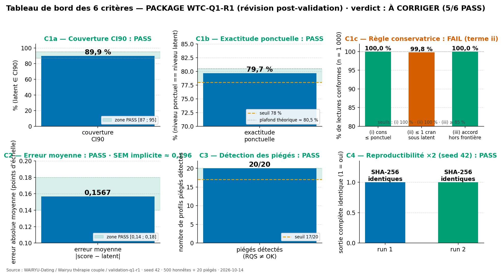
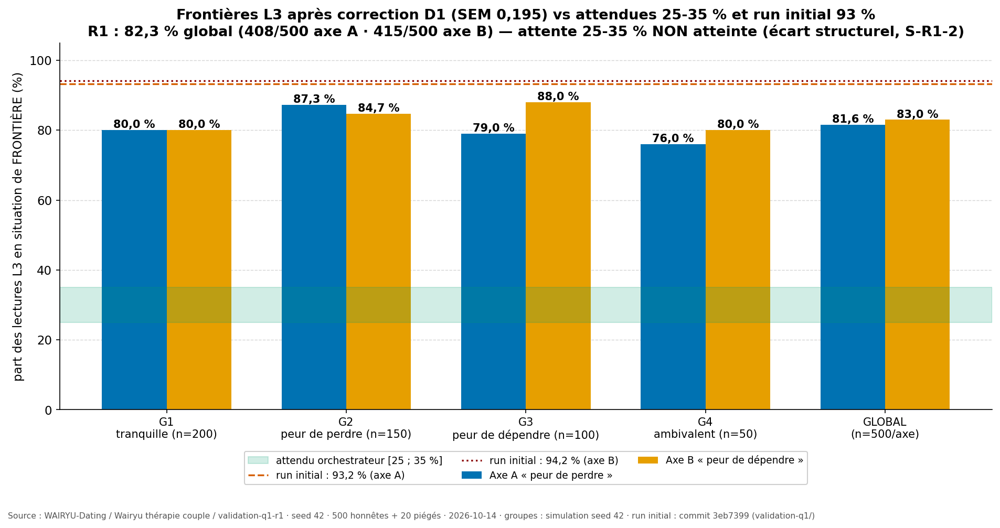
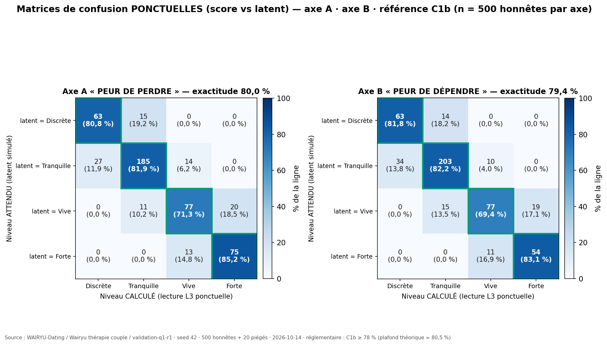

# PACKAGE WTC-Q1-R1 — Révision post-validation (Quête 1 « Comment je me raccroche »)

Réponse de l'exécuteur (Data Insight, rôle strict) au rapport WTC-Q1 du run initial
(commit `3eb7399`, dossier [`../validation-q1/`](../validation-q1/)). Le **code du run initial est conservé
tel quel** ; les corrections portent exclusivement sur les paramètres et critères
imposés par l'orchestrateur (modifications D1-D5).

> **📍 Emplacement** : ce paquet est hébergé dans le dépôt `WAIRYU-Dating` (dossier
> `Wairyu thérapie couple/validation-q1-r1/`) — la création du dépôt dédié
> `wtc-validation-q1` a été REFUSÉE par le token GitHub (`403 Resource not accessible
> by personal access token`, vérifié à nouveau le 2026-10-14). Rien n'est perdu :
> tout le contenu demandé est ci-dessous, **visible directement sur cette page**.

---

## 🖼️ Tableau de bord des 6 critères



## 🖼️ Frontières vs attendues (25-35 %) vs run initial (93 %)



## 🖼️ Matrice ponctuelle axe A · axe B



Matrices séparées (versions individuelles du run) :
[Axe A](figures/Heatmap_MatriceConfusionPonctuelle_AxeA_R1_2026-10-14.png) ·
[Axe B](figures/Heatmap_MatriceConfusionPonctuelle_AxeB_R1_2026-10-14.png)

---

## Verdict R1 : **À CORRIGER** — 5/6 critères PASS — note 6,5/10

| Critère | Seuil | Observé | Verdict |
|---|---|---|---|
| C1a — Couverture CI90 | ∈ [87 % ; 95 %] | **89,9 %** | **PASS** |
| C1b — Exactitude ponctuelle | ≥ 78 % (plafond ≈ 80,5 %) | **79,7 %** | **PASS** |
| C1c — Règle conservatrice | (i) 100 % · (ii) 100 % · (iii) ≥ 85 % | (i) 100 % · (ii) 99,8 % (2 violations) · (iii) 100 % (n = 63) | **FAIL** |
| C2 — Erreur moyenne | ∈ [0,14 ; 0,18] | **0,1567** (SEM implicite ≈ 0,196) | **PASS** |
| C3 — Piégés détectés | ≥ 17/20 | **20/20** (7/7 · 6/6 · 4/4 · 3/3) | **PASS** |
| C4 — Reproductibilité (×2, seed 42) | identique | **OUI** (SHA-256) | **PASS** |

**Frontières L3 — comparaison demandée** :

| Référence | Axe A | Axe B |
|---|---|---|
| Attendu orchestrateur (post-D1) | 25-35 % | 25-35 % |
| Run initial (commit 3eb7399) | 93,2 % | 94,2 % |
| **Run R1 (ce paquet)** | **81,6 %** | **83,0 %** |

La correction D1 divise la demi-largeur du CI90 par ≈ 1,29 (± 0,4129 → ± 0,3198) et fait
chuter les frontières de ~93 % à 82,3 % — la dégénérescence du run initial est corrigée.
**L'objectif 25-35 % n'est pas atteint** : l'écart est structurel (bande Vive 0,60 <
largeur CI90 0,6396 ; groupes placés volontairement à 0,10-0,30 des seuils) — analyse
complète en Section E du rapport (signal S-R1-2).

Non-régression : α de Cronbach poolés **A = 0,9155 / B = 0,9082** — identiques au run
initial (référence « 0,916 ») → **préservée**.

Les 2 violations C1c-(ii) (H291 axe A, H405 axe B) sont des latents Forte dont le score
tombe un cran (Vive) pendant que le CI90 redescend encore un cran (Tranquille) —
mécanique documentée en Section F (S-R1-1) avec 3 options d'arbitrage, **aucune
correction appliquée de mon propre initiative**.

## Modifications appliquées

| Mod. | Objet | Contenu |
|---|---|---|
| D1 | SEM structurel | `SEM_axe = 0,195` (remplace sd_pop 0,65 / α 0,85 → SEM 0,2517) · CI90 = score ± 1,64 × 0,195 = ± 0,3198 · SE_face inchangé |
| D2 | C1 en 3 sous-critères | C1a couverture ∈ [87 % ; 95 %] · C1b exactitude ponctuelle ≥ 78 % (plafond théorique ≈ 80,5 %) · C1c règle conservatrice (i) 100 %, (ii) 100 %, (iii) ≥ 85 % |
| D3 | C2 redéfini | erreur moyenne \|score − latent\| ∈ [0,14 ; 0,18] |
| D4 | Simulateur | génération sur l'échelle CORRIGÉE puis stockage en brut (brut inversé = 5 − corrigé) — lecture psychométrique confirmée (signal S1 du run initial : résolu) |
| D5 | C3 / C4 inchangés | re-vérifiés (non-régression) |

## 📥 Téléchargements directs (rapport + données brutes)

| Fichier | Lien direct |
|---|---|
| **Rapport complet 7 sections (A-G)** | [results/rapport.md](results/rapport.md) — [télécharger](https://raw.githubusercontent.com/georgyfr/WAIRYU-Dating/main/Wairyu%20th%C3%A9rapie%20couple/validation-q1-r1/results/rapport.md) |
| Critères R1 (JSON) | [results/criteres_r1.json](results/criteres_r1.json) — [télécharger](https://raw.githubusercontent.com/georgyfr/WAIRYU-Dating/main/Wairyu%20th%C3%A9rapie%20couple/validation-q1-r1/results/criteres_r1.json) |
| 1 000 lectures détaillées | [results/lectures_detaillees.csv](results/lectures_detaillees.csv) — [télécharger](https://raw.githubusercontent.com/georgyfr/WAIRYU-Dating/main/Wairyu%20th%C3%A9rapie%20couple/validation-q1-r1/results/lectures_detaillees.csv) |
| Réponses honnêtes calculées (500) | [results/reponses_honnetes_calculees.csv](results/reponses_honnetes_calculees.csv) — [télécharger](https://raw.githubusercontent.com/georgyfr/WAIRYU-Dating/main/Wairyu%20th%C3%A9rapie%20couple/validation-q1-r1/results/reponses_honnetes_calculees.csv) |
| Réponses piégées calculées (20) | [results/reponses_pieges_calculees.csv](results/reponses_pieges_calculees.csv) — [télécharger](https://raw.githubusercontent.com/georgyfr/WAIRYU-Dating/main/Wairyu%20th%C3%A9rapie%20couple/validation-q1-r1/results/reponses_pieges_calculees.csv) |
| Détail RQS (520) | [results/rqs_detail.csv](results/rqs_detail.csv) — [télécharger](https://raw.githubusercontent.com/georgyfr/WAIRYU-Dating/main/Wairyu%20th%C3%A9rapie%20couple/validation-q1-r1/results/rqs_detail.csv) |
| Matrices de confusion | [results/matrices_confusion.csv](results/matrices_confusion.csv) — [télécharger](https://raw.githubusercontent.com/georgyfr/WAIRYU-Dating/main/Wairyu%20th%C3%A9rapie%20couple/validation-q1-r1/results/matrices_confusion.csv) |
| Statistiques par groupe | [results/stats_groupes.csv](results/stats_groupes.csv) — [télécharger](https://raw.githubusercontent.com/georgyfr/WAIRYU-Dating/main/Wairyu%20th%C3%A9rapie%20couple/validation-q1-r1/results/stats_groupes.csv) |
| Violations C1c (détail) | [results/violations_c1c.csv](results/violations_c1c.csv) — [télécharger](https://raw.githubusercontent.com/georgyfr/WAIRYU-Dating/main/Wairyu%20th%C3%A9rapie%20couple/validation-q1-r1/results/violations_c1c.csv) |
| Tableau de bord 6 critères (PNG) | [figures/BarChart_TableauDeBord_6Criteres_2026-10-14.png](figures/BarChart_TableauDeBord_6Criteres_2026-10-14.png) — [télécharger](https://raw.githubusercontent.com/georgyfr/WAIRYU-Dating/main/Wairyu%20th%C3%A9rapie%20couple/validation-q1-r1/figures/BarChart_TableauDeBord_6Criteres_2026-10-14.png) |
| Frontières vs attendues (PNG) | [figures/BarChart_Frontieres_vs_Attendues_2026-10-14.png](figures/BarChart_Frontieres_vs_Attendues_2026-10-14.png) — [télécharger](https://raw.githubusercontent.com/georgyfr/WAIRYU-Dating/main/Wairyu%20th%C3%A9rapie%20couple/validation-q1-r1/figures/BarChart_Frontieres_vs_Attendues_2026-10-14.png) |
| Matrice ponctuelle A·B (PNG) | [figures/Heatmap_MatricePonctuelle_AxeA_AxeB_2026-10-14.png](figures/Heatmap_MatricePonctuelle_AxeA_AxeB_2026-10-14.png) — [télécharger](https://raw.githubusercontent.com/georgyfr/WAIRYU-Dating/main/Wairyu%20th%C3%A9rapie%20couple/validation-q1-r1/figures/Heatmap_MatricePonctuelle_AxeA_AxeB_2026-10-14.png) |

## Arborescence

```
validation-q1-r1/
├── README.md                    ← ce fichier (tableau de bord + liens)
├── src/
│   ├── wtc_q1_core.py           ← instrument + L1-L4/L7 (D1 appliquée)
│   ├── wtc_q1_simulator.py      ← seed 42, 500 honnêtes + 20 piégés (D4 confirmée)
│   ├── wtc_q1_validation.py     ← critères R1 (D2/D3), figures, rapport (D5)
│   └── wtc_q1_r1_figures.py     ← génération des 3 visuels de synthèse (cette page)
├── results/
│   ├── rapport.md               ← RAPPORT FINAL 7 sections (A-G)
│   ├── criteres_r1.json         ← tous les critères + métadonnées R1
│   ├── lectures_detaillees.csv  ← 1 000 lectures (champs R1 : C1a/C1b/C1c/C2)
│   ├── reponses_honnetes_calculees.csv (500) · reponses_pieges_calculees.csv (20)
│   ├── rqs_detail.csv (520) · matrices_confusion.csv · stats_groupes.csv
│   └── violations_c1c.csv       ← détail individuel des violations C1c
└── figures/
    ├── BarChart_TableauDeBord_6Criteres_2026-10-14.png     ← tableau de bord des 6 critères
    ├── BarChart_Frontieres_vs_Attendues_2026-10-14.png     ← frontières vs 25-35 % / 93 %
    ├── Heatmap_MatricePonctuelle_AxeA_AxeB_2026-10-14.png  ← matrice ponctuelle A · B
    ├── Heatmap_MatriceConfusionPonctuelle_AxeA_R1_2026-10-14.png · _AxeB_ (séparées)
    └── BarChart_CriteresR1_2026-10-14.png · BarChart_Frontieres_R1_2026-10-14.png (run)
```

## Reproduction

```bash
python3 src/wtc_q1_validation.py   # seed 42 — le pipeline s'exécute 2 fois (C4)
python3 src/wtc_q1_r1_figures.py   # régénère les 3 visuels de cette page
# Dépendances : numpy, pandas, matplotlib
```

Déterminisme : seed 42 (numpy PCG64), ordre de tirage figé, aucun horodatage à la
seconde près (date seule) — deux exécutions le même jour sont identiques octet par octet.

Rôle : EXÉCUTEUR STRICT — la vérité du système prime sur son succès apparent.
Références citées : Bowlby ; Brennan, Clark & Shaver. Instrument original WAIRYU.
