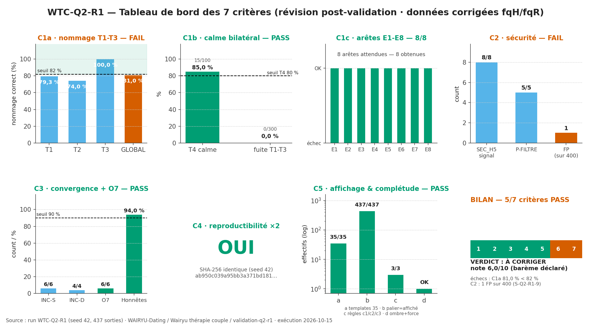
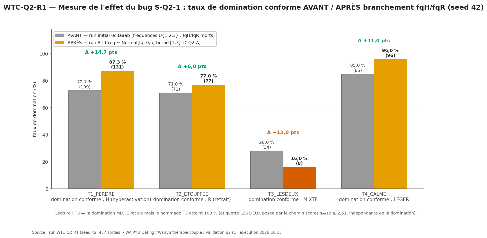
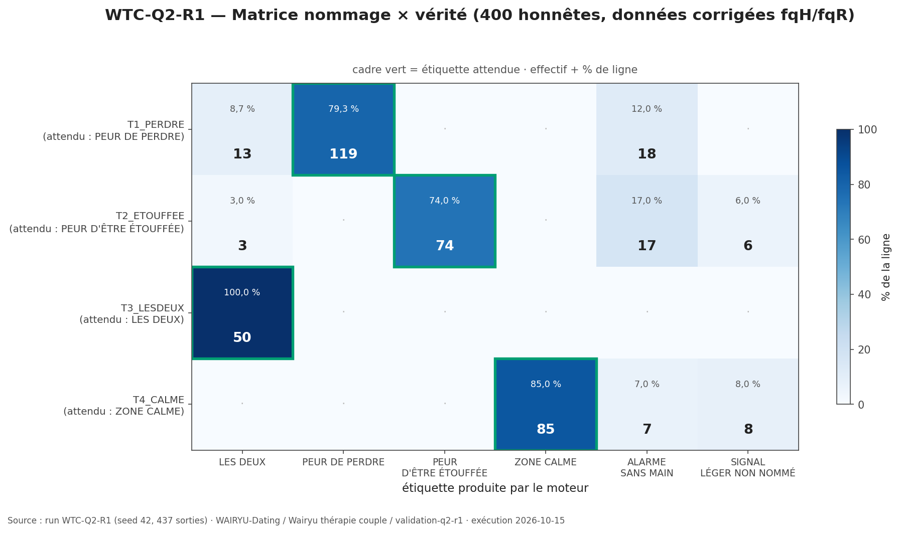
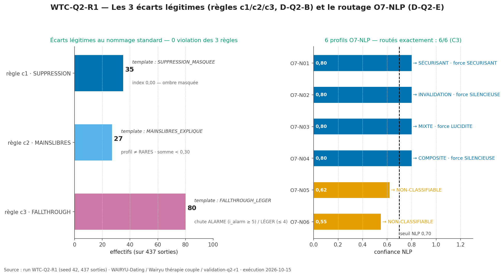

# WTC-Q2-R1 — Révision post-validation « Ce qui m'effraie vraiment » (RIO-02)

**Réponse de l'orchestrateur exécutée** : package WTC-Q2-R1, sur le rapport WTC-Q2 (commit `0c3aaab`).
Le code de l'exécution précédente est **conservé** ; les corrections portent uniquement sur ce que le package pose :
**D-Q2-A** branchement fqH/fqR dans `gen()` (S-Q2-1 clos à la source) · **D-Q2-B** C5c reformulé en 3 règles
(c1/c2/c3) + 3 templates (SUPPRESSION_MASQUEE · MAINSLIBRES_EXPLIQUE · FALLTHROUGH_LEGER) · **D-Q2-C** `vides()`
corrigé dans le canonique (S-Q2-8 absorbé) · **D-Q2-D** effectifs officiels 400 + 23 + 8 = 431, C2-FP sur les 400 ·
**D-Q2-E** 6 profils O7-NLP, C3 étendu à 6/6 · **D-Q2-F** `longitudinal()` marqué NON TESTÉ (reporté WTC-SUIVI).

**Rôle : EXÉCUTEUR STRICT** — seed 42, aucune correction libre, la vérité du système prime.

## Verdict

| | Critère | Seuil | Observé | Verdict |
|---|---|---|---|---|
| C1a | Nommage T1-T3 (données corrigées) | ≥ 82 % | **81,0 %** (T1 79,3 · T2 74,0 · T3 100,0) | **FAIL** |
| C1b | Calme bilatéral | ≥ 80 % / ≤ 2 % | **85,0 %** / **0,00 %** | PASS |
| C1c | Arêtes E1-E8 | 8/8 | **8/8** | PASS |
| C2 | Sécurité | 8/8 · 5/5 · 0 FP (sur 400) | 8/8 · 5/5 · **1 FP** (T3_LESDEUX-047) | **FAIL** |
| C3 | Convergence + O7 | 6/6 · 4/4 · ≥ 90 % · 6/6 O7 | 6/6 · 4/4 · 94,0 % · 6/6 | PASS |
| C4 | Reproductibilité ×2 (seed 42) | octet à octet | **OUI** (`ab950c03…`) | PASS |
| C5 | Affichage & complétude | a 35/35 · b palier · c c1/c2/c3 · d | a 35/35 · b 437/437 · c 3/3 · d OK | PASS |

**VERDICT PACKAGE : À CORRIGER — 5/7 critères PASS — note 6/10** (barème déclaré a priori).

Progrès vs run initial (`0c3aaab`, 5/7 mais échecs C1a 72,7 % + C5c impossible) :
**C5 est réparé** (réformulation D-Q2-B : 3 règles PASS, 35/35 templates) ; **C1a progresse de +8,3 pts**
(72,7 % → 81,0 %, faute de 1,0 pt sur le seuil) ; **C2** bascule en échec sur un **FP de frontière**
(1/400 : profil honnête T3 avec H5 « souvent » ET sA = 3,80 ≥ 3,70 — événement ≈ 0,22 %/profil, absent du run
initial par tirage).

## Visuels (générés directement depuis `results/`, aucune valeur saisie à la main)









## Mesure de l'effet du bug S-Q2-1 (Section C du rapport)

| Groupe | Domination conforme | Avant `0c3aaab` | Après R1 | Δ |
|---|---|---|---|---|
| T1_PERDRE | H (hyperactivation) | 72,7 % | **87,3 %** | +14,7 pts |
| T2_ETOUFFEE | R (retrait) | 71,0 % | **77,0 %** | +6,0 pts |
| T3_LESDEUX | MIXTE | 28,0 % | 16,0 % | −12,0 pts (mais nommage T3 **100 %** via le chemin scores) |
| T4_CALME | LÉGER | 85,0 % | **96,0 %** | +11,0 pts |

Lecture : le branchement D-Q2-A ferme S-Q2-1 mais **ne réalise pas l'hypothèse « domination ≈ 93 % »** :
la dispersion Normal(fq, 0,5) écrêtée + l'inflation par zéro laissent 13-23 % des profils T1/T2 en domination
LÉGER → fallthrough quand i_alarm ≥ 5. Résidu C1a documenté en **S-Q2-R1-8** avec 3 options d'arbitrage
(aucune appliquée).

## Téléchargements directs

| Fichier | Lien |
|---|---|
| Rapport 7 sections (A-G) | [results/rapport.md](https://raw.githubusercontent.com/georgyfr/WAIRYU-Dating/main/Wairyu%20th%C3%A9rapie%20couple/validation-q2-r1/results/rapport.md) |
| Critères JSON + métadonnées | [results/criteres_q2_r1.json](https://raw.githubusercontent.com/georgyfr/WAIRYU-Dating/main/Wairyu%20th%C3%A9rapie%20couple/validation-q2-r1/results/criteres_q2_r1.json) |
| Profils calculés (437 sorties) | [results/profils_calcules.csv](https://raw.githubusercontent.com/georgyfr/WAIRYU-Dating/main/Wairyu%20th%C3%A9rapie%20couple/validation-q2-r1/results/profils_calcules.csv) |
| Matrice nommage × vérité | [results/matrice_nommage.csv](https://raw.githubusercontent.com/georgyfr/WAIRYU-Dating/main/Wairyu%20th%C3%A9rapie%20couple/validation-q2-r1/results/matrice_nommage.csv) |
| Stats par groupe (+ attendus corrigés) | [results/stats_groupes.csv](https://raw.githubusercontent.com/georgyfr/WAIRYU-Dating/main/Wairyu%20th%C3%A9rapie%20couple/validation-q2-r1/results/stats_groupes.csv) |
| Non-nommés (fallthrough) | [results/non_nommes.csv](https://raw.githubusercontent.com/georgyfr/WAIRYU-Dating/main/Wairyu%20th%C3%A9rapie%20couple/validation-q2-r1/results/non_nommes.csv) |
| **Comparaison avant/après (effet du bug)** | [results/comparaison_avant_apres.csv](https://raw.githubusercontent.com/georgyfr/WAIRYU-Dating/main/Wairyu%20th%C3%A9rapie%20couple/validation-q2-r1/results/comparaison_avant_apres.csv) |
| Référence run initial archivée | [results/run_initial/profils_calcules.csv](https://raw.githubusercontent.com/georgyfr/WAIRYU-Dating/main/Wairyu%20th%C3%A9rapie%20couple/validation-q2-r1/results/run_initial/profils_calcules.csv) |
| Figure 1 — tableau de bord | [figures/BarChart_TableauDeBord_7Criteres_R1_2026-10-15.png](https://raw.githubusercontent.com/georgyfr/WAIRYU-Dating/main/Wairyu%20th%C3%A9rapie%20couple/validation-q2-r1/figures/BarChart_TableauDeBord_7Criteres_R1_2026-10-15.png) |
| Figure 2 — effet du bug avant/après | [figures/BarChart_Domination_AvantApres_fqHfqR_R1_2026-10-15.png](https://raw.githubusercontent.com/georgyfr/WAIRYU-Dating/main/Wairyu%20th%C3%A9rapie%20couple/validation-q2-r1/figures/BarChart_Domination_AvantApres_fqHfqR_R1_2026-10-15.png) |
| Figure 3 — matrice nommage | [figures/Heatmap_MatriceNommage_Verite_R1_2026-10-15.png](https://raw.githubusercontent.com/georgyfr/WAIRYU-Dating/main/Wairyu%20th%C3%A9rapie%20couple/validation-q2-r1/figures/Heatmap_MatriceNommage_Verite_R1_2026-10-15.png) |
| Figure 4 — écarts légitimes + O7 | [figures/BarChart_EcartsLegitimes_O7_R1_2026-10-15.png](https://raw.githubusercontent.com/georgyfr/WAIRYU-Dating/main/Wairyu%20th%C3%A9rapie%20couple/validation-q2-r1/figures/BarChart_EcartsLegitimes_O7_R1_2026-10-15.png) |
| Code — moteur (3 templates D-Q2-B) | [src/wtc_q2_core.py](https://raw.githubusercontent.com/georgyfr/WAIRYU-Dating/main/Wairyu%20th%C3%A9rapie%20couple/validation-q2-r1/src/wtc_q2_core.py) |
| Code — simulateur (fqH/fqR + O7) | [src/wtc_q2_simulator.py](https://raw.githubusercontent.com/georgyfr/WAIRYU-Dating/main/Wairyu%20th%C3%A9rapie%20couple/validation-q2-r1/src/wtc_q2_simulator.py) |
| Code — validateur R1 | [src/wtc_q2_validation.py](https://raw.githubusercontent.com/georgyfr/WAIRYU-Dating/main/Wairyu%20th%C3%A9rapie%20couple/validation-q2-r1/src/wtc_q2_validation.py) |
| Code — figures | [src/wtc_q2_figures.py](https://raw.githubusercontent.com/georgyfr/WAIRYU-Dating/main/Wairyu%20th%C3%A9rapie%20couple/validation-q2-r1/src/wtc_q2_figures.py) |

## Reproduction

```bash
cd "Wairyu thérapie couple/validation-q2-r1/src"
python3 wtc_q2_validation.py   # ×2 exécutions intégrales (C4) — seed 42
python3 wtc_q2_figures.py      # 4 figures 1920×1080 lues depuis results/
```

## Signalements R1 (Section F du rapport — aucune correction libre)

- **S-Q2-R1-1** — règles c1/c2/c3 : implémentation vérifiable machine documentée (ancrée sur les 3 écarts légitimes) ; PASS 3/3.
- **S-Q2-R1-2** — prose des 3 templates : identifiants posés mot pour mot, textes définitifs à la charge de la rédaction.
- **S-Q2-R1-3** — exemple SUPPRESSION_MASQUEE : T4-004/053 sont des ZC pures 🟢 dans les données corrigées ; tracé retenu : **T4_CALME-016** (premier T4 supprimé).
- **S-Q2-R1-4** — ordre de consommation du RNG modifié par D-Q2-A (attendu) : rend la comparaison avant/après mesurable à seed égal.
- **S-Q2-R1-5** — `longitudinal()` NON TESTÉ (D-Q2-F), reporté WTC-SUIVI.
- **S-Q2-R1-6** — lectures historiques C5c conservées comme données de continuité (ZC→🟢 : 87/87).
- **S-Q2-R1-7** — mesure d'effet consolidée du bug (tableau ci-dessus).
- **S-Q2-R1-8** — **résidu C1a** : dom H (T1) 87,3 % · dom R (T2) 77,0 % ≠ hypothèse 93 % — 3 options d'arbitrage, aucune appliquée.
- **S-Q2-R1-9** — **mécanique exacte du FP C2** : T3_LESDEUX-047 (sA 3,8011 ≥ 3,70 · H5 = 3) — ≈ 0,22 %/profil T3, verdict sur la lettre du package.
- **S-Q2-R1-10** — paysage 🟢-OMBRE structurel et préexistant (Q2 : 37 = 12+25+0 · R1 : 45 = 9+36+0 ; jamais dans la bande [0,30 ; 0,60[).
- **S-Q2-R1-11** — critères encore en échec : C1a, C2.

## Arborescence

```text
validation-q2-r1/
├── README.md                     ← ce fichier
├── src/
│   ├── wtc_q2_core.py            ← moteur CONSERVÉ + 3 templates (D-Q2-B) + longitudinal NON TESTÉ (D-Q2-F)
│   ├── wtc_q2_simulator.py       ← gen() branché fqH/fqR (D-Q2-A) · vides() canonique (D-Q2-C) · 6 O7-NLP (D-Q2-E)
│   ├── wtc_q2_validation.py      ← validateur R1 : 7 critères + routage NLP + comparaison avant/après + rapport A-G
│   └── wtc_q2_figures.py         ← 4 figures 1920×1080 (lecture directe des results/)
├── results/
│   ├── rapport.md                ← rapport final détaillé 7 sections
│   ├── criteres_q2_r1.json       ← 7 critères + modifications appliquées + empreintes C4
│   ├── profils_calcules.csv      ← 437 sorties, champs complets
│   ├── matrice_nommage.csv       ← matrices honnêtes + piégés + O7
│   ├── stats_groupes.csv         ← moyennes + attendus corrigés (E[freq] exact)
│   ├── non_nommes.csv            ← 80 fallthroughs tracés
│   ├── comparaison_avant_apres.csv ← mesure de l'effet du bug S-Q2-1
│   └── run_initial/              ← référence 0c3aaab archivée (profils + critères)
└── figures/                      ← 4 PNG 1920×1080, 150 DPI, Okabe-Ito
```

*Fiche WTC-Q2-R1 prête pour contresignature GLM (Section G du rapport) · exécution du 2026-10-15.*
