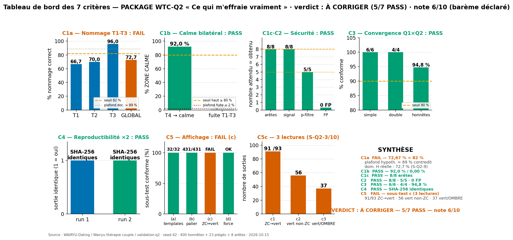
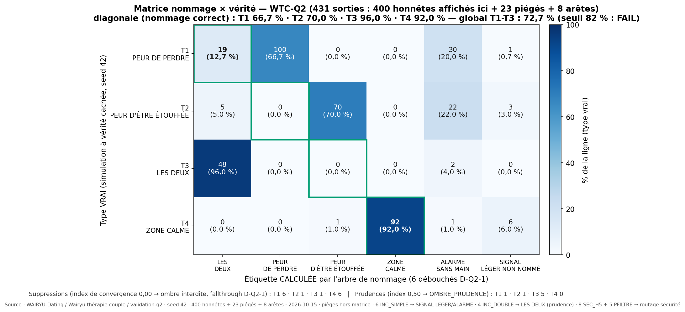

# PACKAGE WTC-Q2 — « Ce qui m'effraie vraiment » (Quête 2, fiche RIO-02)

Validation exécutée par **Data Insight (rôle strict)** · seed 42 · **431 sorties** (400 honnêtes
150+100+50+100 · 23 piégés 6+4+8+5 · 8 arêtes E1-E8) · moteur `wtc_q2_core.py` et simulateur
`wtc_q2_simulator.py` **copiés tels quels** (fournis par l'orchestrateur) ; seul `wtc_q2_validation.py`
est écrit par l'exécuteur. Plafonds calculés a priori (leçon Q1) rappelés sous chaque critère du rapport.

## Verdict : **À CORRIGER** — 5/7 critères PASS — note 6/10 (barème déclaré)

| # | Critère | Seuil | Observé | Verdict |
|---|---|---|---|---|
| C1a | Nommage correct T1-T3 | ≥ 82 % (plafond doc. ≈ 89 %) | **72,67 %** (T1 66,7 · T2 70,0 · T3 96,0) | **FAIL** |
| C1b | ZONE CALME bilatérale | T4 ≥ 80 % · fuite T1-T3 ≤ 2 % | T4 **92,0 %** · fuite **0,00 %** | **PASS** |
| C1c | Batterie d'arêtes E1-E8 | 8/8 | **8/8** | **PASS** |
| C2 | Routage sécurité | 8/8 · 5/5 · 0 FP | **8/8 · 5/5 · 0 FP** | **PASS** |
| C3 | Convergence Q1×Q2 | 6/6 · 4/4 · honnêtes ≥ 90 % | **6/6 · 4/4 · 94,75 %** | **PASS** |
| C4 | Reproductibilité ×2 (seed 42) | octet à octet | **OUI** (SHA-256 identiques) | **PASS** |
| C5 | Affichage & complétude | 100 % (4 sous-tests) | a 32/32 · b 431/431 · **c ÉCHEC (3 lectures)** · d OK | **FAIL** |

## 🖼️ Tableau de bord des 7 critères



## 🖼️ Matrice nommage × vérité



Autres visuels : [Statistiques par groupe](figures/BarChart_StatsGroupes_Q2_2026-10-15.png) ·
[Non-nommés / fallthrough D-Q2-1](figures/BarChart_NonNommes_Fallthrough_Q2_2026-10-15.png)

## Diagnostics (Section F du rapport — rien corrigé de ma propre initiative)

- **C1a FAIL (72,67 % < 82 %)** — le plafond a priori (≈ 89 %) suppose une domination H/R ≈ 93 % ;
  mesuré : **72,7 % (T1) / 75,0 % (T2)** — avec pH=0,65 × fréquence U{1,2,3}, l'écart H_norm−R_norm
  passe sous 0,20 dans ≈ 27 % des tirages → les non-dominants tombent dans le fallthrough
  (T1 : 30 ALARME SANS MAIN + 1 SIGNAL LÉGER ; T2 : 22 + 3). **Chaîne causale probable : le bug
  S-Q2-1** — les paramètres `fqH`/`fqR` (2,3 vs 1,5…) sont déclarés dans `gen()` mais **jamais
  utilisés**. Options d'arbitrage (aucune appliquée) : brancher fqH/fqR, recalibrer le seuil sur le
  plafond réel (≈ 73-75 %), ou redéfinir la règle de domination.
- **C5c FAIL sous les 3 lectures** — c1 ZC→🟢 : 91/93 (T4-004/T4-053 : une case R « souvent » →
  somme 0,333 → 🟠) ; c2 🟢→ZC stricte : 56 🟢 non-ZC ; c3 🟢 jamais sur OMBRE : 37 (12 LES DEUX ·
  10 PEUR DE PERDRE · 15 ÉTOUFFÉE). Tension : la docstring du palier dit « indépendant du label ».
- **S-Q2-8 BUG BLOQUANT du simulateur fourni** — `d,p,r = vides()` alors que `vides()` renvoie 4
  dicts → `ValueError` (inexécutable tel quel). Réparation **mécanique minimale** appliquée et
  documentée (`d,p,_h,r = vides()`, sémantique inchangée) — la source canonique est à corriger par
  l'orchestrateur.
- Autres signalements : effectifs spec (500/520) vs réels (400/423+8) · FP non défini (2 lectures
  calculées) · origine multi-choix/O7-NLP non exercée · `longitudinal()` sans données ce cycle.

## 📥 Téléchargements directs (rapport + données brutes)

| Fichier | Lien |
|---|---|
| **Rapport complet 7 sections (A-G)** | [results/rapport.md](results/rapport.md) — [télécharger](https://raw.githubusercontent.com/georgyfr/WAIRYU-Dating/main/Wairyu%20th%C3%A9rapie%20couple/validation-q2/results/rapport.md) |
| Critères Q2 (JSON) | [results/criteres_q2.json](results/criteres_q2.json) |
| 431 sorties calculées | [results/profils_calcules.csv](results/profils_calcules.csv) |
| Matrice nommage × vérité | [results/matrice_nommage.csv](results/matrice_nommage.csv) |
| Statistiques par groupe | [results/stats_groupes.csv](results/stats_groupes.csv) |
| Non-nommés (Section E) | [results/non_nommes.csv](results/non_nommes.csv) |
| Tableau de bord (PNG) | [figures/BarChart_TableauDeBord_7Criteres_Q2_2026-10-15.png](figures/BarChart_TableauDeBord_7Criteres_Q2_2026-10-15.png) |
| Matrice nommage (PNG) | [figures/Heatmap_MatriceNommage_Verite_Q2_2026-10-15.png](figures/Heatmap_MatriceNommage_Verite_Q2_2026-10-15.png) |
| Stats groupes (PNG) | [figures/BarChart_StatsGroupes_Q2_2026-10-15.png](figures/BarChart_StatsGroupes_Q2_2026-10-15.png) |
| Non-nommés (PNG) | [figures/BarChart_NonNommes_Fallthrough_Q2_2026-10-15.png](figures/BarChart_NonNommes_Fallthrough_Q2_2026-10-15.png) |

## Arborescence

```
validation-q2/
├── README.md                     ← ce fichier (tableau de bord + liens)
├── src/
│   ├── wtc_q2_core.py            ← moteur FOURNI (copié tel quel, sauf réparation S-Q2-8 documentée)
│   ├── wtc_q2_simulator.py       ← simulateur FOURNI (seed 42, tel quel)
│   ├── wtc_q2_validation.py      ← validateur (7 critères, ×2 runs, rapport A-G) — écrit par l'exécuteur
│   └── wtc_q2_figures.py         ← génération des 4 visuels (lecture directe des results/)
├── results/
│   ├── rapport.md                ← RAPPORT FINAL 7 sections (A-G) + fiche WTC-Q2 à contresigner
│   ├── criteres_q2.json          ← 7 critères + métadonnées (SHA-256 ×2)
│   ├── profils_calcules.csv      ← 431 sorties, champs complets (réponses brutes incluses)
│   ├── matrice_nommage.csv · stats_groupes.csv · non_nommes.csv
└── figures/                      ← 4 PNG 1920×1080 (Okabe-Ito, français)
```

## Reproduction

```bash
cd src
python3 wtc_q2_validation.py   # seed 42 — exécute ×2 (C4) et écrit tout results/
python3 wtc_q2_figures.py      # régénère les 4 visuels
# Dépendances : numpy, matplotlib
```

Déterminisme : seed 42 (numpy PCG64), ordre de tirage figé — les deux exécutions produisent des
sorties identiques octet par octer (C4, SHA-256).

Rôle : EXÉCUTEUR STRICT — la vérité du système prime sur son succès apparent.
Construits cités : Mikulincer & Shaver (hyperactivation/déactivation) ; Bowlby (proteste) ;
convergence multi-instruments. Instrument original WAIRYU — fiche RIO-02.
