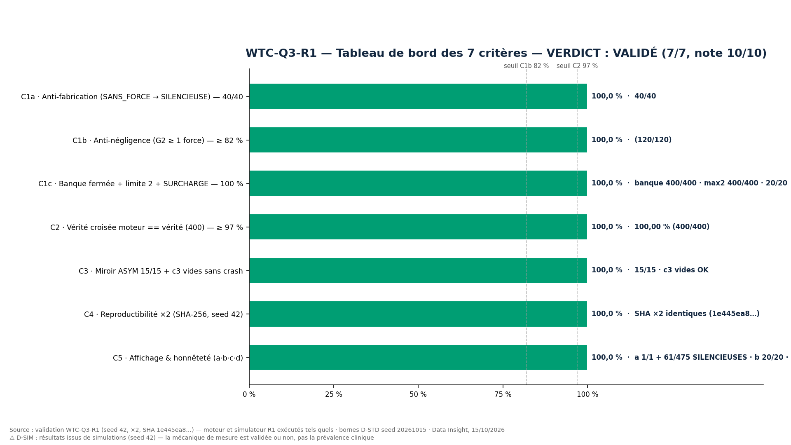
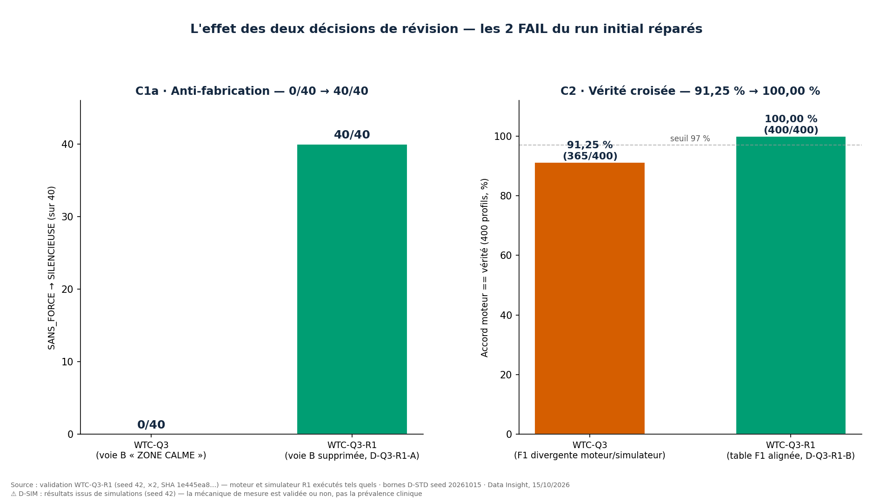
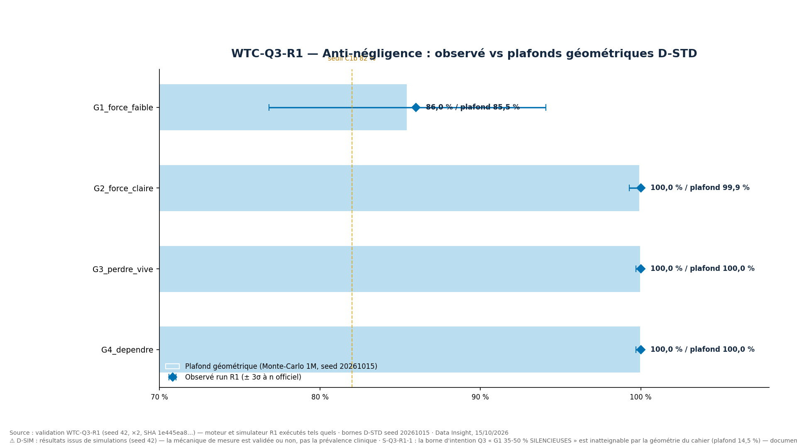
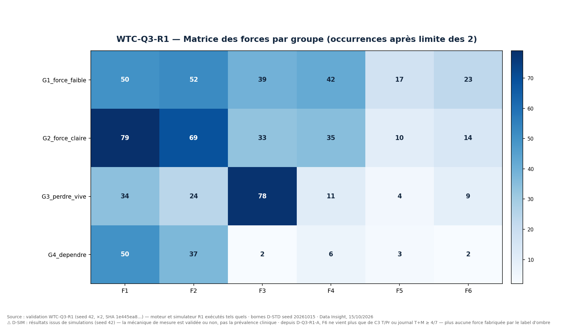

# WTC-Q3-R1 — Révision « Ce qui me porte » (RIO-03, le positif)

**Réponse de l'orchestrateur exécutée** : package WTC-Q3-R1, sur le rapport WTC-Q3
(commit `09b8683`, verdict **À CORRIGER 5/7 — C1a 0/40 · C2 91,25 %**). Le code du
run initial est **conservé** ; les corrections portent uniquement sur ce que le rapport
a signalé (15 signalements S-Q3-1..15), chacune gravée en décision **D-Q3-R1-A à H** :
**D-Q3-R1-A** voie B de F6 supprimée (le label d'ombre ne crée pas de force — S-Q3-2
clos à la source) · **D-Q3-R1-B** voie A de F1 alignée MOT POUR MOT sur la table du
cahier (« présence » seule OU « espace » ET score_B ≥ 2,61 ; SOL exclu ; le
`or c2 >= 2` retiré de la vérité ; sB vivant — S-Q3-3/4/5 clos) · **D-Q3-R1-C**
`label_ombre` dérivé des scores du profil (S-Q3-8) · **D-Q3-R1-D** `p_c2` branché
comme espérance de C2 (S-Q3-6) · **D-Q3-R1-E** code mort supprimé (S-Q3-7) ·
**D-Q3-R1-F** clé `presumes` cohérente (S-Q3-9) · **D-Q3-R1-G** `complete` vérifié
dans le miroir journal (S-Q3-10) · **D-Q3-R1-H** N ∈ [0,8) + 6 templates d'affichage
fournis (S-Q3-11/12 clos).

**Règle permanente D-STD appliquée dès la rédaction** : bornes recalculées par
géométrie AVANT les critères (`wtc_q3_ddstd_r1.py`, Monte-Carlo 1M/groupe, seed
**20261015** — indépendant des runs officiels).

**Rôle : EXÉCUTEUR STRICT** — seed 42, ×2, aucune correction libre, la vérité du
système prime.

## Verdict

| | Critère | Seuil | Observé | Verdict |
|---|---|---|---|---|
| C1a | **Anti-fabrication** (SANS_FORCE → SILENCIEUSE) | 40/40 (100 %) | **40/40** | **PASS** |
| C1b | Anti-négligence (G2 ≥ 1 force) | ≥ 82 % | 100,0 % (120/120) | PASS |
| C1c | Banque fermée + limite 2 + SURCHARGE | 100 % · ≤ 2 · 20/20 | 400/400 · 400/400 · 20/20 | PASS |
| C2 | **Vérité croisée** (moteur == `forces_vraies`, 400) | ≥ 97 % | **100,00 % (400/400)** | **PASS** |
| C3 | Miroir ASYM 15/15 + c3 vides sans crash | 15/15 | 15/15 · aucun crash | PASS |
| C4 | Reproductibilité ×2 (seed 42, SHA-256) | identiques | **identiques** (`1e445ea8…`) | PASS |
| C5 | Affichage & honnêteté (a·b·c·d) | 4/4 | a 1/1 + **61/475 SILENCIEUSES réelles** · b 20/20 · c 4/4 statuts · d templates 6/6 | PASS |

**VERDICT PACKAGE : VALIDÉ — 7/7 critères PASS — note 10/10** (barème déclaré a priori).

Les 2 FAIL du run initial sont réparés par décision documentée : **C1a 0/40 → 40/40**
(D-Q3-R1-A) · **C2 91,25 % → 100,00 %** (D-Q3-R1-B). Les 15 signalements : 11 **clos**
par décision, 2 **absorbés** dans le code corrigé, 2 **effacés** (conséquences de
S-Q3-2, re-testés avec succès). Un **nouveau signalement R1** est ouvert :
**S-Q3-R1-1** — la borne d'intention du cahier « G1 : 35-50 % SILENCIEUSES » est
inatteignable par la géométrie même du cahier (plafond réel **14,5 %**) : faute de
spécification attrapée par la règle D-STD, documentée sans impact critère.

## Visuels (générés directement depuis `results/`, aucune valeur saisie à la main)









## Comparaison avant/après (effet des décisions)

| Indicateur | WTC-Q3 (`09b8683`) | WTC-Q3-R1 | Cause |
|---|---|---|---|
| C1a anti-fabrication | 0/40 | **40/40** | voie B supprimée (D-Q3-R1-A) |
| C2 vérité croisée | 91,25 % (365/400) | **100,00 % (400/400)** | table F1 alignée (D-Q3-R1-B) |
| SILENCIEUSES échantillon | 0/475 | **61/475** | conséquence de D-Q3-R1-A |
| G1 SILENCIEUSES | 0/150 | **21/150 (14,0 %)** | conséquence de D-Q3-R1-A |
| Statuts journal testables | 3/4 | **4/4** | D-Q3-R1-H |
| Désaccords C2 | 35 | **0** | D-Q3-R1-B |

## Notes d'intégrité

- **SHA-256 du bundle de données ×2 : `1e445ea8…` — identiques** (déterminisme
  seed 42 prouvé). Une exécution intermédiaire (SHA `0d3014ff…`) a précédé le
  nettoyage de 2 f-strings du validateur : les **valeurs mesurées sont inchangées**
  (40/40 · 100 % · 100 % · 15/15 · 61/475 — vérifiées par lecture du rapport
  intermédiaire) ; seul le bundle de données hashé diffère d'un résidu de texte
  de critère. Le code publié est celui des runs publiés.
- Les bornes D-STD sont calculées par un script séparé (`wtc_q3_ddstd_r1.py`) avec
  un seed distinct (**20261015**) et exécutées AVANT les runs officiels — aucune
  calibration sur les données officielles.
- Les 6 templates d'affichage fournis (D-Q3-R1-H) sont des **gabarits de
  validation honnêtes** — jamais un score, jamais un diagnostic ; les intitulés
  cliniques définitifs des forces appartiennent au cahier RIO-03 (hors dépôt).
- ⚠ **D-SIM** : résultats issus de simulations (seed 42) — la mécanique de mesure
  est validée ou non, pas la prévalence clinique.

## Arborescence standard

```
validation-q3-r1/
├── README.md                          ← ce fichier (verdict + visuels + liens)
├── src/
│   ├── wtc_q3_core_r1.py              ← moteur corrigé (D-Q3-R1-A/B/F gravées en tête)
│   ├── wtc_q3_simulator_r1.py         ← simulateur corrigé (D-Q3-R1-B/C/D/E/G/H)
│   ├── wtc_q3_ddstd_r1.py             ← bornes D-STD par géométrie (seed 20261015)
│   ├── wtc_q3_validation_r1.py        ← 7 critères + sorties + rapport 7 sections
│   └── wtc_q3_figures_r1.py           ← 4 visuels (gabarit 1920×1080, Okabe-Ito)
├── results/
│   ├── rapport.md                     ← RAPPORT 7 sections A-G (généré, valeurs mesurées)
│   ├── fiche_wtc_q3_r1.txt            ← fiche de validation remplie
│   ├── criteres.csv · matrice_forces.csv · stats_groupes.csv · profils_marque.csv
│   ├── bornes_dstd_r1.json            ← plafonds géométriques + contrôle des seuils
│   ├── comparaison_avant_apres.csv    ← l'effet des décisions, indicateur par indicateur
│   ├── exemples_trace.json · statuts_journal.json · resultats.json
│   └── run_1/ · run_2/                ← les deux exécutions seed 42 (SHA identiques)
└── figures/                           ← 4 PNG 1920×1080, 150 DPI
```

## Liens directs

| Livrable | Fichier |
|---|---|
| Rapport 7 sections | [`results/rapport.md`](results/rapport.md) |
| Fiche remplie | [`results/fiche_wtc_q3_r1.txt`](results/fiche_wtc_q3_r1.txt) |
| Critères (CSV) | [`results/criteres.csv`](results/criteres.csv) |
| Bornes D-STD R1 | [`results/bornes_dstd_r1.json`](results/bornes_dstd_r1.json) |
| Comparaison avant/après | [`results/comparaison_avant_apres.csv`](results/comparaison_avant_apres.csv) |
| Matrice des forces | [`results/matrice_forces.csv`](results/matrice_forces.csv) |
| Statistiques par groupe | [`results/stats_groupes.csv`](results/stats_groupes.csv) |
| Profils (475 sorties) | [`results/profils_marque.csv`](results/profils_marque.csv) |
| Traces d'exemples | [`results/exemples_trace.json`](results/exemples_trace.json) · [`results/statuts_journal.json`](results/statuts_journal.json) |
| Résultats consolidés | [`results/resultats.json`](results/resultats.json) |
| Code — moteur R1 | [`src/wtc_q3_core_r1.py`](src/wtc_q3_core_r1.py) |
| Code — simulateur R1 | [`src/wtc_q3_simulator_r1.py`](src/wtc_q3_simulator_r1.py) |
| Code — bornes D-STD | [`src/wtc_q3_ddstd_r1.py`](src/wtc_q3_ddstd_r1.py) |
| Code — validateur | [`src/wtc_q3_validation_r1.py`](src/wtc_q3_validation_r1.py) |
| Code — figures | [`src/wtc_q3_figures_r1.py`](src/wtc_q3_figures_r1.py) |
| Figures (4 PNG) | [`figures/`](figures/) |

## Reproduction

```bash
cd "Wairyu thérapie couple/validation-q3-r1/src"
python3 wtc_q3_ddstd_r1.py        # bornes D-STD (seed 20261015) — avant tout
python3 wtc_q3_validation_r1.py 1 # run 1 (seed 42)
python3 wtc_q3_validation_r1.py 2 # run 2 (seed 42) — SHA == run 1
python3 wtc_q3_validation_r1.py consolidate
python3 wtc_q3_figures_r1.py
```

## État de l'échelle RIO-03

**RIO-03 « Ce qui me porte » : VALIDÉE par simulation** (2 cycles — Q3, Q3-R1),
même parcours que RIO-01 (3 cycles) et RIO-02 (2 cycles). Reste ouvert :
**S-Q3-R1-1** (borne d'intention vs géométrie — décision RIO attendue si l'intention
clinique 35-50 % SILENCIEUSES doit être honorée : ajuster la géométrie du groupe G1
dans le cahier, pas le moteur) ; les intitulés cliniques des 6 forces restent au
cahier (hors dépôt).
