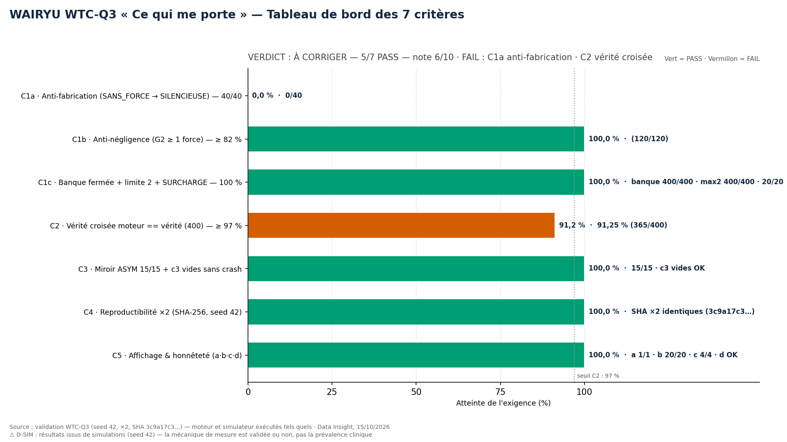
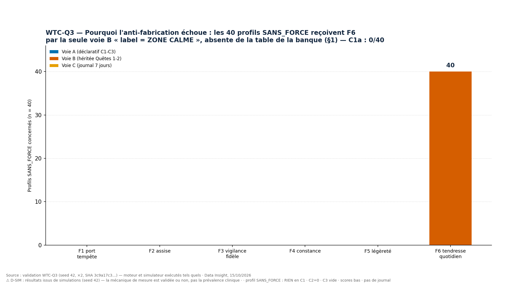
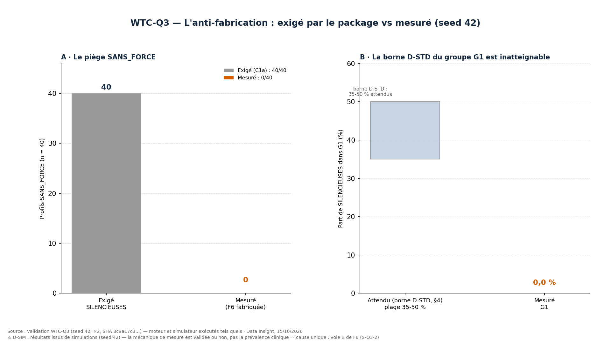
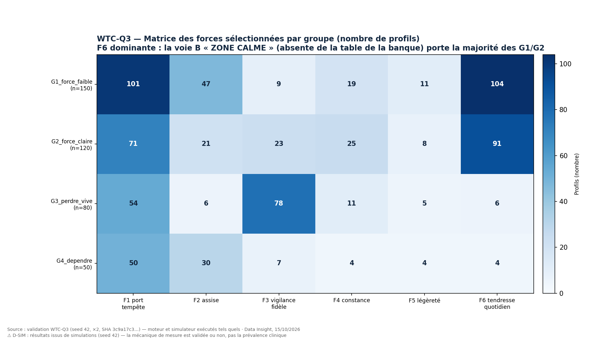

# WTC-Q3 — Validation « Ce qui me porte » (RIO-03, l'échelle du positif)

**Exécution du package WTC-Q3** fourni complet par l'orchestrateur (cahier `wtc_q3_core.py`
+ simulateur `wtc_q3_simulator.py` copiés **tels quels**, validation `wtc_q3_validation.py`
écrite par l'exécuteur). Rôle : **EXÉCUTEUR STRICT** — seed 42, ×2, aucune correction libre,
la vérité du système prime sur son succès apparent. Date : 15/10/2026.

⚠ **D-SIM** : résultats issus de simulations (seed 42) — la mécanique de mesure est validée
ou non, pas la prévalence clinique.

## Verdict

| | Critère | Seuil | Observé | Verdict |
|---|---|---|---|---|
| C1a | **Anti-fabrication** (SANS_FORCE → SILENCIEUSE) | 40/40 (100 %) | **0/40** | **FAIL** |
| C1b | Anti-négligence (G2 ≥ 1 force) | ≥ 82 % | 100,0 % (120/120) | PASS |
| C1c | Banque fermée + limite 2 + SURCHARGE | 100 % · ≤ 2 · 20/20 | 400/400 · 400/400 · 20/20 | PASS |
| C2 | **Vérité croisée** (moteur == `forces_vraies`, 400) | ≥ 97 % | **91,25 % (365/400)** | **FAIL** |
| C3 | Miroir ASYM 15/15 + c3 vides sans crash | 15/15 | 15/15 · aucun crash | PASS |
| C4 | Reproductibilité ×2 (seed 42, SHA-256) | identiques | **identiques** (`3c9a17c3…`) | PASS |
| C5 | Affichage & honnêteté (a·b·c·d) | 4/4 | a 1/1 cas unitaire · b 20/20 · c 4/4 statuts · d OK | PASS |

**VERDICT PACKAGE : À CORRIGER — 5/7 critères PASS — note 6/10**
(barème déclaré a priori : 10 × (PASS/7), −1 si C1a FAIL éliminatoire, arrondi au demi-point).

**La cause racine est unique et structurelle (S-Q3-2)** : le cahier ajoute à `cond_B` une
voie B de F6 — `label_ombre == "ZONE CALME"` — **absente de la table de la banque (§1)**.
Or le piège SANS_FORCE est construit avec `label_ombre = "ZONE CALME"` : les 40 profils
« sans aucune voie » reçoivent donc F6 (la tendresse du quotidien) par la seule héritage
du label. Conséquences en chaîne : C1a impossible (0/40), la borne D-STD du groupe G1
(35-50 % de SILENCIEUSES) inatteignable (plafond réel 0 %), **zéro SILENCIEUSE dans tout
l'échantillon (0/475)**, et C1b/C1c PASS « portés » par la voie non spécifiée. C2 échoue
par ailleurs sur une divergence moteur/simulateur de la voie A de F1 (S-Q3-5) : 35 désaccords
(91,25 % < 97 %).

**Le moteur lui-même n'invente rien** : le test anti-invention sur les 475 profils ne trouve
**aucune force produite sans condition remplie** — la fabrication vient de la spécification
de la voie B, pas de l'exécution.

## Visuels (générés directement depuis `results/`, aucune valeur saisie à la main)









## Les 15 signalements (Section F du rapport — sans correction libre)

| # | Signalement | Nature |
|---|---|---|
| **S-Q3-1** | `rng.sample()` inexistant sur `numpy.random.Generator` → `AttributeError` à l'import. **Réparation mécanique au strict minimum** : `choice(size=4, replace=False)`, même sémantique, même rng seedé 42 | bloquant, réparé |
| **S-Q3-2** | **Voie B de F6 (`ZONE CALME`) absente de la table de la banque** → C1a 0/40 + borne D-STD G1 inatteignable + 0/475 SILENCIEUSES | **structurel, éliminatoire** |
| S-Q3-3 | `cond_A` : `a["F1"]` assignée deux fois (redondance **pré-documentée** D-CHECK) | pré-documenté |
| S-Q3-4 | Voie tabulaire F1 « espace ≥ 2 **ET** score_B ≥ 2,61 » non implémentée (`sB` paramètre mort) ; `_c1v ≥ 2` inclut SOL, absente de la table | écart cahier/table |
| S-Q3-5 | `forces_vraies` : F1-A = (PRES ou ESP) ou `c2 ≥ 2` — diffère du moteur → 35 désaccords C2 | divergence |
| S-Q3-6 | `p_c2` jamais utilisé dans `gen()` (distribution fixe ≈ 50 % pour tous les groupes) | paramètre mort |
| S-Q3-7 | `c1 = np.random.default_rng()` créé à chaque itération, jamais utilisé | code mort |
| S-Q3-8 | `label_ombre` dérivé des muA/muB du groupe, pas des scores du profil (tous les profils d'un groupe partagent le même label) | spécification |
| S-Q3-9 | `coherence_miroir` : branche vide renvoie la clé `presume` au lieu de `presumes` | mineur |
| S-Q3-10 | `cond_journal_like` ne vérifie pas `complete` (sans impact ici) | mineur |
| S-Q3-11 | Statut SILENCIEUX (N ≥ 5) inatteignable via le simulateur (N ∈ [0,3)) ; commentaire d'affichage tronqué | mineur |
| S-Q3-12 | Templates d'affichage (6 forces + SILENCIEUSE) non fournis — C5a vérifié sur gabarit du pipeline | mineur |
| S-Q3-13 | « 1 G1 SILENCIEUSE » (Section D) irréalisable : 0/150 — exemple fourni depuis SANS_FORCE | conséquence |
| **S-Q3-14** | `forces_vraies` : `cb["F4"]`/`cb["F5"]` lues mais non définies → `KeyError: 'F4'`. **Réparation mécanique au strict minimum** : deux clés `False` (= `cond_B` du cahier) | bloquant, réparé |
| S-Q3-15 | Zéro SILENCIEUSE dans l'échantillon (0/475) : C5a testé par cas unitaire, à re-tester après correction de S-Q3-2 | conséquence |

## Arborescence standard

```
validation-q3/
├── README.md                          ← ce fichier (verdict + visuels + liens)
├── src/
│   ├── wtc_q3_core.py                 ← moteur fourni — copié TEL QUEL (+ commentaires S-Q3)
│   ├── wtc_q3_simulator.py            ← simulateur fourni — copié TEL QUEL (2 réparations S-Q3-1/14)
│   ├── wtc_q3_validation.py           ← 7 critères + sorties + rapport (écrit par l'exécuteur)
│   └── wtc_q3_figures.py              ← 4 visuels (gabarit 1920×1080, Okabe-Ito)
├── results/
│   ├── rapport.md                     ← RAPPORT 7 sections A-G (généré, valeurs mesurées)
│   ├── fiche_wtc_q3.txt               ← fiche de validation remplie
│   ├── criteres.csv · matrice_forces.csv · stats_groupes.csv
│   ├── desaccords_c2.csv              ← les 35 désaccords C2, item par item
│   ├── profils_marque.csv             ← les 475 profils (moteur vs vérité)
│   ├── exemples_trace.json · statuts_journal.json · resultats.json
│   ├── signalement_SQ3-1_traceback.txt · signalement_SQ3-14_traceback.txt
│   ├── run_1/ · run_2/                ← les deux exécutions seed 42 (SHA identiques)
└── figures/                           ← 4 PNG 1920×1080, 150 DPI
```

## Liens directs

| Livrable | Fichier |
|---|---|
| Rapport 7 sections | [`results/rapport.md`](results/rapport.md) |
| Fiche remplie | [`results/fiche_wtc_q3.txt`](results/fiche_wtc_q3.txt) |
| Désaccords C2 (35) | [`results/desaccords_c2.csv`](results/desaccords_c2.csv) |
| Matrice des forces | [`results/matrice_forces.csv`](results/matrice_forces.csv) |
| Statistiques par groupe | [`results/stats_groupes.csv`](results/stats_groupes.csv) |
| Tracebacks des réparations | [`results/signalement_SQ3-1_traceback.txt`](results/signalement_SQ3-1_traceback.txt) · [`results/signalement_SQ3-14_traceback.txt`](results/signalement_SQ3-14_traceback.txt) |
| Figures | [`figures/`](figures/) (4 PNG) |

## Ce que l'orchestrateur devra arbitrer (proposition de révision, hors rôle)

L'exécuteur ne corrige pas ; pour la révision WTC-Q3-R1, les décisions à prendre :
**(a)** supprimer la voie B de F6 (aligner `cond_B` sur la table de la banque) —
C1a redevient testable et la borne D-STD G1 devient cohérente ; **(b)** aligner la voie A
de F1 moteur et simulateur (choisir la table : « présence ≥ 2 » seule, ou toute option ≥ 2)
— C2 redevient mesurable à son plafond 100 % ; **(c)** brancher le paramètre `p_c2` ou le
supprimer ; **(d)** fournir les templates d'affichage. Les bornes D-STD devront être
recalculées après (a) — la règle permanente s'applique dès la rédaction.
