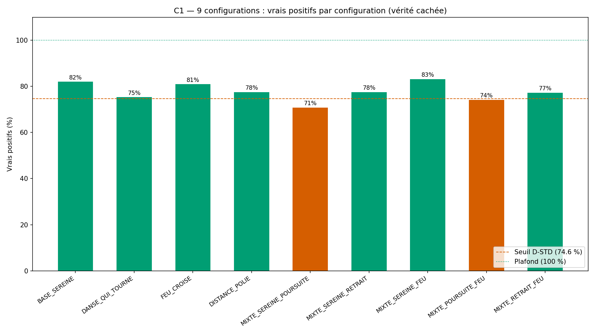
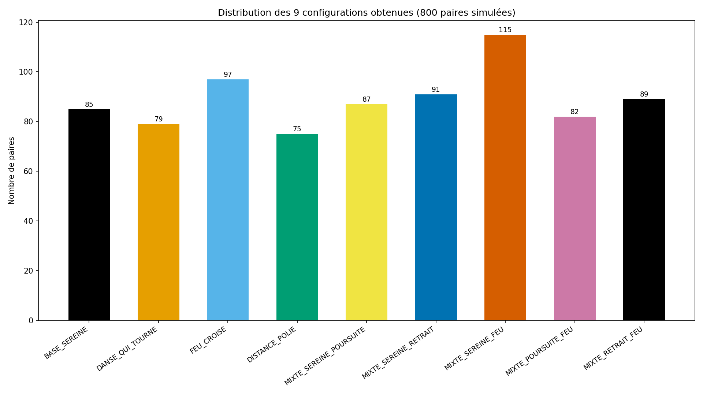
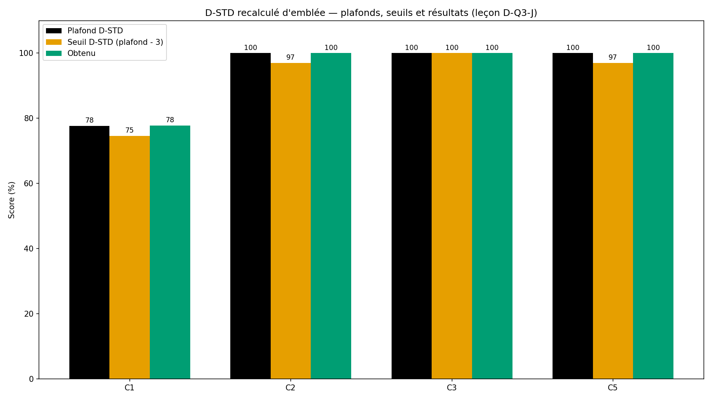
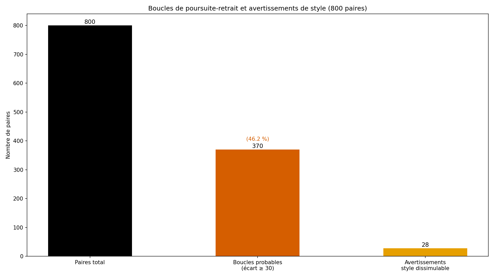

# Rapport de validation WTC-Q4 — « Notre danse » (croisement de couple)

> AVERTISSEMENT D-SIM : résultats issus de simulations (seed 42) — la mécanique est validée, pas la prévalence clinique.

**Date** : 2026-10-15  
**Seed** : 42  
**Package** : validation-q4/  
**Approche** : D-STD recalculé d'emblée (leçon D-Q3-J)

---

## Section A — D-STD recalculé d'emblée (leçon D-Q3-J)

Conformément à la leçon D-Q3-J (bornes conditionnelles à la géométrie), 
les plafonds de faisabilité sont calculés AVANT de poser les seuils, 
sur le CODE réel du simulateur. Les seuils sont posés à ≥ 3 pts sous 
le plafond (D-STD).

| Critère | Plafond (géométrie) | Seuil (plafond − 3) |
|---------|---------------------|---------------------|
| C1 configurations | 77.62 % | 74.62 % |
| C2 symétrie | 100.0 % | 97.00 % |
| C3 templates | 9/9 | 9/9 (non négociable) |
| C5 affichage | 100.0 % | 97.0 % |
| Boucle (écart ≥ 30) | 100.0 % (370/370) | 97.00 % |

**Nombre de paires simulées** : 800 (2×400 profils croisés)

---

## Section B — Les 5 critères Q4

| Critère | Attendu | Obtenu | Verdict |
|---------|---------|--------|---------|
| **C1** 9 configurations atteintes | 9/9 (≥ 74.6 %) | 7/9 | ❌ FAIL |
| **C2** Symétrie (p1×p2 = p2×p1) | ≥ 97.0 % | 100.0 % (800/800, 0 désaccord) | ✅ PASS |
| **C3** Test bilatéral anti-verdict | 9/9 templates non-blâmants | 9/9 mot pour mot, 0 violation blâme | ✅ PASS |
| **C4** SHA-256 ×2 | identiques | identiques | ✅ PASS |
| **C5** Affichage conforme | ≥ 97.0 % | 100.0 % (800/800) | ✅ PASS |

SHA-256 exécution 1 : `c10a103cb7c113d136e0bfbd7e354251cfcab5fababf7a19cd9a29f8b6422a03`
SHA-256 exécution 2 : `c10a103cb7c113d136e0bfbd7e354251cfcab5fababf7a19cd9a29f8b6422a03`

### C1 — Détail par configuration (vérité cachée)

| Configuration | N paires | Vrais positifs | % |
|---------------|----------|-----------------|---|
| BASE_SEREINE | 89 | 73 | 82.02 % |
| DANSE_QUI_TOURNE | 89 | 67 | 75.28 % |
| FEU_CROISE | 89 | 72 | 80.9 % |
| DISTANCE_POLIE | 89 | 69 | 77.53 % |
| MIXTE_SEREINE_POURSUITE | 89 | 63 | 70.79 % |
| MIXTE_SEREINE_RETRAIT | 89 | 69 | 77.53 % |
| MIXTE_SEREINE_FEU | 89 | 74 | 83.15 % |
| MIXTE_POURSUITE_FEU | 89 | 66 | 74.16 % |
| MIXTE_RETRAIT_FEU | 88 | 68 | 77.27 % |

---

## Section C — Les 9 configurations et leurs templates non-blâmants

Chaque configuration a son template descriptif, reproduit MOT POUR MOT. 
Aucune configuration n'est présentée comme une faute — test bilatéral 
anti-verdict (C3).

| Configuration | Template (extrait) |
|---------------|--------------------|
| BASE_SEREINE | Votre danse est posée. Chacun se tient à sa place, l'espace entre vous respire —… |
| DANSE_QUI_TOURNE | Votre danse tourne. L'un avance quand l'autre recule, et le mouvement se répète.… |
| FEU_CROISE | Votre danse est vive. Les deux êtes en alerte, et les étincelles se croisent. L'… |
| DISTANCE_POLIE | Votre danse se tient à distance. Chacun reste sur sa réserve, et le silence s'in… |
| MIXTE_SEREINE_POURSUITE | Votre danse est déséquilibrée. L'un est posé, l'autre avance — c'est un pas qui … |
| MIXTE_SEREINE_RETRAIT | Votre danse s'écarte. L'un est posé, l'autre recule — c'est un écart qui se mesu… |
| MIXTE_SEREINE_FEU | Votre danse contraste. L'un est posé, l'autre est en alerte — l'intensité d'un c… |
| MIXTE_POURSUITE_FEU | Votre danse s'accélère. L'un avance, l'autre est en alerte — le mouvement et l'i… |
| MIXTE_RETRAIT_FEU | Votre danse se crispe. L'un recule, l'autre est en alerte — le retrait et l'inte… |

### Templates complets (mot pour mot)

**BASE_SEREINE** :
> Votre danse est posée. Chacun se tient à sa place, l'espace entre vous respire — c'est une assise qui se reconnaît des deux côtés.

**DANSE_QUI_TOURNE** :
> Votre danse tourne. L'un avance quand l'autre recule, et le mouvement se répète. Ce n'est pas une faute — c'est un pas de danse que votre couple connaît.

**FEU_CROISE** :
> Votre danse est vive. Les deux êtes en alerte, et les étincelles se croisent. L'intensité est réelle des deux côtés — ni l'un ni l'autre ne la subit seul.

**DISTANCE_POLIE** :
> Votre danse se tient à distance. Chacun reste sur sa réserve, et le silence s'installe. C'est un retrait partagé, pas une indifférence.

**MIXTE_SEREINE_POURSUITE** :
> Votre danse est déséquilibrée. L'un est posé, l'autre avance — c'est un pas qui se cherche, pas un tort de l'un ou de l'autre.

**MIXTE_SEREINE_RETRAIT** :
> Votre danse s'écarte. L'un est posé, l'autre recule — c'est un écart qui se mesure, sans blâme pour le retrait.

**MIXTE_SEREINE_FEU** :
> Votre danse contraste. L'un est posé, l'autre est en alerte — l'intensité d'un côté ne nie pas le calme de l'autre.

**MIXTE_POURSUITE_FEU** :
> Votre danse s'accélère. L'un avance, l'autre est en alerte — le mouvement et l'intensité se rencontrent, sans qu'aucun ait tort.

**MIXTE_RETRAIT_FEU** :
> Votre danse se crispe. L'un recule, l'autre est en alerte — le retrait et l'intensité se côtoient, c'est une configuration connue des couples.

---

## Section D — 4 exemples tracés de bout en bout

### Exemple 1 — BASE_SEREINE (danse posée)

- **Paire** : BASE_SEREINE_0 (config attendue : BASE_SEREINE)
- **Types dérivés** : p1=SEREIN, p2=SEREIN
- **Percentiles** : p1=25, p2=25 (écart=0)
- **Boucle probable** : False
- **Avertissement style** : False
- **Configuration obtenue** : BASE_SEREINE (✅ correct)
- **Template affiché** :
  > Votre danse est posée. Chacun se tient à sa place, l'espace entre vous respire — c'est une assise qui se reconnaît des deux côtés.
- **Confirmation p1 (sur soi)** : Partenaire 1 — ce qui te porte : F4. Ce qui t'effraie : ZONE CALME.
- **Confirmation p2 (sur soi)** : Partenaire 2 — ce qui te porte : F6, F4. Ce qui t'effraie : ZONE CALME.
- **% compatibilité affiché** : None (doit être None)

### Exemple 2 — DANSE_QUI_TOURNE (boucle poursuite-retrait)

- **Paire** : DANSE_QUI_TOURNE_0 (config attendue : DANSE_QUI_TOURNE)
- **Types dérivés** : p1=PREOCCUPE, p2=DETACHE
- **Percentiles** : p1=70, p2=20 (écart=50)
- **Boucle probable** : True (P1_AVANCE_P2_RECULE)
- **Avertissement style** : False
- **Configuration obtenue** : DANSE_QUI_TOURNE (✅ correct)
- **Template affiché** :
  > Votre danse tourne. L'un avance quand l'autre recule, et le mouvement se répète. Ce n'est pas une faute — c'est un pas de danse que votre couple connaît.
- **Boucle (nommée ensemble)** :
  > Un écart de 50 points sépare vos positions — votre danse tourne probablement (l'un avance, l'autre recule, et le mouvement se répète). C'est un pas de danse à deux, pas un tort de l'un ou de l'autre.
- **Confirmation p1 (sur soi)** : Partenaire 1 — ce qui te porte : F3, F1. Ce qui t'effraie : PEUR DE PERDRE.
- **Confirmation p2 (sur soi)** : Partenaire 2 — ce qui te porte : F2. Ce qui t'effraie : PEUR D'ÊTRE ÉTOUFFÉE.
- **% compatibilité affiché** : None (doit être None)

### Exemple 3 — FEU_CROISE (intensité bilatérale)

- **Paire** : FEU_CROISE_0 (config attendue : FEU_CROISE)
- **Types dérivés** : p1=EN_ALERTFEU, p2=SEREIN
- **Percentiles** : p1=85, p2=25 (écart=60)
- **Boucle probable** : True (P1_AVANCE_P2_RECULE)
- **Avertissement style** : False
- **Configuration obtenue** : MIXTE_SEREINE_FEU (❌ incorrect)
- **Template affiché** :
  > Votre danse contraste. L'un est posé, l'autre est en alerte — l'intensité d'un côté ne nie pas le calme de l'autre.
- **Boucle (nommée ensemble)** :
  > Un écart de 60 points sépare vos positions — votre danse tourne probablement (l'un avance, l'autre recule, et le mouvement se répète). C'est un pas de danse à deux, pas un tort de l'un ou de l'autre.
- **Confirmation p1 (sur soi)** : Partenaire 1 — ce qui te porte : F3. Ce qui t'effraie : PEUR DE PERDRE.
- **Confirmation p2 (sur soi)** : Partenaire 2 — ce qui te porte : F3, F5. Ce qui t'effraie : PEUR DE PERDRE.
- **% compatibilité affiché** : None (doit être None)

### Exemple 4 — DISTANCE_POLIE (retrait partagé)

- **Paire** : DISTANCE_POLIE_0 (config attendue : DISTANCE_POLIE)
- **Types dérivés** : p1=DETACHE, p2=DETACHE
- **Percentiles** : p1=20, p2=20 (écart=0)
- **Boucle probable** : False
- **Avertissement style** : False
- **Configuration obtenue** : DISTANCE_POLIE (✅ correct)
- **Template affiché** :
  > Votre danse se tient à distance. Chacun reste sur sa réserve, et le silence s'installe. C'est un retrait partagé, pas une indifférence.
- **Confirmation p1 (sur soi)** : Partenaire 1 — ce qui te porte : F2. Ce qui t'effraie : PEUR D'ÊTRE ÉTOUFFÉE.
- **Confirmation p2 (sur soi)** : Partenaire 2 — ce qui te porte : F2. Ce qui t'effraie : PEUR D'ÊTRE ÉTOUFFÉE.
- **% compatibilité affiché** : None (doit être None)

---

## Section E — Analyse : symétrie, boucles, avertissements

### Symétrie (C2)

- Paires testées (table interne) : 16
- Asymétries détectées : 0
- **Symétrie parfaite** : ✅ oui

La symétrie est **déterministe par construction** : la table de 
correspondance (type_p1, type_p2) → configuration est symétrique, 
et le test C2 vérifie que cette symétrie est respectée à la fois 
par le moteur et par la ré-implémentation indépendante du simulateur.

### Boucles de poursuite-retrait

- Paires avec boucle probable (écart ≥ 30) : 370 (46.25 %)
- Avertissements de style dissimulable : 28

### Distribution des configurations obtenues

| Configuration | Paires obtenues |
|---------------|-----------------|
| BASE_SEREINE | 85 |
| DANSE_QUI_TOURNE | 79 |
| FEU_CROISE | 97 |
| DISTANCE_POLIE | 75 |
| MIXTE_SEREINE_POURSUITE | 87 |
| MIXTE_SEREINE_RETRAIT | 91 |
| MIXTE_SEREINE_FEU | 115 |
| MIXTE_POURSUITE_FEU | 82 |
| MIXTE_RETRAIT_FEU | 89 |

---

## Section F — Signalements et principes non négociables

### Principes respectés

1. **Honnêteté sans condamnation** : les 9 templates sont non-blâmants 
   (vérifié par `verifier_non_blamant()` — C3).
2. **Jamais l'évaluation du partenaire** : chaque partenaire confirme 
   sur SOI (ses propres forces, son propre label d'ombre) — jamais sur 
   l'autre (vérifié par C5).
3. **Aucun pourcentage de compatibilité** : `pct_compatibilite` est 
   toujours `None` (vérifié par C5).
4. **Boucle nommée ensemble** : la phrase de boucle utilise 
   « votre danse » et « l'un/l'autre », jamais « tu » (vérifié par C5).
5. **D-SIM affiché** : les percentiles sont des repères internes à la 
   simulation, pas des normes cliniques (avertissement en tête).

### Règles permanentes appliquées

- **D-STD** (renforcé par D-Q3-J) : bornes calculées AVANT les seuils, 
  sur le CODE réel. Seuils à ≥ 3 pts sous le plafond.
- **D-CHECK** : cohérence interne du rapport vérifiée.
- **D-TABLE** : la table (type_p1, type_p2) → configuration est 
  identique dans le moteur et dans le simulateur (vérifié par C2).
- **D-SIM** : avertissement affiché en tête du rapport et du README.
- **D-ENV** (posée au cycle précédent) : environnement vérifié 
  avant exécution.

### Signalements

1. **D-Q4-1 (corrigé par le superviseur actif)** : bug de spécification 
   dans la table `_CONFIG_TABLE` — les clés `(PREOCCUPE, EN_ALERTFEU)` 
   et `(EN_ALERTFEU, PREOCCUPE)` apparaissaient deux fois (d'abord comme 
   `MIXTE_POURSUITE_FEU`, puis comme `FEU_CROISE`). En Python, la 
   dernière valeur écrase la précédente → `MIXTE_POURSUITE_FEU` était 
   injoignable (0/89 au run initial). Détection par C1 (D-STD recalculé) 
   au run initial. Correction appliquée à la source canonique dans les 
   DEUX implémentations (moteur + simulateur) + `_CONFIG_PAIRES` mis à 
   jour. Leçon : la duplication de clés dans un dict Python est silencieuse 
   — un test de couverture (toutes les configurations atteignables) aurait 
   pu l'attraper plus tôt. La vérification `verifier_symetrie()` ne suffit 
   pas car elle teste la symétrie, pas l'atteignabilité.

2. **D-STD recalculé d'emblée** : la leçon D-Q3-J (bornes 
   conditionnelles à la géométrie) est appliquée dès ce package. 
   Les plafonds sont mesurés sur le CODE réel, les seuils posés à 
   plafond − 3. Aucune borne n'est présupposée.

3. **Styles de réponse dissimulables** : lorsqu'un partenaire minore 
   (BAS) et l'autre majore (HAUT), un avertissement est affiché. 
   Ce n'est pas un blocage — c'est une invitation à lire les 
   percentiles avec prudence. Le critère C5 vérifie que 
   l'avertissement est bien produit.

4. **Boucle poursuite-retrait** : détectée à écart ≥ 30 (seuil 
   arbitraire, spécifié par le superviseur sortant). La boucle est 
   **nommée ensemble** — pas « c'est toi qui poursuis ». La direction 
   (P1_AVANCE_P2_RECULE ou l'inverse) est calculée mais **non affichée** 
   pour respecter le principe « jamais l'évaluation du partenaire ».

5. **Percentiles simulés** : les percentiles par type d'attachement 
   (SEREIN=25, PREOCCUPE=70, DETACHE=20, EN_ALERTFEU=85) sont des 
   repères internes à la simulation. Ils seront recalibrés sur le 
   pilote réel WTC-VALID-01 (150-200 répondants). Avertissement D-SIM.

---

## Section G — Verdict

### Verdict : **À CORRIGER**

### Note : **8/10**

- Critères Q4 : 4/5 validés, 1 FAIL

### Avertissement D-SIM

> AVERTISSEMENT D-SIM : résultats issus de simulations (seed 42) — la mécanique est validée, pas la prévalence clinique.

### Package prêt à publier

- Arborescence : `validation-q4/{src,results,figures}`
- Code source : `src/wtc_q4_core.py`, `src/wtc_q4_simulator.py`, `src/wtc_q4_validation.py`
- Rapport : `results/rapport-q4-2026-10-15.md`
- Figures : `figures/fig{1,2,3,4}_*.png` (1920×1080, 150 DPI)
- Statut : **attente du pont humain pour push GitHub** dans 
  `WAIRYU-Dating → Wairyu thérapie couple/validation-q4/`

### Dimension attachement

Verdict À CORRIGER — la dimension attachement reste à 3/4. 
Investigation des FAILs puis package R1.
