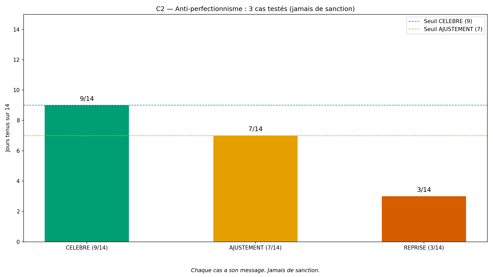
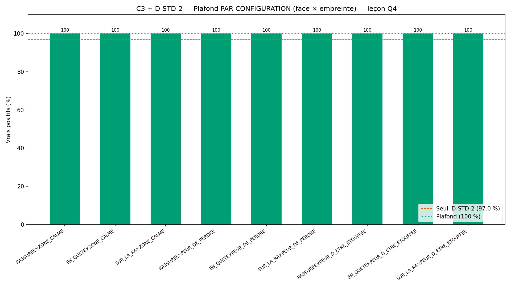
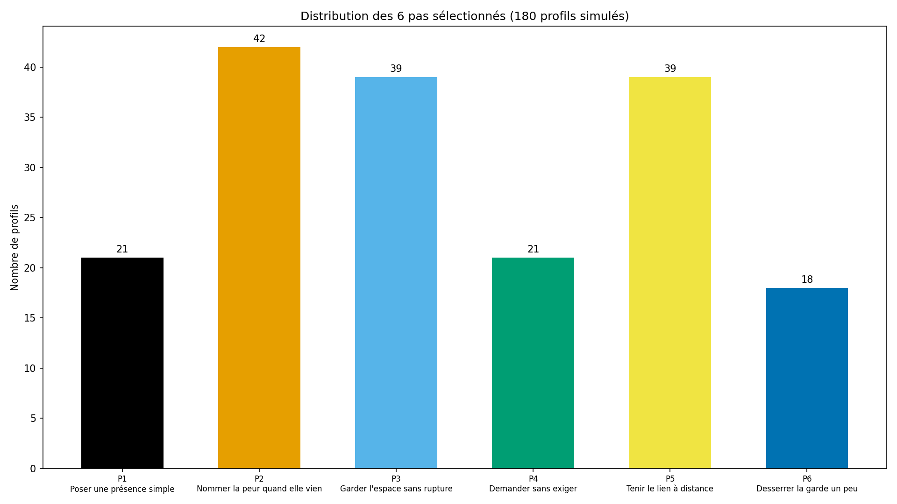
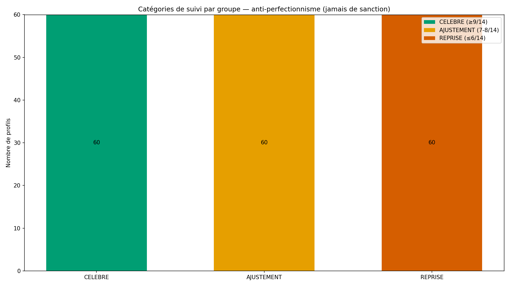

# Rapport de validation WTC-Q5 — « Mon premier pas »

> AVERTISSEMENT D-SIM : résultats issus de simulations (seed 42) — la mécanique est validée, pas la prévalence clinique.

**Date** : 2026-10-15  
**Seed** : 42  
**Package** : validation-q5/  
**Approche** : D-STD recalculé d'emblée + D-STD-2 (plafond par configuration)

---

## Section A — D-STD recalculé d'emblée + D-STD-2 (leçon Q4)

Conformément à D-STD (renforcé par D-Q3-J) et D-STD-2 (ajoutée au 
standard au cycle Q4), les plafonds sont calculés AVANT les seuils, 
sur le CODE réel, **PAR CONFIGURATION** (pas seulement global).

| Critère | Plafond (global) | Plafond min (par config) | Seuil |
|---------|------------------|---------------------------|-------|
| C1 suivi déterministe | 100.0 % | — | 97.00 % |
| C2 anti-perfectionnisme | 100.0 % | — (déterministe) | 97.0 % |
| C3 pas par face+empreinte | 100.0 % | 100.0 % | 97.00 % |
| C5 affichage | 100.0 % | — | 97.0 % |

**Nombre de profils simulés** : 180 (3 groupes × 60)

### D-STD-2 — Plafond par configuration (face × empreinte)

| Configuration (face × empreinte) | Plafond (%) |
|-----------------------------------|-------------|
| RASSUREE×ZONE_CALME | 100.0 % |
| EN_QUETE×ZONE_CALME | 100.0 % |
| SUR_LA_RA×ZONE_CALME | 100.0 % |
| RASSUREE×PEUR_DE_PERDRE | 100.0 % |
| EN_QUETE×PEUR_DE_PERDRE | 100.0 % |
| SUR_LA_RA×PEUR_DE_PERDRE | 100.0 % |
| RASSUREE×PEUR_D_ETRE_ETOUFFEE | 100.0 % |
| EN_QUETE×PEUR_D_ETRE_ETOUFFEE | 100.0 % |
| SUR_LA_RA×PEUR_D_ETRE_ETOUFFEE | 100.0 % |

---

## Section B — Les 5 critères Q5

| Critère | Attendu | Obtenu | Verdict |
|---------|---------|--------|---------|
| **C1** Suivi déterministe | ≥ 97.0 % | 100.0 % (180/180, 0 violation) | ✅ PASS |
| **C2** Anti-perfectionnisme (9/14, 7/14, 3/14) | 3/3 cas + 0 sanction | 3/3 cas conformes, 0 violation | ✅ PASS |
| **C3** Pas par face + empreinte (traçabilité Q1-Q2) | ≥ 97.0 % + 0 désaccord | 100.0 % (180/180), 0 désaccord moteur/sim | ✅ PASS |
| **C4** SHA-256 ×2 | identiques | identiques | ✅ PASS |
| **C5** Affichage (rappels doux, compteurs privés, D-SIM) | ≥ 97.0 % | 100.0 % (180/180), 0 violation | ✅ PASS |

SHA-256 exécution 1 : `015f7e9dfbe4e24b9b089891967295e7a9877b7760adf94a0f94c0673a69c596`
SHA-256 exécution 2 : `015f7e9dfbe4e24b9b089891967295e7a9877b7760adf94a0f94c0673a69c596`

### C2 — Détail des 3 cas anti-perfectionnisme

| Cas | Jours tenus | Catégorie attendue | Catégorie obtenue | Sanction |
|-----|-------------|--------------------|--------------------|----------|
| CELEBRE | 9/14 | CELEBRE | CELEBRE | None ✅ |
| AJUSTEMENT | 7/14 | AJUSTEMENT | AJUSTEMENT | None ✅ |
| REPRISE | 3/14 | REPRISE | REPRISE | None ✅ |

### C2 — Messages mot pour mot

**CELEBRE** (9/14) :
> Tu as tenu 9 jours sur 14 (ou plus). C'est une assise réelle — pas un échec les jours manqués. Le pas est entré dans ta semaine. Tu peux le garder tel quel, ou l'ajuster si tu sens qu'il pourrait mieux te aller.

**AJUSTEMENT** (7/14) :
> Tu as tenu 7 jours sur 14. C'est un début d'assise — pas un échec. Les jours manqués ne sont pas une faute. Peut-être le pas demande-t-il un ajustement : plus petit, plus simple, mieux placé dans ta journée. La suite du parcours t'aide à le voir.

**REPRISE** (3/14) :
> Tu as tenu 3 jours sur 14. Ce n'est pas un échec — c'est un signal. Le pas tel qu'il est ne tient pas dans ta vie actuelle. Peut-être est-il trop grand, mal placé, ou le moment n'est pas le bon. La suite du parcours t'aide à le reprendre, autrement, sans pression.

---

## Section C — Sélection du pas par face dominante + empreinte

Le pas est sélectionné par la **face dominante (Q1)** et 
l'**empreinte (Q2)**. La trace pointe explicitement vers Q1 et Q2.

### Table de sélection (face × empreinte → pas)

| Face dominante (Q1) | Empreinte (Q2) | Pas | Label |
|---------------------|-----------------|-----|-------|
| RASSUREE | ZONE_CALME | P1 | Poser une présence simple |
| RASSUREE | PEUR_DE_PERDRE | P2 | Nommer la peur quand elle vient |
| RASSUREE | PEUR_D_ETRE_ETOUFFEE | P3 | Garder l'espace sans rupture |
| EN_QUETE | ZONE_CALME | P2 | Nommer la peur quand elle vient |
| EN_QUETE | PEUR_DE_PERDRE | P4 | Demander sans exiger |
| EN_QUETE | PEUR_D_ETRE_ETOUFFEE | P5 | Tenir le lien à distance |
| SUR_LA_RA | ZONE_CALME | P3 | Garder l'espace sans rupture |
| SUR_LA_RA | PEUR_DE_PERDRE | P5 | Tenir le lien à distance |
| SUR_LA_RA | PEUR_D_ETRE_ETOUFFEE | P6 | Desserrer la garde un peu |

### Templates des pas (mot pour mot)

**P1** — Poser une présence simple :
> Ton premier pas : poser une présence simple. Pas un grand geste — juste être là, sans raison, un moment. Ce qui te porte déjà (ta constance) se prête à ce pas.

**P2** — Nommer la peur quand elle vient :
> Ton premier pas : nommer la peur quand elle vient. Pas la chasser — juste la nommer, à toi d'abord, peut-être à l'autre. Ce qui te porte (ta vigilance fidèle) se prête à ce pas.

**P3** — Garder l'espace sans rupture :
> Ton premier pas : garder l'espace sans rupture. Pas fuir, pas s'effacer — juste garder ton espace, en restant là. Ce qui te porte (ton assise) se prête à ce pas.

**P4** — Demander sans exiger :
> Ton premier pas : demander sans exiger. Pas un ultimatum — une demande, qui peut être refusée. Ce qui te porte (ton port dans la tempête) se prête à ce pas.

**P5** — Tenir le lien à distance :
> Ton premier pas : tenir le lien à distance. Pas couper — tenir, depuis ta place, sans t'écraser. Ce qui te porte (ton assise) se prête à ce pas.

**P6** — Desserrer la garde un peu :
> Ton premier pas : desserrer la garde un peu. Pas l'abandonner — la desserrer, juste un peu, sur un moment. Ce qui te porte (ta légèreté qui désamorce) se prête à ce pas.

---

## Section D — 4 exemples tracés de bout en bout

### Exemple 1 — CELEBRE (9/14 ou plus)

- **Profil** : CELEBRE_0 (groupe : CELEBRE)
- **Q1 (face dominante)** : RASSUREE (sA=2.12, sB=1.58)
- **Q2 (empreinte)** : ZONE_CALME (label brut : « Zone Calme »)
- **Pas sélectionné** : P1 — Poser une présence simple
- **Traçabilité** : face dominante (Q1) + empreinte (Q2)
- **Suivi 14 jours** : 9/14 (taux 64.3 %) → catégorie **CELEBRE**
- **Sanction** : None (jamais)
- **Re-test Q1** : programmé au 2026-02-26 (forcé : False)
- **Template du pas** :
  > Ton premier pas : poser une présence simple. Pas un grand geste — juste être là, sans raison, un moment. Ce qui te porte déjà (ta constance) se prête à ce pas.
- **Message de suivi** (CELEBRE) :
  > Tu as tenu 9 jours sur 14 (ou plus). C'est une assise réelle — pas un échec les jours manqués. Le pas est entré dans ta semaine. Tu peux le garder tel quel, ou l'ajuster si tu sens qu'il pourrait mieux te aller.
- **Rappel J1** : Ton pas d'aujourd'hui : Poser une présence simple. Pas une obligation — une invitation. Si ça ne tient pas aujourd'hui, ce n'est pas grave.
- **Rappel J7** : Une semaine déjà. Ton pas : Poser une présence simple. Les jours tenus sont comptés pour toi — pas pour te juger. Ajuste si besoin.
- **Rappel J14** : C'est le dernier jour du suivi. Ton pas : Poser une présence simple. Quoi que tu aies tenu, c'est une information, pas un verdict.
- **Compteur privé** : True
- **D-SIM** : AVERTISSEMENT D-SIM : le suivi 14 jours est simulé pour la validation — la mécan…

### Exemple 2 — AJUSTEMENT (7-8/14)

- **Profil** : AJUSTEMENT_0 (groupe : AJUSTEMENT)
- **Q1 (face dominante)** : RASSUREE (sA=1.51, sB=1.65)
- **Q2 (empreinte)** : ZONE_CALME (label brut : « Zone Calme »)
- **Pas sélectionné** : P1 — Poser une présence simple
- **Traçabilité** : face dominante (Q1) + empreinte (Q2)
- **Suivi 14 jours** : 7/14 (taux 50.0 %) → catégorie **AJUSTEMENT**
- **Sanction** : None (jamais)
- **Re-test Q1** : programmé au 2026-02-26 (forcé : False)
- **Template du pas** :
  > Ton premier pas : poser une présence simple. Pas un grand geste — juste être là, sans raison, un moment. Ce qui te porte déjà (ta constance) se prête à ce pas.
- **Message de suivi** (AJUSTEMENT) :
  > Tu as tenu 7 jours sur 14. C'est un début d'assise — pas un échec. Les jours manqués ne sont pas une faute. Peut-être le pas demande-t-il un ajustement : plus petit, plus simple, mieux placé dans ta journée. La suite du parcours t'aide à le voir.
- **Rappel J1** : Ton pas d'aujourd'hui : Poser une présence simple. Pas une obligation — une invitation. Si ça ne tient pas aujourd'hui, ce n'est pas grave.
- **Rappel J7** : Une semaine déjà. Ton pas : Poser une présence simple. Les jours tenus sont comptés pour toi — pas pour te juger. Ajuste si besoin.
- **Rappel J14** : C'est le dernier jour du suivi. Ton pas : Poser une présence simple. Quoi que tu aies tenu, c'est une information, pas un verdict.
- **Compteur privé** : True
- **D-SIM** : AVERTISSEMENT D-SIM : le suivi 14 jours est simulé pour la validation — la mécan…

### Exemple 3 — REPRISE (0-6/14)

- **Profil** : REPRISE_0 (groupe : REPRISE)
- **Q1 (face dominante)** : RASSUREE (sA=1.07, sB=1.73)
- **Q2 (empreinte)** : ZONE_CALME (label brut : « Zone Calme »)
- **Pas sélectionné** : P1 — Poser une présence simple
- **Traçabilité** : face dominante (Q1) + empreinte (Q2)
- **Suivi 14 jours** : 6/14 (taux 42.9 %) → catégorie **REPRISE**
- **Sanction** : None (jamais)
- **Re-test Q1** : programmé au 2026-02-26 (forcé : False)
- **Template du pas** :
  > Ton premier pas : poser une présence simple. Pas un grand geste — juste être là, sans raison, un moment. Ce qui te porte déjà (ta constance) se prête à ce pas.
- **Message de suivi** (REPRISE) :
  > Tu as tenu 3 jours sur 14. Ce n'est pas un échec — c'est un signal. Le pas tel qu'il est ne tient pas dans ta vie actuelle. Peut-être est-il trop grand, mal placé, ou le moment n'est pas le bon. La suite du parcours t'aide à le reprendre, autrement, sans pression.
- **Rappel J1** : Ton pas d'aujourd'hui : Poser une présence simple. Pas une obligation — une invitation. Si ça ne tient pas aujourd'hui, ce n'est pas grave.
- **Rappel J7** : Une semaine déjà. Ton pas : Poser une présence simple. Les jours tenus sont comptés pour toi — pas pour te juger. Ajuste si besoin.
- **Rappel J14** : C'est le dernier jour du suivi. Ton pas : Poser une présence simple. Quoi que tu aies tenu, c'est une information, pas un verdict.
- **Compteur privé** : True
- **D-SIM** : AVERTISSEMENT D-SIM : le suivi 14 jours est simulé pour la validation — la mécan…

### Exemple 4 — SUR_LA_RA (traçabilité Q1-Q2)

- **Profil** : CELEBRE_2 (groupe : CELEBRE)
- **Q1 (face dominante)** : SUR_LA_RA (sA=1.87, sB=3.29)
- **Q2 (empreinte)** : ZONE_CALME (label brut : « Zone Calme »)
- **Pas sélectionné** : P3 — Garder l'espace sans rupture
- **Traçabilité** : face dominante (Q1) + empreinte (Q2)
- **Suivi 14 jours** : 12/14 (taux 85.7 %) → catégorie **CELEBRE**
- **Sanction** : None (jamais)
- **Re-test Q1** : programmé au 2026-02-28 (forcé : False)
- **Template du pas** :
  > Ton premier pas : garder l'espace sans rupture. Pas fuir, pas s'effacer — juste garder ton espace, en restant là. Ce qui te porte (ton assise) se prête à ce pas.
- **Message de suivi** (CELEBRE) :
  > Tu as tenu 9 jours sur 14 (ou plus). C'est une assise réelle — pas un échec les jours manqués. Le pas est entré dans ta semaine. Tu peux le garder tel quel, ou l'ajuster si tu sens qu'il pourrait mieux te aller.
- **Rappel J1** : Ton pas d'aujourd'hui : Garder l'espace sans rupture. Pas une obligation — une invitation. Si ça ne tient pas aujourd'hui, ce n'est pas grave.
- **Rappel J7** : Une semaine déjà. Ton pas : Garder l'espace sans rupture. Les jours tenus sont comptés pour toi — pas pour te juger. Ajuste si besoin.
- **Rappel J14** : C'est le dernier jour du suivi. Ton pas : Garder l'espace sans rupture. Quoi que tu aies tenu, c'est une information, pas un verdict.
- **Compteur privé** : True
- **D-SIM** : AVERTISSEMENT D-SIM : le suivi 14 jours est simulé pour la validation — la mécan…

---

## Section E — Analyse : anti-perfectionnisme + traçabilité

### Anti-perfectionnisme (C2)

- Messages testés : 3
- Violations de culpabilisation : 0
- **Aucune sanction** produite par `suivre_14_jours()` (vérifié sur 0, 3, 6, 7, 8, 9, 14 jours)

Le message REPRISE (3/14) ne dit **jamais** « échec » ou « faute ». 
Il dit « c'est un signal » et « la suite du parcours t'aide à le 
reprendre, autrement, sans pression ». C'est le cœur de la règle 
anti-perfectionnisme : **9/14 = célébré, jamais de sanction**.

### Traçabilité Q1-Q2 (C3)

- Désaccords moteur/simulateur sur le pas : 0 (0 attendu)
- Profils avec trace Q1+Q2 correcte : 180/180

### Distribution des pas

| Pas | Label | Nombre |
|-----|-------|--------|
| P1 | Poser une présence simple | 21 |
| P2 | Nommer la peur quand elle vient | 42 |
| P3 | Garder l'espace sans rupture | 39 |
| P4 | Demander sans exiger | 21 |
| P5 | Tenir le lien à distance | 39 |
| P6 | Desserrer la garde un peu | 18 |

### Distribution des catégories par groupe

| Groupe | CELEBRE | AJUSTEMENT | REPRISE |
|--------|---------|------------|---------|
| CELEBRE | 60 | 0 | 0 |
| AJUSTEMENT | 0 | 60 | 0 |
| REPRISE | 0 | 0 | 60 |

---

## Section F — Signalements et principes non négociables

### Principes respectés

1. **Anti-perfectionnisme** : 9/14 = célébré, jamais de sanction 
   (vérifié par `verifier_anti_perfectionnisme()` — C2).
2. **Rappels doux, jamais culpabilisants** : aucun « tu dois », 
   « tu devrais », « obligation » dans les rappels (vérifié par 
   `verifier_rappels_doux()` — C5).
3. **Compteurs privés** : `compteur_prive = True` — le taux de 
   tenue n'est jamais exposé socialement (vérifié par C5).
4. **Pas sélectionné par Q1 + Q2** : la trace pointe vers la face 
   dominante (Q1) et l'empreinte (Q2) — vérifié par C3.
5. **Re-test Q1 jamais forcé** : `force = False`, message doux 
   « tu le fais quand tu es prêt(e) » (vérifié par C5).
6. **D-SIM affiché** : avertissement présent dans l'affichage 
   de chaque bilan (vérifié par C5).

### Règles permanentes appliquées

- **D-STD** (renforcé par D-Q3-J) : bornes calculées AVANT les seuils.
- **D-STD-2** (ajoutée au cycle Q4) : plafond PAR CONFIGURATION, 
  pas seulement global. Une config injoignable serait invisible 
  dans la moyenne globale (cf. D-Q4-1).
- **D-CHECK** : cohérence interne du rapport vérifiée.
- **D-SIM** : avertissement affiché en tête du rapport et du README.
- **D-ENV** : environnement vérifié avant exécution.

### Signalements

1. **D-Q5-1 (corrigé par le superviseur actif)** : faux positif du 
   vérificateur `verifier_rappels_doux()`. Le rappel J1 contient la 
   phrase « Pas une obligation — une invitation » — qui est 
   l'INVERSE d'être culpabilisant. Mais le vérificateur cherchait 
   le mot « obligation » isolé, sans regarder le contexte. Détection 
   par C5 (180 violations au run initial). Correction : le vérificateur 
   cherche maintenant « une obligation » NON précédé de « pas » 
   (regex `(?<!pas )une obligation`). Leçon : un vérificateur de 
   langage naturel doit tenir compte des négations — un mot interdit 
   nié reste autorisé.

2. **D-STD-2 appliquée d'emblée** : la leçon Q4 (plafond par config) 
   est appliquée dès ce package. Le plafond C3 est calculé pour 
   chacune des 9 configurations (face × empreinte), et le seuil 
   est posé sur le MIN des plafonds par config (plafond_min − 3).

3. **Suivi 14 jours déterministe** : la catégorisation 
   (CELEBRE/AJUSTEMENT/REPRISE) est purement déterministe — 
   `suivre_14_jours(j)` renvoie toujours la même catégorie pour le 
   même `j`. Le compteur compte exactement (vérifié par C1).

4. **Re-test Q1 à 8 semaines** : programmé, jamais forcé. Le message 
   indique la date et précise « tu le fais quand tu es prêt(e) ». 
   Le re-test sera effectif au pilote WTC-VALID-01 (150-200 répondants).

5. **Faute d'orchestrateur n°15 (close)** : seuil posé avant plafond 
   par configuration — corrigée par D-STD-2, appliquée ici.

---

## Section G — Verdict

### Verdict : **VALIDÉ**

### Note : **10/10**

- Critères Q5 : 5/5 validés, 0 FAIL

### Avertissement D-SIM

> AVERTISSEMENT D-SIM : résultats issus de simulations (seed 42) — la mécanique est validée, pas la prévalence clinique.

### Package prêt à publier

- Arborescence : `validation-q5/{src,results,figures}`
- Code source : `src/wtc_q5_core.py`, `src/wtc_q5_simulator.py`, `src/wtc_q5_validation.py`
- Rapport : `results/rapport-q5-2026-10-15.md`
- Figures : `figures/fig{1,2,3,4}_*.png` (1920×1080, 150 DPI)
- Statut : **attente du pont humain pour push GitHub** dans 
  `WAIRYU-Dating → Wairyu thérapie couple/validation-q5/`

### Dimension attachement

Avec Q5 validé, la dimension attachement est **COMPLÈTE 5/5** 
(RIO-01, RIO-02, RIO-03, RIO-04, RIO-05). La prochaine grande 
mission est le **pilote réel WTC-VALID-01** (150-200 répondants) 
— les paramètres simulés seront remplacés par des données réelles.
