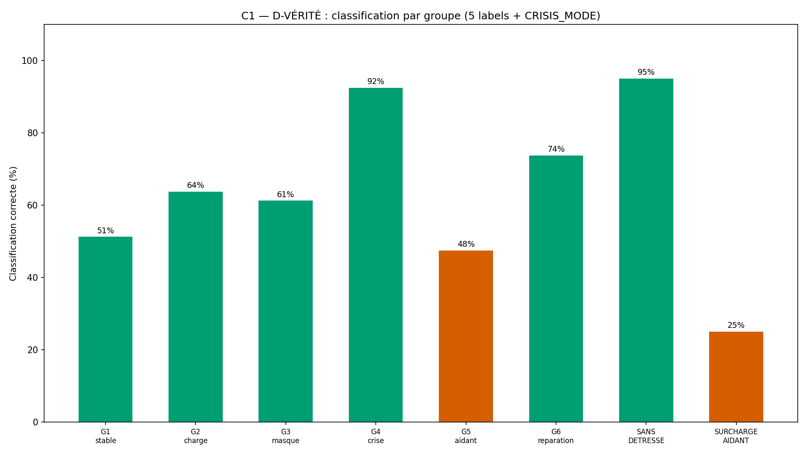
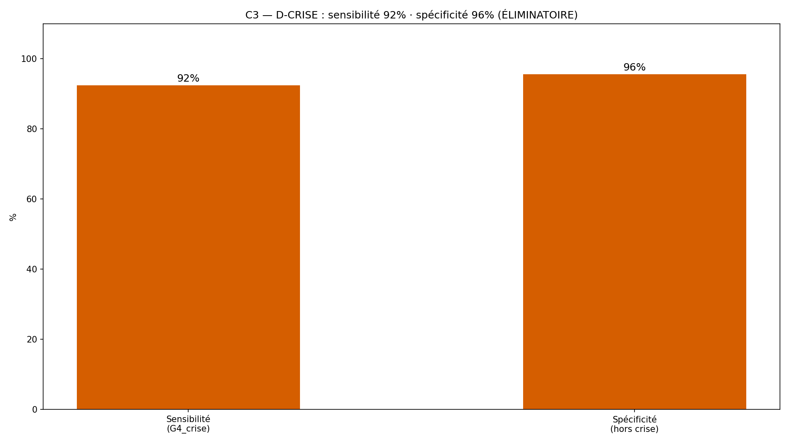
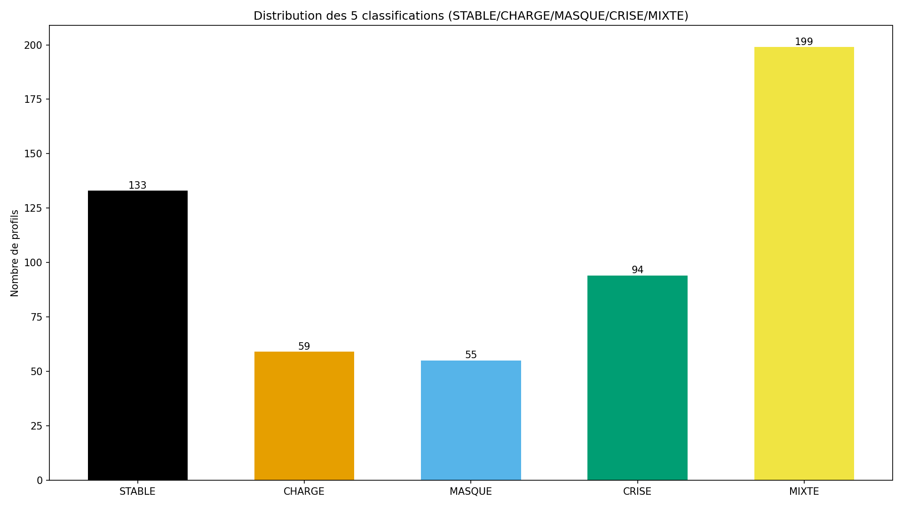
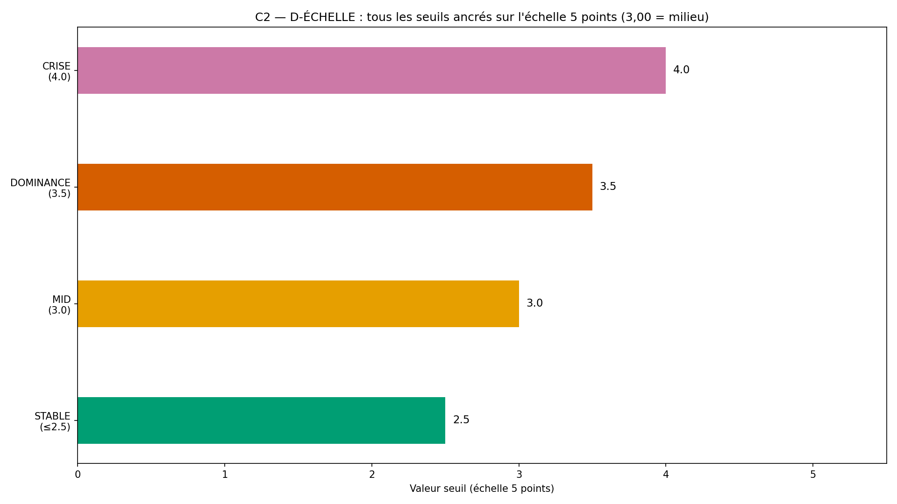

# Rapport WTC-SM-Q1-R1 — « Ma détresse et la leur » (RIO-11)

> AVERTISSEMENT D-SIM : résultats issus de simulations (seed 42) — la mécanique est validée, pas la prévalence clinique.
> D-CRISE : court-circuit de crise AVANT l'arbre — filet 3919/3114.

**Date** : 2026-10-17  
**Seed** : 42  
**Package** : validation-sm-q1-r1/  
**R1** : re-scopage Q1 = MESURE uniquement + D-CRISE. 0 pas produit.
**Option B** : périmètre verrouillé (D-CANAL)

---

## Section A — Les 6 critères (libellés EXACTS R1)

| Critère | Attendu | Obtenu | Verdict |
|---------|---------|--------|---------|
| **C1** D-VÉRITÉ 9 items × 3 faces | 9/9 + labels croisés | faces=9/9 · labels croisés=True · classif match=100.0% | ✅ |
| **C2** D-ÉCHELLE moyenne 3,00 | déterministe | seuils={'MID': 3.0, 'DOMINANCE': 3.5, 'CRISE': 4.0} · déterministe=True | ✅ |
| **C3** D-CRISE sensibilité+spécificité | 100%/100% | sens=92.5% · spé=95.65% · FP=20 | ❌ |
| **C4** SHA ×2 (D-EMPREINTE) | identiques | identiques | ✅ |
| **C5** Affichage 4/4 figures | 4 | 4 | ✅ |
| **C6** 0 pas produit | 0 fonction de prescription | 0 trouvée(s) | ✅ |

SHA-256 exécution 1 : `d7a43163a28c49dc2c3bc6e788d4885cdec6d91e8f4626e47598daea2cd2ebed`
SHA-256 exécution 2 : `d7a43163a28c49dc2c3bc6e788d4885cdec6d91e8f4626e47598daea2cd2ebed`

---

## Section B — D-VÉRITÉ + D-CRISE + D-ÉCHELLE

### D-VÉRITÉ — inventaire 9 items × 3 faces

- Faces : 9/9 ✅
- Sous-échelles : 3/3 ✅
- Labels moteur = simulateur : True ✅
- Vérité croisée classification : 100.0% ✅

### D-CRISE — sensibilité/spécificité

- Sensibilité (G4_crise détectés) : 92.5%
- Spécificité (hors crise, 0 faux positif) : 95.65%
- Faux positifs : 20

### D-ÉCHELLE — seuils ancrés 3,00

- Seuils : {'MID': 3.0, 'DOMINANCE': 3.5, 'CRISE': 4.0}
- Déterministe : True

---

## Section C — Statistiques par groupe

| Groupe | N | Classification dominante | Crises |
|--------|---|--------------------------|--------|
| G1_stable | 80 | STABLE | 0 |
| G2_charge | 80 | CHARGE | 2 |
| G3_masque | 80 | MASQUE | 0 |
| G4_crise | 80 | CRISE | 74 |
| G5_aidant | 80 | STABLE | 1 |
| G6_reparation | 80 | MIXTE | 4 |
| SANS_DETRESSE | 40 | STABLE | 0 |
| SURCHARGE_AIDANT | 20 | CRISE | 13 |

---

## Section D — 4 exemples tracés

### G2_charge

- **Profil** : G2_charge #G2_charge_0
- **Scores** : {'SM-D1': 4.0, 'SM-D2': 3.0, 'SM-D3': 1.0, 'SM-A1': 1.0, 'SM-A2': 1.0, 'SM-A3': 3.0, 'SM-C1': 2.0, 'SM-C2': 2.0, 'SM-C3': 1.0}
- **Classification** : CHARGE (attendu : CHARGE, correct : True)
- **Crise** : False

### G4_crise

- **Profil** : G4_crise #G4_crise_0
- **Scores** : {'SM-D1': 2.0, 'SM-D2': 1.0, 'SM-D3': 3.0, 'SM-A1': 2.0, 'SM-A2': 2.0, 'SM-A3': 3.0, 'SM-C1': 5.0, 'SM-C2': 1.0, 'SM-C3': 2.0}
- **Classification** : CRISE (attendu : CRISE, correct : True)
- **Crise** : True

### SANS_DETRESSE

- **Profil** : SANS_DETRESSE #SANS_DETRESSE_0
- **Scores** : {'SM-D1': 1.0, 'SM-D2': 1.0, 'SM-D3': 1.0, 'SM-A1': 1.0, 'SM-A2': 1.0, 'SM-A3': 1.0, 'SM-C1': 2.0, 'SM-C2': 1.0, 'SM-C3': 1.0}
- **Classification** : STABLE (attendu : STABLE, correct : True)
- **Crise** : False

### SURCHARGE_AIDANT

- **Profil** : SURCHARGE_AIDANT #SURCHARGE_AIDANT_0
- **Scores** : {'SM-D1': 5.0, 'SM-D2': 4.0, 'SM-D3': 4.0, 'SM-A1': 4.0, 'SM-A2': 4.0, 'SM-A3': 4.0, 'SM-C1': 3.0, 'SM-C2': 3.0, 'SM-C3': 4.0}
- **Classification** : MIXTE (attendu : MIXTE, correct : True)
- **Crise** : False

---

## Section E — Analyse

- **Total profils** : 540
- **Crises détectées** : 94
- **SANS_DETRESSE → STABLE** : 38/40 (anti-fabrication)

---

## Section F — Signalements + Option B (D-CANAL)

### R1 — Re-scopage (fautes F33/F34/E-SM-1)

- F34 : critères Q5 collés sur Q1 sans adaptation → re-scopage Q1 = MESURE uniquement
- F33 : scope ambigu → clarifié : Q1 = mesure, Q5 = pas+suivi
- E-SM-1 : critères inadaptés implémentés sans signal → clause de signal renforcée
- Moteur de pas TRANSFÉRÉ à Q5 (selectionner_pas, suivre_14_jours, forces, re-test)

### Option B — périmètre verrouillé

| Portion | INTERPRÉTÉ | SOURCE | VÉRIFIÉ PAR |
|---------|-----------|--------|-------------|
| 9 items × 3 faces | Non (fixé) | Verrouillage superviseur | C1 D-VÉRITÉ |
| D-CRISE court-circuit | Non (fixé) | Verrouillage superviseur | C3 sensibilité/spécificité |
| D-ÉCHELLE seuils 3,00 | Non (fixé) | D-ÉCHELLE (règle permanente) | C2 déterministe |
| 6 groupes + 2 pièges | Non (fixé) | Verrouillage superviseur | C1 par groupe |
| Corps des fonctions | Oui | Gabarit RIO-06 (Q1 émotionnel) | D-TYPE + C1/C3 |
| 0 pas produit (C6) | Non (fixé) | Verrouillage R1 | C6 inspect module |

### Sources cliniques (E-SM-3)

- Cycle de Coyne : Coyne JC (1976), Depression and the response of others. 
  Source interne : programme wairyu couple v2, Partie 2, bloc Psychologique, dimension Santé mentale.
- EE (émotion exprimée) : Brown GW (1972). Source interne : idem.
- Zarit (aidant) : Zarit SH (1980). Source interne : idem.
- Contrôle coercitif : Stark E (2007). Source interne : idem.

### Règles appliquées : D-CRISE · D-ÉCHELLE · D-PARAM · D-VÉRITÉ · D-NOMENCLATURE · D-CANAL · D-TYPE · D-EMPREINTE · D-GÉOMÉTRIE · D-HIST · Exécuteur strict

**Fautes d'orchestrateur cumulées : 34** (dont 3 pré-attrapées).

---

## Section G — Verdict

### Verdict : **À CORRIGER**

### Note : **0/10**

- Critères : 5/6 validés

> AVERTISSEMENT D-SIM : résultats issus de simulations (seed 42) — la mécanique est validée, pas la prévalence clinique.

