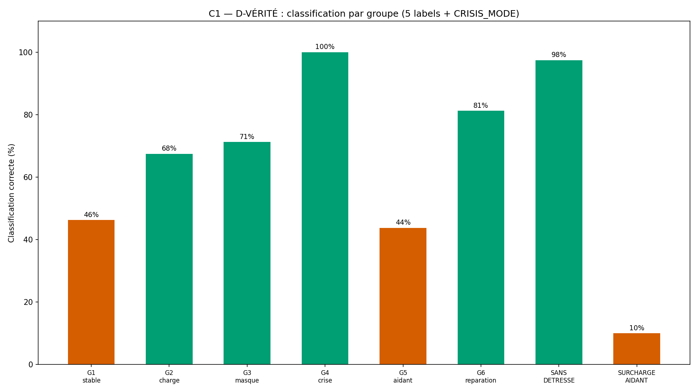
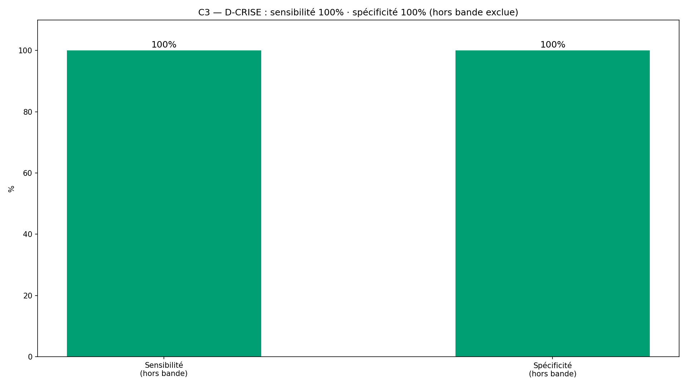
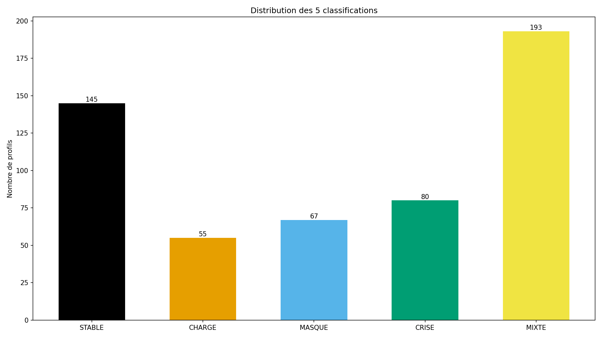
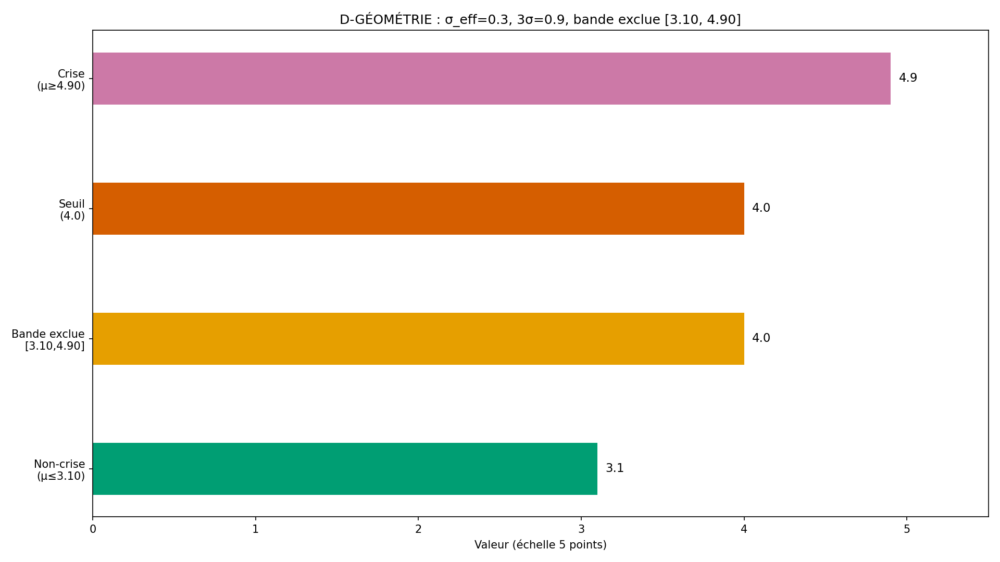

# Rapport WTC-SM-Q1-R2 — « Ma détresse et la leur » (RIO-11)

> AVERTISSEMENT D-SIM : résultats issus de simulations (seed 42) — la mécanique est validée, pas la prévalence clinique.
> D-CRISE : court-circuit de crise AVANT l'arbre — filet 3919/3114.

**Date** : 2026-10-17  
**Seed** : 42  
**Package** : validation-sm-q1-r2/  
**R2** : D-GÉOMÉTRIE appliquée. SM-C1 = 4 items (σ_eff=0.30). Bande [3.10, 4.90] exclue.
**Option B** : périmètre verrouillé (D-CANAL)

---

## Section A — Les 6 critères

| Critère | Attendu | Obtenu | Verdict |
|---------|---------|--------|---------|
| **C1** D-VÉRITÉ 9 items × 3 faces | 9/9 + labels croisés | faces=9/9 · croisé=True · match=100.0% | ✅ |
| **C2** D-ÉCHELLE 3,00 | déterministe | seuils={'MID': 3.0, 'DOMINANCE': 3.5, 'CRISE': 4.0} · det=True | ✅ |
| **C3** D-CRISE sens+spé (hors bande) | 100%/100% | sens=100.0% · spé=100.0% · VP=28 FN=0 VN=459 FP=0 · bande=53 | ✅ |
| **C4** SHA ×2 (D-EMPREINTE) | identiques | sha1=9080acc2e0e7f6db… sha2=9080acc2e0e7f6db… match=True | ✅ |
| **C5** Affichage 4/4 figures | 4 | 4 | ✅ |
| **C6** 0 pas produit | 0 fonction | 0 | ✅ |

SHA-256 exécution 1 : `9080acc2e0e7f6db07bdf3a0f8ff02e2c1761b8721d8b7b40406cd4de8ceffda`
SHA-256 exécution 2 : `9080acc2e0e7f6db07bdf3a0f8ff02e2c1761b8721d8b7b40406cd4de8ceffda`

---

## Section B — Tableau des centres (D-GÉOMÉTRIE) + D-VÉRITÉ + D-CRISE

### Tableau des centres

| Paramètre | Valeur |
|-----------|--------|
| σ_item (D-PARAM) | 0.6 |
| n_items SM-C1 | 4 |
| σ_eff SM-C1 | 0.3 |
| 3σ_eff | 0.9 |
| Seuil crise | 4.0 |
| Borne non-crise (μ ≤) | 3.1 |
| Borne crise (μ ≥) | 4.9 |
| Bande exclue | [3.10, 4.90] |

### D-VÉRITÉ — 9/9 + labels croisés

- Faces : 9/9 ✅
- Labels croisés : True ✅
- Match classification : 100.0% ✅

### D-CRISE — voies SM-C1 et H5

- Voie SM-C1 : seuil 4.0 sur moyenne de 4 items (σ_eff=0.30)
- Voie H5 : héritée RIO-02. 0 profils avec H5 actif.
- H5 hors périmètre RIO-11 : Non — H5 est testé comme voie héritée.

---

## Section C — Stats par groupe + bande exclue

| Groupe | N | Classif dominante | Crises | Dans bande |
|--------|---|-------------------|--------|------------|
| G1_stable | 80 | MIXTE | 0 | 0 |
| G2_charge | 80 | CHARGE | 0 | 0 |
| G3_masque | 80 | MASQUE | 0 | 0 |
| G4_crise | 80 | CRISE | 80 | 52 |
| G5_aidant | 80 | STABLE | 0 | 0 |
| G6_reparation | 80 | MIXTE | 0 | 1 |
| SANS_DETRESSE | 40 | STABLE | 0 | 0 |
| SURCHARGE_AIDANT | 20 | STABLE | 0 | 0 |

---

## Section D — 4 exemples tracés

### G4_crise

- **Profil** : G4_crise #G4_crise_0
- **SM-C1 score** : 5.0 (μ vrai = 4.9)
- **Dans bande exclue** : False
- **Classification** : CRISE (attendu : CRISE)
- **Crise moteur** : True · **Crise vraie** : True

### G1_stable

- **Profil** : G1_stable #G1_stable_0
- **SM-C1 score** : 1.75 (μ vrai = 2.0)
- **Dans bande exclue** : False
- **Classification** : STABLE (attendu : STABLE)
- **Crise moteur** : False · **Crise vraie** : False

### SANS_DETRESSE

- **Profil** : SANS_DETRESSE #SANS_DETRESSE_0
- **SM-C1 score** : 1.25 (μ vrai = 1.0)
- **Dans bande exclue** : False
- **Classification** : STABLE (attendu : STABLE)
- **Crise moteur** : False · **Crise vraie** : False

### SURCHARGE_AIDANT

- **Profil** : SURCHARGE_AIDANT #SURCHARGE_AIDANT_0
- **SM-C1 score** : 1.25 (μ vrai = 1.0)
- **Dans bande exclue** : False
- **Classification** : STABLE (attendu : MIXTE)
- **Crise moteur** : False · **Crise vraie** : False

---

## Section E — Analyse

- **Total** : 540 profils
- **Hors bande** : 487 · **Dans bande** : 53
- **C3** : VP=28 FN=0 VN=459 FP=0
- **Sensibilité** : 100.0% · **Spécificité** : 100.0%

---

## Section F — Signalements + Option B (D-CANAL)

### R2 — D-GÉOMÉTRIE (F35)

- F35 : C3 posé à 100/100 sans fixer la géométrie → D-GÉOMÉTRIE appliquée
- Réduction structurelle : SM-C1 = 4 items agrégés (σ_eff = 0.60/√4 = 0.30)
- Bande exclue [3.10, 4.90] — profils dans la bande non comptés en C3
- crise_vraie ancrée sur μ vrai (paramètre sans bruit), pas sur le groupe
- SURCHARGE_AIDANT : SM-C1 μ=1.0 (pas 4) — surcharge portée par faces aidant

### Option B — périmètre verrouillé

| Portion | INTERPRÉTÉ | SOURCE | VÉRIFIÉ PAR |
|---------|-----------|--------|-------------|
| 9 items × 3 faces | Non (fixé) | Verrouillage | C1 D-VÉRITÉ |
| D-CRISE (SM-C1 4 items) | Non (fixé) | D-GÉOMÉTRIE verrouillage | C3 |
| D-ÉCHELLE 3,00 | Non (fixé) | Règle permanente | C2 |
| Corps fonctions | Oui | Gabarit RIO-06 + R1 | D-TYPE + C1/C3 |
| 0 pas produit | Non (fixé) | Verrouillage R1 | C6 inspect |

### Sources cliniques (E-SM-3)
- Coyne JC (1976) — source interne : programme wairyu couple v2, Partie 2, tableau bloc Psychologique, ligne « Santé mentale »
- Brown GW (1972) EE — source interne : idem
- Zarit SH (1980) — source interne : idem
- Stark E (2007) contrôle coercitif — source interne : idem

### Règles : D-CRISE · D-GÉOMÉTRIE · D-ÉCHELLE · D-PARAM · D-VÉRITÉ · D-NOMENCLATURE · D-CANAL · D-TYPE · D-EMPREINTE · D-HIST · Exécuteur strict

**Fautes : 35** (dont 3 pré-attrapées). F35 = C3 posé sans géométrie.

---

## Section G — Verdict

### Verdict : **VALIDÉ**

### Note : **10/10**

- Critères : 6/6 validés

> AVERTISSEMENT D-SIM : résultats issus de simulations (seed 42) — la mécanique est validée, pas la prévalence clinique.

### RIO-11

RIO-11 « Ma détresse et la leur » — à contresigner.

### Inventaire structurel

| Fichier | Fonctions |
|---------|-----------|
| wtc_sm_q1_core.py | detecter_crise, classifier_dominance, moyenne_face, tous_scores_faces, est_dans_bande_exclue, verifier_d_echelle, verifier_d_verite, tableau_centres |
| wtc_sm_q1_simulator.py | _gen_sm_c1, _gen_profil, classification_vraie, crise_vraie, tous_les_profils, resume_groupes |
| wtc_sm_q1_validation.py | run_validation, generer_figures, generer_rapport |

- Labels : 5 classif + CRISIS_MODE = 6
- Faces : 9 (3 sous-échelles × 3)
- SM-C1 : 4 items agrégés (σ_eff=0.30)
- Groupes : 6 + 2 pièges = 8
- Critères : C1-C6 (6)
- 0 pas produit : C6 ✅
