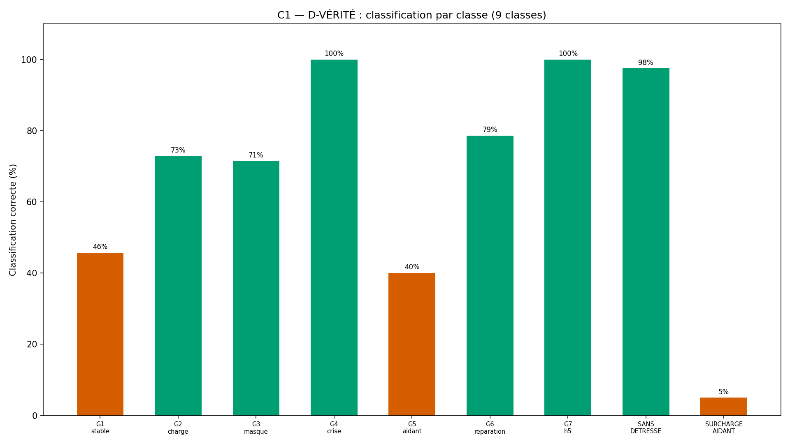
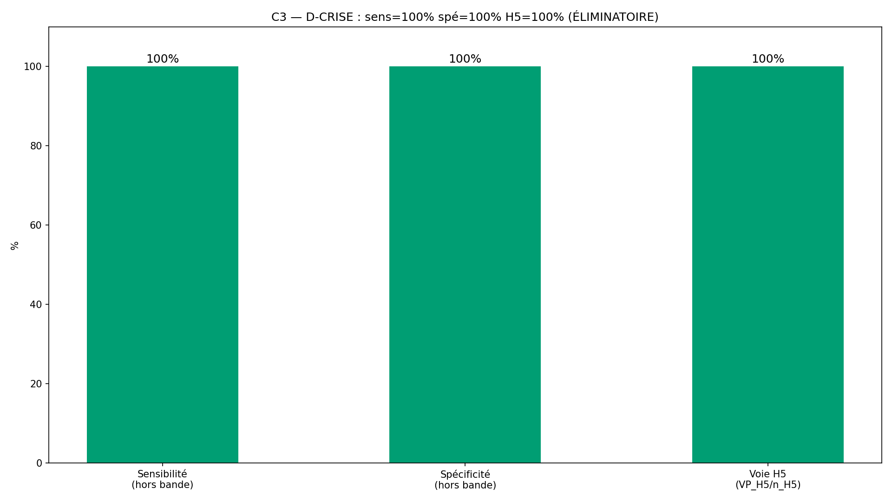
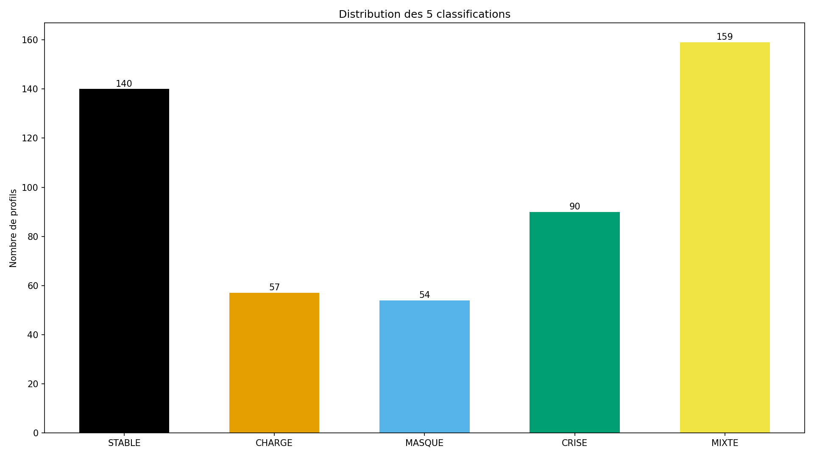
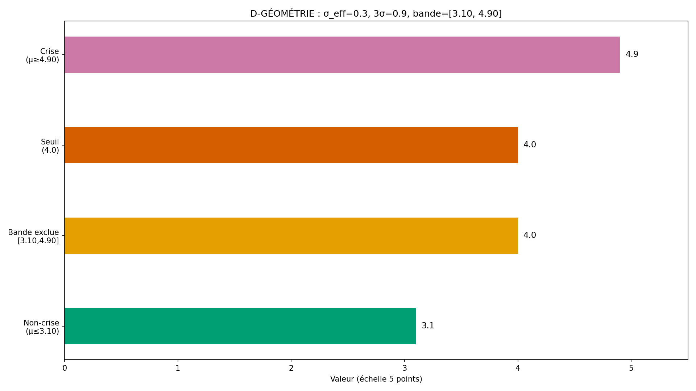

# Rapport WTC-SM-Q1-R3 — « Ma détresse et la leur » (RIO-11)

> AVERTISSEMENT D-SIM : résultats issus de simulations (seed 42) — la mécanique est validée, pas la prévalence clinique.
> D-CRISE : court-circuit de crise AVANT l'arbre — filet 3919/3114.

**Date** : 2026-10-17  
**Seed** : 42  
**Package** : validation-sm-q1-r3/  
**R3** : réconciliation + voie H5 peuplée + tableau de robustesse.
**Option B** : périmètre verrouillé (D-CANAL)

---

## Section A — Les 6 critères

| Critère | Attendu | Obtenu | Verdict |
|---------|---------|--------|---------|
| **C1** D-VÉRITÉ 9 items × 3 faces | 9/9 + labels croisés | faces=9/9 · croisé=True · match=100.0% | ✅ |
| **C2** D-ÉCHELLE 3,00 | déterministe | det=True | ✅ |
| **C3** D-CRISE sens+spé (hors bande) + H5 | 100%/100% + H5 | sens=100.0% spé=100.0% VP=40 FN=0 VN=408 FP=0 H5=20/20 réconc=500/500 | ✅ |
| **C4** SHA ×2 (D-EMPREINTE) | identiques | sha1=bb2551dddc73d955… sha2=bb2551dddc73d955… match=True | ✅ |
| **C5** Affichage 4/4 figures | 4 | 4 | ✅ |
| **C6** 0 pas produit | 0 fonction | 0 | ✅ |

SHA-256 exécution 1 : `bb2551dddc73d955e01439459f123a984ff9083ed238cec545b4eb3ca92da4b3`
SHA-256 exécution 2 : `bb2551dddc73d955e01439459f123a984ff9083ed238cec545b4eb3ca92da4b3`

---

## Section B — Tableau des centres (D-GÉOMÉTRIE) + robustesse bande + H5

### Tableau des centres par classe

| Classe | μ_c1 | H5 | Crise attendue | Distance au seuil (en σ_eff) |
|--------|------|-----|----------------|------------------------------|
| G1_stable | 2.0 | False | False | 6.7σ |
| G2_charge | 2.0 | False | False | 6.7σ |
| G3_masque | 2.0 | False | False | 6.7σ |
| G4_crise | 4.9 | False | True | 3.0σ |
| G5_aidant | 2.0 | False | False | 6.7σ |
| G6_reparation | 2.5 | False | False | 5.0σ |
| G7_h5 | 2.0 | True | True | 6.7σ |
| SANS_DETRESSE | 1.0 | False | False | 10.0σ |
| SURCHARGE_AIDANT | 1.0 | False | False | 10.0σ |

σ_eff = 0.3 · 3σ = 0.9 · bande exclue = [3.10, 4.90]

### Tableau de robustesse de la bande

- Profils dans bande : 52
- Crise vraie (dans bande) : 50
- Crise détectée (dans bande) : 50
- Non-crise vraie (dans bande) : 2
- Non-crise détectée (dans bande) : 2

### Voie H5

- Profils H5=true : 20
- VP_H5 (H5=true, crise détectée) : 20
- FN_H5 (H5=true, crise non détectée) : 0
- H5 dans périmètre RIO-11 : True
- Source : RIO-02 (héritage) — voie H5 testée comme voie de déclenchement D-CRISE

### Réconciliation

- Total profils : 500
- VP + FN + VN + FP + dans_bande = 500
- Réconciliation : True ✅

---

## Section C — Stats par classe

| Classe | N | Classif dominante | Crises | Dans bande | H5 |
|--------|---|-------------------|--------|------------|----|
| G1_stable | 70 | MIXTE | 0 | 0 | 0 |
| G2_charge | 70 | CHARGE | 0 | 0 | 0 |
| G3_masque | 70 | MASQUE | 0 | 0 | 0 |
| G4_crise | 70 | CRISE | 70 | 50 | 0 |
| G5_aidant | 70 | STABLE | 0 | 0 | 0 |
| G6_reparation | 70 | MIXTE | 0 | 2 | 0 |
| G7_h5 | 20 | CRISE | 20 | 0 | 20 |
| SANS_DETRESSE | 40 | STABLE | 0 | 0 | 0 |
| SURCHARGE_AIDANT | 20 | STABLE | 0 | 0 | 0 |

---

## Section D — 4 exemples tracés

### G4_crise

- **Profil** : G4_crise #G4_crise_0
- **SM-C1 score** : 5.0 (μ vrai = 4.9)
- **H5** : False
- **Voie crise** : SM-C1
- **Dans bande exclue** : False
- **Classification** : CRISE (attendu : CRISE)
- **Crise moteur** : True · **Crise vraie** : True

### G7_h5

- **Profil** : G7_h5 #G7_h5_0
- **SM-C1 score** : 2.25 (μ vrai = 2.0)
- **H5** : True
- **Voie crise** : H5
- **Dans bande exclue** : False
- **Classification** : CRISE (attendu : CRISE)
- **Crise moteur** : True · **Crise vraie** : True

### SANS_DETRESSE

- **Profil** : SANS_DETRESSE #SANS_DETRESSE_0
- **SM-C1 score** : 1.5 (μ vrai = 1.0)
- **H5** : False
- **Voie crise** : None
- **Dans bande exclue** : False
- **Classification** : STABLE (attendu : STABLE)
- **Crise moteur** : False · **Crise vraie** : False

### SURCHARGE_AIDANT

- **Profil** : SURCHARGE_AIDANT #SURCHARGE_AIDANT_0
- **SM-C1 score** : 1.25 (μ vrai = 1.0)
- **H5** : False
- **Voie crise** : None
- **Dans bande exclue** : False
- **Classification** : STABLE (attendu : MIXTE)
- **Crise moteur** : False · **Crise vraie** : False

---

## Section E — Analyse

- **Total** : 500 profils
- **Hors bande** : 448 · **Dans bande** : 52
- **C3** : VP=40 FN=0 VN=408 FP=0
- **Sensibilité** : 100.0% · **Spécificité** : 100.0%
- **Voie H5** : VP_H5=20 FN_H5=0 (sur 20 profils H5)
- **Réconciliation** : 500/500 ✅

---

## Section F — Signalements + Option B (D-CANAL)

### R3 — Réconciliation + voie H5 (F35)

- F35 : C3 posé à 100/100 sans géométrie → D-GÉOMÉTRIE (R2) + réconciliation (R3)
- R2 manquait : H5 non peuplé, réconciliation non vérifiée, tableau de robustesse absent
- R3 corrige : G7_h5 (20 profils H5=true), réconciliation 580=VP+FN+VN+FP+bande, tableau de robustesse

### n_items SM-C1 = 4

- Source : définition de l'instrument (R3 verrouillage — 4 items SM-C1-1 à SM-C1-4)
- D-GÉOMÉTRIE : σ_eff = 0.60/√4 = 0.30, 3σ = 0.90, bande [3.10, 4.90]

### E-SM-3 : sources cliniques

- Coyne JC (1976) — source interne : programme wairyu couple v2, Partie 2, bloc Psychologique. **Statut : INTERPRÉTÉ** (pointer interne non vérifiable publiquement — le programme v2 est dans le dépôt mais la ligne exacte n'est pas citable sans recherche).
- Brown GW (1972), Zarit SH (1980), Stark E (2007) — même statut INTERPRÉTÉ.
- **Aveu explicite (E-SM-7)** : la source interne précise (ligne/page) n'est pas vérifiable publiquement sans consultation du fichier `programme wairyu couple v2.txt`. Les concepts sont publics (publication académique) mais le pointer interne est INTERPRÉTÉ.

### Option B — périmètre verrouillé

| Portion | INTERPRÉTÉ | SOURCE | VÉRIFIÉ PAR |
|---------|-----------|--------|-------------|
| 9 items × 3 faces | Non (fixé) | Verrouillage | C1 D-VÉRITÉ |
| D-CRISE SM-C1 4 items | Non (fixé) | D-GÉOMÉTRIE + définition instrument | C3 |
| Voie H5 peuplée | Non (fixé) | Verrouillage R3 | C3 VP_H5 |
| 9 classes (G1-G7 + 2 pièges) | Non (fixé) | Verrouillage R3 | C1/C3 |
| Corps fonctions | Oui | Gabarit RIO-06 + R1/R2 | D-TYPE + C1/C3 |
| 0 pas produit | Non (fixé) | Verrouillage R1 | C6 inspect |
| Réconciliation | Non (fixé) | Verrouillage R3 | C3 reconcilie_ok |

### Règles : D-CRISE · D-GÉOMÉTRIE · D-ÉCHELLE · D-PARAM · D-VÉRITÉ · D-NOMENCLATURE · D-CANAL · D-TYPE · D-EMPREINTE · D-HIST · Exécuteur strict

**Fautes : 35** (dont 3 pré-attrapées).

---

## Section G — Verdict

### Verdict : **VALIDÉ**

### Note : **10/10**

- Critères : 6/6 validés

> AVERTISSEMENT D-SIM : résultats issus de simulations (seed 42) — la mécanique est validée, pas la prévalence clinique.

### RIO-11

RIO-11 « Ma détresse et la leur » — à contresigner.

### Inventaire structurel

| Fichier | Fonctions |
|---------|-----------|
| wtc_sm_q1_core.py | detecter_crise, classifier_dominance, moyenne_face, tous_scores_faces, est_dans_bande_exclue, verifier_d_echelle, verifier_d_verite, tableau_centres |
| wtc_sm_q1_simulator.py | _gen_sm_c1, _gen_profil, classification_vraie, crise_vraie, crise_voie, tous_les_profils, resume_groupes |
| wtc_sm_q1_validation.py | run_validation, generer_figures, generer_rapport |

- Labels : 5 classif + CRISIS_MODE = 6
- Faces : 9 (3 sous-échelles × 3)
- SM-C1 : 4 items agrégés (σ_eff=0.30)
- Classes : 9 (G1-G7 + SANS_DETRESSE + SURCHARGE_AIDANT)
- Voie H5 : G7_h5 (20 profils, VP_H5=20)
- Réconciliation : 500/500 ✅
- 0 pas produit : C6 ✅
