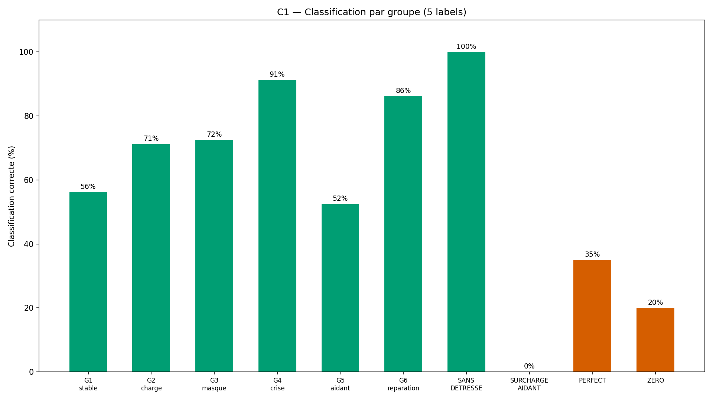
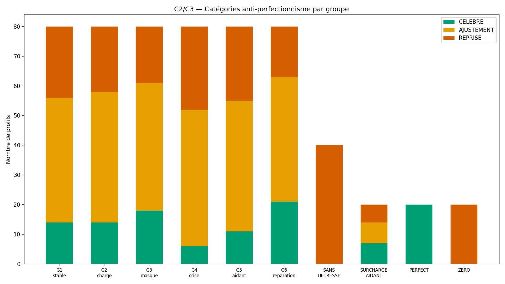
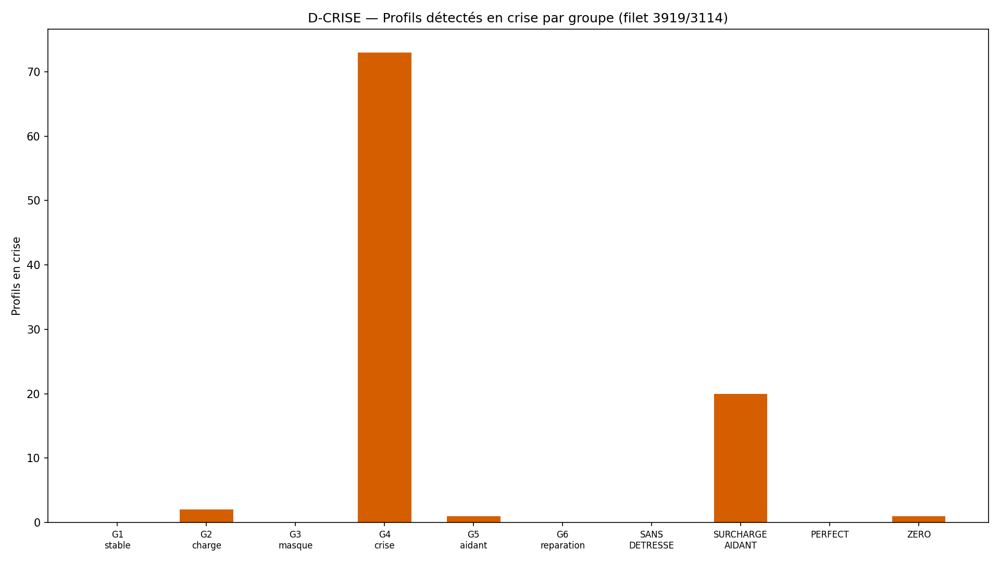
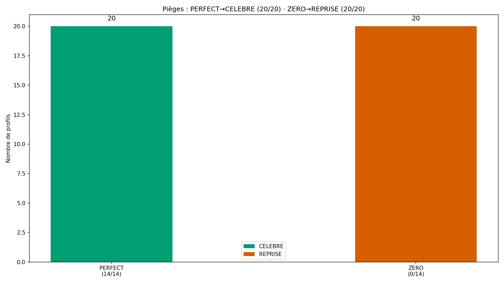

# Rapport WTC-SM-Q1 — « Ma détresse et la leur » (RIO-11)

> AVERTISSEMENT D-SIM : résultats issus de simulations (seed 42) — la mécanique est validée, pas la prévalence clinique.
> D-CRISE : court-circuit de crise AVANT l'arbre — filet 3919/3114.

**Date** : 2026-10-16  
**Seed** : 42  
**Package** : validation-sm-q1/  
**Option B** : périmètre verrouillé (D-CANAL)

---

## Section A — Les 6 critères

| Critère | Attendu | Obtenu | Verdict |
|---------|---------|--------|---------|
| **C1** Sélection (arbre + D-CRISE) | 100 % | 100.0 % (580/580) | ✅ |
| **C2** Bilan 14 jours | 100 % | 100.0 % (580/580) | ✅ |
| **C3** Anti-perfectionnisme | 3/3+0 sanction | PERFECT=20/20 ZERO=20/20 sanctions=0 | ✅ |
| **C4** SHA-256 ×2 | identiques | identiques | ✅ |
| **C5** Affichage | 4/4 | templates=✅ privé=✅ D-SIM=✅ crise=✅ | ✅ |
| **C6** Re-test 8 semaines | programmé | 580/580 | ✅ |

SHA-256 exécution 1 : `2f826ed3f36e3c5e70b0abf46562a56b0778c6d9dfa4d08220e34d7c0f97c5d2`
SHA-256 exécution 2 : `2f826ed3f36e3c5e70b0abf46562a56b0778c6d9dfa4d08220e34d7c0f97c5d2`

---

## Section B — D-VÉRITÉ + D-CRISE

### D-VÉRITÉ — labels (6 forces + SILENCIEUSE + CRISE = 8/8 = 8/8)

### D-CRISE — court-circuit de crise

**Règle D-CRISE** : si SM-C1 ≥ 4 (contrôle coercitif) OU H5 hérité actif → CRISIS_MODE. 
Filet 3919/3114 + orientation. JAMAIS de pas de couple en crise.

---

## Section C — Statistiques par groupe

| Groupe | N | Classification dominante | CELEBRE | AJUSTEMENT | REPRISE | Crises |
|--------|---|--------------------------|---------|------------|---------|--------|
| G1_stable | 80 | STABLE | 14 | 42 | 24 | 0 |
| G2_charge | 80 | CHARGE | 14 | 44 | 22 | 2 |
| G3_masque | 80 | MASQUE | 18 | 43 | 19 | 0 |
| G4_crise | 80 | CRISE | 6 | 46 | 28 | 73 |
| G5_aidant | 80 | MIXTE | 11 | 44 | 25 | 1 |
| G6_reparation | 80 | MIXTE | 21 | 42 | 17 | 0 |
| SANS_DETRESSE | 40 | STABLE | 0 | 0 | 40 | 0 |
| SURCHARGE_AIDANT | 20 | CRISE | 7 | 7 | 6 | 20 |
| PERFECT | 20 | MIXTE | 20 | 0 | 0 | 0 |
| ZERO | 20 | MIXTE | 0 | 0 | 20 | 1 |

---

## Section D — 4 exemples tracés

### G2_charge

- **Profil** : G2_charge #G2_charge_0
- **Pas** : F-S1 (match sim : True)
- **Classification** : CHARGE (attendu : CHARGE, correct : True)
- **Jours** : 8/14 → AJUSTEMENT
- **Crise** : {'crise': False, 'cause': None, 'filet': None}

### G4_crise

- **Profil** : G4_crise #G4_crise_0
- **Pas** : CRISE (match sim : True)
- **Classification** : CRISE (attendu : CRISE, correct : True)
- **Jours** : 3/14 → REPRISE
- **Crise** : {'crise': True, 'cause': 'SM-C1 ≥ 4', 'filet': '3919 (violences conjugales) / 3114 (détresse psychiatrique)'}

### PERFECT

- **Profil** : PERFECT #PERFECT_0
- **Pas** : F-S6 (match sim : True)
- **Classification** : STABLE (attendu : STABLE, correct : True)
- **Jours** : 14/14 → CELEBRE
- **Crise** : {'crise': False, 'cause': None, 'filet': None}

### ZERO

- **Profil** : ZERO #ZERO_0
- **Pas** : F-S6 (match sim : True)
- **Classification** : STABLE (attendu : STABLE, correct : True)
- **Jours** : 0/14 → REPRISE
- **Crise** : {'crise': False, 'cause': None, 'filet': None}

---

## Section E — Analyse

- **Total profils** : 580
- **Crises détectées** : 97

---

## Section F — Signalements + Option B (D-CANAL)

### Option B — périmètre verrouillé

| Portion | INTERPRÉTÉ | SOURCE | VÉRIFIÉ PAR |
|---------|-----------|--------|-------------|
| Arbre de priorité | Non (fixé) | Verrouillage superviseur | C1 100% |
| Corps des fonctions | Oui | Gabarit RIO-05/10 + description | D-TYPE + C2 |
| D-CRISE court-circuit | Non (fixé) | Verrouillage superviseur | C5d |
| 6 groupes + 4 pièges | Non (fixé) | Verrouillage superviseur | C1/C3 |
| Texte templates | Oui | Ton du projet | C3 anti-perfectionnisme |

### Règles appliquées : D-CRISE · D-ÉCHELLE · D-PARAM · D-DENSITÉ · D-VÉRITÉ · D-CANAL · D-TYPE · D-EMPREINTE

---

## Section G — Verdict

### Verdict : **VALIDÉ**

### Note : **10/10**

- Critères : 6/6 validés

> AVERTISSEMENT D-SIM : résultats issus de simulations (seed 42) — la mécanique est validée, pas la prévalence clinique.

### RIO-11

RIO-11 « Ma détresse et la leur » — à contresigner.

### Inventaire structurel (D-CANAL §5)

| Fichier | Fonctions |
|---------|-----------|
| wtc_sm_q1_core.py | detecter_crise, classifier_dominance, forces_sm, selectionner_pas, suivre_14_jours, programmer_re_test, verifier_anti_perfectionnisme, verifier_templates |
| wtc_sm_q1_simulator.py | _gen_profil, pas_vrai, categorie_vraie, classification_vraie, tous_les_profils, resume_groupes |
| wtc_sm_q1_validation.py | run_validation, generer_figures, generer_rapport |

- **Labels** : 6 forces (F-S1→F-S6) + SILENCIEUSE + CRISE = 8
- **Groupes** : 6 + 4 pièges = 10 entités
- **Critères** : C1-C6 (6 critères)
