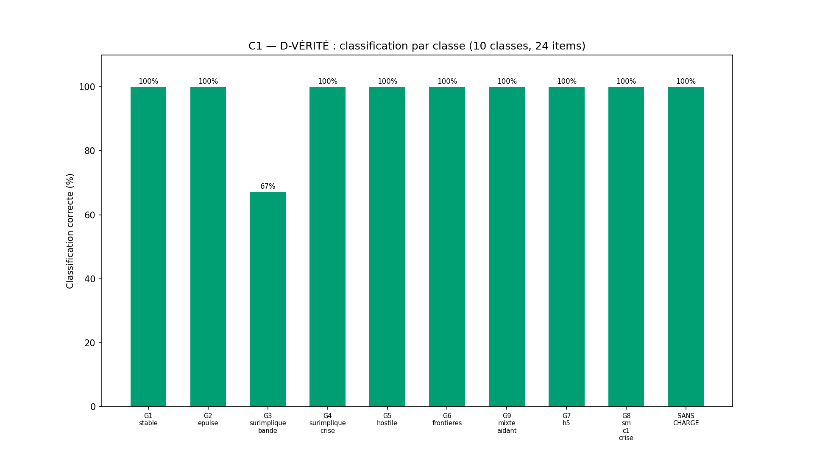
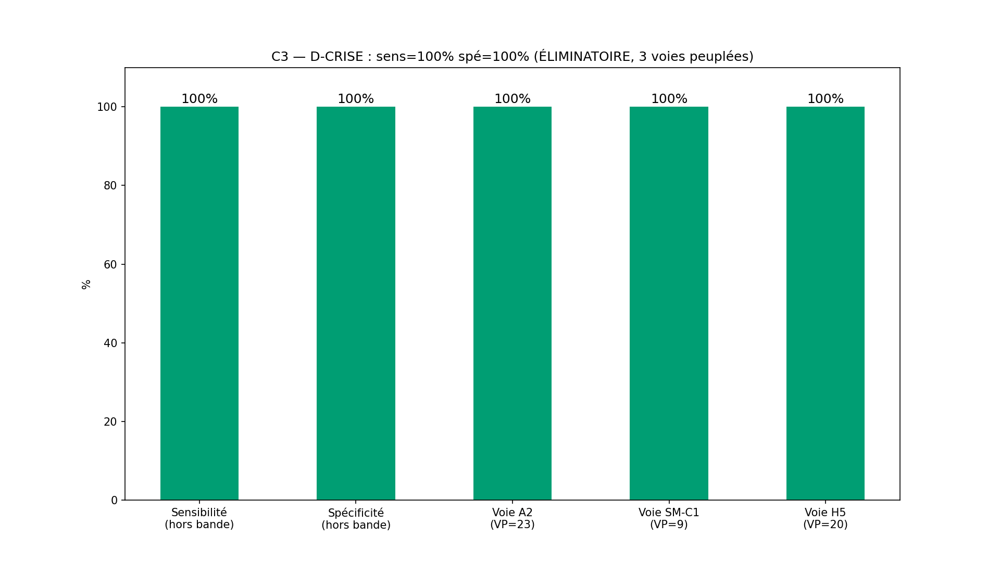
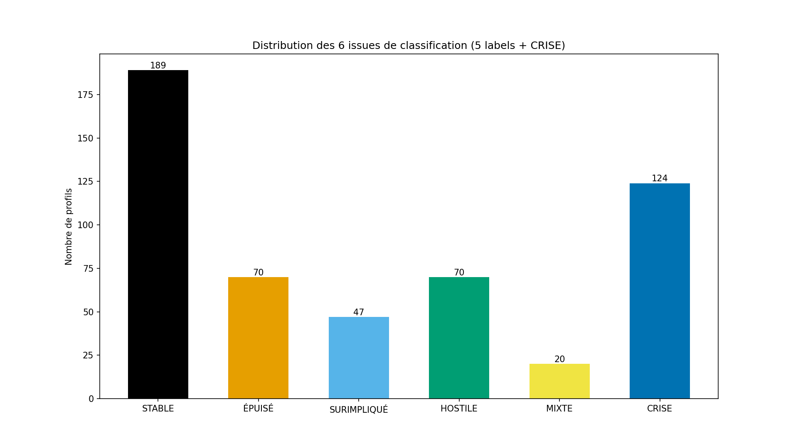
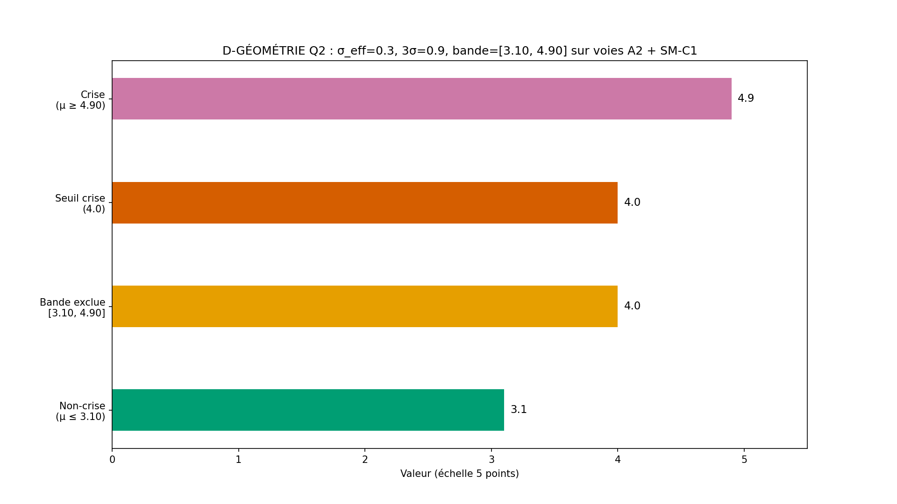

# Rapport WTC-SM-Q2 — « Ce que je porte pour toi » (RIO-12)

> AVERTISSEMENT D-SIM : résultats issus de simulations (seed 42) — la mécanique est validée, pas la prévalence clinique.
> D-CRISE : court-circuit de crise AVANT l'arbre — filet 3919/3114.

**Date** : 2026-10-17  
**Seed** : 42  
**Package** : validation-sm-q2/  
**Production** : reproduction verrouillée par le superviseur-pont (SUP-TAKEOVER-1) — verrouillage SM-Q2-VERROUILLAGE + arbitrage Q2-C3-ARBITRAGE, empreinte propre (les commits de l'exécuteur étaient inaccessibles ; rien de publié n'est retouché, D-EMPREINTE).

---

## Section A — Les 6 critères

| Critère | Attendu | Obtenu | Verdict |
|---------|---------|--------|---------|
| **C1** D-VÉRITÉ 6 faces × 4 items | 24/24 + labels croisés | faces=6/6 · items=24/24 · croisé=True · match=100.0% | ✅ |
| **C2** D-ÉCHELLE 3,00 (2 axes) | déterministe | det=True | ✅ |
| **C3** D-CRISE sens+spé hors bande + 3 voies + frontière | 100%/100% + VP>0 par voie + 3,99/4,00 | sens=100.0% spé=100.0% VP=52 FN=0 VN=342 FP=0 · A2=23 SM-C1=9 H5=20 · frontière=True · réconc=520/520 | ✅ |
| **C4** SHA ×2 (D-EMPREINTE) | identiques | sha1=f57fc089e85861b5… sha2=f57fc089e85861b5… match=True | ✅ |
| **C5** Affichage des figures 4/4 | 4 | 4 | ✅ |
| **C6** 0 pas produit | 0 fonction | 0 | ✅ |

SHA-256 exécution 1 : `f57fc089e85861b51ac4955231e0bae9f7f73d6cf7995f7025b2f2c006aa1a98`
SHA-256 exécution 2 : `f57fc089e85861b51ac4955231e0bae9f7f73d6cf7995f7025b2f2c006aa1a98`

---

## Section B — Tableau des centres (D-GÉOMÉTRIE) + voies + frontière

σ_eff = 0.3 · 3σ = 0.9 · bande exclue = [3.10, 4.90] (sur voies A2 et SM-C1)

### Tableau des centres par classe

| Classe | N | μ_A2 | μ_C1 | H5 | Crise attendue | Rôle |
|--------|---|------|------|----|----------------|------|
| G1_stable | 70 | 2.0 | 2.0 | False | False | aidant sans charge excessive (base) |
| G2_epuise | 70 | 2.0 | 2.0 | False | False | épuisement élevé, présence maintenue |
| G3_surimplique_bande | 70 | 3.7 | 2.0 | False | False | piège SURCHARGE_AIDANT (b) — surimplication en bande |
| G4_surimplique_crise | 70 | 4.9 | 2.0 | False | True | piège SURCHARGE_AIDANT (a) — surimplication sévère |
| G5_hostile | 70 | 2.0 | 2.0 | False | False | hostilité installée (EE), sans surimplication |
| G6_frontieres | 70 | 2.0 | 2.0 | False | False | frontières B hautes — test B non classifiantes |
| G9_mixte_aidant | 20 | 2.0 | 2.0 | False | False | deux faces A hautes — n_high = 2 |
| G7_h5 | 20 | 2.0 | 2.0 | True | True | voie H5 héritée (RIO-02) |
| G8_sm_c1_crise | 20 | 2.0 | 4.9 | False | True | voie SM-C1 héritée (Q1) |
| SANS_CHARGE | 40 | 1.0 | 1.0 | False | False | piège anti-fabrication (tout bas) |

### Voies D-CRISE (3 peuplées, VP/FN par voie)

| Voie | Origine | VP (hors bande) | FN | N voie vraie | Peuplée |
|------|---------|-----------------|----|--------------|---------|
| A2 | Q2 (nouvelle — surimplication sévère) | 23 | 0 | 70 | ✅ |
| SM-C1 | héritée Q1 (contrôle coercitif) | 9 | 0 | 20 | ✅ |
| H5 | héritée RIO-02 (item de sécurité) | 20 | 0 | 20 | ✅ |

### Test de frontière 3,99/4,00 (verrouillé)

- A2 = 4.00 → crise : True (attendu True)
- A2 = 3.99 → crise : False (attendu False)
- SM-C1 = 4.00 → crise : True (attendu True)
- SM-C1 = 3.99 → crise : False (attendu False)
- Frontière OK : **True**

### Bascule A2 de la bande (SURIMPLIQUÉ non-crise, centre 3.70)

- G3_surimplique_bande : 70 profils
- Bascule observée (crise moteur) : 14 (20.0%)
- Théorie continue (verrouillage) : 15.87%
- Fallthrough STABLE : 9
- Toutes les bascules tombent DANS la bande → exclues du décompte C3 (grain entier des items : la variance effective du tirage dépasse l'approximation continue — documenté, Section F)

### Tableau de robustesse de la bande

- Profils dans bande : 126
- Crise vraie (dans bande) : 58
- Crise détectée (dans bande) : 72
- Non-crise vraie (dans bande) : 68
- Non-crise détectée (dans bande) : 54

### Réconciliation

- Total profils : 520
- VP + FN + VN + FP + dans_bande = 520
- Réconciliation : ✅

---

## Section C — Stats par classe

| Classe | N | Dominante | Correct | Crises | Dans bande | H5 |
|--------|---|-----------|---------|--------|------------|----|
| G1_stable | 70 | STABLE | 70/70 | 0 | 0 | 0 |
| G2_epuise | 70 | ÉPUISÉ | 70/70 | 0 | 0 | 0 |
| G3_surimplique_bande | 70 | SURIMPLIQUÉ | 47/70 | 14 | 67 | 0 |
| G4_surimplique_crise | 70 | CRISE | 70/70 | 70 | 47 | 0 |
| G5_hostile | 70 | HOSTILE | 70/70 | 0 | 0 | 0 |
| G6_frontieres | 70 | STABLE | 70/70 | 0 | 1 | 0 |
| G9_mixte_aidant | 20 | MIXTE | 20/20 | 0 | 0 | 0 |
| G7_h5 | 20 | CRISE | 20/20 | 20 | 0 | 20 |
| G8_sm_c1_crise | 20 | CRISE | 20/20 | 20 | 11 | 0 |
| SANS_CHARGE | 40 | STABLE | 40/40 | 0 | 0 | 0 |

---

## Section D — Profils tracés

### G4_surimplique_crise (piège SURCHARGE_AIDANT (a) — surimplication sévère)

- **Profil** : G4_surimplique_crise_0
- **A2 score** : 5.0 (μ vrai = 4.9)
- **SM-C1 score** : 2.0 (μ vrai = 2.0)
- **H5** : False
- **Voie moteur** : A2 · **Voie vraie** : A2
- **Dans bande exclue** : False
- **Classification** : CRISE (attendu : CRISE)

### G8_sm_c1_crise (voie SM-C1 héritée (Q1))

- **Profil** : G8_sm_c1_crise_0
- **A2 score** : 1.75 (μ vrai = 2.0)
- **SM-C1 score** : 5.0 (μ vrai = 4.9)
- **H5** : False
- **Voie moteur** : SM-C1 · **Voie vraie** : SM-C1
- **Dans bande exclue** : False
- **Classification** : CRISE (attendu : CRISE)

### G7_h5 (voie H5 héritée (RIO-02))

- **Profil** : G7_h5_0
- **A2 score** : 2.25 (μ vrai = 2.0)
- **SM-C1 score** : 2.0 (μ vrai = 2.0)
- **H5** : True
- **Voie moteur** : H5 · **Voie vraie** : H5
- **Dans bande exclue** : False
- **Classification** : CRISE (attendu : CRISE)

### G3_surimplique_bande (piège SURCHARGE_AIDANT (b) — surimplication en bande)

- **Profil** : G3_surimplique_bande_0
- **A2 score** : 3.75 (μ vrai = 3.7)
- **SM-C1 score** : 2.25 (μ vrai = 2.0)
- **H5** : False
- **Voie moteur** : None · **Voie vraie** : None
- **Dans bande exclue** : True
- **Classification** : SURIMPLIQUÉ (attendu : SURIMPLIQUÉ)

### G6_frontieres (frontières B hautes — test B non classifiantes)

- **Profil** : G6_frontieres_0
- **A2 score** : 2.0 (μ vrai = 2.0)
- **SM-C1 score** : 2.25 (μ vrai = 2.0)
- **H5** : False
- **Voie moteur** : None · **Voie vraie** : None
- **Dans bande exclue** : False
- **Classification** : STABLE (attendu : STABLE)

### SANS_CHARGE (piège anti-fabrication (tout bas))

- **Profil** : SANS_CHARGE_0
- **A2 score** : 2.5 (μ vrai = 2.0)
- **SM-C1 score** : 1.0 (μ vrai = 1.0)
- **H5** : False
- **Voie moteur** : None · **Voie vraie** : None
- **Dans bande exclue** : False
- **Classification** : STABLE (attendu : STABLE)

---

## Section E — Analyse

- **Univers** : 520 profils, 10 classes (7 groupes + piège SURCHARGE_AIDANT en 2 configs + piège SANS_CHARGE + voie H5)
- **Hors bande** : 394 · **Dans bande** : 126
- **C3 hors bande** : VP=52 FN=0 VN=342 FP=0 — sens=100.0% spé=100.0%
- **Voie A2** : VP=23 FN=0 (voie vraie : 70 profils)
- **Voie SM-C1** : VP=9 FN=0 (voie vraie : 20 profils)
- **Voie H5** : VP=20 FN=0 (voie vraie : 20 profils)
- **Labels peuplés** : ['CRISE', 'HOSTILE', 'MIXTE', 'STABLE', 'SURIMPLIQUÉ', 'ÉPUISÉ']
- **Réconciliation** : 520/520 ✅

---

## Section F — Sources par face, signalements, périmètre

### Sources cliniques par face

| Face | Construct | Source | Statut |
|------|-----------|--------|--------|
| SM-A1 « L'épuisement » | fatigue du soutien | Zarit SH (1980) — burden interview | CONSTRUIT PUBLIC · instrument ex nihilo |
| SM-A2 « La surimplication » | contrôle, décisions pour l'autre | Zarit (1980) + contrôle coercitif (héritage Q1 SM-C1) | CONSTRUIT PUBLIC · INTERPRÉTÉ pour le seuil 4.0 hérité |
| SM-A3 « L'hostilité » | critique installée | Brown GW (1972) — émotion exprimée (EE) | CONSTRUIT PUBLIC |
| SM-B1 « Le retrait » | se fermer pour se protéger | `programme wairyu couple.txt` **ligne 133** — « La frontière co-étiquetée » (vérifié verbatim à la prise en main) | SOURCE INTERNE VÉRIFIÉE |
| SM-B2 « La culpabilité » | « si tu vas mal, c'est ma faute » | ligne 133 (même ancrage Axe B) | SOURCE INTERNE VÉRIFIÉE |
| SM-B3 « La réparation » | se retrouver après crise | ligne 133 (même ancrage Axe B) | SOURCE INTERNE VÉRIFIÉE |
| Voie SM-C1 (héritée) | contrôle coercitif | cycle de Coyne (1976) — `programme wairyu couple.txt` **ligne 101** (E-SM-3 clôturé, pointer vérifié verbatim) | SOURCE INTERNE VÉRIFIÉE |
| Voie H5 (héritée) | sécurité (RIO-02) | héritage instrument RIO-02 | SOURCE PROJET |

### Faces B : nouvelles (correction §6)

- Q1-R3 n'a PAS de faces B (9 faces D/A/C vérifiées sur source) — B1/B2/B3 sont des faces NOUVELLES ancrées ligne 133 ; la phrase §6 de la SPEC (« Q2 reprend les 6 faces A+B ») est corrigée au commit du présent package.

### Grain entier des items (signalement géométrique, non bloquant)

- La théorie continue du verrouillage (bascule 15,9 %) sous-estime le taux observé : les items sont des ENTIERS 1-5 (arrondi du tirage normal), la variance effective de la moyenne 4 items dépasse σ_eff = 0.30 en proche voisinage des seuils. Conséquences : fallthrough STABLE et bascules CRISE plus nombreux sur G3_surimplique_bande — toutes les bascules retombant dans la bande, la spécificité C3 reste 100 %. Documenté pour Q3 (centres à ≥ 0.5 pt des seuils de classification si l'on veut des stats par classe serrées).

### Option B — périmètre verrouillé (D-CANAL)

| Portion | INTERPRÉTÉ | SOURCE | VÉRIFIÉ PAR |
|---------|-----------|--------|-------------|
| 6 faces × 4 items = 24 | Non (fixé) | Verrouillage (4 items/face, σ_eff=0.30) | C1 D-VÉRITÉ |
| n_high faces A (3,50) | Non (fixé) | Verrouillage (déterministe) | C1/C3 |
| D-CRISE 3 voies (A2 ∨ SM-C1 ∨ H5) | Non (fixé) | Verrouillage + arbitrage C3 | C3 voies |
| Bande [3.10, 4.90] sur A2 ET SM-C1 | Non (fixé) | Arbitrage Q2-C3 (héritage Q1-R3) | C3 réconciliation |
| Centres : crise 4.9, non-crise ≤ 2.5, bande 3.70 | Non (fixé) | Arbitrage Q2-C3 | Section B |
| 2 pièges (SANS_CHARGE, SURCHARGE_AIDANT ×2 configs) | Non (fixé) | Verrouillage | C1/C3 |
| Voies héritées SM-C1/H5 hors instrument | Oui (portage) | Héritage Q1-R3 lu sur source | C3 VP par voie |
| Corps des fonctions, noms internes des groupes | Oui | LIBRE (verrouillage §10) | D-TYPE + C1/C3 |
| 0 pas produit | Non (fixé) | Verrouillage R1 | C6 inspect |

### Règles

D-CRISE · D-GÉOMÉTRIE · D-ÉCHELLE · D-PARAM · D-VÉRITÉ · D-NOMENCLATURE · D-CANAL · D-CANAL-2 · D-TYPE · D-EMPREINTE · D-LECTURE · D-HIST · Exécuteur strict (auto-audit pont : production → run ×2 → SHA ×2 → publication → pointeurs → audit sur origin → contresignature)

**Fautes : 36** (dont 4 pré-attrapées) — la n°36 (E-SM-11 faux positif d'affichage) est une faute d'AUDIT levée à la prise en main, hors code package ; voir registre + erratum worklog.

---

## Section G — Verdict

### Verdict : **VALIDÉ**

### Note : **10/10**

- Critères : 6/6 validés (C5 affichage 4/4 inclus)

> AVERTISSEMENT D-SIM : résultats issus de simulations (seed 42) — la mécanique est validée, pas la prévalence clinique.

### RIO-12

RIO-12 « Ce que je porte pour toi » — publié, en audit (auto-audit pont sur origin après push, puis contresignature).

### Inventaire structurel

| Fichier | Fonctions |
|---------|-----------|
| wtc_sm_q2_core.py | moyenne_face, scores_faces, n_high_a, crise_de_scores, detecter_crise, classifier, est_dans_bande_exclue, verifier_d_echelle, verifier_d_verite, tableau_centres |
| wtc_sm_q2_simulator.py | _it, _gen_face, _gen_profil, classification_vraie, crise_vraie, crise_voie, taux_bascule_theorique, tous_les_profils, resume_groupes |
| wtc_sm_q2_validation.py | run_validation, generer_figures, generer_rapport |

- Instrument : 24 items (6 faces × 4), échelle 5 points, 2 axes (A charge / B frontière)
- Labels : 5 classification + CRISE + CRISIS_MODE = 7
- D-CRISE : 3 voies (A2 nouvelle · SM-C1 héritée · H5 héritée), toutes peuplées : A2=23 · SM-C1=9 · H5=20
- Bande exclue : 126 profils (robustesse documentée)
- Réconciliation : 520/520 ✅
- 0 pas produit : C6 ✅
