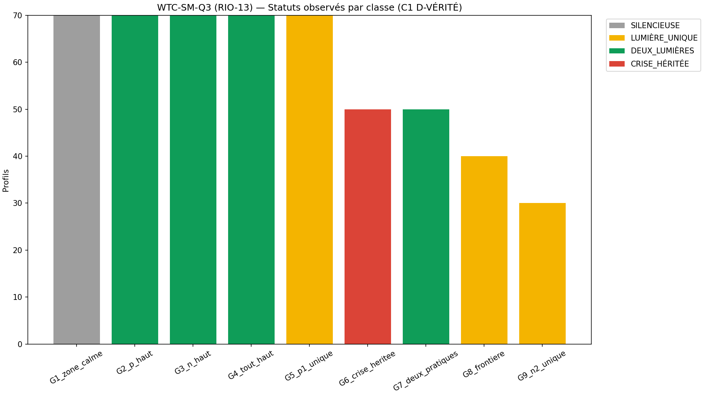
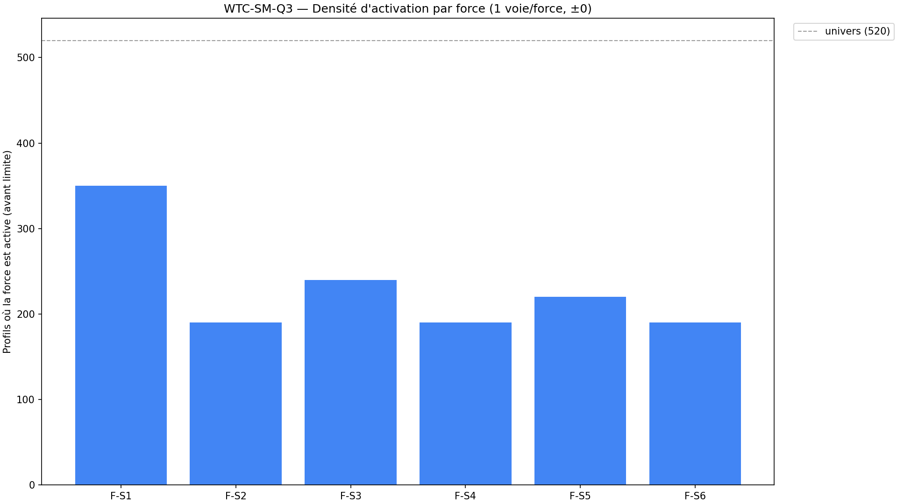
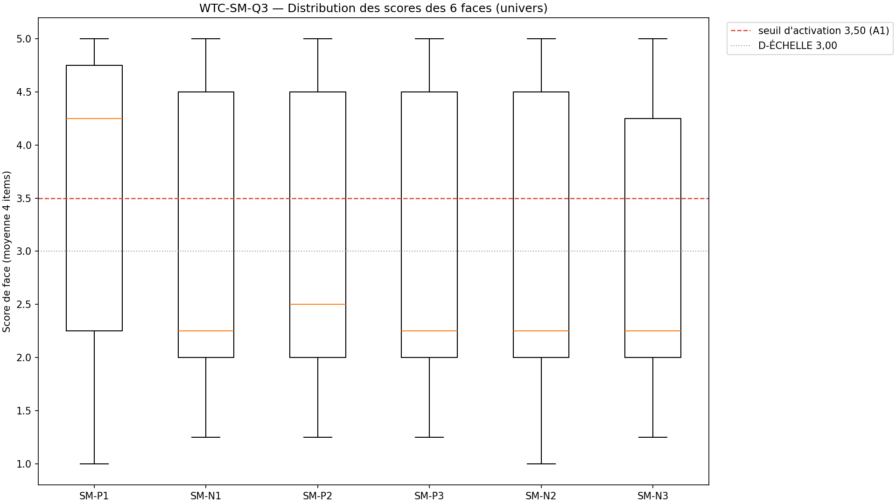
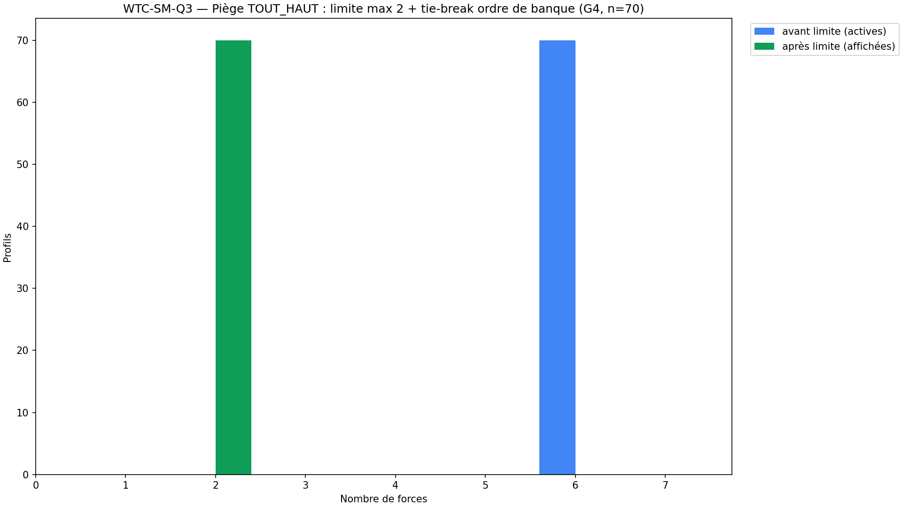

# Rapport WTC-SM-Q3 — « Ce que notre lien sait porter » (RIO-13)

> AVERTISSEMENT D-SIM : résultats issus de simulations (seed 42) — la mécanique est validée, pas la prévalence clinique.
> D-CRISE : 0 voie nouvelle en Q3 — routage hérité A2 ∨ SM-C1 ∨ H5 (override affichage, A3).

**Date** : 2026-10-18  
**Seed** : 42  
**Package** : validation-sm-q3/  
**SPEC** : SM-Q3-SPEC.md VERROUILLÉE (fondateur, 18/10/2026 — A1 3,50 · A2 faces seules · A3 override · A4 mot pour mot).

---

## Section A — Les 7 critères

| Critère | Attendu | Obtenu | Verdict |
|---------|---------|--------|---------|
| **C1** D-VÉRITÉ 6 faces × 4 items + croisé + D-TABLE | 24/24 + croisé + table=code | faces=6/6 · items=24/24 · croisé=True · match=100.0% · D-TABLE=True | ✅ |
| **C2** D-ÉCHELLE 3,00 (2 axes) | déterministe | det=True | ✅ |
| **C3** D-DENSITÉ 1 voie/force ±0 + max 2 + tie-break | 1/1 × 6 + limite + ordre banque | voies=True · max2=True · tie-break=True · frontière 3,25/3,50=True | ✅ |
| **C4** SHA ×2 (D-EMPREINTE) | identiques | sha1=0ae85f4675017594… sha2=0ae85f4675017594… match=True | ✅ |
| **C5** Affichage des figures 4/4 | 4 figures 1920×1080 150 DPI | 4/4 · dims=True | ✅ |
| **C6** 0 pas produit | 0 fonction | 0 | ✅ |
| **C7** Anti-fabrication + override (A3/A4) | SILENCIEUSE mot pour mot + override testé | zone=True · override=True | ✅ |

SHA-256 exécution 1 : `0ae85f467501759467b8672ed7d9738c18a43d2c7d81478bef15dd25b8b44a4b`
SHA-256 exécution 2 : `0ae85f467501759467b8672ed7d9738c18a43d2c7d81478bef15dd25b8b44a4b`

> Texte SILENCIEUSE verrouillé (A4, mot pour mot) : « Votre lien est encore discret sur ces questions — c'est un constat, pas un défaut : la suite du parcours servira aussi à ça. »
---

## Section B — Géométrie (D-GÉOMÉTRIE) + voies héritées + frontière

σ_item = 0.60 · σ_eff = 0.30 · seuil d'activation = 3.50 (A1) · leçon grain Q2 appliquée : centres ≥ 0,8 pt du seuil (haut 4.60), ≥ 1,1 pt (bas 2.00, mid 2.40).

### Tableau des centres par classe

| Classe | N | SM-P1 | SM-N1 | SM-P2 | SM-P3 | SM-N2 | SM-N3 | Crise héritée | Attendu |
|--------|---|---|---|---|---|---|---|------|---------|
| G1_zone_calme | 70 | 2.0 | 2.0 | 2.0 | 2.0 | 2.0 | 2.0 | False | SILENCIEUSE |
| G2_p_haut | 70 | 4.6 | 2.0 | 4.6 | 4.6 | 2.0 | 2.0 | False | DEUX_LUMIÈRES · F-S1,F-S3 |
| G3_n_haut | 70 | 2.0 | 4.6 | 2.0 | 2.0 | 4.6 | 4.6 | False | DEUX_LUMIÈRES · F-S2,F-S5 |
| G4_tout_haut | 70 | 4.6 | 4.6 | 4.6 | 4.6 | 4.6 | 4.6 | False | DEUX_LUMIÈRES · F-S1,F-S2 |
| G5_p1_unique | 70 | 4.6 | 2.0 | 2.0 | 2.0 | 2.0 | 2.0 | False | LUMIÈRE_UNIQUE · F-S1 |
| G6_crise_heritee | 50 | 4.6 | 4.6 | 4.6 | 4.6 | 4.6 | 4.6 | True | CRISE_HÉRITÉE |
| G7_deux_pratiques | 50 | 4.6 | 2.0 | 4.6 | 2.0 | 2.0 | 2.0 | False | DEUX_LUMIÈRES · F-S1,F-S3 |
| G8_frontiere | 40 | 4.6 | 2.0 | 2.4 | 2.0 | 2.0 | 2.0 | False | LUMIÈRE_UNIQUE · F-S1 |
| G9_n2_unique | 30 | 2.0 | 2.0 | 2.0 | 2.0 | 4.6 | 2.0 | False | LUMIÈRE_UNIQUE · F-S5 |

### Voies D-CRISE héritées (0 voie nouvelle)

- G6_crise_heritee : 30 profils voie SM-C1 (héritée Q1) + 20 profils voie H5 (héritée RIO-02)
- Toutes routées en override affichage (A3) : statut CRISE_HÉRITÉE, forces calculées gardées (traçabilité), forces affichées = []

### Frontière 3,25/3,50 (verrouillée A1)

- face = 3.50 → active : True (attendu True) · face = 3.25 → active : False (attendu False)

### Réconciliation : 520 profils, sum(N classes) = 520 → ✅

---

## Section C — Stats par classe

| Classe | N | Dominante | Correct | Crises héritées |
|--------|---|-----------|---------|-----------------|
| G1_zone_calme | 70 | SILENCIEUSE | 70/70 | 0 |
| G2_p_haut | 70 | DEUX_LUMIÈRES | 70/70 | 0 |
| G3_n_haut | 70 | DEUX_LUMIÈRES | 70/70 | 0 |
| G4_tout_haut | 70 | DEUX_LUMIÈRES | 70/70 | 0 |
| G5_p1_unique | 70 | LUMIÈRE_UNIQUE | 70/70 | 0 |
| G6_crise_heritee | 50 | CRISE_HÉRITÉE | 50/50 | 50 |
| G7_deux_pratiques | 50 | DEUX_LUMIÈRES | 50/50 | 0 |
| G8_frontiere | 40 | LUMIÈRE_UNIQUE | 40/40 | 0 |
| G9_n2_unique | 30 | LUMIÈRE_UNIQUE | 30/30 | 0 |

---

## Section D — Profils tracés

### G4_tout_haut_0 (G4_tout_haut)

- **Scores** : SM-P1=4.5 · SM-N1=4.25 · SM-P2=5.0 · SM-P3=4.75 · SM-N2=4.5 · SM-N3=4.25 (μ vrais : classe du tableau B)
- **Voies héritées** : aucune
- **Actives avant limite** : 6 (F-S1,F-S2,F-S3,F-S4,F-S5,F-S6)
- **Forces affichées** : F-S1,F-S2 · **calculées (traçabilité)** : F-S1,F-S2
- **Classification** : DEUX_LUMIÈRES (attendu : DEUX_LUMIÈRES)

### G6_crise_heritee_0 (G6_crise_heritee)

- **Scores** : SM-P1=4.5 · SM-N1=4.75 · SM-P2=5.0 · SM-P3=4.25 · SM-N2=4.75 · SM-N3=4.75 (μ vrais : classe du tableau B)
- **Voies héritées** : ['SM-C1']
- **Actives avant limite** : 6 (F-S1,F-S2,F-S3,F-S4,F-S5,F-S6)
- **Forces affichées** : — · **calculées (traçabilité)** : F-S1,F-S2
- **Classification** : CRISE_HÉRITÉE (attendu : CRISE_HÉRITÉE)

### G6_crise_heritee_30 (G6_crise_heritee)

- **Scores** : SM-P1=4.25 · SM-N1=4.5 · SM-P2=4.75 · SM-P3=4.25 · SM-N2=4.0 · SM-N3=4.75 (μ vrais : classe du tableau B)
- **Voies héritées** : ['H5']
- **Actives avant limite** : 6 (F-S1,F-S2,F-S3,F-S4,F-S5,F-S6)
- **Forces affichées** : — · **calculées (traçabilité)** : F-S1,F-S2
- **Classification** : CRISE_HÉRITÉE (attendu : CRISE_HÉRITÉE)

### G1_zone_calme_0 (G1_zone_calme)

- **Scores** : SM-P1=2.0 · SM-N1=1.5 · SM-P2=2.0 · SM-P3=2.0 · SM-N2=2.0 · SM-N3=2.25 (μ vrais : classe du tableau B)
- **Voies héritées** : aucune
- **Actives avant limite** : 0 (—)
- **Forces affichées** : — · **calculées (traçabilité)** : —
- **Classification** : SILENCIEUSE (attendu : SILENCIEUSE)

### G7_deux_pratiques_0 (G7_deux_pratiques)

- **Scores** : SM-P1=5.0 · SM-N1=2.75 · SM-P2=4.5 · SM-P3=2.75 · SM-N2=1.75 · SM-N3=2.0 (μ vrais : classe du tableau B)
- **Voies héritées** : aucune
- **Actives avant limite** : 2 (F-S1,F-S3)
- **Forces affichées** : F-S1,F-S3 · **calculées (traçabilité)** : F-S1,F-S3
- **Classification** : DEUX_LUMIÈRES (attendu : DEUX_LUMIÈRES)

### G8_frontiere_0 (G8_frontiere)

- **Scores** : SM-P1=4.25 · SM-N1=1.75 · SM-P2=2.25 · SM-P3=2.25 · SM-N2=1.75 · SM-N3=2.25 (μ vrais : classe du tableau B)
- **Voies héritées** : aucune
- **Actives avant limite** : 1 (F-S1)
- **Forces affichées** : F-S1 · **calculées (traçabilité)** : F-S1
- **Classification** : LUMIÈRE_UNIQUE (attendu : LUMIÈRE_UNIQUE)

---

## Section E — Analyse

- **Univers** : 520 profils, 9 classes (zone calme · 2 asymétries · tout haut · lumière unique ×2 · crise héritée · deux pratiques · frontière mid · N2 unique)
- **D-DENSITÉ** : 6 forces × 1 voie (face ≥ 3,50) — ±0 · max 2 forces/profil · tie-break ordre de banque (F-S1 < … < F-S6)
- **Conformité table de vérité** : 520/520 (statut + forces affichées, ancrés paramètres vrais — grain documenté Section F)
- **Labels peuplés** : CRISE_HÉRITÉE, DEUX_LUMIÈRES, LUMIÈRE_UNIQUE, SILENCIEUSE
- **Réconciliation** : 520/520 ✅

---

## Section F — Sources par force, signalements, périmètre

### Sources internes par force (mot pour mot)

| Force | Face (voie unique, A2) | Ancrage `programme wairyu couple.txt` | Statut |
|-------|------------------------|----------------------------------------|--------|
| F-S1 « Le plan des jours durs » | SM-P1 ≥ 3,50 | ligne 134 — « Le plan des jours durs » | SOURCE INTERNE VÉRIFIÉE |
| F-S2 « La frontière co-étiquetée » | SM-N1 ≥ 3,50 | lignes 133-134 — « La frontière co-étiquetée (3 cases : trouble / toi / désaccord) » | SOURCE INTERNE VÉRIFIÉE |
| F-S3 « Les rituels de deux adultes » | SM-P2 ≥ 3,50 | ligne 134 — « Les rituels de deux adultes » | SOURCE INTERNE VÉRIFIÉE |
| F-S4 « La revue mensuelle » | SM-P3 ≥ 3,50 | ligne 135 — « Revue mensuelle » | SOURCE INTERNE VÉRIFIÉE |
| F-S5 « Ma rive, ta rive » | SM-N2 ≥ 3,50 | ligne 133 — « Ma rive / ta rive asymétriques » | SOURCE INTERNE VÉRIFIÉE |
| F-S6 « Le soin qui ne dévore pas » | SM-N3 ≥ 3,50 | ligne 113 — santé somatique « renvoyé aux Deux Rives » (fusion) | SOURCE INTERNE VÉRIFIÉE |

### Grain entier des items (signalement géométrique, non bloquant)

- Leçon Q2 appliquée à la CONCEPTION : centres hauts 4,60 (0,8 pt au-dessus du seuil 3,50), bas 2,00, mid 2,40 (1,1 pt en dessous) — variance effective de la moyenne 4 items (grain entier 1-5) reste > σ_eff en proche voisinage des seuils ; les écarts résiduels à la table de vérité sont à rapporter ici.
- **Écarts observés : 0** — table de vérité conforme à 100 %

### Option B — périmètre verrouillé (D-CANAL)

| Portion | INTERPRÉTÉ | SOURCE | VÉRIFIÉ PAR |
|---------|-----------|--------|-------------|
| 6 faces × 4 items = 24 | Non (fixé) | Verrouillage (4 items/face, σ_eff=0.30) | C1 D-VÉRITÉ |
| Seuil d'activation 3,50 | Non (fixé) | Arbitrage A1 (fondateur, 18/10) | C3 frontière |
| 1 voie/force (faces seules) | Non (fixé) | Arbitrage A2 (fondateur, 18/10) | C3 ±0 |
| Banque fermée F-S1 à F-S6, ordre de banque | Non (fixé) | SPEC §4 + modèle émo v1.1 | C1 D-TABLE |
| Max 2 forces + tie-break | Non (fixé) | D-DENSITÉ (faute n°21) | C3 |
| Override crise héritée | Non (fixé) | Arbitrage A3 (fondateur, 18/10) | C7 |
| Texte SILENCIEUSE | Non (fixé) | Arbitrage A4 (fondateur, 18/10) | C7 mot pour mot |
| Centres 4,60 / 2,00 / 2,40 · noms des groupes | Oui | LIBRE (verrouillage §10) | D-TYPE + C1 |
| Corps des fonctions | Oui | LIBRE (verrouillage §10) | D-TYPE + C1/C3 |
| 0 pas produit | Non (fixé) | Verrouillage R1 | C6 inspect |

### Règles

D-CRISE (hérité) · D-GÉOMÉTRIE · D-ÉCHELLE · D-PARAM · D-VÉRITÉ · D-NOMENCLATURE · D-CANAL · D-CANAL-2 · D-TABLE · D-DENSITÉ · D-TYPE · D-EMPREINTE · D-LECTURE · D-HIST · Exécuteur strict (auto-audit pont : production → run ×2 → SHA ×2 → publication → pointeurs → audit sur origin → contresignature)

**Fautes : 36** (dont 4 pré-attrapées) — compteur inchangé par ce package.

---

## Section G — Verdict

### Verdict : **VALIDÉ

### Note : **7/7**

- Critères : 7/7 validés (C5 affichage 4/4 inclus)

> AVERTISSEMENT D-SIM : résultats issus de simulations (seed 42) — la mécanique est validée, pas la prévalence clinique.

### RIO-13

RIO-13 « Ce que notre lien sait porter » — publié, en audit (auto-audit pont sur origin après push, puis contresignature).

### Inventaire structurel

| Fichier | Fonctions |
|---------|-----------|
| wtc_sm_q3_core.py | moyenne_face, scores_faces, force_active_de_score, forces_actives, appliquer_limite, crise_heritee_de, statut_de, classifier, verifier_d_echelle, verifier_d_verite, tableau_centres |
| wtc_sm_q3_simulator.py | _gen_face, _voies_de, tous_les_profils, classification_vraie, voie_vraie_de, resume_groupes |
| wtc_sm_q3_validation.py | executer, critere_c1, critere_c2, critere_c3, critere_c5, critere_c6, critere_c7, generer_figures, generer_rapport, main |

- Instrument : 24 items (6 faces × 4), échelle 5 points, 2 axes (P pratiques / N nommage)
- Labels : SILENCIEUSE + LUMIÈRE_UNIQUE + DEUX_LUMIÈRES + CRISE_HÉRITÉE = 4
- Banque fermée : 6 forces × 1 voie (A2 faces seules), max 2/profil
- D-CRISE : 0 voie nouvelle — override hérité (A3) : SM-C1 30 + H5 20
- Réconciliation : 520/520 ✅
- 0 pas produit : C6 ✅
