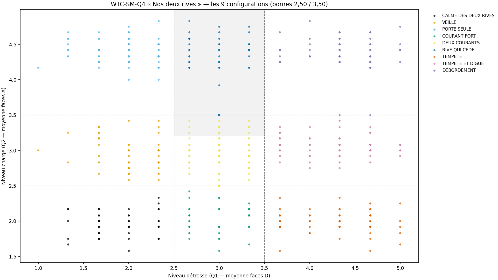
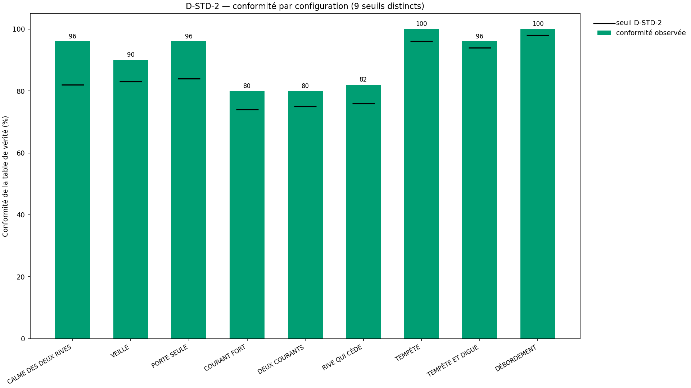
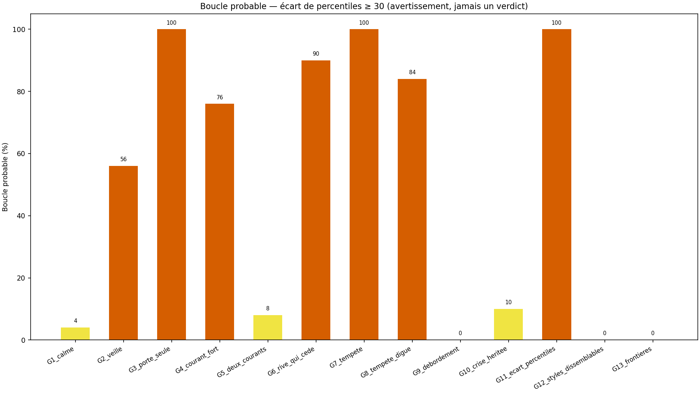
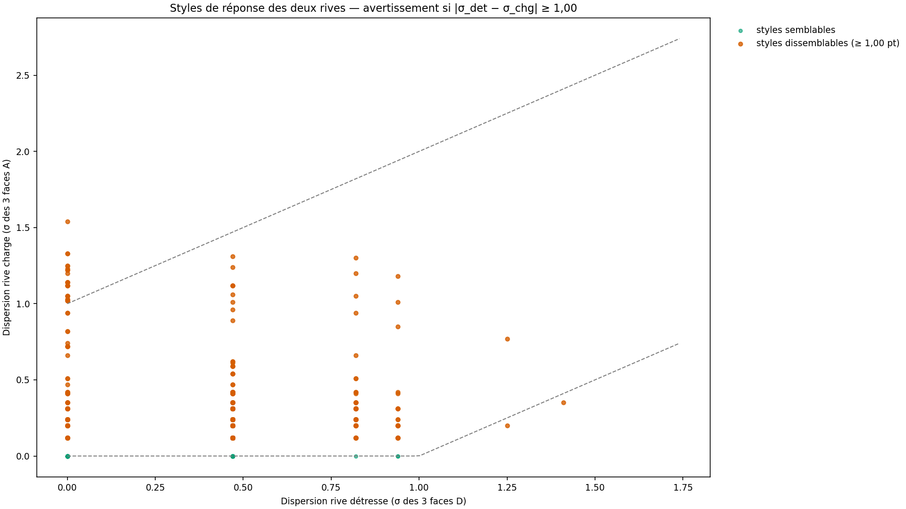

# Rapport WTC-SM-Q4 — « Nos deux rives » (RIO-14)

> AVERTISSEMENT D-SIM : résultats issus de simulations (seed 42) — la mécanique est validée, pas la prévalence clinique.
> D-CRISE : 0 voie nouvelle en Q4 — override hérité A2 ∨ SM-C1 ∨ H5 (A4) : configuration tracée, jamais déployée sur crise active.

**Date** : 2026-10-18  
**Seed** : 42 (univers) · 42 (population norm 2 000)  
**Package** : validation-sm-q4/  
**SPEC** : SM-Q4-SPEC.md VERROUILLÉE (délégation fondateur → pont, 18/10/2026 — A1 bornes 2,50/3,50 · A2 zéro item nouveau · A3 percentiles seed 42 · A4 override 🔴 · A5 9 noms mot pour mot).

---

## Section A — Les 7 critères

| Critère | Attendu | Obtenu | Verdict |
|---------|---------|--------|---------|
| **C1** D-VÉRITÉ 9 configs + croisé + D-TABLE | 9/9 + croisé 100 % + table=code | démontrées=9/9 · croisé=True · D-TABLE=True | ✅ |
| **C2** D-CONFIRMATION pure + anti-inversion | 100 % déterministe + 0 inversion | grille=True · swap=6 flips / 3 stables · pipeline det=True | ✅ |
| **C3** D-STD-2 par config + frontières | 9/9 à leur seuil + bornes déterministes | 9/9 à seuil · frontière FAIBLE/MOYEN/MOYEN/ÉLEVÉ · exactes 40/40 | ✅ |
| **C4** SHA ×2 (D-EMPREINTE) | identiques | sha1=c0220b0413588399… sha2=c0220b0413588399… match=True | ✅ |
| **C5** Affichage 4/4 (templates ×9 + boucle + styles + D-SIM) | 4/4 | templates=✅ · boucle=✅ · styles=✅ · D-SIM=✅ · figures 4/4 · dims=✅ | ✅ |
| **C6** 0 pas produit | 0 fonction | 0 | ✅ |
| **C7** Anti-fabrication + override (A4) | 0 verdict sur crise + zone calme honnête | override 50/50 · zone calme=✅ · 0 fabrication=✅ | ✅ |

SHA-256 exécution 1 : `c0220b041358839911146e7d551c590111c62a53b6ce23edbbebd97695cec9fd`
SHA-256 exécution 2 : `c0220b041358839911146e7d551c590111c62a53b6ce23edbbebd97695cec9fd`

> Littéraux d'affichage cités (autoporteur contresignature) — zone calme (anti-fabrication §5.5) : « Les deux rives sont calmes — détresse contenue, charge tenable. C'est une zone calme : rien à fabriquer ici, le constat se suffit. » · override crise (A4) : « Un des deux porte une crise active — ce croisement n'est pas déployé aujourd'hui : le chemin le plus court passe par l'orientation (palier 🔴), pas par un verdict de couple. La configuration reste notée pour la suite du parcours. »
---

## Section B — Géométrie (D-GÉOMÉTRIE) + population + voies + frontières

σ_item = 0,60 (D-PARAM) · σ_eff agrégat détresse ≈ 0,35 (3 items) · σ_eff agrégat charge ≈ 0,17 (12 items) · bornes 2,50/3,50 (A1) · centres ≥ 0,5 pt des bornes (leçon grain Q2 : μ 2,00 / 3,00 / 4,50).

### Population de référence percentiles (A3)

- 2000 couples simulés, seed 42 — μ rive ~ N(3.0 ; 0.8) + bruit item σ 0.6 — **placeholder à remplacer par le pilote (L2)**
- rang mid-rank, arrondi 0,1 · boucle probable si écart ≥ 30 (ligne 262) · styles dissemblables si |σ_det − σ_chg| ≥ 1,00 (INTERPRÉTÉ, D-PARAM)

### Voies D-CRISE héritées (0 voie nouvelle)

- G10_crise_heritee : 20 couples voie SM-C1 (héritée Q1, profil p1) + 20 voie A2 (héritée Q2, profil p2) + 10 voie H5 (héritée RIO-02, profil p2)
- Toutes routées en override affichage (A4) : affichage CRISE_HÉRITÉE, configuration TRACÉE (traçabilité), jamais déployée comme verdict de couple

### Frontières 2,50 / 3,50 (déterministes)

- direct : 2,49→FAIBLE · 2,50→MOYEN · 3,49→MOYEN · 3,50→ÉLEVÉ (borne haute inclusive — « Faible < 2,50 ≤ Moyen < 3,50 ≤ Élevé »)
- piège FRONTIÈRES (charge, grain 1/12) : 40/40 couples classés exactement aux bornes 2,50/3,50

### Réconciliation : 600 couples, sum(N groupes) = 600 → ✅ · conformité table de vérité (non-crise) : 506/550

---

## Section C — Stats par groupe

| Groupe | N | Config attendue | Conformes | Boucle % | Styles % | Crises |
|--------|---|-----------------|-----------|----------|----------|--------|
| G1_calme | 50 | C | 48/50 | 4.0 | 0.0 | 0 |
| G2_veille | 50 | V | 45/50 | 56.0 | 0.0 | 0 |
| G3_porte_seule | 50 | P | 48/50 | 100.0 | 0.0 | 0 |
| G4_courant_fort | 50 | C | 40/50 | 76.0 | 0.0 | 0 |
| G5_deux_courants | 50 | D | 40/50 | 8.0 | 0.0 | 0 |
| G6_rive_qui_cede | 50 | R | 41/50 | 90.0 | 0.0 | 0 |
| G7_tempete | 50 | T | 50/50 | 100.0 | 0.0 | 0 |
| G8_tempete_digue | 50 | T | 48/50 | 84.0 | 2.0 | 0 |
| G9_debordement | 50 | D | 50/50 | 0.0 | 0.0 | 0 |
| G10_crise_heritee | 50 | D | 43/50 | 10.0 | 6.0 | 50 |
| G11_ecart_percentiles | 30 | P | 26/30 | 100.0 | 0.0 | 0 |
| G12_styles_dissemblables | 30 | D | 30/30 | 0.0 | 76.7 | 0 |
| G13_frontieres | 40 | R | 40/40 | 0.0 | 0.0 | 0 |

---

## Section D — Couples tracés

### G1_calme_0 (G1_calme)

- **Scores** : détresse D=[2, 1, 2] (moy. 1.67) · charge A=[1.75, 2.0, 2.25] (moy. 2.0)
- **Niveaux** : FAIBLE / FAIBLE — config calculée : CALME DES DEUX RIVES
- **Voies héritées** : aucune — crise : False → affichage : **CALME DES DEUX RIVES**
- **Percentiles** : détresse 9.1 · charge 10.8 — boucle probable : False
- **Styles** : σ_det=0.47 · σ_chg=0.2 — dissemblables : False

### G10_crise_heritee_0 (G10_crise_heritee)

- **Scores** : détresse D=[3, 3, 3] (moy. 3.0) · charge A=[3.0, 3.5, 3.25] (moy. 3.25)
- **Niveaux** : MOYEN / MOYEN — config calculée : DEUX COURANTS
- **Voies héritées** : SM-C1 — crise : True → affichage : **CRISE_HÉRITÉE**
- **Percentiles** : détresse 48.7 · charge 60.1 — boucle probable : False
- **Styles** : σ_det=0.0 · σ_chg=0.2 — dissemblables : False

### G10_crise_heritee_25 (G10_crise_heritee)

- **Scores** : détresse D=[3, 3, 3] (moy. 3.0) · charge A=[2.0, 4.25, 2.75] (moy. 3.0)
- **Niveaux** : MOYEN / MOYEN — config calculée : DEUX COURANTS
- **Voies héritées** : A2 — crise : True → affichage : **CRISE_HÉRITÉE**
- **Percentiles** : détresse 48.7 · charge 48.2 — boucle probable : False
- **Styles** : σ_det=0.0 · σ_chg=0.94 — dissemblables : False

### G11_ecart_percentiles_0 (G11_ecart_percentiles)

- **Scores** : détresse D=[3, 1, 2] (moy. 2.0) · charge A=[4.0, 4.25, 4.75] (moy. 4.33)
- **Niveaux** : FAIBLE / ÉLEVÉ — config calculée : PORTE SEULE
- **Voies héritées** : aucune — crise : False → affichage : **PORTE SEULE**
- **Percentiles** : détresse 12.9 · charge 92.7 — boucle probable : True
- **Styles** : σ_det=0.82 · σ_chg=0.31 — dissemblables : False

### G12_styles_dissemblables_0 (G12_styles_dissemblables)

- **Scores** : détresse D=[3, 3, 3] (moy. 3.0) · charge A=[2.0, 2.75, 3.75] (moy. 2.83)
- **Niveaux** : MOYEN / MOYEN — config calculée : DEUX COURANTS
- **Voies héritées** : aucune — crise : False → affichage : **DEUX COURANTS**
- **Percentiles** : détresse 48.7 · charge 39.2 — boucle probable : False
- **Styles** : σ_det=0.0 · σ_chg=0.72 — dissemblables : False

### G13_frontieres_0 (G13_frontieres)

- **Scores** : détresse D=[3, 3, 3] (moy. 3.0) · charge A=[3.5, 3.5, 3.5] (moy. 3.5)
- **Niveaux** : MOYEN / ÉLEVÉ — config calculée : RIVE QUI CÈDE
- **Voies héritées** : aucune — crise : False → affichage : **RIVE QUI CÈDE**
- **Percentiles** : détresse 48.7 · charge 71.0 — boucle probable : False
- **Styles** : σ_det=0.0 · σ_chg=0.0 — dissemblables : False

### G13_frontieres_20 (G13_frontieres)

- **Scores** : détresse D=[3, 3, 3] (moy. 3.0) · charge A=[2.5, 2.5, 2.5] (moy. 2.5)
- **Niveaux** : MOYEN / MOYEN — config calculée : DEUX COURANTS
- **Voies héritées** : aucune — crise : False → affichage : **DEUX COURANTS**
- **Percentiles** : détresse 48.7 · charge 26.4 — boucle probable : False
- **Styles** : σ_det=0.0 · σ_chg=0.0 — dissemblables : False

---

## Section E — Analyse

- **Univers** : 600 couples, 13 groupes (9 configurations × 50 + 4 pièges : crise héritée 50 · écart percentiles 30 · styles dissemblables 30 · frontières 40)
- **D-CONFIRMATION** : grille 9/9 exacte · anti-inversion 6 flips / 3 stables (6 flips hors diagonale, 3 diagonales stables) · pipeline déterministe 600/600
- **D-STD-2** : 9/9 configurations à leur seuil (9 seuils distincts, calibrés comme émo-Q4)
- **Boucle probable** : 49.0 % des couples — signature des configurations de niveau divergent ; avertissement, JAMAIS un verdict (ligne 262)
- **Styles dissemblables** : 4.5 % — seuil 1,00 pt explicité (INTERPRÉTÉ)
- **Conformité table de vérité** (non-crise) : 506/550 — la conformité < 100 % des rangées exposées est STRUCTURELLE (bruit grain détresse 1/3 item autour des bornes) et encadrée par D-STD-2, comme émo-Q4
- **Réconciliation** : 600/600 ✅

---

## Section F — Sources, périmètre, règles

### Ancrages internes (mot pour mot)

| Ancrage | `programme wairyu couple.txt` | Statut |
|---------|-------------------------------|--------|
| Q4 = croisement à deux, confirmé | ligne 224 — « Q4 Le croisement (à deux, confirmé) » | SOURCE INTERNE VÉRIFIÉE |
| 9 configurations, percentiles | lignes 297-298 — « Q4 (croisement à 9 configurations, percentiles) » | SOURCE INTERNE VÉRIFIÉE |
| Empreinte situationnelle = croisement Q1×Q2 | ligne 261 — « Empreinte situationnelle (croisement Q1×Q2) » | SOURCE INTERNE VÉRIFIÉE |
| Percentiles, boucle ≥ 30, styles dissemblables | ligne 262 — « Couple par PERCENTILES (correction du style de réponse) · boucle probable si écart de percentiles ≥ 30 · avertissement si styles dissemblables » | SOURCE INTERNE VÉRIFIÉE |
| Asymétrie structurelle | ligne 133 — « Ma rive / ta rive asymétriques » | SOURCE INTERNE VÉRIFIÉE |

### Périmètre verrouillé (D-CANAL)

| Portion | INTERPRÉTÉ | SOURCE | VÉRIFIÉ PAR |
|--------|-----------|--------|-------------|
| 9 configurations 3×3, noms mot pour mot | Non (fixé) | Arbitrage A5 (pont par délégation, 18/10) | C1 D-TABLE |
| Bornes 2,50/3,50 sur moyennes brutes | Non (fixé) | Arbitrage A1 (pont par délégation, 18/10) | C3 frontières |
| Zéro item nouveau (croisement Q1×Q2 seul) | Non (fixé) | Arbitrage A2 | C1/C6 |
| Percentiles seed 42 (2 000), boucle ≥ 30 | Non (fixé) | Arbitrage A3 + ligne 262 | C5 boucle |
| Override crise héritée 🔴 | Non (fixé) | Arbitrage A4 + D-CRISE | C7 |
| Population norm N(3,0 ; 0,8) + bruit 0,60 | Oui | LIBRE (placeholder L2, à remplacer par le pilote) | D-SIM + C4 |
| Seuil styles dissemblables 1,00 pt | Oui | INTERPRÉTÉ (demi-niveau, non sourcé) | D-PARAM (explicité) |
| Seuils D-STD-2 (9 valeurs distinctes) | Oui | Calibrés géométrie, comme émo-Q4 | C3 |
| Corps des fonctions, noms internes, découpage 3 fichiers | Oui | LIBRE (verrouillage §9) | D-TYPE + C1/C2 |
| 0 pas produit | Non (fixé) | Verrouillage | C6 inspect |

### Règles

D-CRISE (hérité) · D-CONFIRMATION (nouvelle — anti-inversion croisement asymétrique) · D-STD-2 · D-VÉRITÉ · D-TABLE · D-NOMENCLATURE · D-GÉOMÉTRIE · D-PARAM · D-CANAL · D-CANAL-2 · D-TYPE · D-EMPREINTE · D-LECTURE · D-HIST · Exécuteur strict (auto-audit pont : production → run ×2 → SHA ×2 → publication → pointeurs → audit sur origin → contresignature)

**Fautes : 36** (dont 4 pré-attrapées) — compteur inchangé par ce package.

---

## Section G — Verdict

### Verdict : **VALIDÉ**

### Note : **7/7**

- Critères : 7/7 validés (C5 affichage 4/4 inclus)

> AVERTISSEMENT D-SIM : résultats issus de simulations (seed 42) — la mécanique est validée, pas la prévalence clinique.

### RIO-14

RIO-14 « Nos deux rives » — contresigné (pont, 18/10/2026 ; auto-audit origin : reproduction prouvée, empreinte c0220b04… inchangée).

### Inventaire structurel

| Fichier | Fonctions |
|---------|-----------|
| wtc_sm_q4_core.py | niveau_de, configuration_de, percentile_de, boucle_probable_de, styles_de, styles_dissemblables_de, crise_heritee_de, classifier, verifier_d_table, verifier_d_confirmation |
| wtc_sm_q4_simulator.py | _gen_item, _gen_det, _gen_chg, _gen_chg_exact, classification_vraie, population_norme, _voies_de, tous_les_couples, resume_groupes |
| wtc_sm_q4_validation.py | _diagnostics, executer, critere_c1, critere_c2, critere_c3, critere_c5, critere_c6, critere_c7, _conformite, generer_figures, generer_rapport, main |

- Croisement : 9 configurations 3×3, zéro item nouveau (A2) — entrées = sorties contresignées Q1-R3 (RIO-11) × Q2 (RIO-12)
- Niveaux : bornes 2,50/3,50 sur moyennes brutes (A1) · percentiles seed 42, 2 000 couples (A3) · boucle ≥ 30 · styles ≥ 1,00
- D-CRISE : 0 voie nouvelle — override hérité (A4) : SM-C1 20 + A2 20 + H5 10
- Réconciliation : 600/600 ✅
- 0 pas produit : C6 ✅
