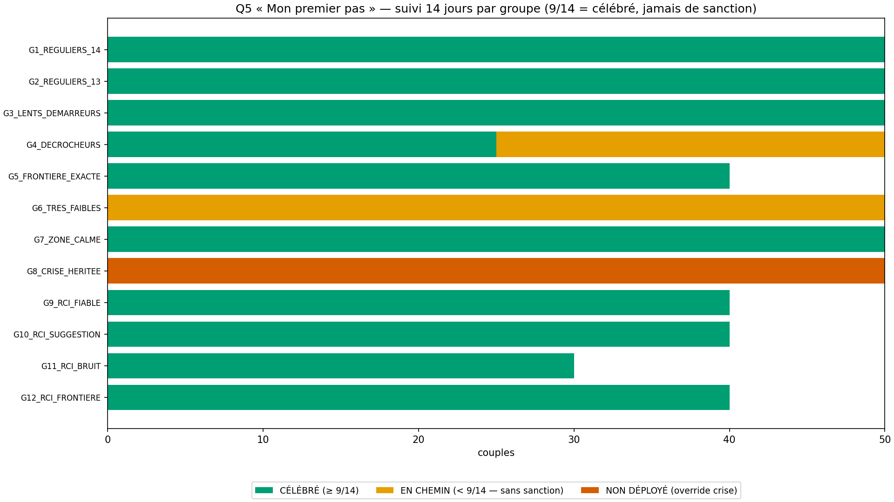
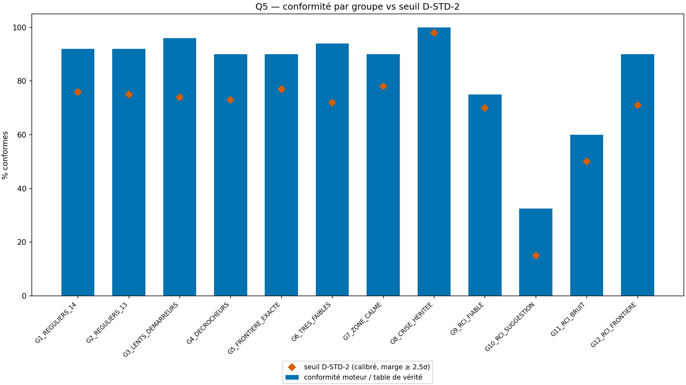
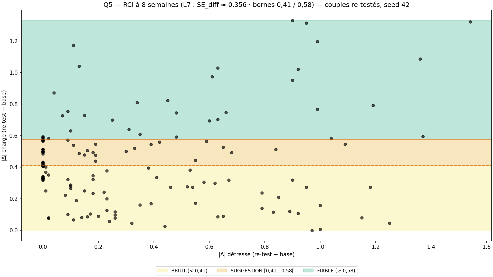
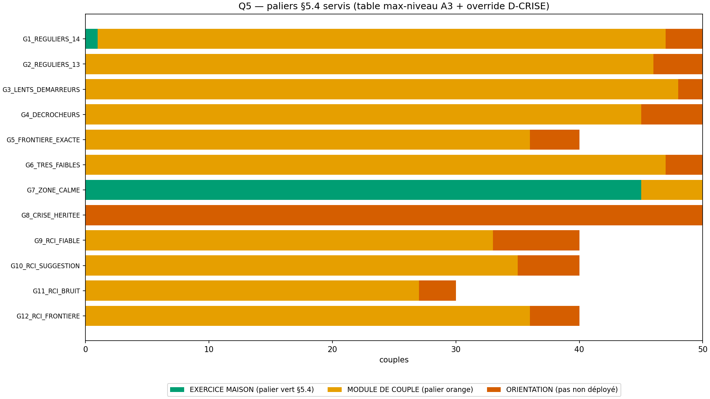

# Rapport WTC-SM-Q5 — « Mon premier pas vers l'autre rive » (RIO-15)

> AVERTISSEMENT D-SIM : résultats issus de simulations (seed 42) — la mécanique est validée, pas la prévalence clinique.
> D-CRISE : 0 voie nouvelle en Q5 — override hérité (A2 ∨ SM-C1 ∨ H5) : JAMAIS de pas de couple en crise, court-circuit avant le choix du pas (hub verbatim).

**Date** : 2026-10-18  
**Seed** : 42 (univers)  
**Package** : validation-sm-q5/  
**SPEC** : SM-Q5-SPEC.md VERROUILLÉE (délégation fondateur → pont, 18/10/2026 — « je te délègues le tranchage comme en Q4. Puis verrouillage → production → RIO-15 → santé mentale 5/5 » · A1 check-in binaire · A2 banque modules existants + champ libre · A3 table palier max-niveau · A4 RCI deux agrégats + bornes A1 · A5 C6 = 0 sanction / 0 rémission).

---

## Section A — Les 7 critères

| Critère | Attendu | Obtenu | Verdict |
|---------|---------|--------|---------|
| **C1** D-VÉRITÉ : tracking démontré + D-TABLE + croisé | 540/540 + croisé 100 % + table=code | démontrées=540/540 · croisé=True · D-TABLE=True | ✅ |
| **C2** D-CONFIRMATION : pureté + anti-inversion temporelle | 100 % déterministe + 0 inversion | pure=True · anti-inversion=True · n_rci=150 | ✅ |
| **C3** D-STD-2 par groupe + frontières | 12/12 à leur seuil + bornes déterministes | 12/12 à seuil · frontière OK · exactes 40/40 | ✅ |
| **C4** SHA ×2 (D-EMPREINTE) | identiques | sha1=6684a435d072c095… sha2=6684a435d072c095… match=True | ✅ |
| **C5** Affichage (templates ×9 + banque + champ libre + D-SIM) | 4/4 | templates=True · banque=True · champ libre=True · figures 4/4 · dims=True | ✅ |
| **C6** 0 sanction / 0 rémission (A5) | 0 libellé interdit | 0_interdit=True · nomenclature=True | ✅ |
| **C7** Anti-fabrication + D-CRISE | 0 pas sur crise + zone calme honnête | override 50/50 · zone calme 45/50 (règle banque) · court-circuit=True | ✅ |

SHA-256 exécution 1 : `6684a435d072c095d2ecddc41c4acbbb8832a5f869fea6e13330136f8d55d18a`
SHA-256 exécution 2 : `6684a435d072c095d2ecddc41c4acbbb8832a5f869fea6e13330136f8d55d18a`

> Littéraux d'affichage cités (autoporteur contresignature) — zone calme (anti-fabrication §5.5) : « Zone calme — rien à fabriquer ici. Un exercice maison, pas une réparation. » · override crise (D-CRISE) : « Le chemin le plus court, pas un échec — l'orientation professionnelle est le pas qui compte ici. » · EN CHEMIN (jamais de sanction, ligne 298) : « 8 jours sur 14 — le pas est en chemin. Rien n'est perdu, rien n'est noté : le suivi continue, sans sanction. » · pile seuil (G5) : « 9 jours sur 14 — c'est célébré pile sur le seuil. Pas besoin de viser plus : le programme compte 9/14 comme un pas tenu. » · BRUIT (anti-surinterprétation L4) : « Dans le bruit de la mesure — ça ne dit ni réussite ni échec, ça dit que la mesure ne tranche pas encore. »
---

## Section B — Géométrie (D-GÉOMÉTRIE) + banque + palier

σ_item = 0,60 (items entiers 1-5, géométrie Q4) · grain détresse 1/3 (3 faces × 1 item, sorties RIO-11) · grain charge 1/12 (3 faces × 4 items, sorties RIO-12) · SEM L7 ≈ 0,252 → SE_diff = 0,356 (constante moteur, ligne 263 verbatim) · σ_eff agrégats : détresse ≈ 0,35 · charge ≈ 0,17 · bornes A1 2,50/3,50 (héritées Q4 — une mesure, un rôle) · centres μ ∈ {2,0 · 3,0 · 3,25} à ≥ 0,5 pt des bornes (leçon grain).

### Banque de pas (A2 — modules existants, zéro invention)

- 🟢-1 « Exercice maison : pratiquer la force dérivée identifiée en Q3 (banque F-S1 à F-S6) »
- 🟢-2 « Exercice maison : noter chaque soir un mot sur sa rive, 7 jours (météo intérieure, ligne 128) »
- 🟢-3 « Exercice maison : préparer sa question pour la Revue mensuelle »
- 🟠-1 « À deux : co-étiqueter la frontière (3 cases : trouble / toi / désaccord) »
- 🟠-2 « À deux : tenir Les rituels de deux adultes une fois cette semaine »
- 🟠-3 « À deux : ouvrir Le plan des jours durs et l'ajuster ensemble »
- Champ libre : « Notre pas à nous — écrit par le couple (champ libre) » (le choix reste au couple)

### Table palier (A3 — max-niveau, mécanique pure)

| Configuration Q4 | Palier |
|------------------|--------|
| CALME DES DEUX RIVES | EXERCICE MAISON |
| VEILLE | MODULE DE COUPLE |
| PORTE SEULE | ORIENTATION |
| COURANT FORT | MODULE DE COUPLE |
| DEUX COURANTS | MODULE DE COUPLE |
| RIVE QUI CÈDE | ORIENTATION |
| TEMPÊTE | ORIENTATION |
| TEMPÊTE ET DIGUE | ORIENTATION |
| DÉBORDEMENT | ORIENTATION |

### Voies D-CRISE héritées (0 voie nouvelle)

- G8_CRISE_HERITEE : {'A2': 20, 'SM-C1': 20, 'H5': 10} — override affichage 🔴 (ORIENTATION), pas NON déployé, suivi non évalué (court-circuit avant le choix du pas)

### Réconciliation : 540 couples, sum(N groupes) = 540 → ✅

---

## Section C — Stats par groupe

| Groupe | N | Conformes | CÉLÉBRÉ | EN CHEMIN | Non déployé | 🟢 | 🟠 | 🔴 | FIABLE | SUGGESTION | BRUIT | Traversées | Crises |
|--------|---|-----------|---------|-----------|-------------|---|---|---|--------|------------|-------|------------|--------|
| G1_REGULIERS_14 | 50 | 46 | 50 | 0 | 0 | 1 | 46 | 3 | 0 | 0 | 0 | 0 | 0 |
| G2_REGULIERS_13 | 50 | 46 | 50 | 0 | 0 | 0 | 46 | 4 | 0 | 0 | 0 | 0 | 0 |
| G3_LENTS_DEMARREURS | 50 | 48 | 50 | 0 | 0 | 0 | 48 | 2 | 0 | 0 | 0 | 0 | 0 |
| G4_DECROCHEURS | 50 | 45 | 25 | 25 | 0 | 0 | 45 | 5 | 0 | 0 | 0 | 0 | 0 |
| G5_FRONTIERE_EXACTE | 40 | 36 | 40 | 0 | 0 | 0 | 36 | 4 | 0 | 0 | 0 | 0 | 0 |
| G6_TRES_FAIBLES | 50 | 47 | 0 | 50 | 0 | 0 | 47 | 3 | 0 | 0 | 0 | 0 | 0 |
| G7_ZONE_CALME | 50 | 45 | 50 | 0 | 0 | 45 | 5 | 0 | 0 | 0 | 0 | 0 | 0 |
| G8_CRISE_HERITEE | 50 | 50 | 0 | 0 | 50 | 0 | 0 | 50 | 0 | 0 | 0 | 0 | 50 |
| G9_RCI_FIABLE | 40 | 30 | 40 | 0 | 0 | 0 | 33 | 7 | 37 | 2 | 1 | 48 | 0 |
| G10_RCI_SUGGESTION | 40 | 13 | 40 | 0 | 0 | 0 | 35 | 5 | 12 | 14 | 14 | 30 | 0 |
| G11_RCI_BRUIT | 30 | 18 | 30 | 0 | 0 | 0 | 27 | 3 | 4 | 6 | 20 | 16 | 0 |
| G12_RCI_FRONTIERE | 40 | 36 | 40 | 0 | 0 | 0 | 36 | 4 | 10 | 20 | 10 | 18 | 0 |

---

## Section D — Couples tracés

### G1_REGULIERS_14_0 (G1_REGULIERS_14)

- **Scores** : détresse [3, 3, 3] (moy. 3.00) · charge [3, 3, 2, 3, 3, 3, 3, 3, 4, 3, 3, 3] (moy. 3.00)
- **Config Q4 tracée** : DEUX COURANTS (MOYEN/MOYEN) — crise : false
- **Palier (A3)** : MODULE DE COUPLE — pas : « Notre pas à nous — écrit par le couple (champ libre) »
- **Suivi 14j** : 14/14 → statut : CÉLÉBRÉ

### G4_DECROCHEURS_1 (G4_DECROCHEURS)

- **Scores** : détresse [3, 3, 2] (moy. 2.67) · charge [3, 3, 2, 4, 3, 3, 5, 3, 3, 4, 2, 3] (moy. 3.17)
- **Config Q4 tracée** : DEUX COURANTS (MOYEN/MOYEN) — crise : false
- **Palier (A3)** : MODULE DE COUPLE — pas : « À deux : tenir Les rituels de deux adultes une fois cette semaine »
- **Suivi 14j** : 8/14 → statut : EN CHEMIN

### G5_FRONTIERE_EXACTE_0 (G5_FRONTIERE_EXACTE)

- **Scores** : détresse [4, 2, 3] (moy. 3.00) · charge [3, 4, 4, 3, 4, 3, 3, 3, 4, 3, 2, 3] (moy. 3.25)
- **Config Q4 tracée** : DEUX COURANTS (MOYEN/MOYEN) — crise : false
- **Palier (A3)** : MODULE DE COUPLE — pas : « À deux : co-étiqueter la frontière (3 cases : trouble / toi / désaccord) »
- **Suivi 14j** : 9/14 → statut : CÉLÉBRÉ

### G6_TRES_FAIBLES_0 (G6_TRES_FAIBLES)

- **Scores** : détresse [3, 3, 3] (moy. 3.00) · charge [3, 2, 4, 4, 3, 4, 3, 3, 3, 3, 3, 2] (moy. 3.08)
- **Config Q4 tracée** : DEUX COURANTS (MOYEN/MOYEN) — crise : false
- **Palier (A3)** : MODULE DE COUPLE — pas : « À deux : co-étiqueter la frontière (3 cases : trouble / toi / désaccord) »
- **Suivi 14j** : 1/14 → statut : EN CHEMIN

### G7_ZONE_CALME_0 (G7_ZONE_CALME)

- **Scores** : détresse [3, 2, 2] (moy. 2.33) · charge [2, 2, 2, 3, 1, 2, 2, 2, 2, 2, 2, 2] (moy. 2.00)
- **Config Q4 tracée** : CALME DES DEUX RIVES (FAIBLE/FAIBLE) — crise : false
- **Palier (A3)** : EXERCICE MAISON — pas : « Exercice maison : pratiquer la force dérivée identifiée en Q3 (banque F-S1 à F-S6) »
- **Suivi 14j** : 12/14 → statut : CÉLÉBRÉ

### G8_CRISE_HERITEE_0 (G8_CRISE_HERITEE)

- **Scores** : détresse [3, 2, 4] (moy. 3.00) · charge [3, 3, 3, 4, 4, 4, 3, 3, 3, 3, 3, 4] (moy. 3.33)
- **Config Q4 tracée** : DEUX COURANTS (MOYEN/MOYEN) — crise : true
- **Palier (A3)** : ORIENTATION — pas : aucun (orientation — le chemin le plus court, pas un échec)
- **Suivi 14j** : aucun (pas non déployé — D-CRISE) → statut : non évalué

### G9_RCI_FIABLE_0 (G9_RCI_FIABLE)

- **Scores** : détresse [4, 4, 3] (moy. 3.67) · charge [3, 4, 3, 3, 2, 3, 3, 4, 3, 3, 3, 3] (moy. 3.08)
- **Config Q4 tracée** : TEMPÊTE ET DIGUE (ÉLEVÉ/MOYEN) — crise : false
- **Palier (A3)** : ORIENTATION — pas : aucun (orientation — le chemin le plus court, pas un échec)
- **Suivi 14j** : 12/14 → statut : CÉLÉBRÉ
- **RCI 8 sem** : Δ det -0.6 (FIABLE) · Δ chg -0.69 (FIABLE) → ensemble : **UN CHANGEMENT FIABLE** · traversées : det true (ÉLEVÉ → MOYEN) · chg true (MOYEN → FAIBLE)

### G12_RCI_FRONTIERE_0 (G12_RCI_FRONTIERE)

- **Scores** : détresse [3, 4, 4] (moy. 3.67) · charge [4, 3, 3, 3, 3, 3, 4, 3, 3, 3, 2, 3] (moy. 3.08)
- **Config Q4 tracée** : TEMPÊTE ET DIGUE (ÉLEVÉ/MOYEN) — crise : false
- **Palier (A3)** : ORIENTATION — pas : aucun (orientation — le chemin le plus court, pas un échec)
- **Suivi 14j** : 14/14 → statut : CÉLÉBRÉ
- **RCI 8 sem** : Δ det 0.0 (BRUIT) · Δ chg -0.58 (FIABLE) → ensemble : **UN CHANGEMENT FIABLE** · traversées : det false (—) · chg false (—)

---

## Section E — Analyse

- **Univers** : 540 couples, 12 groupes (suivi 7 × 50 + zone calme 50 + crise 50 + RCI 40+40+30+40)
- **Engagement global** : 415 CÉLÉBRÉ · 75 EN CHEMIN (sans sanction) · 50 non déployés (override D-CRISE)
- **RCI global** : 63 UN CHANGEMENT FIABLE · 42 UNE PISTE À CONFIRMER · 45 DANS LE BRUIT DE LA MESURE · 112 traversées de borne (signification clinique L7)
- **D-CONFIRMATION** : grille pure 540/540 · anti-inversion temporelle : Δ signé inversé exactement sur 150 couples re-testés (swap base/re-test)
- **D-STD-2** : 12/12 groupes à leur seuil (12 seuils distincts, calibrés théorique − 2,5σ comme émo-Q4/Q4) · conformité < 100 % des groupes RCI STRUCTURELLE (fenêtre SUGGESTION étroite 0,17 pt vs σ_eff) et encadrée par D-STD-2 · exactes 40/40 (piège frontière ε = 0, grain 1/12)
- **D-CRISE** : 50/50 court-circuités avant le pas — {'A2': 20, 'SM-C1': 20, 'H5': 10} — 0 pas déployé sur crise active
- **Réconciliation** : 540/540 ✅

---

## Section F — Sources, périmètre, règles

### Ancrages internes (mot pour mot)

| Ancrage | `programme wairyu couple.txt` | Statut |
|---------|-------------------------------|--------|
| Q5 = le pas | ligne 224 — « Q5 Le pas (1 changement + suivi 14 jours) » | SOURCE INTERNE VÉRIFIÉE |
| Tracking 14 j, anti-perfectionnisme | lignes 297-298 — « Q5 (tracking 14 jours, seuils anti-perfectionnisme : 9/14 = célébré, jamais de sanction) » | SOURCE INTERNE VÉRIFIÉE |
| RCI longitudinal | ligne 263 (L7) — « RCI longitudinal (Jacobson & Truax) : SE_diff = √2 × SEM ≈ 0,356 · \|Δ\| ≥ 0,58 = FIABLE · 0,41-0,58 = SUGGESTION · < 0,41 = BRUIT · + signification clinique si seuil traversé » | SOURCE INTERNE VÉRIFIÉE |
| Re-test 8 semaines | ligne 274 — « re-test programmé à 8 semaines » | SOURCE INTERNE VÉRIFIÉE |
| Tracking d'engagement | ligne 427 — « WTC-Q5 (tracking d'engagement) » | SOURCE INTERNE VÉRIFIÉE |
| 3 paliers | §5.4 lignes 227-230 — « 🟢 Seul(e) (ombre légère → exercice maison) · 🟠 À deux (moyenne → module de couple) · 🔴 Professionnel (élevée/signal → orientation chaleureuse, « le chemin le plus court, pas un échec ») » | SOURCE INTERNE VÉRIFIÉE |
| D-CRISE | hub — « Court-circuit de crise AVANT l'arbre — filet 3919/3114. JAMAIS de pas de couple en crise. » | SOURCE INTERNE VÉRIFIÉE |

### Périmètre verrouillé (D-CANAL)

| Portion | INTERPRÉTÉ | SOURCE | VÉRIFIÉ PAR |
|--------|-----------|--------|-------------|
| Check-in binaire, statuts CÉLÉBRÉ/EN CHEMIN | Non (fixé) | Arbitrage A1 (pont par délégation, 18/10) + ligne 427 | C1 D-TABLE |
| Banque 6 pas modules existants + champ libre | Non (fixé) | Arbitrage A2 + lignes 128/133/134 | C5/C6 |
| Table palier max-niveau + override 🔴 | Non (fixé) | Arbitrage A3 + §5.4 + D-CRISE | C1 croisé + C7 |
| RCI deux agrégats, L7 verbatim, agrégation max | Non (fixé) | Arbitrage A4 + ligne 263 | C2/C3 |
| C6 = 0 sanction / 0 rémission | Non (fixé) | Arbitrage A5 + ligne 298 | C6 inspect |
| Seuils D-STD-2 (12 valeurs distinctes) | Oui | Calibrés théorique − 2,5σ, comme Q4 | C3 |
| Profils de check-in, bruit du re-test | Oui | LIBRE (verrouillage §9) | D-GÉOMÉTRIE |
| 0 pas produit → C6 Q5 | Non (fixé) | Verrouillage (Q4 §5 a transféré la prescription à Q5) | C6 |

### Règles

D-CRISE (transversale) · D-CONFIRMATION (anti-inversion temporelle) · D-STD-2 · D-VÉRITÉ · D-TABLE · D-NOMENCLATURE · D-GÉOMÉTRIE · D-PARAM · D-CANAL · D-CANAL-2 · D-TYPE · D-EMPREINTE · D-LECTURE · D-HIST · Exécuteur strict (production → run ×2 → SHA ×2 → publication → pointeurs → audit sur origin → contresignature)

**Fautes : 36** (dont 4 pré-attrapées) — compteur inchangé par ce package.

---

## Section G — Verdict

### Verdict : **VALIDÉ**

### Note : **7/7**

- Critères : 7/7 validés (C4 SHA ×2 inclus)

> AVERTISSEMENT D-SIM : résultats issus de simulations (seed 42) — la mécanique est validée, pas la prévalence clinique.

### RIO-15

RIO-15 « Mon premier pas vers l'autre rive » — publié, en audit (auto-audit pont sur origin après push, puis contresignature — délégation « santé mentale 5/5 »).

### Inventaire structurel

| Fichier | Fonctions |
|---------|-----------|
| wtc_sm_q5_core.py | niveau_de, config_de, crise_heritee_de, palier_de, pas_de, statut_engagement_de, delta_de, statut_rci_de, statut_ensemble_de, traverse_borne_de, signification_de, classifier, verifier_d_table, verifier_d_confirmation |
| wtc_sm_q5_simulator.py | _item, _serie, _profil_serie, _base_items, _re_items, _re_items_exact, _voies_g8, classification_vraie, _conforme, tous_les_couples, resume_groupes, voies_heritees_g10 |
| wtc_sm_q5_validation.py | _sha, classifier_ok, conformity_par_couple, critere_c1, critere_c2, critere_c3, critere_c5, critere_c6, critere_c7, executer, generer_figures, generer_rapport, main |

- Le pas : 1 changement + suivi 14 jours (ligne 224) — check-in binaire (A1), statuts CÉLÉBRÉ (≥ 9/14) / EN CHEMIN (< 9/14), jamais de sanction (lignes 297-298)
- RCI 8 semaines (ligne 274) : L7 verbatim — SE_diff 0,356 · |Δ| ≥ 0,58 FIABLE · [0,41 ; 0,58[ SUGGESTION · < 0,41 BRUIT · traversée des bornes A1 · agrégation max (A4)
- D-CRISE : 0 voie nouvelle — override hérité (court-circuit avant le pas) : SM-C1 20 + A2 20 + H5 10
- Banque : 6 pas modules existants (lignes 128/133/134) + forces Q3 + champ libre (A2) — zéro invention de contenu thérapeutique
- Réconciliation : 540/540 ✅
